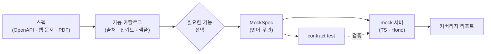

# specmock

API 스펙을 읽어 **기능 목록을 뽑고, 필요한 것만 골라, mock 서버를 생성**하는 도구입니다. OpenAPI 파일은 LLM 없이 결정적으로 처리합니다. 웹 문서나 PDF처럼 구조화되지 않은 스펙은 Claude Code가 읽어 기능을 추출하는 방식으로 확장할 예정입니다(Phase 1B).



## 빠른 시작

Node 22.19 이상, pnpm 12가 필요합니다.

```bash
git clone https://github.com/geonhos/specmock.git && cd specmock
pnpm install
pnpm specmock run petstore examples/petstore/petstore.yaml --select all
cd mock/petstore && npm install && npm start
curl -s localhost:4010/pets/1       # {"id":1,"name":"Rex","tag":"dog"}
```

`run`은 ingest → analyze → select → generate → verify를 한 번에 실행합니다. 마지막 verify가 mock을 띄워 contract test를 돌리고 `contract: 통과 6 / 실패 0 / 전체 6`을 출력합니다. 더 자세한 흐름은 [examples/petstore](examples/petstore/README.md)에 있습니다.

## 사용 방식

### CLI

```bash
specmock ingest   <system> <spec.yaml|url>...       # 스펙 읽기 → .specmock/<system>/source.json
specmock analyze  <system>                          # 기능 카탈로그 생성 + 표 출력
specmock list     <system> [--group g] [--json]     # 카탈로그 표 (그룹 필터 시에도 번호는 전체 기준)
specmock show     <system> <featureId> [--json]     # 기능 하나의 요청·응답 스키마, 샘플
specmock select   <system> <표현식>... [--add|--remove]
specmock generate <system> [--out dir] [--force]    # ./mock/<system>/ 에 Hono 프로젝트 생성
specmock verify   <system> [--dir d] [--report p]   # mock 기동 → contract test → coverage.md
specmock run      <system> <spec> [--select 표현식] [--no-verify]   # 위 과정을 한 번에
```

이 저장소 안에서는 `pnpm specmock <command>`로 실행합니다. `verify`는 mock 디렉터리에 `node_modules`가 없으면 `npm install`을 먼저 수행하고, contract가 하나라도 실패하면 종료 코드 2, 기동 실패 등 오류는 1을 돌려줍니다.

### Claude Code 스킬 (Phase 1B, 예정)

Claude Code 안에서 "이 스펙으로 mock 만들어줘"라고 하면 스킬이 위 명령을 순서대로 실행하고, 기능 목록을 보여준 뒤 선택을 받아 생성합니다. 웹 문서처럼 LLM이 읽어야 하는 스펙은 이 모드에서 처리합니다.

### Web UI (Phase 2, 예정)

로컬에서 실행해 브라우저에서 스펙 입력 → 기능 체크 → 생성까지 진행합니다.

## 입력 형식

| 형식 | 상태 | LLM | 비고 |
|---|---|---|---|
| OpenAPI 3.x (json, yaml, 파일/URL) | 지원 | 불필요 | `$ref` 해석(순환 참조 포함), example 수집 |
| Swagger 2.0 | 지원 | 불필요 | formData → body 객체, `type: file` → `string/binary` 로 변환 |
| 웹 문서 URL | Phase 1B | 필요 | 셀렉트박스·탭 뒤 내용은 ego-browser로 수확 |
| Markdown / PDF / 텍스트 | Phase 1B | 필요 | |
| gRPC / GraphQL | 미정 | | |

## 기능 목록과 선택

`analyze`(또는 `list`)가 모든 기능을 그룹별로 나열합니다. 아래는 `pnpm specmock list petstore`의 실제 출력입니다.

```
petstore — 5개 기능 (openapi 5 · 문서추출 0 · 추론 0)

  #   id              method  path              출처  신뢰  샘플
── pets (4) ──────────────────────────────────────────────
  1   listPets        GET     /pets             spec  1.0   ○
  2   createPet       POST    /pets             spec  1.0   ○
  3   getPet          GET     /pets/{petId}     spec  1.0   ●
  4   deletePet       DELETE  /pets/{petId}     spec  1.0   —
── store (1) ─────────────────────────────────────────────
  5   inventory.list  GET     /store/inventory  spec  1.0   ○

범례  출처: spec=OpenAPI, doc=문서에서 추출, inf=추론 · 샘플: ●있음 ○스키마만 —없음
```

`operationId`가 있으면 그대로 id가 되고, 없으면 경로와 메서드로 만듭니다(`GET /store/inventory` → `inventory.list`). 그룹은 첫 번째 tag, 없으면 경로의 첫 세그먼트입니다(`v1`, `api` 같은 접두사는 건너뜁니다).

선택 표현식 (`specmock select <system> <표현식>...`):

| 표현 | 의미 |
|---|---|
| `all` | 전부 |
| `1,3-5` | 표시 번호 (`list --group`으로 좁혀 봐도 번호는 같다) |
| `getPet,listPets` | id |
| `users.*` | id 글롭 (`.`은 문자 그대로). 아무것도 안 걸리면 오류 |
| `group:pets` | 그룹 전체 |
| `method:GET`, `has:example`, `has:schema`, `confidence>=0.8` | 필터. 선택이 비어 있으면 카탈로그에서 고르고, 이미 선택이 있으면 그 안에서 좁힌다 |
| `-deletePet` | 제외 (앞에 `-`). 별도 인자로 줘도 된다: `select petstore all -deletePet` |
| `@selection.json` | 파일에서 (이전 선택 재사용) |

`--add` / `--remove`는 기존 선택에 더하거나 뺍니다. 나중에 기능을 더 넣으려면 `specmock select <system> --add <id>` 후 `generate`를 다시 실행합니다.

```bash
pnpm specmock select petstore group:pets -deletePet     # 선택 3개: listPets, createPet, getPet
pnpm specmock select petstore --add inventory.list      # 선택 4개
pnpm specmock generate petstore
```

상태 파일은 현재 디렉터리의 `.specmock/<system>/`에, 생성 결과는 `./mock/<system>/`에 놓입니다. `--workspace <dir>`, `generate --out <dir>`로 바꿀 수 있습니다.

## 생성 결과물

```
mock/<system>/
├── package.json                           # npm start → tsx src/server.ts (PORT, 기본 4010)
├── src/server.ts, src/routes/<group>.ts   # Hono 서버. 요청 검증(ajv) → fixture 응답
├── src/notMocked.ts                       # 선택하지 않은 경로의 501 응답
├── fixtures/<featureId>/<status>.json     # 응답 데이터. 요청 때마다 읽으므로 재시작 없이 편집 가능
├── contracts/<featureId>.json             # verify가 실행하는 케이스
├── specmock.lock.json                     # 생성 시점 정보, fixture 해시(보존 판단 기준)
└── README.md
```

서버 동작:

| 요청 | 응답 |
|---|---|
| 선택한 기능, 유효한 요청 | fixture 그대로 (스펙 example > 스키마 생성 > 빈 객체) |
| 선택한 기능, 요청 검증 실패 | `400 { error: "validation_failed", details }` |
| 카탈로그에는 있지만 선택하지 않은 경로 | `501 { error: "not_mocked", feature, hint }` — hint에 추가 명령이 들어 있다 |
| 카탈로그에 없는 경로 | `404 { error: "unknown_path" }` |
| `GET /__specmock/health` | `{ ok, system, features }` |

`generate`를 다시 실행하면 사용자가 수정한 fixture는 보존하고(`specmock.lock.json`의 해시와 비교. lock을 지우면 보존되지 않는다), `--force`를 주면 덮어씁니다. 선택 해제된 기능의 라우트·contract·수정하지 않은 fixture는 정리하고, 수정 흔적이 있는 fixture만 남기고 알려줍니다.

## 커버리지 리포트

`verify`가 `.specmock/<system>/coverage.md`를 씁니다(`--report <path>`로 사본 저장). fixture 출처 비율(spec-example / doc-sample / schema-generated / empty), 신뢰도 분포, 가정 목록, contract 결과, 선택되지 않은 기능이 들어 있습니다. 이 파일이 "이 mock을 어디까지 믿을지"의 근거입니다.

## 제한 사항 (Phase 1A)

- 입력은 OpenAPI 3.x / Swagger 2.0 파일·URL뿐입니다. 웹 문서, Markdown, PDF, LLM 기반 추출은 아직 없습니다.
- 생성 언어는 TypeScript(Hono) 하나입니다.
- `select --interactive`(대화형 체크박스)와 `ingest` / `analyze` / `run`의 `--json` 출력은 아직 없습니다.
- fixture는 스펙의 example이 없으면 스키마에서 시드 고정 난수로 만듭니다. 구조는 맞지만 값은 임의입니다(coverage.md의 `schema-generated` 수치로 확인).
- 순환 `$ref`는 되돌아가는 간선을 `x-specmock-circular` 표식으로 끊고, fixture에서는 `null`로 채웁니다.
- 상태를 가진 동작(POST 후 GET에 반영 등)은 없습니다. 모든 응답은 고정 fixture입니다.

## 문서

- [아키텍처 한눈에 보기](docs/architecture.md)
- [설계 문서](docs/superpowers/specs/2026-11-04-specmock-design.md)
- [구현 계획](docs/superpowers/plans/)
- [Petstore 예제](examples/petstore/README.md)

## 로드맵

| 단계 | 내용 |
|---|---|
| 1A | core + CLI (OpenAPI) ← 현재 |
| 1B | 웹 문서·PDF 분석, LLM 어댑터, ego-browser 수확, Claude Code 스킬, `select --interactive` |
| 2 | MCP 서버, Web UI |
| 3 | 다른 언어 생성(LLM), Proxy/녹화, API 키 어댑터 |
