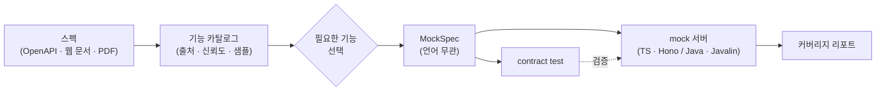
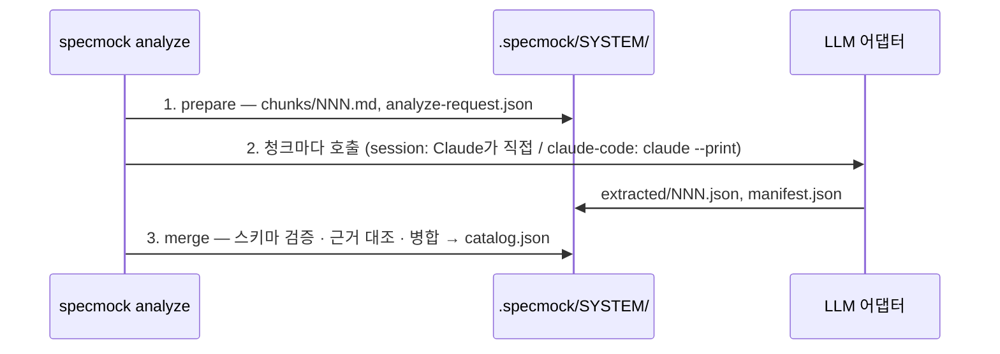

# specmock

API 스펙을 읽어 **기능 목록을 뽑고, 필요한 것만 골라, mock 서버를 생성**하는 도구입니다. OpenAPI 파일은 LLM 없이 결정적으로 처리합니다. 웹 문서·Markdown·PDF처럼 구조화되지 않은 스펙은 Claude Code(구독)가 읽어 기능을 추출하고, 추출 결과는 원문 근거 대조와 신뢰도로 표시됩니다.



## 빠른 시작

Node 22.19 이상, pnpm 12가 필요합니다.

Java mock을 만들려면(`--lang java`) JDK 17 이상과 로그인된 `claude` CLI가 필요합니다. Maven은 설치하지 않아도 됩니다(생성물의 `./mvnw`가 받습니다). 첫 빌드는 Maven 배포본과 의존성을 내려받으므로 **네트워크가 필요**하고 수 분 걸립니다. `unzip`이 없으면 mvnw가 `tar`로 풉니다. JDK가 없거나 JDK 17 미만이거나 오프라인이면 모델을 다시 부르지 않고 종료 코드 1로 즉시 끝납니다. Windows(`mvnw.cmd`)는 동작하도록 작성했지만 검증하지 않았습니다.

```bash
git clone https://github.com/geonhos/specmock.git && cd specmock
pnpm install
pnpm specmock run petstore examples/petstore/petstore.yaml --select all
cd mock/petstore && npm install && npm start
curl -s localhost:4010/pets/1       # {"id":1,"name":"Rex","tag":"dog"}
```

`run`은 ingest → analyze → select → generate → verify를 한 번에 실행합니다. 마지막 verify가 mock을 띄워 contract test를 돌리고 `contract: 통과 6 / 실패 0 / 전체 6`을 출력합니다. 더 자세한 흐름은 [examples/petstore](examples/petstore/README.md)에 있습니다.

### 문서 입력 빠른 시작

OpenAPI가 없는 Markdown 문서에서 시작하는 경로입니다([examples/docs-sample](examples/docs-sample/README.md)). 로컬에 `claude` CLI(Claude Code)가 설치돼 로그인돼 있어야 합니다.

```bash
pnpm specmock ingest docs examples/docs-sample/pets-api.md
pnpm specmock analyze docs --llm claude-code        # 청크별로 claude --print 호출 → 기능 표
pnpm specmock select docs all
pnpm specmock generate docs && pnpm specmock verify docs
```

녹음된 응답으로 LLM 없이 재현하려면(B 경로; A 경로는 모델 출력에 따라 달라질 수 있음) 저장소에 있는 추출 결과를 `extracted/`에 넣고 합치면 됩니다.

```bash
pnpm specmock ingest docs examples/docs-sample/pets-api.md
pnpm specmock analyze docs --prepare                # 청크와 analyze-request.json만 만들고 멈춤
cp examples/docs-sample/extracted/*.json .specmock/docs/extracted/
pnpm specmock analyze docs --merge                  # LLM 호출 없이 카탈로그 생성
```

## 사용 방식

### CLI

```bash
specmock ingest   <system> <origins...> [--refresh] [--harvest auto|always|never] [--json]
                                                     # 스펙 파일/URL(OpenAPI·HTML·Markdown·PDF·텍스트) → .specmock/<system>/source.json
specmock analyze  <system> [--llm session|claude-code] [--model m] [--prepare] [--merge] [--refresh] [--json]
                                                     # 기능 카탈로그 생성 + 표 출력. 문서 입력은 LLM 추출을 거친다
specmock list     <system> [--group g] [--json]      # 카탈로그 표 (그룹 필터 시에도 번호는 전체 기준)
specmock show     <system> <featureId> [--json]      # 기능 하나의 요청·응답 스키마, 샘플, 근거
specmock select   <system> [표현식...] [--add|--remove] [--interactive] [--group g] [--json]
specmock generate <system> [--lang ts|java] [--llm claude-code|session] [--model m] [--max-attempts n]
                           [--finalize] [--out dir] [--force] [--json]  # ./mock/<system>/ 에 mock 프로젝트 생성
specmock verify   <system> [--dir d] [--report p] [--json]              # mock 기동 → contract test → coverage.md
specmock run      <system> <origins...> [--select 표현식] [--lang ts|java] [--max-attempts n] [--out dir] [--no-verify]
                                          [--llm claude-code] [--model m] [--refresh] [--json]   # 위 과정을 한 번에
specmock ui       [--port n] [--no-open]             # 브라우저 화면으로 등록부터 검증까지 (아래 Web UI 절)
```

이 저장소 안에서는 `pnpm specmock <command>`로 실행합니다. 옵션이 헷갈리면 `specmock <command> --help`가 기준입니다. `verify`는 lock에 적힌 설치 단계(TS는 `npm install`, Java는 `./mvnw -q -DskipTests package`)를 먼저 수행합니다. 소스가 바뀌지 않았으면 다시 하지 않습니다(`.specmock-installed`).

종료 코드:

| 명령 | 0 | 1 | 2 | 5 |
|---|---|---|---|---|
| 모든 명령 | 성공 | 오류(메시지 출력) | 명령마다 다름(아래) | — |
| `analyze` | 성공 | 오류 | 일부 청크 추출 실패. 같은 명령을 다시 실행하면 실패한 청크만 재시도 | — |
| `generate` | 성공 | 오류(지원하지 않는 언어, `--finalize` 거부 포함) | — | LLM 생성이 `--max-attempts` 안에 검증을 통과하지 못함 |
| `run` | 성공 | 오류(청크 전부 실패 포함) | contract 실패 **또는** 일부 청크 추출 실패 | `generate`와 같음 |
| `verify` | 성공 | 기동 실패 등 오류 | contract 또는 런타임 계약(501·404) 실패 | — |

`--json`을 주면 결과를 JSON 하나로 출력합니다(`run`은 진행 상황을 stderr로 보냅니다).

### 다른 언어로 생성 (Java)

```bash
pnpm specmock run petstore examples/petstore/petstore.yaml --select all --lang java
cd mock/petstore && ./mvnw -q -DskipTests package && java -jar target/mock.jar
curl -s localhost:4010/pets/1
```

TS는 템플릿으로 만들지만 Java는 `claude`가 MockSpec과 TS 참조 구현을 보고 작성합니다. specmock은 결과를 임시 디렉터리에서 빌드·기동하고 contract와 런타임 계약(선택하지 않은 경로 501, 모르는 경로 404)을 통과한 것만 `mock/<system>/`에 반영합니다. 왜: LLM 출력은 틀릴 수 있어서, 통과하지 못한 시도가 기존 디렉터리를 망가뜨리지 않게 합니다. 실패하면 오류 요약을 붙여 다시 요청하고(기본 3회, `--max-attempts`), 그래도 안 되면 종료 코드 5와 함께 마지막 시도를 `mock/<system>/.specmock-attempt/`(`errors.md`)에 남깁니다.

- 걸리는 시간(실측, Petstore): 생성 1회 약 100초(모델 호출) + 빌드·검증 약 5초(Maven 캐시가 있을 때). 첫 빌드는 다운로드 때문에 더 걸립니다.
- 같은 mockspec으로 다시 `generate`하면 claude를 부르지 않고 "변경 없음"을 출력합니다(`--force`로 다시 생성).
- 기능을 추가해 다시 생성하면 기존 소스를 함께 보내 고칠 부분만 바뀝니다. 직접 고친 소스는 "(사용자 수정)"으로 표시해 라우트 추가·삭제 외에는 바꾸지 말라고 요청하고, 그래도 바뀐 파일은 출력에 목록으로 알립니다. 응답에서 빠진 기존 소스는 지우지 않습니다.
- Claude Code 대화 안에서는 `--llm session`이 지시서(`.specmock/<system>/generate-request.json`)만 쓰고, 대화에서 파일을 작성한 뒤 `specmock generate <system> --finalize`로 확정합니다. MCP는 `generate_mock(language)` → `finalize_generation`입니다.
- 언어를 바꿀 때(ts ↔ java)는 `--force`가 필요합니다. 이전 언어의 소스·빌드 산출물을 지우고 사용자가 고친 fixture는 보존합니다(contracts는 다시 생성. `.git`이나 `.specmock`이 있는 디렉터리는 거부).
- `mock/<system>/`을 커밋한다면 `.gitignore`에 `.specmock-attempt/`, `.specmock-installed`, `target/`, `node_modules/`를 넣으세요(빌드·검증 산출물입니다).

### Claude Code 스킬

저장소의 `plugin/`이 Claude Code 플러그인입니다. 세션에 한해 로드합니다.

```bash
claude --plugin-dir ./plugin
```

```
나: examples/docs-sample/pets-api.md 로 mock 만들어줘
Claude: (ingest → analyze --prepare → 청크를 읽고 extracted/*.json 작성 → analyze --merge) 기능 4개를 찾았습니다. [표]
나: 1-3이랑 pets 그룹
Claude: select → generate → verify 완료. contract 전부 통과. 샘플 없는 항목은 스키마로 만든 응답입니다.
```

스킬 모드는 추출을 **세션의 Claude가 직접** 합니다(`--llm session`, 기본값). 추가 `claude` 호출도 API 키도 없고, 구독 한도만 씁니다. 자세한 절차는 [plugin/README.md](plugin/README.md)를 보세요.

### Claude Code에서 MCP로 쓰기

같은 플러그인이 MCP 서버도 함께 켭니다. 셸 명령 없이 도구 호출만으로 끝까지 갑니다.

```bash
git clone https://github.com/geonhos/specmock && cd specmock
pnpm install && pnpm build
claude --plugin-dir ./plugin
```

Claude Code에서 `/mcp`를 열어 `specmock` 서버와 도구 13개가 보이면 준비된 것입니다. 서버가 안 보이면 `packages/mcp/dist/server.js`가 있는지(`pnpm build`를 했는지) 확인하세요.

| 도구 | 하는 일 |
|---|---|
| `ingest_spec` | 스펙 파일/URL 읽기 (`origins`, `harvest`, `refresh`) |
| `analyze_spec` | 기능 카탈로그. 문서면 추출할 청크 목록 |
| `get_chunk` | 청크 하나의 본문 |
| `submit_extraction` | 청크 하나의 추출 결과 제출(해시 확인 · 엄격 검증) |
| `merge_extractions` | 제출된 추출 결과 병합 |
| `list_features` | 기능 표 |
| `show_feature` | 기능 하나의 스키마 · 샘플 · 근거 |
| `select_features` | 선택 표현식으로 고르기 (`mode`: set/add/remove) |
| `generate_mock` | mock 서버 생성 |
| `verify_mock` | contract test + 커버리지 |
| `open_ui` | 브라우저 화면 서버를 띄우고 URL 돌려주기 (아래 Web UI 절) |

대화는 이런 식으로 흐릅니다(예시 흐름이며 실제 출력은 매번 다릅니다).

```
나: examples/docs-sample/pets-api.md 로 mock 만들어줘
Claude: (ingest_spec → analyze_spec → get_chunk/submit_extraction → merge_extractions → list_features) 기능 목록입니다. [표]
나: 필요한 것만 골라줘
Claude: (select_features → generate_mock → verify_mock) mock을 만들고 contract test 결과를 알려 드립니다.
```

문서 추출은 지금 대화하는 Claude가 합니다. 별도 `claude` 프로세스도, API 키도 없습니다. MCP 서버는 Claude Code를 실행한 디렉터리를 프로젝트 루트로 씁니다(`.specmock/`, `mock/`).

제한 사항:

- 플러그인은 저장소를 clone한 곳에서 `--plugin-dir`로만 동작합니다. 마켓플레이스 설치는 `packages/`를 가져가지 않아 지원하지 않습니다(후속 과제).
- `ingest_spec`의 웹 수확과 `verify_mock`의 첫 실행(mock의 `npm install`)은 몇 분 걸릴 수 있습니다. 서버는 그동안 진행 알림을 보내고, Claude Code(2.1.318 기준)는 진행 알림이 오는 동안 유휴 제한(기본 30분)을 연장합니다. 보통 따로 설정할 필요가 없습니다. 값은 Claude Code 버전에 따라 다를 수 있습니다.
- 커스텀 드롭다운 같은 수동 수확은 여전히 스킬의 파일 절차([수동 수확](plugin/skills/specmock/references/manual-harvest.md))로 합니다. 도구가 아닙니다.

### Web UI

브라우저에서 ① 등록 → ② 분석 → ③ 기능 선택 → ④ 생성 → ⑤ 검증을 차례로 진행합니다. 화면 서버는 내 컴퓨터(127.0.0.1)에서만 열리고, 인증이나 원격 접속은 없습니다.

```bash
pnpm install && pnpm build     # 화면 빌드(packages/web/dist)가 필요합니다
pnpm specmock ui               # 브라우저가 열립니다. --port 4517 로 포트 지정, --no-open 으로 자동 열기 끄기
```

끝내려면 터미널에서 Ctrl+C를 누릅니다. 진행 중인 작업은 취소되고 자식 프로세스도 함께 정리됩니다.

Claude Code 대화에서는 "화면으로 하고 싶어"라고 하면 Claude가 `open_ui` 도구로 같은 화면을 띄우고 URL을 알려 줍니다. 이 화면은 대화와 같은 프로젝트 루트·`.specmock/`를 씁니다. 화면에서 한 선택은 CLI·대화와 같은 파일(`selection.json`)에 저장되고, 대화에서 제출한 추출 결과나 선택 변경은 화면에 바로 반영됩니다.

- 문서(Markdown·PDF·웹) 추출은 `claude` CLI가 있으면 화면에서 바로 시작할 수 있습니다. 없으면 화면이 안내하는 대로 Claude Code 대화에서 추출하세요.
- 생성 화면에서 언어(기존 유지 · TypeScript · Java)를 고를 수 있고, Java는 단계와 시도 n/max를 보여 줍니다. 생성 도중 취소할 수 있고(반영 직전까지는 출력 디렉터리가 바뀌지 않습니다), 이미 만들어진 디렉터리의 언어를 바꾸면 확인 창이 먼저 뜹니다. Web UI는 claude-code로만 생성합니다(세션 모드 없음).
- 화면 서버와 MCP 서버, CLI가 같은 작업 공간에 동시에 써도 파일 잠금으로 보호됩니다.
- E2E: Playwright로 화면 두 경로(OpenAPI 등록부터 검증까지, 가짜 `claude`로 문서 추출)를 확인합니다. 기본 `pnpm test`에는 들어 있지 않습니다.

  ```bash
  pnpm exec playwright install chromium   # 처음 한 번
  pnpm test:e2e
  ```

## 입력 형식

| 형식 | 상태 | LLM | 비고 |
|---|---|---|---|
| OpenAPI 3.x (json, yaml, 파일/URL) | 지원 | 불필요 | `$ref` 해석(순환 참조 포함), example 수집 |
| Swagger 2.0 | 지원 | 불필요 | formData → body 객체, `type: file` → `string/binary` 로 변환 |
| 웹 문서 URL | 지원 | 필요(Claude Code 구독 또는 세션) | 본문은 Markdown으로 변환. 탭·select 뒤 내용은 ego-browser 설치 시 자동 수확, 아니면 누락될 수 있음(리포트에 표시) |
| Markdown / 텍스트 | 지원 | 필요(Claude Code 구독 또는 세션) | 헤딩 단위로 청크 분할 |
| PDF | 지원 | 필요(Claude Code 구독 또는 세션) | 텍스트만 추출(페이지 헤딩 부여). 표 구조는 손실 |
| gRPC / GraphQL | 미정 | | |

## 기능 목록과 선택

`analyze`(또는 `list`)가 모든 기능을 그룹별로 나열합니다. 아래는 `pnpm specmock list petstore`의 실제 출력입니다.

```
petstore — 5개 기능 (openapi 5 · 문서추출 0 · 추론 0)

  #   id              method  path              출처  신뢰  샘플
── pets (4) ──────────────────────────────────────────────
  1   listPets        GET     /pets             spec  1.0   ○
  2   createPet       POST    /pets             spec  1.0   ○
  3   getPet          GET     /pets/{petId}     spec  1.0   ●
  4   deletePet       DELETE  /pets/{petId}     spec  1.0   —
── store (1) ─────────────────────────────────────────────
  5   inventory.list  GET     /store/inventory  spec  1.0   ○

범례  출처: spec=OpenAPI, doc=문서에서 추출, inf=추론 · 샘플: ●있음 ○스키마만 —없음
```

문서에서 추출한 기능은 `출처`가 `doc`입니다. 아래는 `examples/docs-sample`을 B 경로(녹음된 추출 결과)로 돌린 실제 출력입니다.

```
docs — 4개 기능 (openapi 0 · 문서추출 4 · 추론 0)

  #   id           method  path           출처  신뢰  샘플
── Pets (4) ────────────────────────────────────────
  1   pets.list    GET     /pets          doc   1.0   ●
  2   pets.create  POST    /pets          doc   0.8   —
  3   pets.get     GET     /pets/{petId}  doc   1.0   ●
  4   pets.delete  DELETE  /pets/{petId}  doc   0.8   —
```

`신뢰`(confidence)의 의미:

- OpenAPI에서 온 기능은 항상 `1.0`(결정적 변환).
- 문서 추출은 LLM 자기평가 값에서 시작해, 샘플 응답이 있으면 +0.1(최대 1.0이라 문서 추출도 `1.0`이 될 수 있음).
- 근거 인용이 원문에서 안 찾아지면 ×0.3(`notes`에 "근거 불일치"), 근거 자체가 없으면 ×0.7.
- method/path를 추측했으면 최대 `0.5`.

`operationId`가 있으면 그대로 id가 되고, 없으면 경로와 메서드로 만듭니다(`GET /store/inventory` → `inventory.list`). 그룹은 첫 번째 tag, 없으면 경로의 첫 세그먼트입니다(`v1`, `api` 같은 접두사는 건너뜁니다).

선택 표현식 (`specmock select <system> <표현식>...`):

| 표현 | 의미 |
|---|---|
| `all` | 전부 |
| `1,3-5` | 표시 번호 (`list --group`으로 좁혀 봐도 번호는 같다) |
| `getPet,listPets` | id |
| `users.*` | id 글롭 (`.`은 문자 그대로). 아무것도 안 걸리면 오류 |
| `group:pets` | 그룹 전체 |
| `method:GET`, `has:example`, `has:schema`, `confidence>=0.8` | 필터. 선택이 비어 있으면 카탈로그에서 고르고, 이미 선택이 있으면 그 안에서 좁힌다 |
| `-deletePet` | 제외 (앞에 `-`). 별도 인자로 줘도 된다: `select petstore all -deletePet` |
| `@selection.json` | 파일에서 (이전 선택 재사용) |

`--add` / `--remove`는 기존 선택에 더하거나 뺍니다. 표현식 대신 `--interactive`(TTY 필요)를 주면 그룹별 체크박스로 고르고, 이전 선택은 미리 체크돼 있습니다(`--group g`로 한 그룹만 표시). 카탈로그가 바뀌어 다시 `analyze`하면 `catalog-diff.json`에 추가/삭제된 기능이 남고, `select`가 선택에 영향이 있는 변경을 알려 줍니다. 나중에 기능을 더 넣으려면 `specmock select <system> --add <id>` 후 `generate`를 다시 실행합니다.

```bash
pnpm specmock select petstore group:pets -deletePet     # 선택 3개: listPets, createPet, getPet
pnpm specmock select petstore --add inventory.list      # 선택 4개
pnpm specmock generate petstore
```

상태 파일 `.specmock/<system>/`와 생성 결과 `mock/<system>/`는 **명령을 실행한 디렉터리** 기준입니다(`pnpm specmock`은 repo 루트에서 실행됩니다). `--workspace <dir>`, `generate --out <dir>`로 바꿀 수 있고, `verify`는 마지막 `generate --out` 경로를 기억하므로 `--dir`을 다시 줄 필요가 없습니다.

## LLM은 어디에 쓰이나

LLM은 **비구조 문서(웹·Markdown·PDF·텍스트)의 청크에서 기능을 추출하는 단계에만** 씁니다. OpenAPI 변환, 선택, 생성, 검증은 전부 결정적 코드입니다.



| 어댑터 | 쓰는 곳 | 동작 | 단계 |
|---|---|---|---|
| `session` (기본) | Claude Code 스킬 | `analyze --prepare` 후 세션의 Claude가 청크를 읽고 `extracted/`를 직접 씀. `analyze --merge`로 합침 | 지원 |
| `claude-code` | CLI 단독 | 청크마다 로컬 `claude --print --output-format json --json-schema …`를 자동 호출 | 지원 |
| `api` | 배포용 | Anthropic API 키 | 제외 |

- **호출 수 = 청크 수.** 청크는 헤딩 기준으로 최대 6,000자(겹침 200자)입니다. `analyze --prepare`로 호출 전에 청크 수와 내용을 볼 수 있습니다.
- **재현 가능.** 추출 결과는 `.specmock/<system>/extracted/`에 파일로 남습니다. 이 파일을 두고 `analyze --merge`를 다시 돌리면 LLM 없이 같은 카탈로그가 나옵니다. 일부 청크가 실패하면 다시 실행할 때 실패한 청크만 재시도하고, `--refresh`는 전부 다시 추출합니다.
- **격리.** `claude` 자식 프로세스는 빈 임시 디렉터리에서 실행하고(저장소 파일을 읽지 않음) `--no-session-persistence`로 세션 기록을 남기지 않습니다.
- **과금.** 구독 로그인 상태면 구독 한도를 씁니다. 환경에 `ANTHROPIC_API_KEY`가 있으면 `claude`가 API 과금으로 동작할 수 있으니 의도한 것인지 확인하세요.
- **결과 검증.** 응답은 JSON 스키마(ajv)로 검증하고, 근거 인용이 원문에 있는지 대조해 신뢰도를 깎습니다. 실패 항목은 `rejected`와 `notes`에 이유와 함께 남습니다.

### 웹 문서 수확(ego-browser)

탭·select·접힘 영역 뒤의 내용은 일반 fetch로 안 보입니다. 이런 요소가 감지되면(`--harvest auto`) ego-browser(브라우저 자동화 CLI)로 페이지를 열어 내용을 수확합니다. 알아 둘 점:

- **로그인 상태로 열립니다.** ego-browser의 로그인 세션으로 페이지를 열기 때문에 로그인이 필요한 문서도 읽히지만, 그 페이지에 보이는 내용이 수확 대상이 됩니다. 수확 결과는 비밀값 마스킹 후 `source.json`에 저장됩니다(패턴 기반이라 완전하지 않음).
- **링크 추종 범위.** 같은 출처의 docs/reference 류 링크만 깊이 2, 최대 50페이지까지 따라갑니다. bare `/api/` 경로는 앱 API를 호출하게 될 수 있어 따라가지 않습니다.
- **자동 수확이 못 하는 것.** 커스텀 드롭다운(listbox/combobox)은 수동으로 해야 합니다(스킬의 manual-harvest 참고).
- **ego-browser가 없으면** 수확을 건너뛰고 그 사실을 stderr와 `source.json`의 `harvested.notes`에 기록합니다. `--harvest never`로 끌 수도 있습니다.

## 생성 결과물

```
mock/<system>/
├── package.json                           # npm start → tsx src/server.ts (PORT, 기본 4010)
├── src/server.ts, src/routes/<group>.ts   # Hono 서버. 요청 검증(ajv) → fixture 응답
├── src/notMocked.ts                       # 선택하지 않은 경로의 501 응답
├── fixtures/<featureId>/<status>.json     # 기본 응답(가장 낮은 2xx) 하나. 요청 때마다 읽으므로 재시작 없이 편집 가능
├── contracts/<featureId>.json             # verify가 실행하는 케이스
├── specmock.lock.json                     # 생성 시점 정보, fixture 해시(보존 판단 기준)
└── README.md
```

Java(`--lang java`):

```
mock/<system>/
├── pom.xml                                # Javalin 6 + networknt json-schema-validator, shade로 target/mock.jar
├── mvnw, mvnw.cmd, .mvn/wrapper/          # Maven Wrapper (specmock이 넣는 고정 파일, 생성 대상 아님)
├── src/main/java/**                       # claude가 작성. 요청 검증 → fixture 응답, 501·404 동작은 TS와 같다
└── fixtures/, contracts/, specmock.lock.json   # TS와 같다 (lock의 install·start가 빌드·기동 명령)
```

서버 동작:

| 요청 | 응답 |
|---|---|
| 선택한 기능, 유효한 요청 | fixture 그대로 (스펙 example > 스키마 생성 > 빈 객체) |
| 선택한 기능, 요청 검증 실패 | `400 { error: "validation_failed", details }` |
| 카탈로그에는 있지만 선택하지 않은 경로 | `501 { error: "not_mocked", feature, hint }` — hint에 추가 명령이 들어 있다 |
| 카탈로그에 없는 경로 | `404 { error: "unknown_path" }` |
| `GET /__specmock/health` | `{ ok, system, features }` |

`generate`를 다시 실행하면 사용자가 수정한 fixture는 보존하고(`specmock.lock.json`의 해시와 비교. lock을 지우면 보존되지 않는다), `--force`를 주면 같은 언어에서는 사용자가 고친 fixture도 덮어씁니다(언어를 바꿀 때의 `--force`는 이전 소스 삭제만 뜻하고 fixture 수정은 보존합니다). 선택 해제된 기능의 라우트·contract·수정하지 않은 fixture는 정리하고, 수정 흔적이 있는 fixture만 남기고 알려줍니다.

## 커버리지 리포트

`verify`가 `.specmock/<system>/coverage.md`를 씁니다(`--report <path>`로 사본 저장). fixture 출처 비율(recorded / spec-example / doc-sample / schema-generated / empty), 신뢰도 분포, 가정 목록, contract 결과, 선택되지 않은 기능이 들어 있습니다. 이 파일이 "이 mock을 어디까지 믿을지"의 근거입니다.

## LLM 사용량

`claude`를 자동으로 부르는 경로(`analyze --llm claude-code`, `generate --lang java`, `run --llm claude-code`, Web UI 서버가 같은 어댑터로 부르는 호출)는 호출마다 한 줄을 `.specmock/<system>/llm-usage.jsonl`에 덧붙입니다. 성공 · 실패 · 시간 초과를 모두 기록합니다. 프롬프트와 응답 본문은 남기지 않고, 실패 메시지는 비밀값 마스킹을 거칩니다.

```json
{"at":"2026-11-11T06:12:03.412Z","stage":"extract","detail":"chunk 012 · Create a customer","model":"claude-sonnet-4-5","inputTokens":1842,"outputTokens":611,"cacheReadTokens":0,"cacheCreationTokens":3977,"costUsd":0.0219,"costBasis":"list","billing":"subscription","durationMs":9420,"apiDurationMs":8870,"ok":true}
```

| 필드 | 뜻 |
|---|---|
| `stage` · `detail` | `extract`(analyze 청크) 또는 `generate`(LLM 생성 시도, 예: `java attempt 2/3`) |
| `inputTokens` · `outputTokens` · `cacheReadTokens` · `cacheCreationTokens` | `claude` 응답이 알려 준 토큰 수. 응답에 없으면 `null` |
| `costUsd` · `costBasis` | **API 정가 환산 비용**(`costBasis: "list"`). 구독으로 쓰면 실제 청구액이 아닙니다 |
| `billing` | 환경에 `ANTHROPIC_API_KEY` · `ANTHROPIC_AUTH_TOKEN` · `CLAUDE_CODE_USE_BEDROCK` · `CLAUDE_CODE_USE_VERTEX` 중 하나가 있으면 `api-key`, 없으면 `subscription`. 환경만 보고 추정하며 settings의 `apiKeyHelper`는 볼 수 없습니다 |
| `durationMs` · `apiDurationMs` | 호출 전체 벽시계 시간 · `claude`가 보고한 API 시간 |
| `ok` · `error` | 성공 여부와 실패 요약(오류 종류 + 첫 줄 200자 이내) |

`analyze` · `generate` · `run`은 끝날 때 **이번 실행분** 합계를 stderr에 한 줄로 보여 줍니다(`LLM 호출 12회(실패 0) · 입력 22,104 · 출력 7,310 · 캐시 읽기 41,200 · API 환산 $0.26 (API 키 미감지 → 구독으로 간주, 실제 청구 아님) · 1분 52초`). API 키를 감지하면 괄호가 `(API 키 감지 → 실제 청구)`로 바뀝니다. `--json` 결과에는 같은 합계가 `usage` 필드로 들어가고, LLM을 부르지 않은 실행(세션 모드, TS 생성, `--merge`)은 `usage: null`입니다.

세션 모드(`--llm session`, MCP `analyze_spec` · `finalize_generation`)는 LLM을 사용자의 Claude Code 세션이 쓰므로 specmock이 볼 수 없습니다. **미측정**이며 파일도 생기지 않습니다. 이 파일은 `.specmock/` 아래라 위의 `.gitignore` 안내에 이미 포함됩니다.

## 실제 시스템 녹화

실제 시스템이 있으면 정상 요청을 보내 응답을 fixture로 씁니다. `.specmock/<system>/target.json`을 직접 만듭니다.

```json
{ "baseUrl": "https://api.example.com/v2", "headers": { "Authorization": "Bearer ${PETS_TOKEN}" }, "params": { "petId": "123" } }
```

- 비밀 값은 `${환경변수}`로만 적습니다. 값은 실행한 셸의 환경변수에서 읽습니다(`headers`와 `params` 모두). `${ENV}`로 넣은 값은 형식과 무관하게(숫자 포함) 녹화 파일·drift·이벤트·결과·응답 바디에서 `***`로 가립니다(URL 인코딩·form 인코딩·JSON 이스케이프 변형 포함, 4자 미만 값은 제외). 가릴 필요 없는 id 등은 `${ENV}` 없이 값을 직접 적으세요 — 직접 적은 값은 가리지 않습니다. 서버가 받은 값을 한 번 더 인코딩해 되돌려 주는 경우(`%25…`)와 JSON 객체 **키**에 들어간 값은 가리지 않습니다(값만 가림). 녹화 파일에는 target에서 온 헤더의 이름만 남고 값은 전부 `***`입니다. `${ENV}`는 query·header에 쓰기를 권하지만 path 파라미터에도 쓸 수 있습니다. 그래도 이 파일은 커밋하지 마세요(`.specmock/`를 `.gitignore`에 두세요).
- `specmock record <system>`은 GET·HEAD만 보냅니다. 생성·삭제 요청까지 보내려면 `--allow-mutating`(실제 데이터가 바뀝니다). `--feature <id>`로 일부만, `--refresh`로 대상 기능(이번에 보낸 것)의 기존 녹화를 버리고 다시 녹화(건너뛴 변경 요청 기능의 녹화는 유지, 중단되면 모두 유지), `--no-apply`로 mock 반영 없이 녹화만 합니다.
- 결과: `.specmock/<system>/recorded/<기능>.json`, 스펙과의 차이는 `drift.md`("스펙과 다름" = 응답이 스키마와 다름, "상태 불일치" = 기대한 상태 코드가 아님. 404면 `params`로 실제 id를 지정). 녹화 응답은 fixture 출처 `recorded`로 들어가고, 이미 생성한 mock은 LLM 호출 없이 fixture만 바뀝니다. 직접 고친 fixture는 보존됩니다.
- 종료 코드: 0 전부 일치 · 2 스펙과 다름·상태 불일치·실패·반영 실패 중 하나라도 있음 · 1 오류. `--json`은 결과에 `notes`(반영 실패·generate 안내)를 함께 담습니다. 동작 확인: `pnpm record:check`(공개 Petstore v3, 네트워크 필요).

## 제한 사항

- 생성 언어는 TypeScript(Hono, 템플릿)와 Java(Maven + Javalin, LLM 생성)입니다. Java 생성은 LLM 출력이라 매번 코드가 다를 수 있고, verify를 통과한 것만 반영합니다.
- Java 생성은 `claude` 구독 호출을 시도마다 한 번 씁니다. 기능이 많으면 프롬프트가 커집니다.
- Java 출력은 Windows에서 검증하지 않았습니다.
- JDK가 있고 네트워크가 없는 기기에서 `pnpm test`의 `java.test.ts`는 skip되지 않고 **실패**합니다(Maven 다운로드 불가). JDK가 없으면 skip합니다.
- 모든 응답은 고정 fixture입니다. 상태를 가진 동작(POST 후 GET에 반영 등)은 없습니다.
- 기능마다 가장 낮은 2xx 응답 하나만 서빙하고, 4xx fixture는 생성되지 않습니다(coverage.md 집계에는 포함).
- fixture는 스펙의 example이 없으면 스키마에서 시드 고정 난수로 만듭니다. 구조는 맞지만 값은 임의입니다(coverage.md의 `schema-generated` 수치로 확인).
- 순환 `$ref`는 되돌아가는 간선을 `x-specmock-circular` 표식으로 끊고, fixture에서는 `null`로 채웁니다. `2XX` 같은 범위 상태 키와 cookie 파라미터는 지원하지 않습니다.
- `source.json`의 비밀값 마스킹은 `Bearer …`, `sk_live_…`, `api_key: …` 류 패턴 기반이라 완전하지 않습니다. 스펙과 수확 대상 페이지에 실제 토큰이 없는지 확인하세요.
- 문서 추출은 LLM 출력이라 틀릴 수 있습니다. 신뢰도와 근거 인용으로 걸러 보여 주지만, `doc` 출처 기능은 `show`로 근거를 확인하세요.
- 커스텀 드롭다운(listbox)은 자동 수확되지 않습니다. PDF는 텍스트만 추출하므로 표 구조가 사라집니다.
- `run`은 세션 모드(`--llm session`)를 지원하지 않습니다. 문서 입력은 `--llm claude-code`로만 한 번에 실행되고, 세션 모드는 `analyze`로 단계별 진행합니다.
- `analyze`가 모든 청크에서 추출에 실패하면 `catalog.json`이 빈 카탈로그로 덮어써집니다(`run`은 이 경우 exit 1).
- `select --interactive`에는 그룹 접기·검색이 없습니다. 저장할 때 선택이 id 목록으로 평탄화되어, 처음 준 표현식(`group:pets` 등)은 `selection.json`에 남지 않습니다.
- 카탈로그 변경 diff(`catalog-diff.json`, `select` 경고)는 기능의 추가/삭제만 보여 주고, 내용이 바뀐 기능은 표시하지 않습니다.
- TS `generate`는 `src/`를 통째로 다시 씁니다(Java는 사용자 수정 소스를 유지합니다). `mock/<system>/src/`에 직접 추가한 route 파일은 삭제됩니다. 바꿀 것은 fixture에 두세요.
- `select --add`는 기존 선택이 없으면 새 선택으로 동작합니다(오류가 아님).

## 문서

- [아키텍처 한눈에 보기](docs/architecture.md)
- [설계 문서](docs/superpowers/specs/2026-11-04-specmock-design.md)
- [구현 계획](docs/superpowers/plans/)
- [Petstore 예제](examples/petstore/README.md) · [문서(Markdown) 예제](examples/docs-sample/README.md)
- [Claude Code 플러그인](plugin/README.md)
- [3A 설계: 다른 언어 생성](docs/superpowers/specs/2026-11-09-phase3a-java-generator-design.md)

## 기여 방법

```bash
pnpm install
pnpm test          # core 빌드 → vitest (생성된 mock을 실제로 띄우는 테스트 포함)
pnpm typecheck     # src와 test 모두
pnpm test:e2e      # 브라우저 E2E(별도). 처음 한 번 `pnpm exec playwright install chromium`
```

실제 claude 호출 확인은 `pnpm llm:check`, Java 생성·verify까지는 `pnpm llm:check --java`입니다(JDK 17, 수 분, 구독 호출). 실제 네트워크 녹화 확인은 `pnpm record:check`입니다.

변경 후 위 명령이 통과하면 PR을 엽니다. 설계 의도는 [설계 문서](docs/superpowers/specs/2026-11-04-specmock-design.md)에, 단계별 작업 단위는 [구현 계획](docs/superpowers/plans/)(1A, 1B, 2A, 2B, 3A, 3B)에 있습니다. 설계와 다르게 구현한 지점은 설계 문서 12장 "구현 중 변경"에 이유와 함께 적습니다.

## 로드맵

| 단계 | 내용 |
|---|---|
| 1A | core + CLI (OpenAPI) — 완료 |
| 1B | 웹 문서·PDF 분석, LLM 어댑터, ego-browser 수확, Claude Code 스킬, `select --interactive` — 완료 |
| 2A | 공용 서비스 층, MCP 서버(도구 10개), 스킬 MCP 우선 흐름 — 완료 |
| 2B | Web UI(`specmock ui`, MCP `open_ui`로 11개), 파일 잠금, Playwright E2E — 완료 |
| 3A | 다른 언어 생성: `LanguageGenerator`·언어 프로필, Java(Maven + Javalin) LLM 생성과 검증 루프, 세션 모드, MCP `finalize_generation`(12개) — 완료 |
| 3B | 녹화(record): `target.json`의 실제 시스템에 정상 요청을 보내 `recorded/`·`drift.md`, fixture 출처 `recorded`, MCP `record_responses`(13개) ← 현재 |
| 3 | 녹화(record, 3B 완료), 다른 언어 생성(3A 완료). API 키 어댑터는 제외 |
