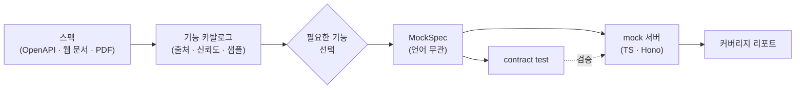
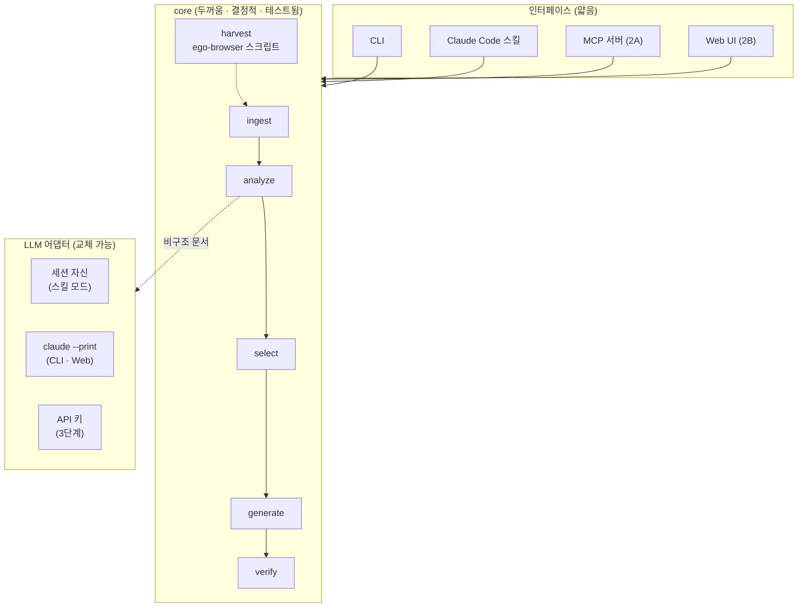
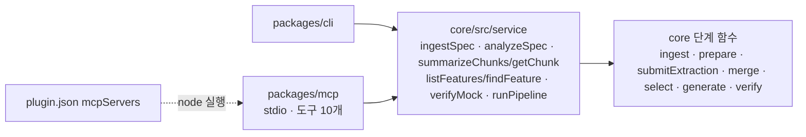
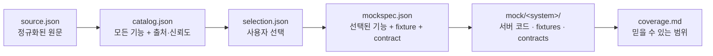
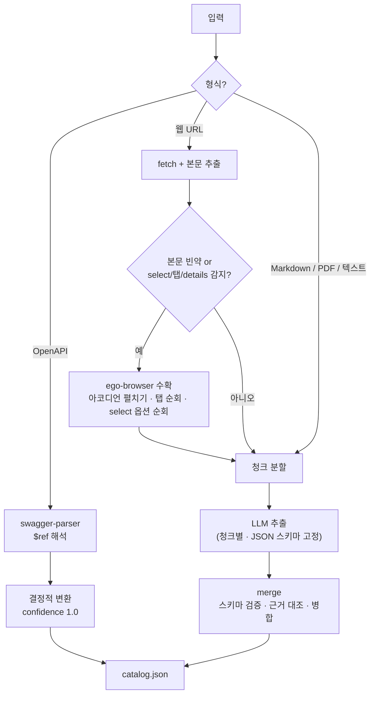
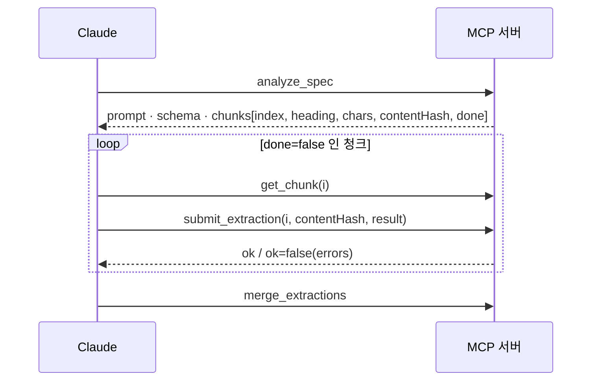
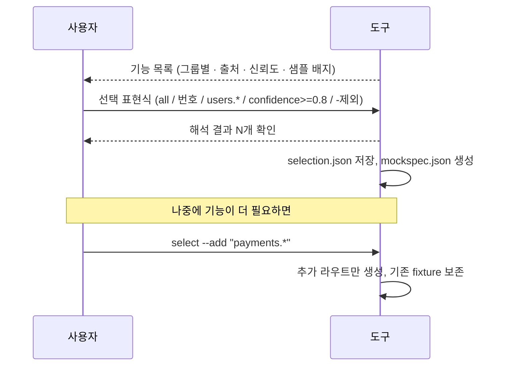

# specmock 아키텍처 한눈에 보기

> 상세 설계는 [설계 문서](superpowers/specs/2026-11-04-specmock-design.md)를 참고. 이 문서는 그림으로 전체를 파악하기 위한 요약이다.

## 무엇을 하는가

어떤 형태의 API 스펙이든 읽어서 언어 무관한 **MockSpec**으로 정규화하고, 그중 **필요한 기능만 골라** mock 서버와 검증 테스트를 생성한다.



## 레이어 구조



**원칙**: LLM은 "비구조 문서에서 기능 추출"과 "다른 언어 생성"에만 쓴다. 나머지는 전부 결정적 코드다.

2A부터 CLI와 MCP 서버는 같은 **서비스 층**(`packages/core/src/service/`)을 호출한다. 흐름 조립과 판정은 서비스 층 한 곳에 있고, 인터페이스는 옵션 파싱과 출력만 맡는다.



## 상태 파일 (파일이 인터페이스)

모든 단계는 `.specmock/<system>/` 아래 파일로 이어진다. 어떤 인터페이스로 시작하든 같은 파일을 쓰고, 중간에 멈췄다 이어갈 수 있다.



| 파일 | 만드는 단계 | 쓰는 단계 | 핵심 내용 |
|---|---|---|---|
| `source.json` | ingest | analyze | 원문 보존. HTML 본문(Markdown으로 변환), PDF 텍스트(페이지 헤딩), dereference된 OpenAPI, 수확 결과(`harvested`, `notes`) |
| `analyze-request.json` | analyze (prepare) | LLM 어댑터 / 세션의 Claude | 프롬프트, 출력 JSON 스키마, 청크 목록(해시 포함). 추출 작업 지시서 |
| `chunks/NNN.md` | analyze (prepare) | LLM 어댑터 / 세션의 Claude | 헤딩 기준 청크(최대 6,000자, 겹침 200자). 호출 수 = 청크 수 |
| `extracted/NNN.json` | LLM 어댑터 / 세션의 Claude | analyze (merge) | 청크별 추출 결과. 재현의 기준이라 남겨 둔다 |
| `extracted/manifest.json` | analyze (extract) | analyze (extract) | 청크 번호별 추출 당시 본문 해시. 본문이 바뀐 청크만 다시 추출 |
| `catalog.json` | analyze | list / select | 모든 기능. `provenance`, `confidence`, `hasExample`, `evidence`, `notes` |
| `catalog-diff.json` | analyze | select | 이전 카탈로그와 id 기준으로 비교한 추가·삭제 목록(내용 변경은 감지하지 않음) |
| `selection.json` | select | select / generate | 선택 표현식, 해석 결과, 선택 시점의 `catalogIds`. 재현과 추가 선택의 기준 |
| `mockspec.json` | select | generate / verify | 선택된 기능 + fixtures + contracts + assumptions. **단일 진실** |
| `coverage.md` | verify | 사용자 | fixture 출처 비율, 신뢰도 분포, 가정 목록, contract 결과 |

## 입력별 처리 경로



수확은 ego-browser가 있을 때만 일어난다. 없으면 건너뛰고 `source.json`의 `harvested.notes`와 stderr에 기록한다. 수확은 ego-browser의 로그인 상태로 페이지를 열고, 결과는 비밀값을 마스킹한 뒤 저장한다. 같은 출처의 docs/reference 류 링크만 깊이 2, 50페이지까지 따라가며 bare `/api/` 경로는 따라가지 않는다. 커스텀 드롭다운은 자동 수확하지 않고 스킬의 수동 절차로 넘긴다.

## LLM 추출 3단계

비구조 문서의 `analyze`는 세 단계로 나뉜다. 가운데 단계만 어댑터에 따라 다르고, 나머지는 결정적 코드다. 단계 사이의 모든 산출물이 파일이라 어느 단계에서든 멈췄다 이어갈 수 있다.

```mermaid
sequenceDiagram
    participant CLI as specmock analyze
    participant WS as .specmock/&lt;system&gt;/
    participant AD as 어댑터
    Note over CLI,WS: 1. prepare (결정적)
    CLI->>WS: source.json 읽기
    CLI->>WS: chunks/000.md … , analyze-request.json 쓰기
    Note over CLI,AD: 2. 추출 (어댑터마다 다름)
    alt --llm claude-code
        loop 청크마다 (이미 있고 낡지 않았으면 건너뜀)
            CLI->>AD: claude --print --json-schema (빈 임시 cwd)
            AD-->>CLI: structured_output
            CLI->>WS: extracted/NNN.json, manifest.json
        end
    else --llm session (스킬 모드)
        CLI-->>AD: analyze-request.json 위치를 안내하고 멈춤
        AD->>WS: 세션의 Claude가 chunks/NNN.md를 읽고 extracted/NNN.json 작성
    end
    Note over CLI,WS: 3. merge (결정적, --merge로 단독 실행 가능)
    CLI->>WS: extracted/*.json 읽기
    CLI->>CLI: 스키마 검증 → 근거 대조 → confidence 보정 → method+path 병합
    CLI->>WS: catalog.json, catalog-diff.json 쓰기
```

- 일부 청크가 실패하면 나머지로 `catalog.json`을 만들고 종료 코드 2를 돌려준다. 같은 명령을 다시 실행하면 실패한 청크만 재시도한다.
- `--prepare`는 1단계에서 멈추고, `--merge`는 3단계만 실행한다. `--refresh`는 기존 `extracted/`를 무시(claude-code)하거나 지운다(session).

### MCP로 추출할 때



`submit_extraction`은 다음 순서로 처리한다.
1. 해시로 청크가 지금 문서와 같은지 확인한다.
2. 모르는 키까지 거부하는 엄격 검증을 한다.
3. 원자적으로 쓴다.
4. manifest에 해시를 남긴다.

`--llm claude-code` 자동 추출도 청크마다 같은 함수를 쓴다(모르는 키는 버리는 관대한 모드).

## 기능 선택 흐름



선택되지 않은 경로로 요청이 오면 mock은 `501 not_mocked`와 함께 "이 기능을 추가하려면 `specmock select <system> --add <id>`" 안내를 돌려준다.

## 로드맵

```mermaid
gantt
    dateFormat  X
    axisFormat  %s
    section 1단계
    core · CLI · Claude Code 스킬        :a1, 0, 3
    section 2단계
    MCP 서버(2A) · Web UI(2B)            :a2, after a1, 2
    section 3단계
    다른 언어 생성 · Proxy/녹화 · API 키 :a3, after a2, 2
```



| 단계 | 완료 기준 |
|---|---|
| 1 | OpenAPI와 웹 문서에서 TS mock 생성, contract test 통과, coverage.md 출력, 기능 추가 재생성 |
| 2 | 2A: MCP로 Claude Code에서 도구 호출(셸 없이 끝까지). 2B: 브라우저 화면에서 같은 흐름 |
| 3 | 검증된 MockSpec으로 임의 언어 생성. 키 있으면 실제 시스템 전달·녹화 |
