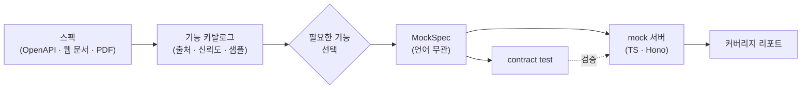
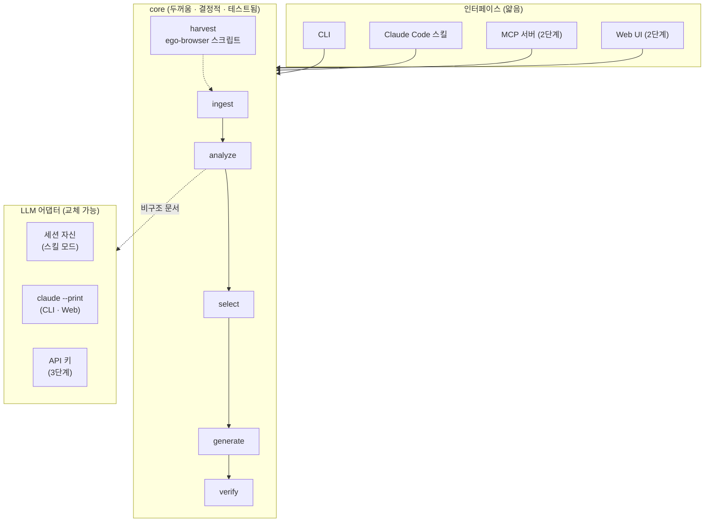
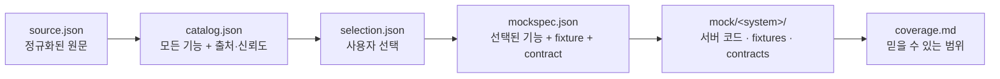
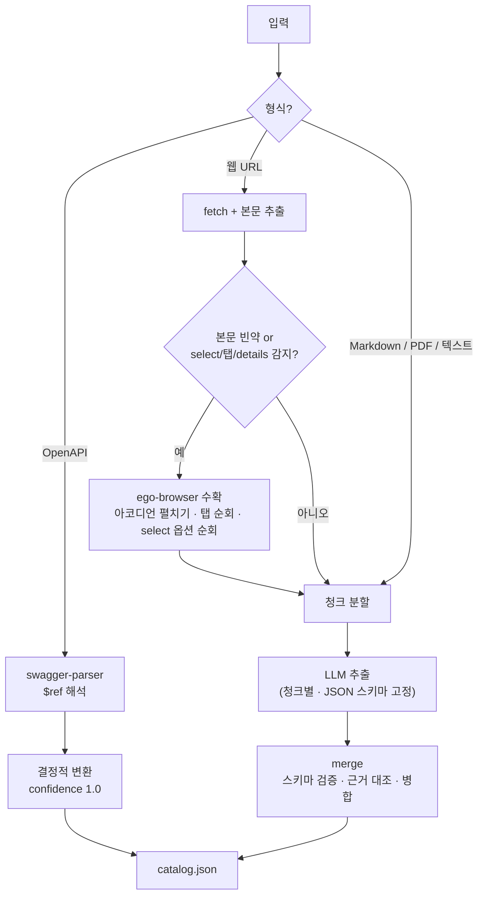
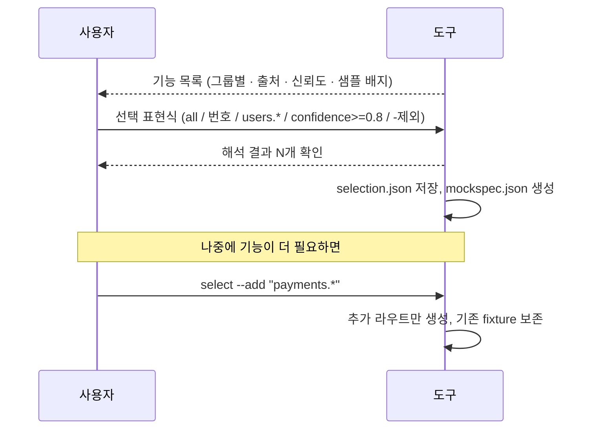

# specmock 아키텍처 한눈에 보기

> 상세 설계는 [설계 문서](superpowers/specs/2026-11-04-specmock-design.md)를 참고. 이 문서는 그림으로 전체를 파악하기 위한 요약이다.

## 무엇을 하는가

어떤 형태의 API 스펙이든 읽어서 언어 무관한 **MockSpec**으로 정규화하고, 그중 **필요한 기능만 골라** mock 서버와 검증 테스트를 생성한다.

## 레이어 구조

**원칙**: LLM은 "비구조 문서에서 기능 추출"과 "다른 언어 생성"에만 쓴다. 나머지는 전부 결정적 코드다.

## 상태 파일 (파일이 인터페이스)

모든 단계는 `.specmock/<system>/` 아래 파일로 이어진다. 어떤 인터페이스로 시작하든 같은 파일을 쓰고, 중간에 멈췄다 이어갈 수 있다.

| 파일 | 만드는 단계 | 쓰는 단계 | 핵심 내용 |
|---|---|---|---|
| `source.json` | ingest | analyze | 원문 보존. HTML 본문, PDF 텍스트, dereference된 OpenAPI, 수확 결과 |
| `catalog.json` | analyze | list / select | 모든 기능. `provenance`, `confidence`, `hasExample`, `evidence`, `notes` |
| `selection.json` | select | select / generate | 선택 표현식과 해석 결과. 재현과 추가 선택의 기준 |
| `mockspec.json` | select | generate / verify | 선택된 기능 + fixtures + contracts + assumptions. **단일 진실** |
| `coverage.md` | verify | 사용자 | fixture 출처 비율, 신뢰도 분포, 가정 목록, contract 결과 |

## 입력별 처리 경로

## 기능 선택 흐름

선택되지 않은 경로로 요청이 오면 mock은 `501 not_mocked`와 함께 "이 기능을 추가하려면 `specmock select <system> --add <id>`" 안내를 돌려준다.

## 로드맵

```mermaid
gantt
    dateFormat  X
    axisFormat  %s
    section 1단계
    core · CLI · Claude Code 스킬        :a1, 0, 3
    section 2단계
    MCP 서버 · Web UI                    :a2, after a1, 2
    section 3단계
    다른 언어 생성 · Proxy/녹화 · API 키 :a3, after a2, 2
```

| 단계 | 완료 기준 |
|---|---|
| 1 | OpenAPI와 웹 문서에서 TS mock 생성, contract test 통과, coverage.md 출력, 기능 추가 재생성 |
| 2 | 브라우저 화면에서 같은 흐름. MCP로 Claude Code에서 도구 호출 |
| 3 | 검증된 MockSpec으로 임의 언어 생성. 키 있으면 실제 시스템 전달·녹화 |
