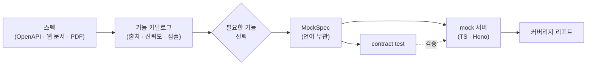

# Phase 1A: Core 파이프라인 (OpenAPI 경로) + CLI 구현 계획

> **For agentic workers:** REQUIRED SUB-SKILL: Use superpowers:subagent-driven-development (recommended) or superpowers:executing-plans to implement this plan task-by-task. Steps use checkbox (`- [ ]`) syntax for tracking.

**Goal:** OpenAPI 파일 하나를 입력받아 기능 카탈로그 → 선택 → TypeScript(Hono) mock 생성 → contract test 검증 → coverage.md 출력까지 CLI로 end-to-end 동작하게 만든다.

**Architecture:** pnpm 모노레포. `packages/core`가 ingest/analyze/select/generate/verify 모듈과 zod 스키마를 가지며 모든 상태를 `.specmock/<system>/` JSON 파일로 주고받는다. `packages/cli`는 core 함수를 commander 서브커맨드로 감싸기만 한다. LLM은 이 계획에서 호출하지 않는다(비구조 문서는 Phase 1B).

**Tech Stack:** Node 26 (ESM), pnpm 12, TypeScript 5.9, vitest 5, zod 4, @apidevtools/swagger-parser 13, json-schema-faker 0.6, ajv 8 + ajv-formats, eta 4, hono 4 + @hono/node-server 2, commander 15, yaml 2, get-port 7, tsx 4.

**설계 문서 대비 결정 사항:**
- 스키마 정의는 JSON Schema 파일 대신 **zod**로 한다. 타입과 검증이 한 곳에서 나오고, 필요하면 `z.toJSONSchema()`로 내보낼 수 있다.
- 템플릿은 루트 `templates/`가 아니라 `packages/core/templates/ts-hono/`에 둔다. 패키지 배포 시 함께 포함되어야 하기 때문이다.
- `mockspec.json`에 `notMocked: [{id, method, path}]`를 추가한다. 생성된 서버가 "선택되지 않은 기능" 501 응답을 만들려면 필요하다.
- 생성된 mock은 `tsx`로 실행한다(`npx tsx src/server.ts`). Node 23.6 미만 사용자도 쓸 수 있게 하기 위해서다.
- 통합 테스트에서는 생성된 mock 디렉터리에 `node_modules`를 루트로 심볼릭 링크하여 `pnpm install` 없이 기동한다. 그래서 루트 devDependencies에 hono, @hono/node-server, ajv, ajv-formats, tsx를 넣는다.

**Phase 1B에서 할 일(이 계획에 없음):** 웹 URL fetch·본문 추출, Markdown/PDF ingest, 청크 분할과 prepare/merge, LLM 어댑터(session, claude-code), ego-browser 수확 스크립트, Claude Code 플러그인/스킬, `show`의 근거 인용 표시.

---

## 파일 구조

```
specmock/
├── package.json                      # 루트. workspace 스크립트, 공용 devDependencies
├── pnpm-workspace.yaml
├── tsconfig.base.json
├── vitest.config.ts
├── packages/
│   ├── core/
│   │   ├── package.json              # @specmock/core
│   │   ├── tsconfig.json
│   │   ├── templates/ts-hono/        # 생성 템플릿 (.eta)
│   │   │   ├── package.json.eta
│   │   │   ├── tsconfig.json.eta
│   │   │   ├── README.md.eta
│   │   │   ├── src/server.ts.eta
│   │   │   ├── src/notMocked.ts.eta
│   │   │   ├── src/fixtures.ts.eta
│   │   │   ├── src/validate.ts.eta
│   │   │   └── src/route.ts.eta      # 그룹당 1회 렌더링
│   │   ├── src/
│   │   │   ├── index.ts              # 공개 API re-export
│   │   │   ├── types.ts              # zod 스키마 + 타입 (Source, Catalog, Selection, MockSpec)
│   │   │   ├── workspace.ts          # .specmock/<system>/ 파일 읽기·쓰기 (검증 포함)
│   │   │   ├── util/hash.ts          # 안정적 JSON 해시
│   │   │   ├── util/random.ts        # 시드 난수 (fixture 재현성)
│   │   │   ├── ingest/index.ts       # ingest(ws, system, origins) → source.json
│   │   │   ├── ingest/openapi.ts     # OpenAPI 로드·dereference
│   │   │   ├── analyze/index.ts      # analyze(ws, system) → catalog.json
│   │   │   ├── analyze/openapi.ts    # OpenAPI 문서 → Feature[]
│   │   │   ├── analyze/featureId.ts  # id·group 규칙
│   │   │   ├── catalog/order.ts      # 표시 순서 (list와 select 번호의 기준)
│   │   │   ├── catalog/format.ts     # 기능 목록 표 렌더링
│   │   │   ├── select/index.ts       # select(ws, system, exprs, opts) → selection.json + mockspec.json
│   │   │   ├── select/expression.ts  # 선택 표현식 해석
│   │   │   ├── select/fixtures.ts    # feature → fixtures
│   │   │   ├── select/contracts.ts   # feature + fixtures → contracts
│   │   │   ├── generate/index.ts     # generate(ws, system, opts) → mock 디렉터리
│   │   │   ├── generate/lock.ts      # specmock.lock.json 읽기·쓰기
│   │   │   ├── generate/tsHono.ts    # 템플릿 렌더링
│   │   │   ├── verify/index.ts       # verify(mockDir) → 결과
│   │   │   ├── verify/server.ts      # mock 서버 기동·헬스체크·종료
│   │   │   └── verify/coverage.ts    # coverage.md 렌더링
│   │   └── test/
│   │       ├── fixtures/petstore.yaml
│   │       ├── *.test.ts             # 모듈별 단위 테스트
│   │       └── e2e.test.ts           # ingest → verify 통합
│   └── cli/
│       ├── package.json              # @specmock/cli, bin: specmock
│       ├── tsconfig.json
│       ├── src/cli.ts                # commander 진입점
│       ├── src/commands/*.ts         # 서브커맨드 1개 = 파일 1개
│       └── test/cli.test.ts
├── examples/petstore/                # README 빠른 시작에서 쓰는 샘플
└── README.md
```

---

### Task 1: 모노레포 스캐폴드

**Files:**
- Create: `package.json`, `pnpm-workspace.yaml`, `tsconfig.base.json`, `vitest.config.ts`, `.npmrc`
- Create: `packages/core/package.json`, `packages/core/tsconfig.json`, `packages/core/src/index.ts`, `packages/core/test/smoke.test.ts`
- Create: `packages/cli/package.json`, `packages/cli/tsconfig.json`, `packages/cli/src/cli.ts`

- [ ] **Step 1: 루트 설정 파일 작성**

`package.json`:
```json
{
  "name": "specmock-monorepo",
  "private": true,
  "type": "module",
  "packageManager": "pnpm@12.9.1",
  "engines": { "node": ">=20.19" },
  "scripts": {
    "build": "pnpm -r build",
    "build:core": "pnpm --filter @specmock/core build",
    "test": "pnpm build:core && vitest run",
    "test:watch": "vitest",
    "typecheck": "pnpm build:core && pnpm -r typecheck",
    "specmock": "pnpm -s build:core && tsx packages/cli/src/cli.ts"
  },
  "devDependencies": {
    "@hono/node-server": "^2.1.6",
    "@types/node": "^26.6.6",
    "ajv": "^8.20.0",
    "ajv-formats": "^3.0.1",
    "hono": "^4.13.16",
    "tsx": "^4.23.15",
    "typescript": "^5.9.3",
    "vitest": "^5.1.0"
  }
}
```

`pnpm-workspace.yaml`:
```yaml
packages:
  - packages/*
```

`.npmrc`:
```
shamefully-hoist=false
```

`tsconfig.base.json`:
```json
{
  "compilerOptions": {
    "target": "ES2022",
    "module": "NodeNext",
    "moduleResolution": "NodeNext",
    "strict": true,
    "esModuleInterop": true,
    "skipLibCheck": true,
    "resolveJsonModule": true,
    "declaration": true,
    "sourceMap": true,
    "isolatedModules": true,
    "verbatimModuleSyntax": true
  }
}
```

`vitest.config.ts`:
```ts
import { defineConfig } from "vitest/config";

export default defineConfig({
  test: {
    include: ["packages/*/test/**/*.test.ts"],
    testTimeout: 60_000,
    hookTimeout: 60_000,
  },
});
```

- [ ] **Step 2: core 패키지 뼈대**

`packages/core/package.json`:
```json
{
  "name": "@specmock/core",
  "version": "0.1.0",
  "type": "module",
  "main": "./dist/index.js",
  "types": "./dist/index.d.ts",
  "exports": { ".": { "types": "./dist/index.d.ts", "import": "./dist/index.js" } },
  "files": ["dist", "templates"],
  "scripts": {
    "build": "tsc -p tsconfig.json",
    "typecheck": "tsc -p tsconfig.json --noEmit",
    "test": "vitest run"
  },
  "dependencies": {
    "@apidevtools/swagger-parser": "^13.1.0",
    "ajv": "^8.20.0",
    "ajv-formats": "^3.0.1",
    "eta": "^4.6.0",
    "get-port": "^7.2.0",
    "json-schema-faker": "^0.6.3",
    "openapi-types": "^12.1.3",
    "yaml": "^2.9.1",
    "zod": "^4.6.7"
  }
}
```

`packages/core/tsconfig.json`:
```json
{
  "extends": "../../tsconfig.base.json",
  "compilerOptions": { "rootDir": "src", "outDir": "dist" },
  "include": ["src"]
}
```

`packages/core/src/index.ts`:
```ts
export const VERSION = "0.1.0";
```

`packages/core/test/smoke.test.ts`:
```ts
import { describe, expect, it } from "vitest";
import { VERSION } from "../src/index.js";

describe("smoke", () => {
  it("exports a version", () => {
    expect(VERSION).toBe("0.1.0");
  });
});
```

- [ ] **Step 3: cli 패키지 뼈대**

`packages/cli/package.json`:
```json
{
  "name": "@specmock/cli",
  "version": "0.1.0",
  "type": "module",
  "bin": { "specmock": "./dist/cli.js" },
  "files": ["dist"],
  "scripts": {
    "build": "tsc -p tsconfig.json",
    "typecheck": "tsc -p tsconfig.json --noEmit",
    "test": "vitest run"
  },
  "dependencies": {
    "@specmock/core": "workspace:*",
    "commander": "^15.0.0"
  }
}
```

`packages/cli/tsconfig.json`:
```json
{
  "extends": "../../tsconfig.base.json",
  "compilerOptions": { "rootDir": "src", "outDir": "dist" },
  "include": ["src"]
}
```

`packages/cli/src/cli.ts`:
```ts
#!/usr/bin/env node
import { Command } from "commander";
import { VERSION } from "@specmock/core";

const program = new Command();
program.name("specmock").description("스펙에서 필요한 기능만 골라 mock 서버를 생성한다").version(VERSION);
program.parseAsync(process.argv);
```

`@specmock/cli`는 `@specmock/core`를 package.json의 `exports`(= `dist/`)로 가져오므로, 테스트·타입체크·CLI 실행 전에 core를 빌드해야 한다. pnpm은 `pretest` 같은 pre 스크립트를 기본으로 실행하지 않으므로 위 스크립트처럼 명시적으로 연결한다.

- [ ] **Step 4: 설치 및 테스트 실행**

Run: `pnpm install && pnpm test`
Expected: `smoke.test.ts` 1 passed. (CLI 패키지는 아직 테스트 없음, 경고 가능)

Run: `pnpm specmock --version`
Expected: `0.1.0`

- [ ] **Step 5: 커밋**

```bash
git add -A
git commit -m "chore: pnpm 모노레포 스캐폴드 (core, cli)"
```

---

### Task 2: 타입(zod 스키마), Workspace, 해시 유틸

**Files:**
- Create: `packages/core/src/types.ts`, `packages/core/src/util/hash.ts`, `packages/core/src/workspace.ts`
- Test: `packages/core/test/types.test.ts`, `packages/core/test/workspace.test.ts`

- [ ] **Step 1: 실패하는 테스트 작성**

`packages/core/test/types.test.ts`:
```ts
import { describe, expect, it } from "vitest";
import { FeatureSchema, MockSpecSchema } from "../src/types.js";

const feature = {
  id: "users.get",
  group: "users",
  title: "Get user",
  method: "GET",
  path: "/users/{id}",
  request: { params: { id: { schema: { type: "string" }, required: true } }, query: {}, headers: {}, body: null },
  responses: { "200": { schema: { type: "object" }, examples: [] } },
  auth: "none",
  provenance: "openapi",
  confidence: 1,
  hasExample: false,
};

describe("FeatureSchema", () => {
  it("accepts a minimal feature and fills defaults", () => {
    const parsed = FeatureSchema.parse(feature);
    expect(parsed.notes).toEqual([]);
    expect(parsed.evidence).toEqual([]);
    expect(parsed.summary).toBe("");
  });

  it("rejects confidence outside 0..1", () => {
    expect(() => FeatureSchema.parse({ ...feature, confidence: 1.5 })).toThrow();
  });
});

describe("MockSpecSchema", () => {
  it("requires fixtures on each feature", () => {
    const bad = { system: "x", baseUrl: "/", language: "ts", features: [feature], notMocked: [], contracts: [], assumptions: [] };
    expect(() => MockSpecSchema.parse(bad)).toThrow();
    const good = { ...bad, features: [{ ...feature, fixtures: [{ status: 200, body: {}, source: "empty" }] }] };
    expect(MockSpecSchema.parse(good).features[0].fixtures).toHaveLength(1);
  });
});
```

`packages/core/test/workspace.test.ts`:
```ts
import { mkdtemp, rm } from "node:fs/promises";
import os from "node:os";
import path from "node:path";
import { afterEach, beforeEach, describe, expect, it } from "vitest";
import { SelectionSchema } from "../src/types.js";
import { Workspace } from "../src/workspace.js";
import { hashJson } from "../src/util/hash.js";

let dir: string;
beforeEach(async () => { dir = await mkdtemp(path.join(os.tmpdir(), "specmock-ws-")); });
afterEach(async () => { await rm(dir, { recursive: true, force: true }); });

describe("Workspace", () => {
  it("writes and reads a validated JSON file", async () => {
    const ws = new Workspace(dir);
    const data = { system: "demo", catalogHash: "abc", selected: ["all"], resolved: ["a.b"], updatedAt: "2026-01-01T00:00:00.000Z" };
    await ws.write("demo", "selection.json", SelectionSchema, data);
    expect(await ws.exists("demo", "selection.json")).toBe(true);
    expect(await ws.read("demo", "selection.json", SelectionSchema)).toEqual(data);
  });

  it("throws a friendly error when a file is missing", async () => {
    const ws = new Workspace(dir);
    await expect(ws.read("demo", "catalog.json", SelectionSchema)).rejects.toThrow(/catalog\.json.*specmock analyze/);
  });
});

describe("hashJson", () => {
  it("is stable across key order", () => {
    expect(hashJson({ a: 1, b: [1, { c: 2 }] })).toBe(hashJson({ b: [1, { c: 2 }], a: 1 }));
  });
});
```

- [ ] **Step 2: 실패 확인**

Run: `pnpm vitest run packages/core/test/types.test.ts packages/core/test/workspace.test.ts`
Expected: FAIL, `Cannot find module '../src/types.js'`

- [ ] **Step 3: 구현**

`packages/core/src/types.ts`:
```ts
import { z } from "zod";

export const JsonSchema = z.record(z.string(), z.unknown());
export type JsonSchema = z.infer<typeof JsonSchema>;

export const HttpMethod = z.enum(["GET", "POST", "PUT", "PATCH", "DELETE", "HEAD", "OPTIONS"]);
export type HttpMethod = z.infer<typeof HttpMethod>;

export const ExampleSchema = z.object({
  source: z.enum(["spec-example", "doc-sample"]),
  body: z.unknown(),
});

export const ResponseSchema = z.object({
  schema: JsonSchema.nullable(),
  examples: z.array(ExampleSchema),
});

export const ParamSchema = z.object({
  schema: JsonSchema.nullable(),
  required: z.boolean(),
});

export const FeatureSchema = z.object({
  id: z.string().min(1),
  group: z.string().min(1),
  title: z.string(),
  summary: z.string().default(""),
  method: HttpMethod,
  path: z.string().startsWith("/"),
  request: z.object({
    params: z.record(z.string(), ParamSchema),
    query: z.record(z.string(), ParamSchema),
    headers: z.record(z.string(), ParamSchema),
    body: JsonSchema.nullable(),
  }),
  responses: z.record(z.string(), ResponseSchema),
  auth: z.enum(["bearer", "apiKey", "basic", "none", "unknown"]),
  provenance: z.enum(["openapi", "doc-extracted", "inferred"]),
  confidence: z.number().min(0).max(1),
  hasExample: z.boolean(),
  evidence: z.array(z.object({ chunk: z.number(), quote: z.string() })).default([]),
  notes: z.array(z.string()).default([]),
});
export type Feature = z.infer<typeof FeatureSchema>;

export const SourceInputSchema = z.object({
  kind: z.enum(["openapi", "html", "markdown", "pdf", "text"]),
  origin: z.string(),
  fetchedAt: z.string(),
  contentHash: z.string(),
  content: z.string(),
  harvested: z.unknown().optional(),
});
export type SourceInput = z.infer<typeof SourceInputSchema>;

export const SourceSchema = z.object({
  system: z.string().min(1),
  inputs: z.array(SourceInputSchema).min(1),
});
export type Source = z.infer<typeof SourceSchema>;

export const CatalogSchema = z.object({
  system: z.string().min(1),
  generatedAt: z.string(),
  features: z.array(FeatureSchema),
  rejected: z.array(z.object({ raw: z.unknown(), reason: z.string() })).default([]),
});
export type Catalog = z.infer<typeof CatalogSchema>;

export const SelectionSchema = z.object({
  system: z.string().min(1),
  catalogHash: z.string(),
  selected: z.array(z.string()),
  resolved: z.array(z.string()),
  updatedAt: z.string(),
});
export type Selection = z.infer<typeof SelectionSchema>;

export const FixtureSchema = z.object({
  status: z.number().int(),
  body: z.unknown(),
  source: z.enum(["spec-example", "doc-sample", "schema-generated", "empty"]),
});
export type Fixture = z.infer<typeof FixtureSchema>;

export const ContractSchema = z.object({
  featureId: z.string(),
  name: z.string(),
  request: z.object({
    method: HttpMethod,
    path: z.string(),
    headers: z.record(z.string(), z.string()),
    query: z.record(z.string(), z.string()),
    body: z.unknown().nullable(),
  }),
  expect: z.object({
    status: z.number().int(),
    schema: JsonSchema.nullable(),
  }),
});
export type Contract = z.infer<typeof ContractSchema>;

export const MockFeatureSchema = FeatureSchema.extend({
  fixtures: z.array(FixtureSchema).min(1),
});
export type MockFeature = z.infer<typeof MockFeatureSchema>;

export const MockSpecSchema = z.object({
  system: z.string().min(1),
  baseUrl: z.string(),
  language: z.enum(["ts"]),
  features: z.array(MockFeatureSchema),
  notMocked: z.array(z.object({ id: z.string(), method: HttpMethod, path: z.string() })),
  contracts: z.array(ContractSchema),
  assumptions: z.array(z.string()),
});
export type MockSpec = z.infer<typeof MockSpecSchema>;
```

`packages/core/src/util/hash.ts`:
```ts
import { createHash } from "node:crypto";

function stable(value: unknown): unknown {
  if (Array.isArray(value)) return value.map(stable);
  if (value && typeof value === "object") {
    return Object.fromEntries(
      Object.keys(value as Record<string, unknown>)
        .sort()
        .map((k) => [k, stable((value as Record<string, unknown>)[k])]),
    );
  }
  return value;
}

export function hashJson(value: unknown): string {
  return createHash("sha256").update(JSON.stringify(stable(value))).digest("hex");
}

export function hashText(text: string): string {
  return createHash("sha256").update(text).digest("hex");
}
```

`packages/core/src/workspace.ts`:
```ts
import { access, mkdir, readFile, writeFile } from "node:fs/promises";
import path from "node:path";
import type { ZodType } from "zod";

const PRODUCER: Record<string, string> = {
  "source.json": "specmock ingest",
  "catalog.json": "specmock analyze",
  "selection.json": "specmock select",
  "mockspec.json": "specmock select",
};

export class Workspace {
  constructor(readonly root: string = path.resolve(".specmock")) {}

  dir(system: string): string {
    return path.join(this.root, system);
  }

  file(system: string, name: string): string {
    return path.join(this.dir(system), name);
  }

  async exists(system: string, name: string): Promise<boolean> {
    try {
      await access(this.file(system, name));
      return true;
    } catch {
      return false;
    }
  }

  async read<T>(system: string, name: string, schema: ZodType<T>): Promise<T> {
    const file = this.file(system, name);
    let text: string;
    try {
      text = await readFile(file, "utf8");
    } catch {
      const hint = PRODUCER[name] ? ` 먼저 \`${PRODUCER[name]} ${system}\`를 실행하세요.` : "";
      throw new Error(`${name} 파일이 없습니다 (${file}).${hint}`);
    }
    return schema.parse(JSON.parse(text));
  }

  async write<T>(system: string, name: string, schema: ZodType<T>, data: T): Promise<string> {
    const file = this.file(system, name);
    await mkdir(path.dirname(file), { recursive: true });
    const validated = schema.parse(data);
    await writeFile(file, JSON.stringify(validated, null, 2) + "\n", "utf8");
    return file;
  }

  async writeText(system: string, name: string, text: string): Promise<string> {
    const file = this.file(system, name);
    await mkdir(path.dirname(file), { recursive: true });
    await writeFile(file, text, "utf8");
    return file;
  }
}
```

- [ ] **Step 4: 통과 확인**

Run: `pnpm vitest run packages/core/test/types.test.ts packages/core/test/workspace.test.ts`
Expected: 6 passed

- [ ] **Step 5: 커밋**

```bash
git add packages/core
git commit -m "feat(core): zod 타입, Workspace, 해시 유틸"
```

---

### Task 3: Feature id와 group 규칙

**Files:**
- Create: `packages/core/src/analyze/featureId.ts`
- Test: `packages/core/test/featureId.test.ts`

규칙(설계 5.2): `operationId`가 있으면 그것(허용 문자 외는 `_`). 없으면 `리소스.동작`. 리소스 = 마지막 정적 세그먼트(없으면 `root`). 동작 = GET+끝이 파라미터 → `get`, GET → `list`, POST → `create`, PUT/PATCH → `update`, DELETE → `delete`, 그 외 → 소문자 메서드. 충돌 시 `2`, `3` 접미사. group = 첫 태그, 없으면 첫 정적 세그먼트, 없으면 `root`.

- [ ] **Step 1: 실패하는 테스트 작성**

`packages/core/test/featureId.test.ts`:
```ts
import { describe, expect, it } from "vitest";
import { deriveFeatureId, deriveGroup, FeatureIdRegistry } from "../src/analyze/featureId.js";

describe("deriveFeatureId", () => {
  it("uses operationId when present", () => {
    expect(deriveFeatureId({ method: "GET", path: "/users/{id}", operationId: "getUser" })).toBe("getUser");
  });
  it("sanitizes operationId", () => {
    expect(deriveFeatureId({ method: "GET", path: "/x", operationId: "get user/1" })).toBe("get_user_1");
  });
  it("derives resource.action from path and method", () => {
    expect(deriveFeatureId({ method: "GET", path: "/users/{id}" })).toBe("users.get");
    expect(deriveFeatureId({ method: "GET", path: "/users" })).toBe("users.list");
    expect(deriveFeatureId({ method: "POST", path: "/users" })).toBe("users.create");
    expect(deriveFeatureId({ method: "PATCH", path: "/users/{id}" })).toBe("users.update");
    expect(deriveFeatureId({ method: "DELETE", path: "/users/{id}" })).toBe("users.delete");
    expect(deriveFeatureId({ method: "GET", path: "/store/inventory" })).toBe("inventory.list");
    expect(deriveFeatureId({ method: "GET", path: "/" })).toBe("root.list");
    expect(deriveFeatureId({ method: "HEAD", path: "/users" })).toBe("users.head");
  });
});

describe("deriveGroup", () => {
  it("prefers the first tag, then first static segment, then root", () => {
    expect(deriveGroup({ path: "/users/{id}", tags: ["People"] })).toBe("People");
    expect(deriveGroup({ path: "/users/{id}", tags: [] })).toBe("users");
    expect(deriveGroup({ path: "/{id}", tags: [] })).toBe("root");
  });
});

describe("FeatureIdRegistry", () => {
  it("appends numeric suffixes on collision", () => {
    const reg = new FeatureIdRegistry();
    expect(reg.claim("users.get")).toBe("users.get");
    expect(reg.claim("users.get")).toBe("users.get2");
    expect(reg.claim("users.get")).toBe("users.get3");
  });
});
```

- [ ] **Step 2: 실패 확인**

Run: `pnpm vitest run packages/core/test/featureId.test.ts`
Expected: FAIL, module not found

- [ ] **Step 3: 구현**

`packages/core/src/analyze/featureId.ts`:
```ts
import type { HttpMethod } from "../types.js";

const PARAM = /^\{.+\}$/;

function segments(path: string): string[] {
  return path.split("/").filter((s) => s.length > 0);
}

export function staticSegments(path: string): string[] {
  return segments(path).filter((s) => !PARAM.test(s));
}

export function deriveFeatureId(input: { method: HttpMethod; path: string; operationId?: string }): string {
  if (input.operationId && input.operationId.trim().length > 0) {
    return input.operationId.trim().replace(/[^A-Za-z0-9_.-]/g, "_");
  }
  const segs = segments(input.path);
  const statics = staticSegments(input.path);
  const resource = statics.length > 0 ? statics[statics.length - 1] : "root";
  const endsWithParam = segs.length > 0 && PARAM.test(segs[segs.length - 1]);
  const action = (() => {
    switch (input.method) {
      case "GET": return endsWithParam ? "get" : "list";
      case "POST": return "create";
      case "PUT":
      case "PATCH": return "update";
      case "DELETE": return "delete";
      default: return input.method.toLowerCase();
    }
  })();
  return `${resource}.${action}`;
}

export function deriveGroup(input: { path: string; tags?: string[] }): string {
  if (input.tags && input.tags.length > 0 && input.tags[0].trim()) return input.tags[0].trim();
  const statics = staticSegments(input.path);
  return statics.length > 0 ? statics[0] : "root";
}

export class FeatureIdRegistry {
  private readonly taken = new Set<string>();

  claim(candidate: string): string {
    if (!this.taken.has(candidate)) {
      this.taken.add(candidate);
      return candidate;
    }
    let n = 2;
    while (this.taken.has(`${candidate}${n}`)) n += 1;
    const id = `${candidate}${n}`;
    this.taken.add(id);
    return id;
  }
}
```

- [ ] **Step 4: 통과 확인**

Run: `pnpm vitest run packages/core/test/featureId.test.ts`
Expected: 5 passed

- [ ] **Step 5: 커밋**

```bash
git add packages/core/src/analyze/featureId.ts packages/core/test/featureId.test.ts
git commit -m "feat(core): feature id·group 파생 규칙"
```

---

### Task 4: ingest (OpenAPI)

**Files:**
- Create: `packages/core/src/ingest/openapi.ts`, `packages/core/src/ingest/index.ts`
- Create: `packages/core/test/fixtures/petstore.yaml`, `packages/core/test/helpers.ts`
- Test: `packages/core/test/ingest.test.ts`

- [ ] **Step 1: 테스트용 Petstore 스펙 작성**

`packages/core/test/fixtures/petstore.yaml`:
```yaml
openapi: 3.0.3
info:
  title: Petstore
  version: 1.0.0
components:
  securitySchemes:
    ApiKey:
      type: apiKey
      in: header
      name: X-API-Key
  schemas:
    Pet:
      type: object
      required: [id, name]
      properties:
        id: { type: integer, format: int64 }
        name: { type: string }
        tag: { type: string }
    NewPet:
      type: object
      required: [name]
      properties:
        name: { type: string }
        tag: { type: string }
    Error:
      type: object
      required: [code, message]
      properties:
        code: { type: integer }
        message: { type: string }
security:
  - ApiKey: []
paths:
  /pets:
    get:
      operationId: listPets
      tags: [pets]
      summary: List all pets
      parameters:
        - name: limit
          in: query
          required: false
          schema: { type: integer, maximum: 100 }
      responses:
        "200":
          description: A paged array of pets
          content:
            application/json:
              schema:
                type: array
                items: { $ref: "#/components/schemas/Pet" }
    post:
      operationId: createPet
      tags: [pets]
      summary: Create a pet
      requestBody:
        required: true
        content:
          application/json:
            schema: { $ref: "#/components/schemas/NewPet" }
      responses:
        "201":
          description: Created
          content:
            application/json:
              schema: { $ref: "#/components/schemas/Pet" }
        "400":
          description: Bad request
          content:
            application/json:
              schema: { $ref: "#/components/schemas/Error" }
  /pets/{petId}:
    get:
      operationId: getPet
      tags: [pets]
      summary: Info for a specific pet
      parameters:
        - name: petId
          in: path
          required: true
          schema: { type: integer }
      responses:
        "200":
          description: Expected response
          content:
            application/json:
              schema: { $ref: "#/components/schemas/Pet" }
              example: { id: 1, name: "Rex", tag: "dog" }
        "404":
          description: Not found
          content:
            application/json:
              schema: { $ref: "#/components/schemas/Error" }
    delete:
      operationId: deletePet
      tags: [pets]
      summary: Delete a pet
      parameters:
        - name: petId
          in: path
          required: true
          schema: { type: integer }
      responses:
        "204":
          description: Deleted
  /store/inventory:
    get:
      summary: Inventory by status
      security: []
      responses:
        "200":
          description: ok
          content:
            application/json:
              schema:
                type: object
                additionalProperties: { type: integer }
```

- [ ] **Step 2: 테스트 헬퍼와 실패하는 테스트 작성**

`packages/core/test/helpers.ts`:
```ts
import path from "node:path";
import { fileURLToPath } from "node:url";

const here = path.dirname(fileURLToPath(import.meta.url));
export const PETSTORE = path.join(here, "fixtures", "petstore.yaml");
/** 루트 node_modules. 생성된 mock에 심볼릭 링크하여 설치 없이 기동할 때 쓴다. */
export const ROOT_NODE_MODULES = path.resolve(here, "..", "..", "..", "node_modules");
```

`packages/core/test/ingest.test.ts`:
```ts
import { mkdtemp, rm, writeFile } from "node:fs/promises";
import os from "node:os";
import path from "node:path";
import { afterEach, beforeEach, describe, expect, it } from "vitest";
import { detectKind, ingest } from "../src/ingest/index.js";
import { SourceSchema } from "../src/types.js";
import { Workspace } from "../src/workspace.js";
import { PETSTORE } from "./helpers.js";

let dir: string;
beforeEach(async () => { dir = await mkdtemp(path.join(os.tmpdir(), "specmock-ingest-")); });
afterEach(async () => { await rm(dir, { recursive: true, force: true }); });

describe("detectKind", () => {
  it("detects openapi by content", () => {
    expect(detectKind("spec.yaml", "openapi: 3.0.0\npaths: {}")).toBe("openapi");
    expect(detectKind("spec.json", '{"swagger":"2.0"}')).toBe("openapi");
  });
  it("falls back to markdown/text by extension", () => {
    expect(detectKind("README.md", "# hi")).toBe("markdown");
    expect(detectKind("notes.txt", "hi")).toBe("text");
  });
});

describe("ingest(openapi)", () => {
  it("writes source.json with a dereferenced document", async () => {
    const ws = new Workspace(dir);
    const file = await ingest(ws, "petstore", [PETSTORE]);
    expect(file.endsWith(path.join("petstore", "source.json"))).toBe(true);
    const source = await ws.read("petstore", "source.json", SourceSchema);
    expect(source.inputs).toHaveLength(1);
    expect(source.inputs[0].kind).toBe("openapi");
    const doc = JSON.parse(source.inputs[0].content);
    // $ref가 해석되어 있어야 한다
    expect(doc.paths["/pets/{petId}"].get.responses["200"].content["application/json"].schema.properties.name.type).toBe("string");
  });

  it("rejects non-openapi inputs in this phase", async () => {
    const ws = new Workspace(dir);
    const md = path.join(dir, "doc.md");
    await writeFile(md, "# API\n", "utf8");
    await expect(ingest(ws, "x", [md])).rejects.toThrow(/Phase 1B/);
  });
});
```

- [ ] **Step 3: 실패 확인**

Run: `pnpm vitest run packages/core/test/ingest.test.ts`
Expected: FAIL, module not found

- [ ] **Step 4: 구현**

`packages/core/src/ingest/openapi.ts` (v13은 ESM default export다. 만약 `SwaggerParser.dereference is not a function`이 나오면 `import * as mod from "@apidevtools/swagger-parser"; const SwaggerParser = (mod as any).default ?? mod;` 로 바꾼다):
```ts
import SwaggerParser from "@apidevtools/swagger-parser";
import type { OpenAPI } from "openapi-types";

export async function loadOpenApi(origin: string): Promise<OpenAPI.Document> {
  // 파일 경로와 URL 모두 지원. 순환 참조는 무시하고 나머지를 해석한다.
  const api = await SwaggerParser.dereference(origin, { dereference: { circular: "ignore" } });
  return api as OpenAPI.Document;
}

export function isOpenApiText(text: string): boolean {
  // YAML(`openapi: 3.0.0`)과 JSON(`{"swagger":"2.0"}`) 모두 앞부분에서 키를 찾는다.
  const head = text.slice(0, 2000);
  return /["']?(openapi|swagger)["']?\s*:/.test(head);
}
```

`packages/core/src/ingest/index.ts`:
```ts
import { readFile } from "node:fs/promises";
import path from "node:path";
import { hashText } from "../util/hash.js";
import { SourceSchema, type SourceInput } from "../types.js";
import type { Workspace } from "../workspace.js";
import { isOpenApiText, loadOpenApi } from "./openapi.js";

export type InputKind = SourceInput["kind"];

export function detectKind(origin: string, text: string): InputKind {
  if (isOpenApiText(text)) return "openapi";
  const ext = path.extname(origin.split("?")[0]).toLowerCase();
  if (ext === ".md" || ext === ".markdown") return "markdown";
  if (ext === ".pdf") return "pdf";
  if (ext === ".html" || ext === ".htm" || /^https?:\/\//.test(origin)) return "html";
  return "text";
}

async function readOrigin(origin: string): Promise<string> {
  if (/^https?:\/\//.test(origin)) {
    const res = await fetch(origin);
    if (!res.ok) throw new Error(`${origin} 요청 실패: HTTP ${res.status}`);
    return await res.text();
  }
  return await readFile(origin, "utf8");
}

export async function ingestOne(origin: string): Promise<SourceInput> {
  const raw = await readOrigin(origin);
  const kind = detectKind(origin, raw);
  if (kind !== "openapi") {
    throw new Error(`${origin}: '${kind}' 입력은 Phase 1B에서 지원합니다. 지금은 OpenAPI(json/yaml)만 가능합니다.`);
  }
  const doc = await loadOpenApi(origin);
  const content = JSON.stringify(doc);
  return { kind, origin, fetchedAt: new Date().toISOString(), contentHash: hashText(content), content };
}

export async function ingest(ws: Workspace, system: string, origins: string[]): Promise<string> {
  if (origins.length === 0) throw new Error("입력 파일 또는 URL을 하나 이상 지정하세요.");
  const inputs: SourceInput[] = [];
  for (const origin of origins) inputs.push(await ingestOne(origin));
  return await ws.write(system, "source.json", SourceSchema, { system, inputs });
}
```

- [ ] **Step 5: 통과 확인**

Run: `pnpm vitest run packages/core/test/ingest.test.ts`
Expected: 4 passed

- [ ] **Step 6: 커밋**

```bash
git add packages/core/src/ingest packages/core/test/ingest.test.ts packages/core/test/helpers.ts packages/core/test/fixtures/petstore.yaml
git commit -m "feat(core): OpenAPI ingest와 입력 형식 감지"
```

---

### Task 5: analyze (OpenAPI → catalog)

**Files:**
- Create: `packages/core/src/analyze/openapi.ts`, `packages/core/src/analyze/index.ts`
- Test: `packages/core/test/analyze.test.ts`

- [ ] **Step 1: 실패하는 테스트 작성**

`packages/core/test/analyze.test.ts`:
```ts
import { mkdtemp, rm } from "node:fs/promises";
import os from "node:os";
import path from "node:path";
import { afterEach, beforeEach, describe, expect, it } from "vitest";
import { analyze } from "../src/analyze/index.js";
import { ingest } from "../src/ingest/index.js";
import { CatalogSchema } from "../src/types.js";
import { Workspace } from "../src/workspace.js";
import { PETSTORE } from "./helpers.js";

let dir: string;
let ws: Workspace;
beforeEach(async () => {
  dir = await mkdtemp(path.join(os.tmpdir(), "specmock-analyze-"));
  ws = new Workspace(dir);
  await ingest(ws, "petstore", [PETSTORE]);
});
afterEach(async () => { await rm(dir, { recursive: true, force: true }); });

describe("analyze(openapi)", () => {
  it("produces one feature per path×method with stable ids", async () => {
    await analyze(ws, "petstore");
    const catalog = await ws.read("petstore", "catalog.json", CatalogSchema);
    const ids = catalog.features.map((f) => f.id).sort();
    expect(ids).toEqual(["createPet", "deletePet", "getPet", "inventory.list", "listPets"]);
  });

  it("fills group, auth, examples and schemas", async () => {
    await analyze(ws, "petstore");
    const catalog = await ws.read("petstore", "catalog.json", CatalogSchema);
    const byId = Object.fromEntries(catalog.features.map((f) => [f.id, f]));

    expect(byId.getPet.group).toBe("pets");
    expect(byId.getPet.auth).toBe("apiKey");
    expect(byId.getPet.hasExample).toBe(true);
    expect(byId.getPet.responses["200"].examples[0]).toEqual({ source: "spec-example", body: { id: 1, name: "Rex", tag: "dog" } });
    expect(byId.getPet.request.params.petId).toEqual({ schema: { type: "integer" }, required: true });

    expect(byId["inventory.list"].group).toBe("store");
    expect(byId["inventory.list"].auth).toBe("none");

    expect(byId.createPet.request.body?.required).toEqual(["name"]);
    expect(byId.createPet.responses["400"].schema).toBeTruthy();

    expect(byId.listPets.request.query.limit.required).toBe(false);
    expect(byId.deletePet.responses["204"].schema).toBeNull();

    for (const f of catalog.features) {
      expect(f.provenance).toBe("openapi");
      expect(f.confidence).toBe(1);
    }
  });
});
```

- [ ] **Step 2: 실패 확인**

Run: `pnpm vitest run packages/core/test/analyze.test.ts`
Expected: FAIL, module not found

- [ ] **Step 3: 구현**

`packages/core/src/analyze/openapi.ts`:
```ts
import type { OpenAPIV2, OpenAPIV3 } from "openapi-types";
import type { Feature, HttpMethod, JsonSchema } from "../types.js";
import { deriveFeatureId, deriveGroup, FeatureIdRegistry } from "./featureId.js";

const METHODS: HttpMethod[] = ["GET", "POST", "PUT", "PATCH", "DELETE", "HEAD", "OPTIONS"];

type AnyDoc = OpenAPIV3.Document | OpenAPIV2.Document;
type AnyOperation = OpenAPIV3.OperationObject | OpenAPIV2.OperationObject;
type AnyParam = OpenAPIV3.ParameterObject | OpenAPIV2.Parameter;

function isV3(doc: AnyDoc): doc is OpenAPIV3.Document {
  return "openapi" in doc;
}

function stripSchema(schema: unknown): JsonSchema | null {
  if (!schema || typeof schema !== "object") return null;
  // dereference 이후이므로 $ref는 없다. 그대로 복사한다.
  return JSON.parse(JSON.stringify(schema)) as JsonSchema;
}

function jsonContent(content: Record<string, OpenAPIV3.MediaTypeObject> | undefined): OpenAPIV3.MediaTypeObject | undefined {
  if (!content) return undefined;
  const key = Object.keys(content).find((k) => k.includes("json")) ?? Object.keys(content)[0];
  return key ? content[key] : undefined;
}

function collectExamples(media: OpenAPIV3.MediaTypeObject | undefined, schema: JsonSchema | null): Feature["responses"][string]["examples"] {
  const out: Feature["responses"][string]["examples"] = [];
  if (media?.example !== undefined) out.push({ source: "spec-example", body: media.example });
  if (media?.examples) {
    for (const ex of Object.values(media.examples)) {
      const value = (ex as OpenAPIV3.ExampleObject).value;
      if (value !== undefined) out.push({ source: "spec-example", body: value });
    }
  }
  if (out.length === 0 && schema && schema.example !== undefined) out.push({ source: "spec-example", body: schema.example });
  return out;
}

function resolveAuth(doc: AnyDoc, op: AnyOperation): Feature["auth"] {
  const requirements = op.security ?? doc.security ?? [];
  if (requirements.length === 0) return "none";
  const schemes: Record<string, { type?: string; scheme?: string }> = isV3(doc)
    ? ((doc.components?.securitySchemes as Record<string, { type?: string; scheme?: string }>) ?? {})
    : ((doc.securityDefinitions as Record<string, { type?: string; scheme?: string }>) ?? {});
  for (const req of requirements) {
    for (const name of Object.keys(req)) {
      const s = schemes[name];
      if (!s) continue;
      if (s.type === "apiKey") return "apiKey";
      if (s.type === "http" && s.scheme === "bearer") return "bearer";
      if (s.type === "http" && s.scheme === "basic") return "basic";
      if (s.type === "basic") return "basic";
      if (s.type === "oauth2" || s.type === "openIdConnect") return "bearer";
    }
  }
  return "unknown";
}

function buildRequest(doc: AnyDoc, pathParams: AnyParam[], op: AnyOperation): Feature["request"] {
  const request: Feature["request"] = { params: {}, query: {}, headers: {}, body: null };
  const merged: AnyParam[] = [...pathParams, ...((op.parameters as AnyParam[] | undefined) ?? [])];
  for (const p of merged) {
    const entry = { schema: stripSchema("schema" in p ? p.schema : { type: (p as OpenAPIV2.GeneralParameterObject).type }), required: Boolean(p.required) };
    if (p.in === "path") request.params[p.name] = { ...entry, required: true };
    else if (p.in === "query") request.query[p.name] = entry;
    else if (p.in === "header") request.headers[p.name] = entry;
    else if (p.in === "body") request.body = stripSchema((p as OpenAPIV2.InBodyParameterObject).schema);
  }
  if (isV3(doc)) {
    const body = (op as OpenAPIV3.OperationObject).requestBody as OpenAPIV3.RequestBodyObject | undefined;
    const media = jsonContent(body?.content);
    if (media?.schema) request.body = stripSchema(media.schema);
  }
  return request;
}

function buildResponses(doc: AnyDoc, op: AnyOperation): Feature["responses"] {
  const out: Feature["responses"] = {};
  for (const [status, resRaw] of Object.entries(op.responses ?? {})) {
    if (!/^\d{3}$/.test(status)) continue; // "default"는 생략
    if (isV3(doc)) {
      const res = resRaw as OpenAPIV3.ResponseObject;
      const media = jsonContent(res.content);
      const schema = stripSchema(media?.schema);
      out[status] = { schema, examples: collectExamples(media, schema) };
    } else {
      const res = resRaw as OpenAPIV2.ResponseObject;
      const schema = stripSchema(res.schema);
      const examples: Feature["responses"][string]["examples"] = [];
      const ex = res.examples as Record<string, unknown> | undefined;
      if (ex) for (const v of Object.values(ex)) examples.push({ source: "spec-example", body: v });
      out[status] = { schema, examples };
    }
  }
  return out;
}

export function analyzeOpenApiDocument(doc: AnyDoc): Feature[] {
  const registry = new FeatureIdRegistry();
  const features: Feature[] = [];
  const paths = (doc.paths ?? {}) as Record<string, Record<string, unknown>>;
  for (const [pathKey, item] of Object.entries(paths)) {
    if (!item) continue;
    const pathParams = ((item.parameters as AnyParam[] | undefined) ?? []);
    for (const method of METHODS) {
      const op = item[method.toLowerCase()] as AnyOperation | undefined;
      if (!op) continue;
      const responses = buildResponses(doc, op);
      const hasExample = Object.values(responses).some((r) => r.examples.length > 0);
      features.push({
        id: registry.claim(deriveFeatureId({ method, path: pathKey, operationId: op.operationId })),
        group: deriveGroup({ path: pathKey, tags: op.tags }),
        title: op.summary ?? `${method} ${pathKey}`,
        summary: op.description ?? "",
        method,
        path: pathKey,
        request: buildRequest(doc, pathParams, op),
        responses,
        auth: resolveAuth(doc, op),
        provenance: "openapi",
        confidence: 1,
        hasExample,
        evidence: [],
        notes: [],
      });
    }
  }
  return features;
}
```

`packages/core/src/analyze/index.ts`:
```ts
import { CatalogSchema, SourceSchema, type Feature } from "../types.js";
import type { Workspace } from "../workspace.js";
import { analyzeOpenApiDocument } from "./openapi.js";

export async function analyze(ws: Workspace, system: string): Promise<string> {
  const source = await ws.read(system, "source.json", SourceSchema);
  const features: Feature[] = [];
  for (const input of source.inputs) {
    if (input.kind === "openapi") {
      features.push(...analyzeOpenApiDocument(JSON.parse(input.content)));
    } else {
      throw new Error(`'${input.kind}' 입력 분석은 Phase 1B에서 지원합니다.`);
    }
  }
  return await ws.write(system, "catalog.json", CatalogSchema, {
    system,
    generatedAt: new Date().toISOString(),
    features,
    rejected: [],
  });
}
```

- [ ] **Step 4: 통과 확인**

Run: `pnpm vitest run packages/core/test/analyze.test.ts`
Expected: 2 passed

- [ ] **Step 5: 커밋**

```bash
git add packages/core/src/analyze packages/core/test/analyze.test.ts
git commit -m "feat(core): OpenAPI 문서를 기능 카탈로그로 변환"
```

---

### Task 6: 표시 순서와 기능 목록 표

**Files:**
- Create: `packages/core/src/catalog/order.ts`, `packages/core/src/catalog/format.ts`
- Test: `packages/core/test/catalog.test.ts`

순서(설계 4.1): 그룹 이름순 → path → method 순(GET, POST, PUT, PATCH, DELETE, HEAD, OPTIONS). 표시 번호는 1부터 이 순서로. `list`와 `select`의 번호 표현식이 같은 함수를 쓴다.

- [ ] **Step 1: 실패하는 테스트 작성**

`packages/core/test/catalog.test.ts`:
```ts
import { describe, expect, it } from "vitest";
import { formatCatalog } from "../src/catalog/format.js";
import { orderFeatures } from "../src/catalog/order.js";
import type { Catalog, Feature } from "../src/types.js";

function f(partial: Partial<Feature> & Pick<Feature, "id" | "group" | "method" | "path">): Feature {
  return {
    title: partial.id, summary: "", request: { params: {}, query: {}, headers: {}, body: null },
    responses: {}, auth: "none", provenance: "openapi", confidence: 1, hasExample: false, evidence: [], notes: [],
    ...partial,
  };
}

const catalog: Catalog = {
  system: "demo", generatedAt: "2026-01-01T00:00:00.000Z", rejected: [],
  features: [
    f({ id: "users.delete", group: "users", method: "DELETE", path: "/users/{id}" }),
    f({ id: "users.get", group: "users", method: "GET", path: "/users/{id}", hasExample: true }),
    f({ id: "accounts.list", group: "accounts", method: "GET", path: "/accounts" }),
    f({ id: "users.list", group: "users", method: "GET", path: "/users", provenance: "doc-extracted", confidence: 0.7, notes: ["path 추론"] }),
  ],
};

describe("orderFeatures", () => {
  it("sorts by group, path, then method order", () => {
    expect(orderFeatures(catalog).map((x) => x.feature.id)).toEqual(["accounts.list", "users.list", "users.get", "users.delete"]);
    expect(orderFeatures(catalog).map((x) => x.index)).toEqual([1, 2, 3, 4]);
  });
});

describe("formatCatalog", () => {
  it("renders groups, badges and warnings", () => {
    const text = formatCatalog(catalog);
    expect(text).toContain("demo — 4개 기능 (openapi 3 · 문서추출 1 · 추론 0)");
    expect(text).toMatch(/── accounts \(1\)/);
    expect(text).toMatch(/── users \(3\)/);
    expect(text).toMatch(/3\s+users\.get\s+GET\s+\/users\/\{id\}\s+spec\s+1\.0\s+●/);
    expect(text).toMatch(/2\s+users\.list\s+GET\s+\/users\s+doc\s+0\.7\s+—\s+⚠ path 추론/);
    expect(text).toContain("범례");
  });
});
```

- [ ] **Step 2: 실패 확인**

Run: `pnpm vitest run packages/core/test/catalog.test.ts`
Expected: FAIL, module not found

- [ ] **Step 3: 구현**

`packages/core/src/catalog/order.ts`:
```ts
import type { Catalog, Feature, HttpMethod } from "../types.js";

const METHOD_ORDER: HttpMethod[] = ["GET", "POST", "PUT", "PATCH", "DELETE", "HEAD", "OPTIONS"];

export interface OrderedFeature {
  index: number; // 1부터
  feature: Feature;
}

export function orderFeatures(catalog: Pick<Catalog, "features">): OrderedFeature[] {
  const sorted = [...catalog.features].sort((a, b) =>
    a.group.localeCompare(b.group) ||
    a.path.localeCompare(b.path) ||
    METHOD_ORDER.indexOf(a.method) - METHOD_ORDER.indexOf(b.method),
  );
  return sorted.map((feature, i) => ({ index: i + 1, feature }));
}
```

`packages/core/src/catalog/format.ts`:
```ts
import type { Catalog, Feature } from "../types.js";
import { orderFeatures } from "./order.js";

const PROVENANCE_LABEL: Record<Feature["provenance"], string> = { openapi: "spec", "doc-extracted": "doc", inferred: "inf" };

function sampleBadge(f: Feature): string {
  if (f.hasExample) return "●";
  const hasSchema = Object.values(f.responses).some((r) => r.schema !== null);
  return hasSchema ? "○" : "—";
}

function pad(s: string, n: number): string {
  return s.length >= n ? s : s + " ".repeat(n - s.length);
}

export function formatCatalog(catalog: Catalog): string {
  const ordered = orderFeatures(catalog);
  const count = (p: Feature["provenance"]) => catalog.features.filter((f) => f.provenance === p).length;
  const lines: string[] = [];
  lines.push(`${catalog.system} — ${catalog.features.length}개 기능 (openapi ${count("openapi")} · 문서추출 ${count("doc-extracted")} · 추론 ${count("inferred")})`);
  lines.push("");

  const idW = Math.max(2, ...ordered.map((o) => o.feature.id.length));
  const pathW = Math.max(4, ...ordered.map((o) => o.feature.path.length));
  lines.push(`  ${pad("#", 3)} ${pad("id", idW)}  ${pad("method", 7)} ${pad("path", pathW)}  출처  신뢰  샘플`);

  let currentGroup: string | null = null;
  for (const { index, feature } of ordered) {
    if (feature.group !== currentGroup) {
      currentGroup = feature.group;
      const n = catalog.features.filter((f) => f.group === currentGroup).length;
      lines.push(`── ${currentGroup} (${n}) ` + "─".repeat(Math.max(0, 60 - currentGroup.length)));
    }
    const warn = feature.notes.length > 0 ? `  ⚠ ${feature.notes[0]}` : "";
    lines.push(
      `  ${pad(String(index), 3)} ${pad(feature.id, idW)}  ${pad(feature.method, 7)} ${pad(feature.path, pathW)}  ` +
        `${pad(PROVENANCE_LABEL[feature.provenance], 5)} ${feature.confidence.toFixed(1)}   ${sampleBadge(feature)}${warn}`,
    );
  }
  lines.push("");
  lines.push("범례  출처: spec=OpenAPI, doc=문서에서 추출, inf=추론 · 샘플: ●있음 ○스키마만 —없음");
  return lines.join("\n");
}
```

- [ ] **Step 4: 통과 확인**

Run: `pnpm vitest run packages/core/test/catalog.test.ts`
Expected: 2 passed

- [ ] **Step 5: 커밋**

```bash
git add packages/core/src/catalog packages/core/test/catalog.test.ts
git commit -m "feat(core): 기능 표시 순서와 목록 표 렌더링"
```

---

### Task 7: 선택 표현식

**Files:**
- Create: `packages/core/src/select/expression.ts`
- Test: `packages/core/test/expression.test.ts`

문법(설계 4.2). 쉼표로 구분된 항목을 왼쪽부터 순서대로 적용한다.

| 항목 | 동작 |
|---|---|
| `all` | 전체 포함 |
| `3`, `5-8` | 표시 번호 포함 |
| `users.get` | id 포함. 없으면 오류 |
| `users.*` | 글롭(`*`만 지원) 일치 id 포함 |
| `method:GET`, `has:example`, `confidence>=0.8` | **필터**. 현재 선택이 비어 있으면 카탈로그 전체에서 일치하는 것을 포함, 비어 있지 않으면 현재 선택을 일치하는 것으로 제한 |
| `-항목` | 위 항목 중 하나를 제외로 적용 |
| `@path` | 파일(selection.json)의 `selected`를 그 자리에 전개. 중첩 `@`는 불허 |

- [ ] **Step 1: 실패하는 테스트 작성**

`packages/core/test/expression.test.ts`:
```ts
import { mkdtemp, rm, writeFile } from "node:fs/promises";
import os from "node:os";
import path from "node:path";
import { afterEach, beforeEach, describe, expect, it } from "vitest";
import { resolveSelection } from "../src/select/expression.js";
import type { Catalog, Feature } from "../src/types.js";

function f(partial: Partial<Feature> & Pick<Feature, "id" | "group" | "method" | "path">): Feature {
  return {
    title: partial.id, summary: "", request: { params: {}, query: {}, headers: {}, body: null },
    responses: {}, auth: "none", provenance: "openapi", confidence: 1, hasExample: false, evidence: [], notes: [],
    ...partial,
  };
}

const catalog: Catalog = {
  system: "demo", generatedAt: "2026-01-01T00:00:00.000Z", rejected: [],
  features: [
    f({ id: "accounts.list", group: "accounts", method: "GET", path: "/accounts" }),           // #1
    f({ id: "users.list", group: "users", method: "GET", path: "/users", confidence: 0.6 }),     // #2
    f({ id: "users.get", group: "users", method: "GET", path: "/users/{id}", hasExample: true }), // #3
    f({ id: "users.delete", group: "users", method: "DELETE", path: "/users/{id}" }),           // #4
  ],
};

let dir: string;
beforeEach(async () => { dir = await mkdtemp(path.join(os.tmpdir(), "specmock-expr-")); });
afterEach(async () => { await rm(dir, { recursive: true, force: true }); });

describe("resolveSelection", () => {
  it("all", async () => {
    expect(await resolveSelection(catalog, ["all"])).toEqual(["accounts.list", "users.list", "users.get", "users.delete"]);
  });
  it("numbers and ranges", async () => {
    expect(await resolveSelection(catalog, ["1,3-4"])).toEqual(["accounts.list", "users.get", "users.delete"]);
  });
  it("ids and globs", async () => {
    expect(await resolveSelection(catalog, ["users.*"])).toEqual(["users.list", "users.get", "users.delete"]);
    expect(await resolveSelection(catalog, ["users.get", "accounts.list"])).toEqual(["accounts.list", "users.get"]);
  });
  it("exclusion", async () => {
    expect(await resolveSelection(catalog, ["users.*,-users.delete"])).toEqual(["users.list", "users.get"]);
  });
  it("filters select from catalog when empty, restrict otherwise", async () => {
    expect(await resolveSelection(catalog, ["method:DELETE"])).toEqual(["users.delete"]);
    expect(await resolveSelection(catalog, ["has:example"])).toEqual(["users.get"]);
    expect(await resolveSelection(catalog, ["users.*,confidence>=0.8"])).toEqual(["users.get", "users.delete"]);
    expect(await resolveSelection(catalog, ["all,-method:GET"])).toEqual(["users.delete"]);
  });
  it("expands @file", async () => {
    const file = path.join(dir, "selection.json");
    await writeFile(file, JSON.stringify({ selected: ["users.get", "accounts.list"] }), "utf8");
    expect(await resolveSelection(catalog, [`@${file}`])).toEqual(["accounts.list", "users.get"]);
  });
  it("errors on unknown id or bad syntax", async () => {
    await expect(resolveSelection(catalog, ["nope.get"])).rejects.toThrow(/알 수 없는 기능 id: nope\.get/);
    await expect(resolveSelection(catalog, ["99"])).rejects.toThrow(/번호 99/);
    await expect(resolveSelection(catalog, ["confidence>>1"])).rejects.toThrow(/해석할 수 없는 선택 항목/);
  });
});
```

- [ ] **Step 2: 실패 확인**

Run: `pnpm vitest run packages/core/test/expression.test.ts`
Expected: FAIL, module not found

- [ ] **Step 3: 구현**

`packages/core/src/select/expression.ts`:
```ts
import { readFile } from "node:fs/promises";
import { orderFeatures } from "../catalog/order.js";
import type { Catalog, Feature } from "../types.js";

type Matcher = (f: Feature, index: number) => boolean;
type Term = { kind: "include" | "filter"; negate: boolean; match: Matcher; raw: string };

function globToRegex(glob: string): RegExp {
  return new RegExp("^" + glob.split("*").map((s) => s.replace(/[.*+?^${}()|[\]\\]/g, "\\$&")).join(".*") + "$");
}

function parseTerm(raw: string, catalog: Catalog, total: number): Term {
  let text = raw.trim();
  const negate = text.startsWith("-");
  if (negate) text = text.slice(1).trim();

  if (text === "all") return { kind: "include", negate, raw, match: () => true };

  const range = /^(\d+)(?:-(\d+))?$/.exec(text);
  if (range) {
    const from = Number(range[1]);
    const to = range[2] ? Number(range[2]) : from;
    for (const n of [from, to]) if (n < 1 || n > total) throw new Error(`번호 ${n}은(는) 범위를 벗어납니다 (1-${total}).`);
    return { kind: "include", negate, raw, match: (_f, i) => i >= from && i <= to };
  }

  const method = /^method:([A-Za-z]+)$/.exec(text);
  if (method) {
    const m = method[1].toUpperCase();
    return { kind: "filter", negate, raw, match: (f) => f.method === m };
  }

  const has = /^has:(example|schema)$/.exec(text);
  if (has) {
    return {
      kind: "filter", negate, raw,
      match: has[1] === "example"
        ? (f) => f.hasExample
        : (f) => Object.values(f.responses).some((r) => r.schema !== null),
    };
  }

  const conf = /^confidence(>=|<=|>|<|=)(\d(?:\.\d+)?)$/.exec(text);
  if (conf) {
    const op = conf[1];
    const v = Number(conf[2]);
    const cmp: Record<string, (a: number) => boolean> = {
      ">=": (a) => a >= v, "<=": (a) => a <= v, ">": (a) => a > v, "<": (a) => a < v, "=": (a) => a === v,
    };
    return { kind: "filter", negate, raw, match: (f) => cmp[op](f.confidence) };
  }

  if (text.includes("*")) {
    const re = globToRegex(text);
    return { kind: "include", negate, raw, match: (f) => re.test(f.id) };
  }

  if (/^[A-Za-z0-9_.-]+$/.test(text)) {
    if (!catalog.features.some((f) => f.id === text)) throw new Error(`알 수 없는 기능 id: ${text}`);
    return { kind: "include", negate, raw, match: (f) => f.id === text };
  }

  throw new Error(`해석할 수 없는 선택 항목: '${raw}'`);
}

async function expandFiles(exprs: string[]): Promise<string[]> {
  const out: string[] = [];
  for (const expr of exprs) {
    for (const item of expr.split(",").map((s) => s.trim()).filter(Boolean)) {
      if (item.startsWith("@")) {
        const json = JSON.parse(await readFile(item.slice(1), "utf8")) as { selected?: unknown };
        if (!Array.isArray(json.selected)) throw new Error(`${item.slice(1)}에 selected 배열이 없습니다.`);
        for (const s of json.selected as string[]) {
          if (s.startsWith("@")) throw new Error("@파일 안에서 @파일을 또 참조할 수 없습니다.");
          out.push(s);
        }
      } else {
        out.push(item);
      }
    }
  }
  return out;
}

/** 표현식을 해석하여 표시 순서대로 정렬된 feature id 배열을 돌려준다. */
export async function resolveSelection(catalog: Catalog, exprs: string[]): Promise<string[]> {
  const ordered = orderFeatures(catalog);
  const items = await expandFiles(exprs);
  if (items.length === 0) throw new Error("선택 항목이 비어 있습니다. 예: all, users.*, 1-5");

  const selected = new Set<string>();
  for (const item of items) {
    const term = parseTerm(item, catalog, ordered.length);
    const matching = ordered.filter(({ feature, index }) => term.match(feature, index)).map((o) => o.feature.id);
    if (term.negate) {
      for (const id of matching) selected.delete(id);
    } else if (term.kind === "include" || selected.size === 0) {
      for (const id of matching) selected.add(id);
    } else {
      const keep = new Set(matching);
      for (const id of [...selected]) if (!keep.has(id)) selected.delete(id);
    }
  }
  return ordered.map((o) => o.feature.id).filter((id) => selected.has(id));
}
```

- [ ] **Step 4: 통과 확인**

Run: `pnpm vitest run packages/core/test/expression.test.ts`
Expected: 7 passed

- [ ] **Step 5: 커밋**

```bash
git add packages/core/src/select/expression.ts packages/core/test/expression.test.ts
git commit -m "feat(core): 선택 표현식 해석기"
```

---

### Task 8: fixture와 contract 생성기

**Files:**
- Create: `packages/core/src/util/random.ts`, `packages/core/src/select/fixtures.ts`, `packages/core/src/select/contracts.ts`
- Test: `packages/core/test/fixtures.test.ts`, `packages/core/test/contracts.test.ts`

- [ ] **Step 1: 실패하는 테스트 작성**

`packages/core/test/fixtures.test.ts`:
```ts
import { describe, expect, it } from "vitest";
import { buildFixtures } from "../src/select/fixtures.js";
import type { Feature } from "../src/types.js";

function f(responses: Feature["responses"]): Feature {
  return {
    id: "x.get", group: "x", title: "x", summary: "", method: "GET", path: "/x",
    request: { params: {}, query: {}, headers: {}, body: null },
    responses, auth: "none", provenance: "openapi", confidence: 1, hasExample: false, evidence: [], notes: [],
  };
}

describe("buildFixtures", () => {
  it("prefers spec examples", () => {
    const { fixtures, assumptions } = buildFixtures(f({ "200": { schema: { type: "object" }, examples: [{ source: "spec-example", body: { a: 1 } }] } }));
    expect(fixtures).toEqual([{ status: 200, body: { a: 1 }, source: "spec-example" }]);
    expect(assumptions).toEqual([]);
  });

  it("generates from schema deterministically", () => {
    const schema = { type: "object", required: ["id", "name"], properties: { id: { type: "integer" }, name: { type: "string" } } };
    const a = buildFixtures(f({ "200": { schema, examples: [] } }));
    const b = buildFixtures(f({ "200": { schema, examples: [] } }));
    expect(a.fixtures[0].source).toBe("schema-generated");
    expect(a.fixtures[0].body).toEqual(b.fixtures[0].body);
    expect(typeof (a.fixtures[0].body as { id: unknown }).id).toBe("number");
  });

  it("falls back to empty with an assumption, and keeps 204 body null", () => {
    const r = buildFixtures(f({ "200": { schema: null, examples: [] }, "204": { schema: null, examples: [] } }));
    expect(r.fixtures).toEqual([
      { status: 200, body: {}, source: "empty" },
      { status: 204, body: null, source: "empty" },
    ]);
    expect(r.assumptions[0]).toMatch(/x\.get: 200 응답 스키마 없음/);
  });

  it("only builds fixtures for 2xx and listed 4xx", () => {
    const r = buildFixtures(f({ "201": { schema: null, examples: [] }, "404": { schema: null, examples: [] }, "500": { schema: null, examples: [] } }));
    expect(r.fixtures.map((x) => x.status)).toEqual([201, 404]);
  });
});
```

`packages/core/test/contracts.test.ts`:
```ts
import { describe, expect, it } from "vitest";
import { buildContracts } from "../src/select/contracts.js";
import type { Feature, Fixture } from "../src/types.js";

const base: Feature = {
  id: "pets.create", group: "pets", title: "", summary: "", method: "POST", path: "/pets/{petId}/toys",
  request: {
    params: { petId: { schema: { type: "integer" }, required: true } },
    query: { verbose: { schema: { type: "boolean" }, required: true }, page: { schema: { type: "integer" }, required: false } },
    headers: {},
    body: { type: "object", required: ["name"], properties: { name: { type: "string" } } },
  },
  responses: {
    "201": { schema: { type: "object" }, examples: [] },
    "400": { schema: { type: "object" }, examples: [] },
  },
  auth: "none", provenance: "openapi", confidence: 1, hasExample: false, evidence: [], notes: [],
};
const fixtures: Fixture[] = [{ status: 201, body: {}, source: "empty" }, { status: 400, body: {}, source: "empty" }];

describe("buildContracts", () => {
  it("builds a happy-path contract with filled params, required query and body", () => {
    const [happy] = buildContracts(base, fixtures);
    expect(happy.name).toBe("정상 요청");
    expect(happy.request.method).toBe("POST");
    expect(happy.request.path).toBe("/pets/1/toys");
    expect(happy.request.query).toEqual({ verbose: "true" });
    expect(happy.request.body).toMatchObject({ name: expect.any(String) });
    expect(happy.expect).toEqual({ status: 201, schema: { type: "object" } });
  });

  it("adds a missing-required contract when 400/422 is listed", () => {
    const contracts = buildContracts(base, fixtures);
    expect(contracts).toHaveLength(2);
    expect(contracts[1].name).toBe("필수 값 누락");
    expect(contracts[1].request.body).toBeNull();
    expect(contracts[1].request.query).toEqual({});
    expect(contracts[1].expect.status).toBe(400);
  });

  it("skips the error contract when nothing is required or no 4xx is listed", () => {
    const noReq: Feature = { ...base, request: { params: {}, query: {}, headers: {}, body: null }, path: "/pets" };
    expect(buildContracts(noReq, fixtures)).toHaveLength(1);
    const no4xx: Feature = { ...base, responses: { "201": base.responses["201"] } };
    expect(buildContracts(no4xx, [fixtures[0]])).toHaveLength(1);
  });

  it("uses the lowest 2xx status", () => {
    const multi: Feature = { ...base, responses: { "202": base.responses["201"], "200": base.responses["201"] } };
    expect(buildContracts(multi, [{ status: 200, body: {}, source: "empty" }])[0].expect.status).toBe(200);
  });
});
```

- [ ] **Step 2: 실패 확인**

Run: `pnpm vitest run packages/core/test/fixtures.test.ts packages/core/test/contracts.test.ts`
Expected: FAIL, module not found

- [ ] **Step 3: 구현**

`packages/core/src/util/random.ts`:
```ts
/** mulberry32: 작은 시드 난수 생성기. fixture 재현성을 위해 쓴다. */
export function seededRandom(seed: number): () => number {
  let a = seed >>> 0;
  return () => {
    a = (a + 0x6d2b79f5) >>> 0;
    let t = a;
    t = Math.imul(t ^ (t >>> 15), t | 1);
    t ^= t + Math.imul(t ^ (t >>> 7), t | 61);
    return ((t ^ (t >>> 14)) >>> 0) / 4294967296;
  };
}
```

`packages/core/src/select/fixtures.ts`:
```ts
import { JSONSchemaFaker } from "json-schema-faker";
import type { Feature, Fixture, JsonSchema } from "../types.js";
import { seededRandom } from "../util/random.js";

export const FIXTURE_SEED = 42;

export function generateFromSchema(schema: JsonSchema, seed = FIXTURE_SEED): unknown {
  JSONSchemaFaker.option({
    random: seededRandom(seed),
    alwaysFakeOptionals: true,
    useExamplesValue: true,
    useDefaultValue: true,
    failOnInvalidTypes: false,
    failOnInvalidFormat: false,
  });
  return JSONSchemaFaker.generate(schema as Parameters<typeof JSONSchemaFaker.generate>[0]);
}

function wanted(status: number): boolean {
  return (status >= 200 && status < 300) || (status >= 400 && status < 500);
}

export function buildFixtures(feature: Feature): { fixtures: Fixture[]; assumptions: string[] } {
  const fixtures: Fixture[] = [];
  const assumptions: string[] = [];
  const statuses = Object.keys(feature.responses).map(Number).filter(wanted).sort((a, b) => a - b);

  for (const status of statuses) {
    const res = feature.responses[String(status)];
    if (status === 204) {
      fixtures.push({ status, body: null, source: "empty" });
      continue;
    }
    if (res.examples.length > 0) {
      fixtures.push({ status, body: res.examples[0].body, source: res.examples[0].source });
      continue;
    }
    if (res.schema) {
      fixtures.push({ status, body: generateFromSchema(res.schema), source: "schema-generated" });
      continue;
    }
    fixtures.push({ status, body: {}, source: "empty" });
    assumptions.push(`${feature.id}: ${status} 응답 스키마 없음. 빈 객체를 반환한다.`);
  }

  if (fixtures.length === 0) {
    fixtures.push({ status: 200, body: {}, source: "empty" });
    assumptions.push(`${feature.id}: 응답 정의 없음. 200 빈 객체를 반환한다.`);
  }
  return { fixtures, assumptions };
}
```

`packages/core/src/select/contracts.ts`:
```ts
import type { Contract, Feature, Fixture, JsonSchema } from "../types.js";
import { generateFromSchema } from "./fixtures.js";

/** 스키마 하나에 대한 대표 값. 경로·쿼리 파라미터용. */
export function sampleScalar(schema: JsonSchema | null): string {
  if (!schema) return "sample";
  if (schema.example !== undefined) return String(schema.example);
  if (Array.isArray(schema.enum) && schema.enum.length > 0) return String(schema.enum[0]);
  if (schema.default !== undefined) return String(schema.default);
  switch (schema.type) {
    case "integer":
    case "number": return "1";
    case "boolean": return "true";
    default:
      if (schema.format === "uuid") return "00000000-0000-4000-8000-000000000000";
      if (schema.format === "date") return "2026-01-01";
      if (schema.format === "date-time") return "2026-01-01T00:00:00Z";
      if (schema.format === "email") return "user@example.com";
      return "sample";
  }
}

export function fillPath(feature: Feature): string {
  return feature.path.replace(/\{([^}]+)\}/g, (_m, name: string) =>
    encodeURIComponent(sampleScalar(feature.request.params[name]?.schema ?? null)),
  );
}

function lowest2xx(fixtures: Fixture[]): Fixture | undefined {
  return fixtures.filter((f) => f.status >= 200 && f.status < 300).sort((a, b) => a.status - b.status)[0];
}

export function buildContracts(feature: Feature, fixtures: Fixture[]): Contract[] {
  const ok = lowest2xx(fixtures);
  if (!ok) return [];
  const requiredQuery = Object.fromEntries(
    Object.entries(feature.request.query).filter(([, p]) => p.required).map(([k, p]) => [k, sampleScalar(p.schema)]),
  );
  const body = feature.request.body ? generateFromSchema(feature.request.body) : null;
  const contracts: Contract[] = [
    {
      featureId: feature.id,
      name: "정상 요청",
      request: { method: feature.method, path: fillPath(feature), headers: {}, query: requiredQuery, body },
      expect: { status: ok.status, schema: feature.responses[String(ok.status)]?.schema ?? null },
    },
  ];

  const errorStatus = [400, 422].find((s) => fixtures.some((f) => f.status === s));
  const hasRequired = Object.keys(requiredQuery).length > 0 || Boolean(feature.request.body);
  if (errorStatus && hasRequired) {
    contracts.push({
      featureId: feature.id,
      name: "필수 값 누락",
      request: { method: feature.method, path: fillPath(feature), headers: {}, query: {}, body: null },
      expect: { status: errorStatus, schema: null },
    });
  }
  return contracts;
}
```

- [ ] **Step 4: 통과 확인**

Run: `pnpm vitest run packages/core/test/fixtures.test.ts packages/core/test/contracts.test.ts`
Expected: 8 passed

- [ ] **Step 5: 커밋**

```bash
git add packages/core/src/util/random.ts packages/core/src/select/fixtures.ts packages/core/src/select/contracts.ts packages/core/test/fixtures.test.ts packages/core/test/contracts.test.ts
git commit -m "feat(core): fixture·contract 생성기 (시드 고정)"
```

---

### Task 9: select 파이프라인 (selection.json + mockspec.json)

**Files:**
- Create: `packages/core/src/select/index.ts`
- Test: `packages/core/test/select.test.ts`

- [ ] **Step 1: 실패하는 테스트 작성**

`packages/core/test/select.test.ts`:
```ts
import { mkdtemp, rm } from "node:fs/promises";
import os from "node:os";
import path from "node:path";
import { afterEach, beforeEach, describe, expect, it } from "vitest";
import { analyze } from "../src/analyze/index.js";
import { ingest } from "../src/ingest/index.js";
import { select } from "../src/select/index.js";
import { MockSpecSchema, SelectionSchema } from "../src/types.js";
import { Workspace } from "../src/workspace.js";
import { PETSTORE } from "./helpers.js";

let dir: string;
let ws: Workspace;
beforeEach(async () => {
  dir = await mkdtemp(path.join(os.tmpdir(), "specmock-select-"));
  ws = new Workspace(dir);
  await ingest(ws, "petstore", [PETSTORE]);
  await analyze(ws, "petstore");
});
afterEach(async () => { await rm(dir, { recursive: true, force: true }); });

describe("select", () => {
  it("writes selection.json and mockspec.json for the chosen features", async () => {
    const result = await select(ws, "petstore", ["getPet", "listPets"]);
    expect(result.resolved).toEqual(["listPets", "getPet"]);

    const selection = await ws.read("petstore", "selection.json", SelectionSchema);
    expect(selection.selected).toEqual(["getPet", "listPets"]);
    expect(selection.resolved).toEqual(["listPets", "getPet"]);
    expect(selection.catalogHash).toMatch(/^[0-9a-f]{64}$/);

    const spec = await ws.read("petstore", "mockspec.json", MockSpecSchema);
    expect(spec.features.map((f) => f.id)).toEqual(["listPets", "getPet"]);
    expect(spec.notMocked.map((f) => f.id).sort()).toEqual(["createPet", "deletePet", "inventory.list"]);
    expect(spec.features[1].fixtures[0]).toEqual({ status: 200, body: { id: 1, name: "Rex", tag: "dog" }, source: "spec-example" });
    expect(spec.contracts.filter((c) => c.featureId === "getPet")[0].request.path).toBe("/pets/1");
  });

  it("--add merges with the previous selection, --remove subtracts", async () => {
    await select(ws, "petstore", ["getPet"]);
    const added = await select(ws, "petstore", ["createPet"], { add: true });
    expect(added.resolved).toEqual(["createPet", "getPet"]); // 표시 순서: /pets POST → /pets/{petId} GET
    const selection = await ws.read("petstore", "selection.json", SelectionSchema);
    expect(selection.selected).toEqual(["getPet", "createPet"]);

    const removed = await select(ws, "petstore", ["getPet"], { remove: true });
    expect(removed.resolved).toEqual(["createPet"]);
  });

  it("records assumptions for features without response schema", async () => {
    const result = await select(ws, "petstore", ["all"]);
    const spec = await ws.read("petstore", "mockspec.json", MockSpecSchema);
    expect(spec.assumptions.length).toBe(0); // petstore는 전부 스키마가 있음
    expect(result.resolved).toHaveLength(5);
  });
});
```

- [ ] **Step 2: 실패 확인**

Run: `pnpm vitest run packages/core/test/select.test.ts`
Expected: FAIL, module not found

- [ ] **Step 3: 구현**

`packages/core/src/select/index.ts`:
```ts
import { CatalogSchema, MockSpecSchema, SelectionSchema, type Contract, type MockFeature, type MockSpec } from "../types.js";
import { hashJson } from "../util/hash.js";
import type { Workspace } from "../workspace.js";
import { buildContracts } from "./contracts.js";
import { resolveSelection } from "./expression.js";
import { buildFixtures } from "./fixtures.js";

export interface SelectOptions {
  add?: boolean;
  remove?: boolean;
  language?: MockSpec["language"];
}

export interface SelectResult {
  selected: string[];
  resolved: string[];
  selectionFile: string;
  mockspecFile: string;
  catalogChanged: boolean;
}

export async function select(ws: Workspace, system: string, exprs: string[], opts: SelectOptions = {}): Promise<SelectResult> {
  const catalog = await ws.read(system, "catalog.json", CatalogSchema);
  const catalogHash = hashJson(catalog.features);

  let selected = [...exprs];
  let catalogChanged = false;
  if ((opts.add || opts.remove) && (await ws.exists(system, "selection.json"))) {
    const prev = await ws.read(system, "selection.json", SelectionSchema);
    catalogChanged = prev.catalogHash !== catalogHash;
    selected = opts.add ? [...prev.selected, ...exprs] : [...prev.selected, ...exprs.map((e) => `-${e}`)];
  }

  const resolved = await resolveSelection(catalog, selected);
  if (resolved.length === 0) throw new Error("선택 결과가 비어 있습니다. 표현식을 확인하세요.");

  const byId = new Map(catalog.features.map((f) => [f.id, f]));
  const features: MockFeature[] = [];
  const contracts: Contract[] = [];
  const assumptions: string[] = [];
  for (const id of resolved) {
    const feature = byId.get(id)!;
    const built = buildFixtures(feature);
    assumptions.push(...built.assumptions);
    features.push({ ...feature, fixtures: built.fixtures });
    contracts.push(...buildContracts(feature, built.fixtures));
  }
  const chosen = new Set(resolved);
  const notMocked = catalog.features.filter((f) => !chosen.has(f.id)).map((f) => ({ id: f.id, method: f.method, path: f.path }));

  const selectionFile = await ws.write(system, "selection.json", SelectionSchema, {
    system, catalogHash, selected, resolved, updatedAt: new Date().toISOString(),
  });
  const mockspecFile = await ws.write(system, "mockspec.json", MockSpecSchema, {
    system, baseUrl: "/", language: opts.language ?? "ts", features, notMocked, contracts, assumptions,
  });
  return { selected, resolved, selectionFile, mockspecFile, catalogChanged };
}
```

- [ ] **Step 4: 통과 확인**

Run: `pnpm vitest run packages/core/test/select.test.ts`
Expected: 3 passed

- [ ] **Step 5: 커밋**

```bash
git add packages/core/src/select/index.ts packages/core/test/select.test.ts
git commit -m "feat(core): select 파이프라인 (selection.json, mockspec.json, --add/--remove)"
```

---

### Task 10: generate (TypeScript/Hono 템플릿, lock, fixture 보존)

**Files:**
- Create: `packages/core/templates/ts-hono/package.json.eta`, `tsconfig.json.eta`, `README.md.eta`, `src/server.ts.eta`, `src/notMocked.ts.eta`, `src/fixtures.ts.eta`, `src/validate.ts.eta`, `src/route.ts.eta`
- Create: `packages/core/src/generate/lock.ts`, `packages/core/src/generate/tsHono.ts`, `packages/core/src/generate/index.ts`
- Test: `packages/core/test/generate.test.ts`

- [ ] **Step 1: 실패하는 테스트 작성**

`packages/core/test/generate.test.ts`:
```ts
import { mkdtemp, readFile, readdir, rm, writeFile } from "node:fs/promises";
import os from "node:os";
import path from "node:path";
import { afterEach, beforeEach, describe, expect, it } from "vitest";
import { analyze } from "../src/analyze/index.js";
import { generate } from "../src/generate/index.js";
import { readLock } from "../src/generate/lock.js";
import { ingest } from "../src/ingest/index.js";
import { select } from "../src/select/index.js";
import { Workspace } from "../src/workspace.js";
import { PETSTORE } from "./helpers.js";

let dir: string;
let ws: Workspace;
let out: string;
beforeEach(async () => {
  dir = await mkdtemp(path.join(os.tmpdir(), "specmock-gen-"));
  ws = new Workspace(path.join(dir, ".specmock"));
  out = path.join(dir, "mock", "petstore");
  await ingest(ws, "petstore", [PETSTORE]);
  await analyze(ws, "petstore");
  await select(ws, "petstore", ["getPet", "createPet", "deletePet"]);
});
afterEach(async () => { await rm(dir, { recursive: true, force: true }); });

describe("generate(ts-hono)", () => {
  it("renders the project layout, fixtures, contracts and lock", async () => {
    const report = await generate(ws, "petstore", { outDir: out });
    expect(report.outDir).toBe(out);

    const files = (await readdir(out, { recursive: true })).map((f) => f.split(path.sep).join("/")).sort();
    expect(files).toEqual(expect.arrayContaining([
      "package.json", "tsconfig.json", "README.md", "specmock.lock.json",
      "src/server.ts", "src/notMocked.ts", "src/fixtures.ts", "src/validate.ts", "src/routes/pets.ts",
      "fixtures/getPet/200.json", "fixtures/getPet/404.json", "fixtures/createPet/201.json", "fixtures/createPet/400.json", "fixtures/deletePet/204.json",
      "contracts/getPet.json", "contracts/createPet.json", "contracts/deletePet.json",
    ]));

    const route = await readFile(path.join(out, "src/routes/pets.ts"), "utf8");
    expect(route).toContain('app.on("GET", "/pets/:petId"');
    expect(route).toContain('app.on("POST", "/pets"');
    expect(route).toContain('return c.body(null, 204)');

    const server = await readFile(path.join(out, "src/server.ts"), "utf8");
    expect(server).toContain('import { register as register_pets } from "./routes/pets.js"');
    expect(server).toContain("/__specmock/health");

    const notMocked = await readFile(path.join(out, "src/notMocked.ts"), "utf8");
    expect(notMocked).toContain('"listPets"');
    expect(notMocked).toContain('"inventory.list"');

    expect(JSON.parse(await readFile(path.join(out, "fixtures/getPet/200.json"), "utf8"))).toEqual({ id: 1, name: "Rex", tag: "dog" });

    const lock = await readLock(out);
    expect(lock?.language).toBe("ts");
    expect(lock?.start).toEqual({ command: "npx", args: ["tsx", "src/server.ts"] });
    expect(Object.keys(lock?.fixtureHashes ?? {})).toContain("fixtures/getPet/200.json");
  });

  it("preserves user-edited fixtures on regenerate unless force", async () => {
    await generate(ws, "petstore", { outDir: out });
    const fixture = path.join(out, "fixtures/getPet/200.json");
    await writeFile(fixture, JSON.stringify({ id: 99, name: "Edited" }), "utf8");

    const second = await generate(ws, "petstore", { outDir: out });
    expect(second.preserved).toContain("fixtures/getPet/200.json");
    expect(JSON.parse(await readFile(fixture, "utf8"))).toEqual({ id: 99, name: "Edited" });

    const third = await generate(ws, "petstore", { outDir: out, force: true });
    expect(third.preserved).toEqual([]);
    expect(JSON.parse(await readFile(fixture, "utf8"))).toEqual({ id: 1, name: "Rex", tag: "dog" });
  });
});
```

- [ ] **Step 2: 실패 확인**

Run: `pnpm vitest run packages/core/test/generate.test.ts`
Expected: FAIL, module not found

- [ ] **Step 3: 템플릿 작성**

`packages/core/templates/ts-hono/package.json.eta`:
```
{
  "name": "<%= it.system %>-mock",
  "private": true,
  "version": "0.0.0",
  "type": "module",
  "description": "specmock이 생성한 <%= it.system %> mock 서버",
  "scripts": {
    "start": "tsx src/server.ts"
  },
  "dependencies": {
    "@hono/node-server": "^2.1.6",
    "ajv": "^8.20.0",
    "ajv-formats": "^3.0.1",
    "hono": "^4.13.16",
    "tsx": "^4.23.15"
  }
}
```

`packages/core/templates/ts-hono/tsconfig.json.eta`:
```
{
  "compilerOptions": {
    "target": "ES2022",
    "module": "NodeNext",
    "moduleResolution": "NodeNext",
    "strict": true,
    "esModuleInterop": true,
    "skipLibCheck": true,
    "noEmit": true
  },
  "include": ["src"]
}
```

`packages/core/templates/ts-hono/src/server.ts.eta`:
```
// specmock이 생성한 파일. 재생성 시 덮어쓴다. 응답 데이터는 fixtures/ 를 수정하세요.
import { serve } from "@hono/node-server";
import { Hono } from "hono";
import { notMocked } from "./notMocked.js";
<% it.groups.forEach((g) => { %>import { register as register_<%= g.safe %> } from "./routes/<%= g.safe %>.js";
<% }) %>
const app = new Hono();

app.get("/__specmock/health", (c) => c.json({ ok: true, system: "<%= it.system %>", features: <%= it.featureCount %> }));
<% it.groups.forEach((g) => { %>register_<%= g.safe %>(app);
<% }) %>
app.notFound((c) => notMocked(c));

const port = Number(process.env.PORT ?? 4010);
serve({ fetch: app.fetch, port }, () => {
  console.log(`[specmock] <%= it.system %> mock listening on http://localhost:${port}`);
});
```

`packages/core/templates/ts-hono/src/notMocked.ts.eta`:
```
// specmock이 생성한 파일. 선택되지 않은 기능과 알 수 없는 경로를 구분해 응답한다.
import type { Context } from "hono";

const NOT_MOCKED = <%~ JSON.stringify(it.notMocked, null, 2) %> as const;

function toRegex(path: string): RegExp {
  return new RegExp("^" + path.replace(/[.*+?^$()|[\]\\]/g, "\\$&").replace(/\{[^}]+\}/g, "[^/]+") + "/?$");
}

export function notMocked(c: Context) {
  const url = new URL(c.req.url);
  const hit = NOT_MOCKED.find((f) => f.method === c.req.method && toRegex(f.path).test(url.pathname));
  if (hit) {
    return c.json(
      { error: "not_mocked", feature: hit.id, hint: `specmock select <%= it.system %> --add ${hit.id} && specmock generate <%= it.system %>` },
      501,
    );
  }
  return c.json({ error: "unknown_path", method: c.req.method, path: url.pathname }, 404);
}
```

`packages/core/templates/ts-hono/src/fixtures.ts.eta`:
```
// specmock이 생성한 파일. fixtures/<featureId>/<status>.json 을 런타임에 읽는다.
import { readFile } from "node:fs/promises";
import path from "node:path";
import { fileURLToPath } from "node:url";

const root = path.resolve(path.dirname(fileURLToPath(import.meta.url)), "..", "fixtures");

export async function loadFixture(featureId: string, status: number): Promise<unknown> {
  const file = path.join(root, featureId, `${status}.json`);
  return JSON.parse(await readFile(file, "utf8"));
}
```

`packages/core/templates/ts-hono/src/validate.ts.eta`:
```
// specmock이 생성한 파일. 요청 params/query/body를 스키마로 검증한다.
import Ajv, { type ErrorObject } from "ajv";
import addFormats from "ajv-formats";

const ajv = new Ajv({ allErrors: true, strict: false, coerceTypes: true, useDefaults: true });
addFormats(ajv);
for (const f of ["int32", "int64", "float", "double", "byte", "binary", "password"]) ajv.addFormat(f, true);

const cache = new Map<object, ReturnType<typeof ajv.compile>>();

export function validate(schema: object, data: unknown): ErrorObject[] | null {
  let fn = cache.get(schema);
  if (!fn) {
    fn = ajv.compile(schema);
    cache.set(schema, fn);
  }
  return fn(data) ? null : (fn.errors ?? []);
}
```

`packages/core/templates/ts-hono/src/route.ts.eta`:
```
// specmock이 생성한 파일. 그룹 "<%= it.group %>"의 라우트. 응답 데이터는 fixtures/ 를 수정하세요.
import type { Hono } from "hono";
import { loadFixture } from "../fixtures.js";
import { validate } from "../validate.js";
<% it.features.forEach((f) => { %>
const schema_<%= f.safe %> = <%~ JSON.stringify(f.validation) %>;<% }) %>

export function register(app: Hono) {
<% it.features.forEach((f) => { %>
  // <%= f.id %>: <%= f.title %>
  app.on("<%= f.method %>", "<%= f.honoPath %>", async (c) => {
    const body = <%= f.hasBody ? "await c.req.json().catch(() => undefined)" : "undefined" %>;
    const errors = validate(schema_<%= f.safe %>, { params: c.req.param(), query: c.req.query(), body });
    if (errors) return c.json({ error: "validation_failed", details: errors }, 400);
<% if (f.status === 204) { %>    return c.body(null, 204);
<% } else { %>    return c.json(await loadFixture("<%= f.id %>", <%= f.status %>), <%= f.status %>);
<% } %>  });
<% }) %>}
```

`packages/core/templates/ts-hono/README.md.eta`:
```
# <%= it.system %> mock

specmock이 생성한 mock 서버입니다. 선택한 기능 <%= it.featureCount %>개를 제공합니다.

## 실행

```bash
npm install
npm start            # http://localhost:4010 (PORT 환경변수로 변경)
curl -s localhost:4010/__specmock/health
```

## 포함된 기능

| id | method | path | fixture 출처 |
|---|---|---|---|
<% it.allFeatures.forEach((f) => { %>| `<%= f.id %>` | <%= f.method %> | `<%= f.path %>` | <%= f.fixtureSource %> |
<% }) %>
## 응답 데이터 바꾸기

`fixtures/<featureId>/<status>.json`을 수정하면 재시작 없이 다음 요청부터 반영됩니다. 수정한 fixture는 `specmock generate`를 다시 실행해도 보존됩니다(`--force`로 덮어쓰기).

## 기능 추가하기

선택하지 않은 경로로 요청하면 `501 not_mocked`와 함께 추가 명령을 안내합니다.

```bash
specmock select <%= it.system %> --add <featureId>
specmock generate <%= it.system %>
```

## 검증

```bash
specmock verify <%= it.system %>
```
```

- [ ] **Step 4: 구현**

`packages/core/src/generate/lock.ts`:
```ts
import { readFile, writeFile } from "node:fs/promises";
import path from "node:path";
import { z } from "zod";

export const LOCK_FILE = "specmock.lock.json";

export const LockSchema = z.object({
  system: z.string(),
  language: z.enum(["ts"]),
  mockspecHash: z.string(),
  generatedAt: z.string(),
  start: z.object({ command: z.string(), args: z.array(z.string()) }),
  healthPath: z.string(),
  fixtureHashes: z.record(z.string(), z.string()),
});
export type Lock = z.infer<typeof LockSchema>;

export async function readLock(dir: string): Promise<Lock | null> {
  try {
    return LockSchema.parse(JSON.parse(await readFile(path.join(dir, LOCK_FILE), "utf8")));
  } catch {
    return null;
  }
}

export async function writeLock(dir: string, lock: Lock): Promise<void> {
  await writeFile(path.join(dir, LOCK_FILE), JSON.stringify(LockSchema.parse(lock), null, 2) + "\n", "utf8");
}
```

`packages/core/src/generate/tsHono.ts`:
```ts
import { Eta } from "eta";
import { mkdir, readFile, writeFile } from "node:fs/promises";
import path from "node:path";
import { fileURLToPath } from "node:url";
import type { Contract, MockFeature, MockSpec } from "../types.js";
import { hashJson, hashText } from "../util/hash.js";
import { readLock, writeLock, type Lock } from "./lock.js";

const TEMPLATES = fileURLToPath(new URL("../../templates/ts-hono/", import.meta.url));

export interface GenerateReport {
  outDir: string;
  written: string[];
  preserved: string[];
}

export function safeName(s: string): string {
  return s.replace(/[^A-Za-z0-9_]/g, "_");
}

export function honoPath(p: string): string {
  return p.replace(/\{([^}]+)\}/g, ":$1");
}

function lowest2xxStatus(f: MockFeature): number {
  return f.fixtures.filter((x) => x.status >= 200 && x.status < 300).map((x) => x.status).sort((a, b) => a - b)[0] ?? 200;
}

function paramsSchema(entries: Record<string, { schema: Record<string, unknown> | null; required: boolean }>) {
  return {
    type: "object",
    properties: Object.fromEntries(Object.entries(entries).map(([k, p]) => [k, p.schema ?? {}])),
    required: Object.entries(entries).filter(([, p]) => p.required).map(([k]) => k),
  };
}

export function validationSchema(f: MockFeature) {
  return {
    type: "object",
    properties: {
      params: paramsSchema(f.request.params),
      query: paramsSchema(f.request.query),
      body: f.request.body ?? {},
    },
    required: f.request.body ? ["body"] : [],
  };
}

async function writeOut(outDir: string, rel: string, text: string, written: string[]): Promise<void> {
  const file = path.join(outDir, rel);
  await mkdir(path.dirname(file), { recursive: true });
  await writeFile(file, text, "utf8");
  written.push(rel);
}

export async function renderTsHono(spec: MockSpec, outDir: string, opts: { force?: boolean } = {}): Promise<GenerateReport> {
  const eta = new Eta({ views: TEMPLATES, autoEscape: false, autoTrim: false });
  const previous = await readLock(outDir);
  const written: string[] = [];
  const preserved: string[] = [];

  const groups = [...new Set(spec.features.map((f) => f.group))].sort().map((name) => ({
    name,
    safe: safeName(name),
    features: spec.features
      .filter((f) => f.group === name)
      .map((f) => ({
        id: f.id,
        safe: safeName(f.id),
        title: f.title,
        method: f.method,
        honoPath: honoPath(f.path),
        hasBody: Boolean(f.request.body),
        status: lowest2xxStatus(f),
        validation: validationSchema(f),
      })),
  }));

  const view = {
    system: spec.system,
    featureCount: spec.features.length,
    groups,
    notMocked: spec.notMocked,
    allFeatures: spec.features.map((f) => ({
      id: f.id, method: f.method, path: f.path,
      fixtureSource: f.fixtures.find((x) => x.status === lowest2xxStatus(f))?.source ?? "empty",
    })),
  };

  // Eta는 이름에 확장자가 이미 있으면 .eta를 붙이지 않으므로 명시한다.
  const render = (name: string, data: object = view) => eta.render(`${name}.eta`, data);
  for (const name of ["package.json", "tsconfig.json", "README.md", "src/server.ts", "src/notMocked.ts", "src/fixtures.ts", "src/validate.ts"]) {
    await writeOut(outDir, name, render(name), written);
  }
  for (const g of groups) {
    await writeOut(outDir, `src/routes/${g.safe}.ts`, render("src/route.ts", { ...view, group: g.name, features: g.features }), written);
  }

  const fixtureHashes: Record<string, string> = {};
  for (const f of spec.features) {
    for (const fx of f.fixtures) {
      const rel = `fixtures/${f.id}/${fx.status}.json`;
      const text = JSON.stringify(fx.body, null, 2) + "\n";
      const file = path.join(outDir, rel);
      const current = await readFile(file, "utf8").catch(() => null);
      const recorded = previous?.fixtureHashes[rel];
      const userEdited = current !== null && recorded !== undefined && hashText(current) !== recorded;
      if (userEdited && !opts.force) {
        preserved.push(rel);
        fixtureHashes[rel] = hashText(current);
        continue;
      }
      await writeOut(outDir, rel, text, written);
      fixtureHashes[rel] = hashText(text);
    }
    const contracts: Contract[] = spec.contracts.filter((c) => c.featureId === f.id);
    await writeOut(outDir, `contracts/${f.id}.json`, JSON.stringify(contracts, null, 2) + "\n", written);
  }

  const lock: Lock = {
    system: spec.system,
    language: "ts",
    mockspecHash: hashJson(spec),
    generatedAt: new Date().toISOString(),
    start: { command: "npx", args: ["tsx", "src/server.ts"] },
    healthPath: "/__specmock/health",
    fixtureHashes,
  };
  await writeLock(outDir, lock);
  return { outDir, written, preserved };
}
```

`packages/core/src/generate/index.ts`:
```ts
import path from "node:path";
import { MockSpecSchema } from "../types.js";
import type { Workspace } from "../workspace.js";
import { renderTsHono, type GenerateReport } from "./tsHono.js";

export interface GenerateOptions {
  outDir?: string;
  force?: boolean;
}

export function defaultMockDir(system: string): string {
  return path.resolve("mock", system);
}

export async function generate(ws: Workspace, system: string, opts: GenerateOptions = {}): Promise<GenerateReport> {
  const spec = await ws.read(system, "mockspec.json", MockSpecSchema);
  const outDir = opts.outDir ?? defaultMockDir(system);
  if (spec.language !== "ts") throw new Error(`'${spec.language}' 생성은 아직 지원하지 않습니다.`);
  return await renderTsHono(spec, outDir, { force: opts.force });
}
```

- [ ] **Step 5: 통과 확인**

Run: `pnpm vitest run packages/core/test/generate.test.ts`
Expected: 2 passed

- [ ] **Step 6: 커밋**

```bash
git add packages/core/templates packages/core/src/generate packages/core/test/generate.test.ts
git commit -m "feat(core): TypeScript/Hono mock 생성기, lock 파일, fixture 보존"
```

---

### Task 11: verify (서버 기동, contract 실행, coverage.md) + 통합 테스트

**Files:**
- Create: `packages/core/src/verify/server.ts`, `packages/core/src/verify/index.ts`, `packages/core/src/verify/coverage.ts`
- Modify: `packages/core/src/index.ts` (공개 API)
- Test: `packages/core/test/e2e.test.ts`

- [ ] **Step 1: 실패하는 테스트 작성**

`packages/core/test/e2e.test.ts`:
```ts
import { mkdtemp, readFile, rm, symlink, writeFile } from "node:fs/promises";
import os from "node:os";
import path from "node:path";
import { afterEach, beforeEach, describe, expect, it } from "vitest";
import { analyze } from "../src/analyze/index.js";
import { generate } from "../src/generate/index.js";
import { readLock } from "../src/generate/lock.js";
import { ingest } from "../src/ingest/index.js";
import { select } from "../src/select/index.js";
import { renderCoverage } from "../src/verify/coverage.js";
import { verify } from "../src/verify/index.js";
import { startMock } from "../src/verify/server.js";
import { MockSpecSchema } from "../src/types.js";
import { Workspace } from "../src/workspace.js";
import { PETSTORE, ROOT_NODE_MODULES } from "./helpers.js";

let dir: string;
let ws: Workspace;
let out: string;
beforeEach(async () => {
  dir = await mkdtemp(path.join(os.tmpdir(), "specmock-e2e-"));
  ws = new Workspace(path.join(dir, ".specmock"));
  out = path.join(dir, "mock", "petstore");
  await ingest(ws, "petstore", [PETSTORE]);
  await analyze(ws, "petstore");
});
afterEach(async () => { await rm(dir, { recursive: true, force: true }); });

async function linkNodeModules() {
  await symlink(ROOT_NODE_MODULES, path.join(out, "node_modules"), "dir");
}

describe("e2e: ingest → analyze → select → generate → verify", () => {
  it("all contracts pass for the full petstore", async () => {
    await select(ws, "petstore", ["all"]);
    await generate(ws, "petstore", { outDir: out });
    await linkNodeModules();

    const result = await verify(out);
    expect(result.failed, JSON.stringify(result.results.filter((r) => !r.passed), null, 2)).toBe(0);
    expect(result.total).toBeGreaterThanOrEqual(6); // 5 정상 + createPet 필수 누락

    const spec = await ws.read("petstore", "mockspec.json", MockSpecSchema);
    const md = renderCoverage(spec, result);
    expect(md).toContain("# petstore coverage");
    expect(md).toContain("선택 기능: 5 / 5");
    expect(md).toMatch(/spec-example\s*\|\s*1/);
    expect(md).toContain("contract: 통과 " + result.passed);
  });

  it("answers 501 not_mocked for unselected catalog paths and 404 for unknown ones", async () => {
    await select(ws, "petstore", ["getPet"]);
    await generate(ws, "petstore", { outDir: out });
    await linkNodeModules();

    const lock = (await readLock(out))!;
    const server = await startMock(out, lock);
    try {
      const notMocked = await fetch(`http://127.0.0.1:${server.port}/pets`, { method: "POST" });
      expect(notMocked.status).toBe(501);
      expect(await notMocked.json()).toMatchObject({ error: "not_mocked", feature: "createPet" });

      const unknown = await fetch(`http://127.0.0.1:${server.port}/nope`);
      expect(unknown.status).toBe(404);

      const ok = await fetch(`http://127.0.0.1:${server.port}/pets/7`);
      expect(ok.status).toBe(200);
      expect(await ok.json()).toEqual({ id: 1, name: "Rex", tag: "dog" });

      const bad = await fetch(`http://127.0.0.1:${server.port}/pets/abc`);
      expect(bad.status).toBe(400);
    } finally {
      await server.stop();
    }
  });

  it("reports a failing contract when a fixture violates the schema", async () => {
    await select(ws, "petstore", ["getPet"]);
    await generate(ws, "petstore", { outDir: out });
    await linkNodeModules();
    await writeFile(path.join(out, "fixtures/getPet/200.json"), JSON.stringify({ id: "not-a-number" }), "utf8");

    const result = await verify(out);
    expect(result.failed).toBe(1);
    expect(result.results[0].errors.join("\n")).toMatch(/name|integer/);
    expect(await readFile(path.join(out, "specmock.lock.json"), "utf8")).toContain("getPet");
  });
});
```

- [ ] **Step 2: 실패 확인**

Run: `pnpm vitest run packages/core/test/e2e.test.ts`
Expected: FAIL, module not found

- [ ] **Step 3: 구현**

`packages/core/src/verify/server.ts`:
```ts
import { spawn, type ChildProcess } from "node:child_process";
import { access } from "node:fs/promises";
import path from "node:path";
import getPort from "get-port";
import type { Lock } from "../generate/lock.js";

export interface RunningMock {
  port: number;
  stop: () => Promise<void>;
}

async function waitForHealth(url: string, child: ChildProcess, stderr: () => string, timeoutMs: number): Promise<void> {
  const deadline = Date.now() + timeoutMs;
  while (Date.now() < deadline) {
    if (child.exitCode !== null) throw new Error(`mock 서버가 종료되었습니다 (exit ${child.exitCode}).\n${stderr()}`);
    try {
      const res = await fetch(url);
      if (res.ok) return;
    } catch {
      // 아직 기동 중
    }
    await new Promise((r) => setTimeout(r, 200));
  }
  throw new Error(`mock 서버가 ${timeoutMs}ms 안에 응답하지 않았습니다.\n${stderr()}`);
}

/** node_modules가 없으면 npm install을 먼저 실행한다. 없이 `npx tsx`를 부르면 npx가 설치 여부를 묻다가 멈춘다. */
export async function ensureInstalled(dir: string): Promise<void> {
  try {
    await access(path.join(dir, "node_modules"));
    return;
  } catch {
    // 설치 필요
  }
  await new Promise<void>((resolve, reject) => {
    const child = spawn("npm", ["install", "--no-audit", "--no-fund", "--loglevel=error"], { cwd: dir, stdio: ["ignore", "ignore", "pipe"] });
    let err = "";
    child.stderr?.on("data", (d) => { err += String(d); });
    child.once("exit", (code) => (code === 0 ? resolve() : reject(new Error(`npm install 실패 (exit ${code}).\n${err}`))));
  });
}

export async function startMock(dir: string, lock: Lock, opts: { timeoutMs?: number } = {}): Promise<RunningMock> {
  await ensureInstalled(dir);
  const port = await getPort();
  const child = spawn(lock.start.command, lock.start.args, {
    cwd: dir,
    env: { ...process.env, PORT: String(port) },
    stdio: ["ignore", "pipe", "pipe"],
  });
  let err = "";
  child.stderr?.on("data", (d) => { err += String(d); });
  child.stdout?.on("data", () => { /* 로그는 버린다 */ });

  const stop = () =>
    new Promise<void>((resolve) => {
      if (child.exitCode !== null) return resolve();
      child.once("exit", () => resolve());
      child.kill("SIGTERM");
      setTimeout(() => { if (child.exitCode === null) child.kill("SIGKILL"); }, 3000).unref();
    });

  try {
    await waitForHealth(`http://127.0.0.1:${port}${lock.healthPath}`, child, () => err, opts.timeoutMs ?? 30_000);
  } catch (e) {
    await stop();
    throw e;
  }
  return { port, stop };
}
```

`packages/core/src/verify/index.ts`:
```ts
import Ajv from "ajv";
import addFormats from "ajv-formats";
import { readdir, readFile } from "node:fs/promises";
import path from "node:path";
import { readLock } from "../generate/lock.js";
import { ContractSchema, type Contract } from "../types.js";
import { startMock } from "./server.js";

export interface ContractResult {
  featureId: string;
  name: string;
  passed: boolean;
  expectedStatus: number;
  actualStatus: number | null;
  errors: string[];
}

export interface VerifyResult {
  mockDir: string;
  total: number;
  passed: number;
  failed: number;
  results: ContractResult[];
}

function makeAjv(): Ajv {
  const ajv = new Ajv({ allErrors: true, strict: false });
  addFormats(ajv);
  for (const f of ["int32", "int64", "float", "double", "byte", "binary", "password"]) ajv.addFormat(f, true);
  return ajv;
}

export async function loadContracts(mockDir: string): Promise<Contract[]> {
  const dir = path.join(mockDir, "contracts");
  const files = (await readdir(dir).catch(() => [] as string[])).filter((f) => f.endsWith(".json")).sort();
  const out: Contract[] = [];
  for (const f of files) {
    const arr = JSON.parse(await readFile(path.join(dir, f), "utf8")) as unknown[];
    for (const c of arr) out.push(ContractSchema.parse(c));
  }
  return out;
}

async function runContract(base: string, ajv: Ajv, c: Contract): Promise<ContractResult> {
  const url = new URL(c.request.path, base);
  for (const [k, v] of Object.entries(c.request.query)) url.searchParams.set(k, v);
  const errors: string[] = [];
  let actualStatus: number | null = null;
  try {
    const res = await fetch(url, {
      method: c.request.method,
      headers: { ...(c.request.body !== null ? { "content-type": "application/json" } : {}), ...c.request.headers },
      body: c.request.body !== null ? JSON.stringify(c.request.body) : undefined,
    });
    actualStatus = res.status;
    if (res.status !== c.expect.status) errors.push(`status: expected ${c.expect.status}, got ${res.status}`);
    if (c.expect.schema && res.status === c.expect.status) {
      const text = await res.text();
      let body: unknown;
      try { body = JSON.parse(text); } catch { errors.push(`body is not JSON: ${text.slice(0, 200)}`); }
      if (body !== undefined) {
        const validate = ajv.compile(c.expect.schema);
        if (!validate(body)) errors.push(...(validate.errors ?? []).map((e) => `${e.instancePath || "/"} ${e.message ?? ""}`.trim()));
      }
    }
  } catch (e) {
    errors.push(`request failed: ${(e as Error).message}`);
  }
  return { featureId: c.featureId, name: c.name, passed: errors.length === 0, expectedStatus: c.expect.status, actualStatus, errors };
}

export async function verify(mockDir: string): Promise<VerifyResult> {
  const lock = await readLock(mockDir);
  if (!lock) throw new Error(`${mockDir}에 specmock.lock.json이 없습니다. 먼저 specmock generate를 실행하세요.`);
  const contracts = await loadContracts(mockDir);
  const server = await startMock(mockDir, lock);
  const ajv = makeAjv();
  const results: ContractResult[] = [];
  try {
    for (const c of contracts) results.push(await runContract(`http://127.0.0.1:${server.port}`, ajv, c));
  } finally {
    await server.stop();
  }
  const passed = results.filter((r) => r.passed).length;
  return { mockDir, total: results.length, passed, failed: results.length - passed, results };
}
```

`packages/core/src/verify/coverage.ts`:
```ts
import type { Fixture, MockSpec } from "../types.js";
import type { VerifyResult } from "./index.js";

const SOURCES: Fixture["source"][] = ["spec-example", "doc-sample", "schema-generated", "empty"];

export function renderCoverage(spec: MockSpec, result: VerifyResult | null): string {
  const total = spec.features.length + spec.notMocked.length;
  const primary = spec.features.map((f) => f.fixtures.filter((x) => x.status >= 200 && x.status < 300).sort((a, b) => a.status - b.status)[0] ?? f.fixtures[0]);
  const bySource = Object.fromEntries(SOURCES.map((s) => [s, primary.filter((p) => p.source === s).length]));
  const conf = {
    "1.0": spec.features.filter((f) => f.confidence >= 1).length,
    "0.8 이상": spec.features.filter((f) => f.confidence >= 0.8 && f.confidence < 1).length,
    "0.5 이상": spec.features.filter((f) => f.confidence >= 0.5 && f.confidence < 0.8).length,
    "0.5 미만": spec.features.filter((f) => f.confidence < 0.5).length,
  };

  const lines: string[] = [];
  lines.push(`# ${spec.system} coverage`);
  lines.push("");
  lines.push(`선택 기능: ${spec.features.length} / ${total}`);
  lines.push("");
  lines.push("## fixture 출처 (기본 응답 기준)");
  lines.push("");
  lines.push("| 출처 | 개수 | 의미 |");
  lines.push("|---|---|---|");
  lines.push(`| spec-example | ${bySource["spec-example"]} | 스펙의 example 그대로. 실제 모양에 가장 가깝다 |`);
  lines.push(`| doc-sample | ${bySource["doc-sample"]} | 문서에서 추출한 샘플 |`);
  lines.push(`| schema-generated | ${bySource["schema-generated"]} | 스키마로 생성. 구조는 맞지만 값은 임의 |`);
  lines.push(`| empty | ${bySource["empty"]} | 스키마 없음. 빈 객체 |`);
  lines.push("");
  lines.push("## 신뢰도 분포");
  lines.push("");
  lines.push("| 구간 | 개수 |");
  lines.push("|---|---|");
  for (const [k, v] of Object.entries(conf)) lines.push(`| ${k} | ${v} |`);
  lines.push("");
  lines.push("## 가정 (assumptions)");
  lines.push("");
  if (spec.assumptions.length === 0) lines.push("없음");
  for (const a of spec.assumptions) lines.push(`- ${a}`);
  lines.push("");
  lines.push("## contract test");
  lines.push("");
  if (!result) {
    lines.push("실행하지 않음 (`specmock verify` 로 실행)");
  } else {
    lines.push(`contract: 통과 ${result.passed} / 실패 ${result.failed} / 전체 ${result.total}`);
    const failed = result.results.filter((r) => !r.passed);
    if (failed.length > 0) {
      lines.push("");
      lines.push("| feature | case | expected | actual | errors |");
      lines.push("|---|---|---|---|---|");
      for (const r of failed) lines.push(`| ${r.featureId} | ${r.name} | ${r.expectedStatus} | ${r.actualStatus ?? "-"} | ${r.errors.join("; ")} |`);
    }
  }
  lines.push("");
  lines.push("## 선택되지 않은 기능");
  lines.push("");
  if (spec.notMocked.length === 0) lines.push("없음");
  for (const n of spec.notMocked) lines.push(`- \`${n.id}\` ${n.method} ${n.path}`);
  lines.push("");
  return lines.join("\n");
}
```

`packages/core/src/index.ts` (전체 교체):
```ts
export const VERSION = "0.1.0";

export * from "./types.js";
export { Workspace } from "./workspace.js";
export { hashJson, hashText } from "./util/hash.js";
export { ingest, ingestOne, detectKind } from "./ingest/index.js";
export { analyze } from "./analyze/index.js";
export { analyzeOpenApiDocument } from "./analyze/openapi.js";
export { orderFeatures, type OrderedFeature } from "./catalog/order.js";
export { formatCatalog } from "./catalog/format.js";
export { resolveSelection } from "./select/expression.js";
export { select, type SelectOptions, type SelectResult } from "./select/index.js";
export { generate, defaultMockDir, type GenerateOptions } from "./generate/index.js";
export { readLock, type Lock } from "./generate/lock.js";
export type { GenerateReport } from "./generate/tsHono.js";
export { verify, loadContracts, type VerifyResult, type ContractResult } from "./verify/index.js";
export { startMock, ensureInstalled, type RunningMock } from "./verify/server.js";
export { renderCoverage } from "./verify/coverage.js";
```

- [ ] **Step 4: 통과 확인**

Run: `pnpm vitest run packages/core/test/e2e.test.ts`
Expected: 3 passed (첫 실행은 tsx 기동 때문에 수 초 걸림)

Run: `pnpm test`
Expected: 모든 테스트 통과

- [ ] **Step 5: 커밋**

```bash
git add packages/core/src/verify packages/core/src/index.ts packages/core/test/e2e.test.ts
git commit -m "feat(core): verify (서버 기동·contract 실행·coverage.md)와 e2e 테스트"
```

---

### Task 12: CLI 서브커맨드

**Files:**
- Modify: `packages/cli/src/cli.ts`
- Create: `packages/cli/src/context.ts`, `packages/cli/src/commands/ingest.ts`, `analyze.ts`, `list.ts`, `show.ts`, `select.ts`, `generate.ts`, `verify.ts`, `run.ts`
- Test: `packages/cli/test/cli.test.ts`

- [ ] **Step 1: 실패하는 테스트 작성**

`packages/cli/test/cli.test.ts`:
```ts
import { execFile } from "node:child_process";
import { mkdtemp, readFile, realpath, rm } from "node:fs/promises";
import os from "node:os";
import path from "node:path";
import { fileURLToPath } from "node:url";
import { promisify } from "node:util";
import { afterEach, beforeEach, describe, expect, it } from "vitest";

const run = promisify(execFile);
const here = path.dirname(fileURLToPath(import.meta.url));
const CLI = path.resolve(here, "..", "src", "cli.ts");
const TSX = path.resolve(here, "..", "..", "..", "node_modules", ".bin", "tsx");
const PETSTORE = path.resolve(here, "..", "..", "core", "test", "fixtures", "petstore.yaml");

let dir: string;
// macOS의 tmpdir는 심볼릭 링크라 자식 프로세스의 process.cwd()가 실제 경로를 돌려준다. 비교를 위해 realpath로 맞춘다.
beforeEach(async () => { dir = await realpath(await mkdtemp(path.join(os.tmpdir(), "specmock-cli-"))); });
afterEach(async () => { await rm(dir, { recursive: true, force: true }); });

async function specmock(...args: string[]) {
  const { stdout, stderr } = await run(TSX, [CLI, ...args], { cwd: dir, env: { ...process.env, NO_COLOR: "1" } });
  return { stdout, stderr };
}

describe("specmock CLI", () => {
  it("ingest → analyze → list → select → generate writes files and prints the table", async () => {
    await specmock("ingest", "petstore", PETSTORE);
    await specmock("analyze", "petstore");
    const { stdout: table } = await specmock("list", "petstore");
    expect(table).toContain("petstore — 5개 기능");
    expect(table).toMatch(/getPet\s+GET\s+\/pets\/\{petId\}/);

    const { stdout: json } = await specmock("list", "petstore", "--json");
    expect(JSON.parse(json).features).toHaveLength(5);

    const { stdout: sel } = await specmock("select", "petstore", "pets.*,getPet,createPet");
    expect(sel).toContain("선택 2개");

    const { stdout: gen } = await specmock("generate", "petstore");
    expect(gen).toContain(path.join(dir, "mock", "petstore"));
    const lock = JSON.parse(await readFile(path.join(dir, "mock", "petstore", "specmock.lock.json"), "utf8"));
    expect(lock.system).toBe("petstore");
  });

  it("show prints a single feature", async () => {
    await specmock("ingest", "petstore", PETSTORE);
    await specmock("analyze", "petstore");
    const { stdout } = await specmock("show", "petstore", "getPet");
    expect(stdout).toContain("GET /pets/{petId}");
    expect(stdout).toContain('"Rex"');
  });

  it("run does everything in one go for OpenAPI (verify skipped)", async () => {
    const { stdout } = await specmock("run", "petstore", PETSTORE, "--select", "all", "--no-verify");
    expect(stdout).toContain("5개 기능");
    expect(stdout).toContain("mock/petstore");
  });

  it("fails fast on an unknown feature id", async () => {
    await specmock("ingest", "petstore", PETSTORE);
    await specmock("analyze", "petstore");
    await expect(specmock("select", "petstore", "nope")).rejects.toMatchObject({ code: 1 });
  });
});
```

주의: `pets.*`는 petstore에 `pets.`로 시작하는 id가 없어 0개와 일치하고, 이어서 `getPet,createPet`이 2개를 더한다. 이 테스트는 글롭이 0개와 일치해도 오류가 아님을 겸해서 확인한다.

- [ ] **Step 2: 실패 확인**

Run: `pnpm vitest run packages/cli/test/cli.test.ts`
Expected: FAIL (명령 없음)

- [ ] **Step 3: 구현**

`packages/cli/src/context.ts`:
```ts
import path from "node:path";
import { Workspace } from "@specmock/core";
import type { Command } from "commander";

export function workspaceFrom(cmd: Command): Workspace {
  const opts = cmd.optsWithGlobals() as { workspace?: string };
  return new Workspace(path.resolve(opts.workspace ?? ".specmock"));
}

export function printJsonOr(json: boolean, data: unknown, text: () => string): void {
  process.stdout.write((json ? JSON.stringify(data, null, 2) : text()) + "\n");
}

export function fail(message: string): never {
  process.stderr.write(`오류: ${message}\n`);
  process.exit(1);
}
```

`packages/cli/src/commands/ingest.ts`:
```ts
import { ingest } from "@specmock/core";
import type { Command } from "commander";
import { fail, workspaceFrom } from "../context.js";

export function registerIngest(program: Command): void {
  program
    .command("ingest")
    .description("스펙 파일/URL을 읽어 .specmock/<system>/source.json 으로 정규화한다")
    .argument("<system>", "시스템 이름 (디렉터리 이름으로 쓰인다)")
    .argument("<origins...>", "OpenAPI 파일 경로 또는 URL")
    .action(async (system: string, origins: string[], _o, cmd: Command) => {
      try {
        const file = await ingest(workspaceFrom(cmd), system, origins);
        process.stdout.write(`source.json 작성: ${file}\n다음: specmock analyze ${system}\n`);
      } catch (e) {
        fail((e as Error).message);
      }
    });
}
```

`packages/cli/src/commands/analyze.ts`:
```ts
import { analyze, CatalogSchema, formatCatalog } from "@specmock/core";
import type { Command } from "commander";
import { fail, workspaceFrom } from "../context.js";

export function registerAnalyze(program: Command): void {
  program
    .command("analyze")
    .description("source.json을 분석해 기능 카탈로그(catalog.json)를 만든다")
    .argument("<system>")
    .action(async (system: string, _o, cmd: Command) => {
      try {
        const ws = workspaceFrom(cmd);
        await analyze(ws, system);
        const catalog = await ws.read(system, "catalog.json", CatalogSchema);
        process.stdout.write(formatCatalog(catalog) + `\n\n다음: specmock select ${system} <표현식>  (예: all, users.*, 1-5)\n`);
      } catch (e) {
        fail((e as Error).message);
      }
    });
}
```

`packages/cli/src/commands/list.ts`:
```ts
import { CatalogSchema, formatCatalog, orderFeatures } from "@specmock/core";
import type { Command } from "commander";
import { fail, printJsonOr, workspaceFrom } from "../context.js";

export function registerList(program: Command): void {
  program
    .command("list")
    .description("기능 카탈로그를 표로 보여준다")
    .argument("<system>")
    .option("--group <name>", "특정 그룹만")
    .option("--json", "JSON으로 출력", false)
    .action(async (system: string, opts: { group?: string; json: boolean }, cmd: Command) => {
      try {
        const catalog = await workspaceFrom(cmd).read(system, "catalog.json", CatalogSchema);
        const filtered = opts.group ? { ...catalog, features: catalog.features.filter((f) => f.group === opts.group) } : catalog;
        printJsonOr(opts.json, { ...filtered, order: orderFeatures(filtered).map((o) => ({ index: o.index, id: o.feature.id })) }, () => formatCatalog(filtered));
      } catch (e) {
        fail((e as Error).message);
      }
    });
}
```

`packages/cli/src/commands/show.ts`:
```ts
import { CatalogSchema } from "@specmock/core";
import type { Command } from "commander";
import { fail, printJsonOr, workspaceFrom } from "../context.js";

export function registerShow(program: Command): void {
  program
    .command("show")
    .description("기능 하나의 상세(스키마, 샘플, 근거)를 보여준다")
    .argument("<system>")
    .argument("<featureId>")
    .option("--json", "JSON으로 출력", false)
    .action(async (system: string, featureId: string, opts: { json: boolean }, cmd: Command) => {
      try {
        const catalog = await workspaceFrom(cmd).read(system, "catalog.json", CatalogSchema);
        const f = catalog.features.find((x) => x.id === featureId);
        if (!f) fail(`알 수 없는 기능 id: ${featureId}`);
        printJsonOr(opts.json, f, () => [
          `${f.id}  (${f.group})`,
          `${f.method} ${f.path}`,
          f.title,
          f.summary,
          `출처 ${f.provenance} · 신뢰도 ${f.confidence} · 인증 ${f.auth} · 샘플 ${f.hasExample ? "있음" : "없음"}`,
          f.notes.length ? `주의: ${f.notes.join("; ")}` : "",
          "",
          "요청:", JSON.stringify(f.request, null, 2),
          "",
          "응답:", JSON.stringify(f.responses, null, 2),
        ].filter((l) => l !== undefined).join("\n"));
      } catch (e) {
        fail((e as Error).message);
      }
    });
}
```

`packages/cli/src/commands/select.ts`:
```ts
import { select } from "@specmock/core";
import type { Command } from "commander";
import { fail, printJsonOr, workspaceFrom } from "../context.js";

export function registerSelect(program: Command): void {
  program
    .command("select")
    .description("필요한 기능을 골라 selection.json과 mockspec.json을 만든다")
    .argument("<system>")
    .argument("<exprs...>", "선택 표현식: all | 1,3-5 | users.* | users.get | method:GET | has:example | confidence>=0.8 | -제외 | @selection.json")
    .option("--add", "기존 선택에 추가", false)
    .option("--remove", "기존 선택에서 제거", false)
    .option("--json", "JSON으로 출력", false)
    .action(async (system: string, exprs: string[], opts: { add: boolean; remove: boolean; json: boolean }, cmd: Command) => {
      try {
        const result = await select(workspaceFrom(cmd), system, exprs, { add: opts.add, remove: opts.remove });
        printJsonOr(opts.json, result, () => {
          const warn = result.catalogChanged ? "\n주의: 카탈로그가 이전 선택 이후 바뀌었습니다. specmock list로 확인하세요." : "";
          return `선택 ${result.resolved.length}개: ${result.resolved.join(", ")}${warn}\n다음: specmock generate ${system}`;
        });
      } catch (e) {
        fail((e as Error).message);
      }
    });
}
```

`packages/cli/src/commands/generate.ts`:
```ts
import { generate } from "@specmock/core";
import type { Command } from "commander";
import { fail, printJsonOr, workspaceFrom } from "../context.js";

export function registerGenerate(program: Command): void {
  program
    .command("generate")
    .description("mockspec.json으로 mock 서버 프로젝트를 생성한다")
    .argument("<system>")
    .option("--lang <lang>", "생성 언어", "ts")
    .option("--out <dir>", "출력 디렉터리 (기본 ./mock/<system>)")
    .option("--force", "사용자가 수정한 fixture도 덮어쓴다", false)
    .option("--json", "JSON으로 출력", false)
    .action(async (system: string, opts: { lang: string; out?: string; force: boolean; json: boolean }, cmd: Command) => {
      try {
        if (opts.lang !== "ts") fail(`'${opts.lang}' 언어는 아직 지원하지 않습니다. (ts만 가능)`);
        const report = await generate(workspaceFrom(cmd), system, { outDir: opts.out, force: opts.force });
        printJsonOr(opts.json, report, () => {
          const kept = report.preserved.length ? `\n보존된 fixture ${report.preserved.length}개 (수정 흔적 있음): ${report.preserved.join(", ")}` : "";
          return `생성 완료: ${report.outDir} (${report.written.length}개 파일)${kept}\n실행: cd ${report.outDir} && npm install && npm start\n검증: specmock verify ${system}`;
        });
      } catch (e) {
        fail((e as Error).message);
      }
    });
}
```

`packages/cli/src/commands/verify.ts`:
```ts
import { defaultMockDir, MockSpecSchema, renderCoverage, verify } from "@specmock/core";
import type { Command } from "commander";
import { stat } from "node:fs/promises";
import path from "node:path";
import { fail, printJsonOr, workspaceFrom } from "../context.js";

export function registerVerify(program: Command): void {
  program
    .command("verify")
    .description("mock 서버를 띄워 contract test를 실행하고 coverage.md를 쓴다")
    .argument("<system>")
    .option("--dir <dir>", "mock 디렉터리 (기본 ./mock/<system>)")
    .option("--report <path>", "coverage.md 추가 저장 경로")
    .option("--json", "JSON으로 출력", false)
    .action(async (system: string, opts: { dir?: string; report?: string; json: boolean }, cmd: Command) => {
      try {
        const ws = workspaceFrom(cmd);
        const dir = path.resolve(opts.dir ?? defaultMockDir(system));
        await stat(dir).catch(() => fail(`${dir} 이(가) 없습니다. 먼저 specmock generate ${system}`));
        const result = await verify(dir);
        const spec = await ws.read(system, "mockspec.json", MockSpecSchema);
        const md = renderCoverage(spec, result);
        const saved = await ws.writeText(system, "coverage.md", md);
        if (opts.report) {
          const { writeFile } = await import("node:fs/promises");
          await writeFile(opts.report, md, "utf8");
        }
        printJsonOr(opts.json, { ...result, coverage: saved }, () => {
          const lines = [`contract: 통과 ${result.passed} / 실패 ${result.failed} / 전체 ${result.total}`];
          for (const r of result.results.filter((x) => !x.passed)) lines.push(`  ✗ ${r.featureId} [${r.name}] ${r.errors.join("; ")}`);
          lines.push(`coverage: ${saved}`);
          return lines.join("\n");
        });
        if (result.failed > 0) process.exit(2);
      } catch (e) {
        fail((e as Error).message);
      }
    });
}
```

`packages/cli/src/commands/run.ts`:
```ts
import { analyze, CatalogSchema, formatCatalog, generate, ingest, MockSpecSchema, renderCoverage, select, verify } from "@specmock/core";
import type { Command } from "commander";
import { fail, workspaceFrom } from "../context.js";

export function registerRun(program: Command): void {
  program
    .command("run")
    .description("OpenAPI 입력에 대해 ingest → analyze → select → generate → verify를 한 번에 실행한다")
    .argument("<system>")
    .argument("<origins...>")
    .option("--select <expr>", "선택 표현식", "all")
    .option("--lang <lang>", "생성 언어", "ts")
    .option("--out <dir>", "출력 디렉터리")
    .option("--no-verify", "contract test를 건너뛴다")
    .action(async (system: string, origins: string[], opts: { select: string; lang: string; out?: string; verify: boolean }, cmd: Command) => {
      try {
        if (opts.lang !== "ts") fail(`'${opts.lang}' 언어는 아직 지원하지 않습니다. (ts만 가능)`);
        const ws = workspaceFrom(cmd);
        await ingest(ws, system, origins);
        await analyze(ws, system);
        const catalog = await ws.read(system, "catalog.json", CatalogSchema);
        process.stdout.write(formatCatalog(catalog) + "\n\n");
        const sel = await select(ws, system, [opts.select]);
        process.stdout.write(`선택 ${sel.resolved.length}개\n`);
        const report = await generate(ws, system, { outDir: opts.out });
        process.stdout.write(`생성 완료: ${report.outDir}\n`);
        if (opts.verify) {
          const result = await verify(report.outDir);
          const spec = await ws.read(system, "mockspec.json", MockSpecSchema);
          const saved = await ws.writeText(system, "coverage.md", renderCoverage(spec, result));
          process.stdout.write(`contract: 통과 ${result.passed} / 실패 ${result.failed}\ncoverage: ${saved}\n`);
          if (result.failed > 0) process.exit(2);
        } else {
          process.stdout.write(`verify 생략. 실행: cd ${report.outDir} && npm install && npm start\n`);
        }
      } catch (e) {
        fail((e as Error).message);
      }
    });
}
```

`packages/cli/src/cli.ts` (전체 교체):
```ts
#!/usr/bin/env node
import { Command } from "commander";
import { VERSION } from "@specmock/core";
import { registerAnalyze } from "./commands/analyze.js";
import { registerGenerate } from "./commands/generate.js";
import { registerIngest } from "./commands/ingest.js";
import { registerList } from "./commands/list.js";
import { registerRun } from "./commands/run.js";
import { registerSelect } from "./commands/select.js";
import { registerShow } from "./commands/show.js";
import { registerVerify } from "./commands/verify.js";

const program = new Command();
program
  .name("specmock")
  .description("스펙에서 필요한 기능만 골라 mock 서버를 생성한다")
  .version(VERSION)
  .option("--workspace <dir>", "상태 파일 디렉터리", ".specmock");

registerIngest(program);
registerAnalyze(program);
registerList(program);
registerShow(program);
registerSelect(program);
registerGenerate(program);
registerVerify(program);
registerRun(program);

program.parseAsync(process.argv).catch((e: Error) => {
  process.stderr.write(`오류: ${e.message}\n`);
  process.exit(1);
});
```

- [ ] **Step 4: 통과 확인**

Run: `pnpm vitest run packages/cli/test/cli.test.ts`
Expected: 4 passed

Run: `pnpm typecheck`
Expected: 오류 없음 (루트 스크립트가 core를 먼저 빌드하므로 `@specmock/core` 타입은 `dist/index.d.ts`에서 해석된다)

- [ ] **Step 5: 커밋**

```bash
git add packages/cli
git commit -m "feat(cli): ingest/analyze/list/show/select/generate/verify/run 서브커맨드"
```

---

### Task 13: 예제와 README

**Files:**
- Create: `examples/petstore/petstore.yaml` (Task 4의 fixture 복사), `examples/petstore/README.md`
- Create: `README.md`

- [ ] **Step 1: 예제 디렉터리**

```bash
mkdir -p examples/petstore
cp packages/core/test/fixtures/petstore.yaml examples/petstore/petstore.yaml
```

`examples/petstore/README.md`:
```markdown
# Petstore 예제

가장 작은 end-to-end 예제. 루트에서 다음을 실행한다.

```bash
pnpm specmock run petstore examples/petstore/petstore.yaml --select all
cd mock/petstore && npm install && npm start
curl -s localhost:4010/pets/1
curl -s -X POST localhost:4010/pets        # 400: 필수 바디 누락
curl -s localhost:4010/store/inventory
```

`--select` 를 바꿔 일부만 생성해 보자.

```bash
pnpm specmock run petstore examples/petstore/petstore.yaml --select "getPet,listPets"
curl -s -X POST localhost:4010/pets        # 501 not_mocked + 추가 안내
```
```

- [ ] **Step 2: 루트 README 작성**

`README.md`:
```markdown
# specmock

API 스펙을 읽어 **기능 목록을 뽑고, 필요한 것만 골라, mock 서버를 생성**하는 도구입니다. OpenAPI 파일은 LLM 없이 결정적으로 처리하고, 웹 문서나 PDF처럼 구조화되지 않은 스펙은 Claude Code가 읽어 기능을 추출합니다(Phase 1B).



## 빠른 시작

```bash
git clone https://github.com/geonhos/specmock.git && cd specmock
pnpm install
pnpm specmock run petstore examples/petstore/petstore.yaml --select all
cd mock/petstore && npm install && npm start
curl -s localhost:4010/pets/1       # {"id":1,"name":"Rex","tag":"dog"}
```

## 사용 방식

### CLI

```bash
specmock ingest   <system> <spec.yaml|url>     # 스펙 읽기
specmock analyze  <system>                     # 기능 카탈로그 생성 + 표 출력
specmock list     <system> [--group g] [--json]
specmock show     <system> <featureId>
specmock select   <system> <표현식>... [--add|--remove]
specmock generate <system> [--out dir] [--force]
specmock verify   <system>                     # mock 기동 → contract test → coverage.md
specmock run      <system> <spec> --select all # 위 과정을 한 번에
```

### Claude Code 스킬 (Phase 1B)

Claude Code 안에서 "이 스펙으로 mock 만들어줘"라고 하면 스킬이 위 명령을 순서대로 실행하고, 기능 목록을 보여준 뒤 선택을 받아 생성합니다. 웹 문서처럼 LLM이 읽어야 하는 스펙은 이 모드에서 처리합니다.

### Web UI (Phase 2)

로컬에서 실행해 브라우저에서 스펙 입력 → 기능 체크 → 생성까지 진행합니다.

## 입력 형식

| 형식 | 상태 | LLM | 비고 |
|---|---|---|---|
| OpenAPI 2/3 (json, yaml, 파일/URL) | 지원 | 불필요 | `$ref` 해석, example 수집 |
| 웹 문서 URL | Phase 1B | 필요 | 셀렉트박스·탭 뒤 내용은 ego-browser로 수확 |
| Markdown / PDF / 텍스트 | Phase 1B | 필요 | |
| gRPC / GraphQL | 미정 | | |

## 기능 목록과 선택

`analyze`가 끝나면 모든 기능이 그룹별로 나열됩니다.

```
petstore — 5개 기능 (openapi 5 · 문서추출 0 · 추론 0)

  #   id              method  path              출처  신뢰  샘플
── pets (4) ─────────────────────────────────────────────────
  1   listPets        GET     /pets             spec  1.0   ○
  2   createPet       POST    /pets             spec  1.0   ○
  3   getPet          GET     /pets/{petId}     spec  1.0   ●
  4   deletePet       DELETE  /pets/{petId}     spec  1.0   —
── store (1) ────────────────────────────────────────────────
  5   inventory.list  GET     /store/inventory  spec  1.0   ○
```

선택 표현식:

| 표현 | 의미 |
|---|---|
| `all` | 전부 |
| `1,3-5` | 표시 번호 |
| `getPet,listPets` | id |
| `users.*` | 글롭 |
| `method:GET`, `has:example`, `confidence>=0.8` | 필터 |
| `-deletePet` | 제외 |
| `@selection.json` | 파일에서 |

나중에 기능을 더 넣으려면 `specmock select <system> --add <id>` 후 `generate`를 다시 실행합니다. 수정한 fixture는 보존됩니다.

## 생성 결과물

```
mock/<system>/
├── src/server.ts, src/routes/<group>.ts   # Hono 서버. 요청 검증 → fixture 응답
├── fixtures/<featureId>/<status>.json     # 응답 데이터. 코드 수정 없이 편집
├── contracts/<featureId>.json             # verify가 실행하는 케이스
├── specmock.lock.json                     # 생성 시점 정보, fixture 해시
└── README.md
```

선택하지 않은 경로로 요청하면 `501 not_mocked`와 추가 명령을 돌려줍니다.

## 커버리지 리포트

`verify`가 `.specmock/<system>/coverage.md`를 씁니다. fixture 출처 비율(spec-example / doc-sample / schema-generated / empty), 신뢰도 분포, 가정 목록, contract 결과가 들어 있습니다. 이 파일이 "이 mock을 어디까지 믿을지"의 근거입니다.

## 문서

- [아키텍처 한눈에 보기](docs/architecture.md)
- [설계 문서](docs/superpowers/specs/2026-11-04-specmock-design.md)
- [구현 계획](docs/superpowers/plans/)

## 로드맵

| 단계 | 내용 |
|---|---|
| 1A | core + CLI (OpenAPI) ← 현재 |
| 1B | 웹 문서·PDF 분석, LLM 어댑터, ego-browser 수확, Claude Code 스킬 |
| 2 | MCP 서버, Web UI |
| 3 | 다른 언어 생성(LLM), Proxy/녹화, API 키 어댑터 |
```

- [ ] **Step 3: 전체 확인**

Run: `pnpm test && pnpm typecheck`
Expected: 모두 통과

Run: `pnpm specmock run petstore examples/petstore/petstore.yaml --select all --no-verify`
Expected: 표 출력, `생성 완료: .../mock/petstore`

- [ ] **Step 4: 커밋**

```bash
git add examples README.md
git commit -m "docs: README와 Petstore 예제"
```

---

## 완료 기준 점검표

- [ ] `pnpm test` 전체 통과 (단위 + e2e)
- [ ] `pnpm specmock run petstore examples/petstore/petstore.yaml --select all` 이 verify까지 통과 (생성 디렉터리에서 `npm install` 후 `specmock verify petstore`로 재확인)
- [ ] `select --add` 후 `generate`가 수정된 fixture를 보존
- [ ] 선택되지 않은 경로 요청 시 501 + 안내
- [ ] `.specmock/`과 `mock/`이 git에 올라가지 않음 (`git status`로 확인)
