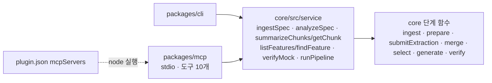
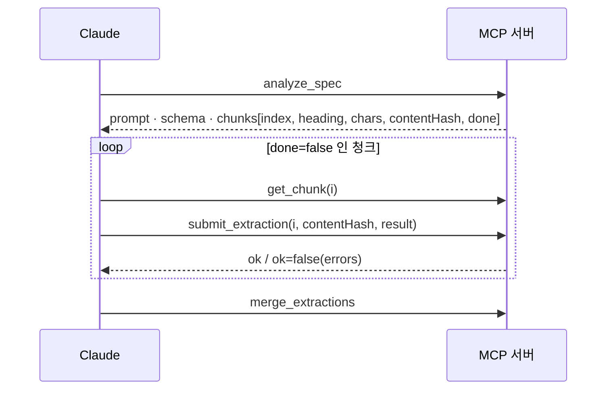

# Phase 2A: 공용 서비스 층 + MCP 서버 구현 계획

> **For agentic workers:** REQUIRED SUB-SKILL: Use superpowers:subagent-driven-development (recommended) or superpowers:executing-plans to implement this plan task-by-task. Steps use checkbox (`- [ ]`) syntax for tracking.

**Goal:** CLI 안에 흩어진 흐름 조립 코드를 `packages/core/src/service/`로 모으고, 그 위에 stdio MCP 서버(`packages/mcp`)를 얹는다. Claude Code는 셸 명령 없이 도구 10개만으로 스펙 → 기능 목록 → 선택 → mock 생성 → 검증을 끝낸다. 비구조 문서는 대화 중인 Claude가 청크를 하나씩 받아 추출하고 `submit_extraction`으로 제출한다.

**Architecture:** 서비스 함수는 결과 객체만 돌려준다. 텍스트 출력·힌트 문구·종료 코드는 호출자(CLI, MCP)가 정한다. 진행 상황은 `onEvent({ stage, message, done?, total? })` 하나로 흘린다. 새 core 함수 `submitExtraction`은 해시로 청크 일치를 확인하고, 엄격 검증한 뒤 원자적으로 쓰고 manifest를 기록한다. 기존 `extract()`도 청크마다 이 함수를 쓴다. MCP 서버는 실행 디렉터리(또는 `--root`)를 프로젝트 루트로 삼는다. 상태는 `<루트>/.specmock/`, mock은 `<루트>/mock/`이다. 플러그인 `plugin.json`의 `mcpServers`가 `node`로 빌드 산출물을 실행한다.

**Tech Stack:** 1B 스택에 다음을 더한다.
- `@modelcontextprotocol/server` 2.4.0 (zod ^4.2 peer. 2026-10-23 배포라 release-age 1440분 제한에 걸리지 않음)
- 테스트 전용 `@modelcontextprotocol/client` 2.4.0
- zod 4 (core와 같은 ^4.6.7)

**사전 확인된 사실 (2026-11-05, 이 기기, Claude Code 2.1.318 / Node 26.10.0):**

플러그인 매니페스트:
- 다음 `mcpServers`가 들어간 `plugin.json`은 `claude plugin validate`를 통과한다(exit 0, 경고는 아이콘 없음뿐).

  ```json
  "mcpServers": { "specmock": { "command": "node", "args": ["${CLAUDE_PLUGIN_ROOT}/../packages/mcp/dist/server.js"] } }
  ```
- 모양이 틀리면(`command: 42`) `mcpServers: Invalid input`으로 exit 1.

실제 로드:
- 확인 방법: 프로젝트 디렉터리에서 `claude --plugin-dir <plugin> mcp list` (헬스 체크로 서버를 실제로 띄운다).
- 표시 이름은 `plugin:specmock:specmock`이다.
- `${CLAUDE_PLUGIN_ROOT}`가 플러그인 디렉터리 절대 경로로 치환되고, 플러그인 밖 상대 경로(`../packages/...`)도 그대로 실행된다.

서버 프로세스 환경 (프로브 스크립트로 확인):
- `process.cwd()`는 **`claude`를 실행한 프로젝트 디렉터리**다.
- env `CLAUDE_PLUGIN_ROOT`는 플러그인 디렉터리, env `CLAUDE_PROJECT_DIR`는 프로젝트 디렉터리다.
- 따라서 루트 기본값은 cwd로 충분하고, `--root`는 대비책으로만 둔다.

MCP SDK 2.4.0 (tarball 소스로 확인):
- 서버 생성: `new McpServer({ name, version })`.
- 도구 등록: `server.registerTool(name, { title, description, inputSchema: z.object(...), outputSchema }, cb)`.
- 전송: `@modelcontextprotocol/server/stdio`의 `StdioServerTransport`.
- 오류 처리:
  - 핸들러가 던진 예외와 입력 검증 실패는 `{ isError: true, content:[{type:"text"}] }`로 바뀌므로 서버가 죽지 않는다.
  - `isError` 응답은 출력 스키마 검증을 건너뛴다.
  - `outputSchema`가 있는데 `structuredContent`가 없으면 오류다.
- 클라이언트 쪽 API:
  - `@modelcontextprotocol/client`에 `Client`, `client.listTools()`, `client.callTool({ name, arguments })`가 있다.
  - `@modelcontextprotocol/client/stdio`에 `StdioClientTransport({ command, args, cwd, stderr: "pipe" })`가 있다.

검증 대상 파일:
- `examples/docs-sample/pets-api.md`는 954자라 기본 청크 설정에서 청크 1개다.
- 녹음된 `examples/docs-sample/extracted/000.json`은 `ExtractionResultSchema`를 통과한다(엔드포인트 4개).
- 엔드포인트 키는 모두 스키마에 있는 키라 엄격(알 수 없는 키 거부) 검증도 통과한다.

core 자식 프로세스:
- `npm install`, mock 서버, harvest, claude가 모두 `stdio: pipe/ignore`다.
- 따라서 MCP 서버의 stdout(프로토콜)을 오염시키지 않는다.

**설계 문서 대비 결정 사항 (이 계획에서 확정):**
- **루트 결정 순서: `--root <dir>` → `process.cwd()`.** 서버는 시작할 때 `process.chdir(root)` 한다. `defaultMockDir`(`path.resolve("mock", system)`), `generate`의 상대 `outDir`, `ingest`의 상대 파일 경로가 모두 cwd 기준이기 때문이다. `CLAUDE_PROJECT_DIR`은 쓰지 않는다. cwd가 이미 같은 값이고, 환경변수 의존을 하나 줄인다.
- **엄격 검증의 범위:**
  - `submitExtraction`은 최상위와 엔드포인트 객체의 **알 수 없는 키를 거부**하고, 타입·필수 필드도 검증한다.
  - 하위(파라미터·응답) 객체는 기존 스키마 그대로다.
  - `extract()`(claude-code 경로)는 `lenient: true`로 호출해 지금처럼 알 수 없는 키를 버린다. 기존 동작(CLI 불변)을 지키기 위해서다.
  - 오류 메시지는 지금과 같은 `출력이 스키마와 맞지 않습니다: <경로> <이유>`다.
- **`submitExtraction(ws, system, input, opts?)`에 4번째 인자 `{ request?, manifest?, lenient? }`를 둔다.** `extract()`가 루프 안에서 analyze-request와 manifest를 매번 다시 읽지 않고 메모리의 manifest를 공유하게 하려는 것이다. 공개 시그니처의 앞 세 인자는 설계 그대로다.
- **`analyze_spec`의 `chunks[].done`:** `extracted/NNN.json`이 있고 manifest의 해시가 지금 청크의 `contentHash`와 같을 때만 true. 세션 모드에서 손으로 쓴 파일(manifest 없음)은 false로 보여 다시 제출하게 한다. 설계 §2.2의 "manifest 구멍"을 MCP 쪽에서 막는 규칙이다.
- **catalog 모드 결과의 `features`는 개수(number)다.** 전체 목록은 `list_features`가 맡는다. 같은 데이터를 두 도구가 크게 돌려주지 않게 하기 위해서다.
- **도구 응답 텍스트에 JSON을 함께 싣는다.** `content[0].text`는 "요약 줄 + 빈 줄 + `structuredContent`의 JSON"이다. Claude Code가 모델에 `structuredContent`를 넘기는지 텍스트를 넘기는지 이 기기에서 확인하지 못했기 때문에 둘 다 싣는다. `list_features`는 요약 대신 설계 4.1의 표를 싣는다.
- **오류 힌트 바꿔 쓰기:** core와 서비스의 오류 메시지는 CLI 명령을 안내한다(예: ``먼저 `specmock analyze x`를 실행하세요``). MCP가 이것을 도구 이름으로 바꿔 쓴다. 예: ``먼저 `specmock analyze x` `` → ``먼저 `analyze_spec` ``, `--dir 로` → `dir 인자로`. 메시지를 core에서 두 벌 만들지 않기 위해서다.
- **`run` 서비스의 단계 콜백:** `runPipeline`은 `onStage`로 카탈로그·선택·생성·검증 결과를 단계마다 넘긴다. 그래야 CLI가 지금과 같은 순서와 시점에 stdout을 쓴다(중간 단계 실패 시에도 앞 단계 출력이 남는다).
- **MCP 쪽 플러그인 검사의 위치:** 플러그인 테스트 중 MCP 관련 부분(mcpServers 경로, 도구 이름 일치)은 `packages/mcp/test/plugin.test.ts`에 둔다. 도구 목록을 얻으려면 SDK 클라이언트로 서버를 띄워야 하는데, 그 devDependency가 mcp 패키지에만 있다. 기존 `packages/cli/test/plugin.test.ts`는 그대로 두고 CLI 흐름 검사를 계속 맡긴다(스킬에 CLI 대비 흐름이 남는다).
- **스킬 문서의 도구 표기는 짧은 이름(`ingest_spec`)이다.** 플러그인이 제공하는 MCP 서버는 Claude Code에서 `plugin:specmock:specmock`으로 등록된다(위 사실). 그래서 전체 도구 이름이 설계에 적힌 `mcp__specmock__*`가 아닐 수 있다(예상: `mcp__plugin_specmock_specmock__*`, 미확인). 스킬은 "이름이 `ingest_spec` 등으로 끝나는 specmock 도구"로 안내한다. 실제 이름은 수동 확인 1에서 기록한다.
- **Task 순서:** 과제 제안의 7개를 유지하되 Task 1의 `ping` 도구를 Task 4에서 지운다. 서버는 도구가 하나는 있어야 `tools` capability를 알리고 `listTools` 테스트가 의미가 있기 때문이다.
- **루트 `test` 스크립트:** `pnpm build:core && vitest run`을 `pnpm build:mcp && vitest run`으로 바꾼다. `build:mcp` = `pnpm --filter "@specmock/mcp..." build`이고, mcp와 그 의존인 core를 순서대로 빌드한다. MCP 통합 테스트가 빌드된 `dist/server.js`를 띄우기 때문이다.

**지켜야 할 제약 (모든 Task 공통):**
- 제품 코드·플러그인·스킬·README·커밋되는 설정에 harness 흔적을 남기지 않는다(사용자에게는 harness가 없다).
- CLI의 출력 문구, `--json` 모양, 종료 코드를 바꾸지 않는다. 증거는 `packages/cli/test/cli.test.ts`를 **수정 없이** 통과시키는 것이다.
- MCP 서버는 stdout에 프로토콜 외에는 아무것도 쓰지 않는다. 로그는 전부 stderr.
- 테스트의 가짜 비밀값은 런타임에 조립한다. 예: `"sk_" + "live_" + "x".repeat(24)`. GitHub push protection 때문이다.
- `.specmock/`, `mock/`, `.harness/`는 커밋하지 않는다.
- 실제 LLM 호출 테스트를 만들지 않는다.
- 새 의존성의 최신판이 pnpm release-age(1440분)에 막히면 그 직전 버전으로 고정한다. 확인 명령: `pnpm view <pkg> time --json`.

**이 계획에 없는 것:** Web UI(2B), MCP HTTP 전송, npm 배포, `run` 도구, MCP 체크박스 선택, 수동 수확 결과 제출 도구.

---

## 파일 구조

| 파일 | 상태 | 책임 |
|---|---|---|
| `package.json` (루트) | 수정 | `build:mcp` 추가, `test`가 mcp까지 빌드 |
| `packages/mcp/package.json` | 생성 | `@specmock/mcp` (private), SDK 의존, build/typecheck/test 스크립트 |
| `packages/mcp/tsconfig.json`, `tsconfig.test.json` | 생성 | 다른 패키지와 같은 설정 |
| `packages/mcp/src/root.ts` | 생성 | `--root` 인자 / cwd로 프로젝트 루트 결정 |
| `packages/mcp/src/server.ts` | 생성 | 진입점: 루트 결정 → chdir → stdio 연결 → stderr 로그 |
| `packages/mcp/src/createServer.ts` | 생성 | `McpServer` 생성과 도구 등록 묶음 |
| `packages/mcp/src/names.ts` | 생성 | `TOOL_NAMES` (도구 이름 단일 출처) |
| `packages/mcp/src/result.ts` | 생성 | `ok`/`toolError`/`guard`, CLI 힌트 → 도구 이름 바꿔 쓰기 |
| `packages/mcp/src/tools/analysis.ts` | 생성 | ingest_spec, analyze_spec, get_chunk, submit_extraction, merge_extractions |
| `packages/mcp/src/tools/mock.ts` | 생성 | list_features, show_feature, select_features, generate_mock, verify_mock |
| `packages/mcp/test/helpers.ts` | 생성 | 빌드된 서버를 자식 프로세스로 띄우는 SDK 클라이언트 헬퍼 |
| `packages/mcp/test/server.test.ts` | 생성 | 기동·루트·stdout 순수성 |
| `packages/mcp/test/result.test.ts` | 생성 | 힌트 바꿔 쓰기 단위 테스트 |
| `packages/mcp/test/tools.test.ts` | 생성 | OpenAPI·문서 두 경로 통합, 오류 응답 |
| `packages/mcp/test/plugin.test.ts` | 생성 | mcpServers 경로 = 빌드 산출물, 스킬 문서 도구 이름 = 등록 이름 |
| `packages/core/src/analyze/submit.ts` | 생성 | `submitExtraction` |
| `packages/core/src/analyze/extract.ts` | 수정 | 청크마다 `submitExtraction(lenient)` 사용 |
| `packages/core/src/service/events.ts` | 생성 | `ServiceEvent`, `OnEvent` |
| `packages/core/src/service/ingest.ts` | 생성 | `ingestSpec` (ingest + 수확 정보 결합) |
| `packages/core/src/service/analyze.ts` | 생성 | `analyzeSpec`, `runLlmExtraction`, `clearExtracted` |
| `packages/core/src/service/chunks.ts` | 생성 | `summarizeChunks`(done 판정), `getChunk` |
| `packages/core/src/service/features.ts` | 생성 | `findFeature`, `listFeatures` |
| `packages/core/src/service/verify.ts` | 생성 | `resolveMockDir`, `verifyMock`(coverage.md 쓰기) |
| `packages/core/src/service/run.ts` | 생성 | `runPipeline` (+ "전부 실패" 판정, `onStage`) |
| `packages/core/src/service/index.ts` | 생성 | 서비스 재수출 |
| `packages/core/src/index.ts` | 수정 | `submitExtraction`, 서비스 수출 |
| `packages/core/test/submit.test.ts` | 생성 | submitExtraction 6종 |
| `packages/core/test/service.test.ts` | 생성 | 서비스 단위 테스트 |
| `packages/cli/src/commands/{ingest,analyze,show,verify,run}.ts` | 수정 | 서비스 호출로 교체 (문구 불변) |
| `packages/cli/src/llmFlow.ts` | 삭제 | `service/analyze.ts`의 `runLlmExtraction`으로 이동 |
| `plugin/.claude-plugin/plugin.json` | 수정 | `mcpServers` |
| `plugin/skills/specmock/SKILL.md` | 수정 | MCP 우선 흐름 + CLI 대비 흐름 |
| `plugin/skills/specmock/references/extraction.md` | 수정 | 도구 제출 절차 한 절 추가 |
| `plugin/README.md` | 수정 | MCP 구성, 빌드 필요 안내 |
| `README.md` | 수정 | "Claude Code에서 MCP로 쓰기" 절, 로드맵 |
| `docs/architecture.md` | 수정 | 서비스 층·MCP 구조도, 문서 추출 시퀀스 |
| `docs/superpowers/specs/2026-11-04-specmock-design.md` | 수정 | §1.2 사용자 환경, §10 도구 목록, §12 2A 행 |

---

### Task 1: 스파이크 + `packages/mcp` 뼈대 + 플러그인 등록

**Files:**
- Create: `packages/mcp/package.json`, `packages/mcp/tsconfig.json`, `packages/mcp/tsconfig.test.json`
- Create: `packages/mcp/src/root.ts`, `packages/mcp/src/createServer.ts`, `packages/mcp/src/server.ts`
- Create: `packages/mcp/test/helpers.ts`
- Test: `packages/mcp/test/server.test.ts`
- Modify: `package.json` (루트), `plugin/.claude-plugin/plugin.json`

- [ ] **Step 1: 의존성 버전 확인**

```bash
pnpm view @modelcontextprotocol/server time --json | tail -5
pnpm view @modelcontextprotocol/client time --json | tail -5
```

Expected: 최신 `2.4.0`이 `2026-10-23...`. 지금보다 24시간 이상 전이면 `^2.4.0`을 쓴다. 더 새 판이 24시간 안에 나왔으면 그 직전 판을 정확히 고정한다(예: `2.4.0`).

- [ ] **Step 2: 패키지 파일**

`packages/mcp/package.json`:

```json
{
  "name": "@specmock/mcp",
  "version": "0.1.0",
  "private": true,
  "type": "module",
  "bin": { "specmock-mcp": "./dist/server.js" },
  "files": ["dist"],
  "scripts": {
    "build": "tsc -p tsconfig.json",
    "typecheck": "tsc -p tsconfig.json --noEmit && tsc -p tsconfig.test.json",
    "test": "vitest run --root ../.. packages/mcp"
  },
  "dependencies": {
    "@modelcontextprotocol/server": "^2.4.0",
    "@specmock/core": "workspace:*",
    "zod": "^4.6.7"
  },
  "devDependencies": {
    "@modelcontextprotocol/client": "^2.4.0"
  }
}
```

`packages/mcp/tsconfig.json`:

```json
{
  "extends": "../../tsconfig.base.json",
  "compilerOptions": { "rootDir": "src", "outDir": "dist", "types": ["node"] },
  "include": ["src"]
}
```

`"types": ["node"]`는 SDK README의 안내(TS에서 node 타입 명시)를 따른 것이다. `packages/mcp/tsconfig.test.json`:

```json
{
  "extends": "./tsconfig.json",
  "compilerOptions": { "rootDir": ".", "noEmit": true, "types": ["node"] },
  "include": ["src", "test"]
}
```

루트 `package.json`의 `scripts`에서 두 줄을 바꾼다:

```json
    "build:mcp": "pnpm --filter \"@specmock/mcp...\" build",
    "test": "pnpm build:mcp && vitest run",
```

(`build:core`, `typecheck`, `specmock`, `llm:check`는 그대로.)

```bash
pnpm install
```

Expected: `packages/mcp/node_modules/@modelcontextprotocol/server`가 생긴다. release-age 오류가 나면 Step 1에 따라 버전을 고정하고 다시 실행한다.

- [ ] **Step 3: 실패하는 테스트**

`packages/mcp/test/helpers.ts`:

```ts
import { Client } from "@modelcontextprotocol/client";
import { StdioClientTransport } from "@modelcontextprotocol/client/stdio";
import path from "node:path";
import { fileURLToPath } from "node:url";
import { expect } from "vitest";

const here = path.dirname(fileURLToPath(import.meta.url));
export const REPO = path.resolve(here, "..", "..", "..");
export const SERVER = path.join(REPO, "packages", "mcp", "dist", "server.js");
export const PLUGIN = path.join(REPO, "plugin");
export const PETSTORE = path.join(REPO, "packages", "core", "test", "fixtures", "petstore.yaml");
export const DOCS_SAMPLE = path.join(REPO, "examples", "docs-sample");
/** 루트 node_modules. 생성된 mock에 심볼릭 링크하여 설치 없이 기동할 때 쓴다(core e2e와 같은 방식). */
export const ROOT_NODE_MODULES = path.join(REPO, "node_modules");

type Json = Record<string, any>; // eslint-disable-line @typescript-eslint/no-explicit-any

export interface Session {
  client: Client;
  stderr: () => string;
  /** 도구를 호출하고 isError가 아님을 확인한 뒤 structuredContent를 돌려준다. */
  ok: (name: string, args?: Json) => Promise<Json>;
  /** 도구를 호출하고 isError임을 확인한 뒤 텍스트를 돌려준다. */
  err: (name: string, args?: Json) => Promise<string>;
  close: () => Promise<void>;
}

export async function connect(cwd: string, args: string[] = []): Promise<Session> {
  const transport = new StdioClientTransport({ command: process.execPath, args: [SERVER, ...args], cwd, stderr: "pipe" });
  const client = new Client({ name: "specmock-test", version: "0.0.0" });
  await client.connect(transport);
  let log = "";
  transport.stderr?.on("data", (b: Buffer) => { log += b.toString("utf8"); });
  const text = (r: Json) => (r.content as { type: string; text?: string }[]).map((c) => c.text ?? "").join("\n");
  return {
    client,
    stderr: () => log,
    ok: async (name, a = {}) => {
      const r = (await client.callTool({ name, arguments: a })) as Json;
      expect(r.isError, `${name} 오류: ${text(r)}`).toBeFalsy();
      return r.structuredContent as Json;
    },
    err: async (name, a = {}) => {
      const r = (await client.callTool({ name, arguments: a })) as Json;
      expect(r.isError, `${name}이 오류를 내야 함: ${text(r)}`).toBe(true);
      return text(r);
    },
    close: () => client.close(),
  };
}
```

`packages/mcp/test/server.test.ts`:

```ts
import { mkdir, mkdtemp, realpath, rm } from "node:fs/promises";
import os from "node:os";
import path from "node:path";
import { afterEach, beforeEach, describe, expect, it } from "vitest";
import { resolveRoot } from "../src/root.js";
import { connect } from "./helpers.js";

let dir: string;
beforeEach(async () => { dir = await realpath(await mkdtemp(path.join(os.tmpdir(), "specmock-mcp-"))); });
afterEach(async () => { await rm(dir, { recursive: true, force: true }); });

describe("resolveRoot", () => {
  it("defaults to cwd and honours --root", () => {
    expect(resolveRoot([], "/a/b")).toBe("/a/b");
    expect(resolveRoot(["--root", "c"], "/a/b")).toBe("/a/b/c");
    expect(resolveRoot(["--root", "/x"], "/a/b")).toBe("/x");
  });
  it("rejects --root without a value", () => {
    expect(() => resolveRoot(["--root"], "/a")).toThrow(/--root/);
    expect(() => resolveRoot(["--root", "--other"], "/a")).toThrow(/--root/);
  });
});

describe("mcp server process", () => {
  it("starts over stdio, lists tools and logs its root to stderr only", async () => {
    const s = await connect(dir);
    try {
      const { tools } = await s.client.listTools();
      expect(tools.length).toBeGreaterThan(0);
      // stdout이 프로토콜 외 출력으로 오염됐다면 connect/listTools가 실패했을 것이다.
      await expect.poll(() => s.stderr()).toContain(`root=${dir}`);
    } finally { await s.close(); }
  });

  it("uses --root instead of cwd when given", async () => {
    const other = path.join(dir, "proj");
    await mkdir(other);
    const s = await connect(dir, ["--root", other]);
    try {
      await expect.poll(() => s.stderr()).toContain(`root=${other}`);
    } finally { await s.close(); }
  });
});
```

- [ ] **Step 4: 실패 확인**

```bash
pnpm build:core && pnpm vitest run packages/mcp/test/server.test.ts
```

Expected: FAIL. `Cannot find module '../src/root.js'`(또는 `dist/server.js` 없음으로 connect 실패).

- [ ] **Step 5: 최소 구현**

`packages/mcp/src/root.ts`:

```ts
import path from "node:path";

/**
 * MCP 서버의 프로젝트 루트. `--root <dir>`가 있으면 그것(cwd 기준 상대 경로 허용), 없으면 cwd.
 * Claude Code는 플러그인 MCP 서버를 프로젝트 디렉터리에서 띄우므로 보통 인자가 필요 없다.
 */
export function resolveRoot(argv: string[], cwd: string = process.cwd()): string {
  const i = argv.indexOf("--root");
  if (i === -1) return cwd;
  const value = argv[i + 1];
  if (value === undefined || value.startsWith("--")) throw new Error("--root 다음에 디렉터리를 주세요.");
  return path.resolve(cwd, value);
}
```

`packages/mcp/src/createServer.ts` (Task 1 임시 판. Task 4에서 `ping`을 실제 도구로 바꾼다):

```ts
import { McpServer } from "@modelcontextprotocol/server";
import { VERSION } from "@specmock/core";

export function createServer(_root: string): McpServer {
  const server = new McpServer({ name: "specmock", version: VERSION });
  server.registerTool(
    "ping",
    { title: "ping", description: "서버가 살아 있는지 확인한다 (임시 도구, Task 4에서 제거)" },
    async () => ({ content: [{ type: "text" as const, text: "pong" }] }),
  );
  return server;
}
```

`packages/mcp/src/server.ts`:

```ts
#!/usr/bin/env node
import { StdioServerTransport } from "@modelcontextprotocol/server/stdio";
import { createServer } from "./createServer.js";
import { resolveRoot } from "./root.js";

// stdout은 MCP 프로토콜 전용이다. 사람이 읽을 로그는 전부 stderr로 보낸다.
try {
  const root = resolveRoot(process.argv.slice(2));
  // mock 기본 경로(./mock/<system>), 상대 outDir, 상대 입력 파일이 모두 cwd 기준이라 루트로 옮긴다.
  process.chdir(root);
  process.stderr.write(`specmock mcp: root=${root}\n`);
  await createServer(root).connect(new StdioServerTransport());
} catch (e) {
  process.stderr.write(`specmock mcp 시작 실패: ${(e as Error).message}\n`);
  process.exit(1);
}
```

- [ ] **Step 6: 통과 확인**

```bash
pnpm build:mcp && pnpm vitest run packages/mcp/test/server.test.ts && pnpm --filter @specmock/mcp typecheck
```

Expected: 4 passed, typecheck 오류 없음.

SDK 타입 선언이 TS 5.9에서 오류를 내면 `packages/mcp/tsconfig.json`의 `compilerOptions`에 `"skipLibCheck": true`를 넣는다. 다른 패키지에는 넣지 않는다. 이 경우 실행 기록에 남긴다.

- [ ] **Step 7: 플러그인에 MCP 서버 등록**

`plugin/.claude-plugin/plugin.json`의 `keywords` 뒤에 다음을 추가한다(쉼표 주의):

```json
  "mcpServers": {
    "specmock": {
      "command": "node",
      "args": ["${CLAUDE_PLUGIN_ROOT}/../packages/mcp/dist/server.js"]
    }
  }
```

```bash
claude plugin validate plugin
```

Expected: exit 0. 출력에 `mcpServers` 오류가 없다. 아이콘 경고는 무시해도 된다.

- [ ] **Step 8: 실제 로드 확인 (수동, 실행 기록에 남김)**

```bash
T=$(mktemp -d) && cd "$T" && claude --plugin-dir <저장소>/plugin mcp list; cd -
```

Expected: `plugin:specmock:specmock: node <저장소>/plugin/../packages/mcp/dist/server.js - ✔ Connected`.

이어서 `.specmock`이 없는 그 디렉터리에서 `claude --plugin-dir <저장소>/plugin`을 실행하고 `/mcp`로 서버를 연다. 서버 stderr 로그(`claude --debug` 또는 `/mcp`의 로그 보기)에 `specmock mcp: root=<T의 실제 경로>`가 보이면 (b) "cwd = 프로젝트 디렉터리"가 확인된 것이다. 아니면 `args`에 `"--root", "${CLAUDE_PROJECT_DIR}"`를 추가하고 다시 확인한다(치환 여부도 함께 기록).

- [ ] **Step 9: 커밋**

```bash
git add package.json pnpm-lock.yaml packages/mcp plugin/.claude-plugin/plugin.json
git commit -m "$(cat <<'EOF'
feat: MCP 서버 패키지 뼈대와 플러그인 등록

- packages/mcp(@specmock/mcp, private): stdio 서버, --root 인자, stderr 전용 로그
- plugin.json mcpServers에서 빌드 산출물 실행
- 루트 test가 mcp까지 빌드

Co-Authored-By: Claude Opus 5.5 <noreply@anthropic.com>
EOF
)"
```

---

### Task 2: `submitExtraction` + `extract()` 리팩터

**Files:**
- Create: `packages/core/src/analyze/submit.ts`
- Modify: `packages/core/src/analyze/extract.ts`, `packages/core/src/index.ts`
- Test: `packages/core/test/submit.test.ts` (기존 `packages/core/test/extract.test.ts`는 수정하지 않는다)

- [ ] **Step 1: 실패하는 테스트** — `packages/core/test/submit.test.ts`

```ts
import { mkdtemp, readdir, readFile, rm, writeFile } from "node:fs/promises";
import os from "node:os";
import path from "node:path";
import { fileURLToPath } from "node:url";
import { afterEach, beforeEach, describe, expect, it, vi } from "vitest";
import { prepare } from "../src/analyze/prepare.js";
import { submitExtraction } from "../src/analyze/submit.js";
import { ingest } from "../src/ingest/index.js";
import type { AnalyzeRequest } from "../src/types.js";
import { Workspace } from "../src/workspace.js";

const here = path.dirname(fileURLToPath(import.meta.url));
const PETS_MD = path.join(here, "fixtures", "docs", "pets.md");
const ENDPOINT = {
  method: "GET", path: "/pets/{petId}", title: "Get a pet",
  responses: [{ status: 200, example: { id: 1 } }],
  evidence: ["`GET /pets/{petId}` returns one pet."], confidence: 0.9,
};

let dir: string; let ws: Workspace; let req: AnalyzeRequest;
beforeEach(async () => {
  dir = await mkdtemp(path.join(os.tmpdir(), "specmock-submit-")); ws = new Workspace(dir);
  await ingest(ws, "pets", [PETS_MD]);
  req = await prepare(ws, "pets", { maxChars: 400, overlap: 50 });
});
afterEach(async () => { vi.restoreAllMocks(); await rm(dir, { recursive: true, force: true }); });

const extracted = (name: string) => path.join(dir, "pets", "extracted", name);

describe("submitExtraction", () => {
  it("writes extracted/NNN.json and records the chunk hash in the manifest", async () => {
    const c = req.chunks[1]!;
    const r = await submitExtraction(ws, "pets", { index: c.index, contentHash: c.contentHash!, result: { endpoints: [ENDPOINT] } });
    expect(r).toEqual({ ok: true, file: extracted("001.json") });
    const saved = JSON.parse(await readFile(extracted("001.json"), "utf8"));
    expect(saved.endpoints[0]).toMatchObject({ method: "GET", path: "/pets/{petId}", summary: "", auth: "unknown" }); // 기본값 채움
    expect(JSON.parse(await readFile(extracted("manifest.json"), "utf8"))).toEqual({ "001": c.contentHash });
  });

  it("keeps existing manifest entries for other chunks", async () => {
    const [a, b] = [req.chunks[0]!, req.chunks[1]!];
    await submitExtraction(ws, "pets", { index: a.index, contentHash: a.contentHash!, result: { endpoints: [] } });
    await submitExtraction(ws, "pets", { index: b.index, contentHash: b.contentHash!, result: { endpoints: [] } });
    expect(JSON.parse(await readFile(extracted("manifest.json"), "utf8"))).toEqual({ "000": a.contentHash, "001": b.contentHash });
  });

  it("rejects schema errors with paths and reasons and writes nothing", async () => {
    const c = req.chunks[0]!;
    const r = await submitExtraction(ws, "pets", { index: c.index, contentHash: c.contentHash!, result: { endpoints: [{ ...ENDPOINT, method: "FETCH", confidence: 2 }] } });
    expect(r.ok).toBe(false);
    if (r.ok) return;
    expect(r.reason).toBe("invalid");
    const paths = r.errors!.map((e) => e.path);
    expect(paths).toContain("endpoints.0.method");
    expect(paths).toContain("endpoints.0.confidence");
    expect(r.errors!.every((e) => e.message.length > 0)).toBe(true);
    expect(await readdir(path.join(dir, "pets", "extracted"))).toEqual([]);
  });

  it("rejects unknown keys on the result and on endpoints (strict)", async () => {
    const c = req.chunks[0]!;
    const r = await submitExtraction(ws, "pets", { index: c.index, contentHash: c.contentHash!, result: { endpoints: [{ ...ENDPOINT, respones: [] }], extra: 1 } });
    expect(r.ok).toBe(false);
    if (r.ok) return;
    expect(r.reason).toBe("invalid");
    expect(r.errors!.map((e) => e.message).join(" ")).toMatch(/respones|extra/);
  });

  it("accepts unknown keys when lenient (extract path)", async () => {
    const c = req.chunks[0]!;
    const r = await submitExtraction(ws, "pets", { index: c.index, contentHash: c.contentHash!, result: { endpoints: [{ ...ENDPOINT, respones: [] }] } }, { lenient: true });
    expect(r.ok).toBe(true);
    expect(JSON.parse(await readFile(extracted("000.json"), "utf8")).endpoints[0]).not.toHaveProperty("respones");
  });

  it("rejects a stale contentHash", async () => {
    const c = req.chunks[0]!;
    const r = await submitExtraction(ws, "pets", { index: c.index, contentHash: "0".repeat(64), result: { endpoints: [] } });
    expect(r).toMatchObject({ ok: false, reason: "stale-chunk" });
    expect(await readdir(path.join(dir, "pets", "extracted"))).toEqual([]);
  });

  it("rejects an unknown chunk index", async () => {
    const r = await submitExtraction(ws, "pets", { index: 999, contentHash: "x", result: { endpoints: [] } });
    expect(r).toMatchObject({ ok: false, reason: "unknown-chunk" });
  });

  it("writes atomically: a failed rename leaves no partial file and no manifest entry", async () => {
    const c = req.chunks[0]!;
    await writeFile(extracted("000.json"), JSON.stringify({ endpoints: [] }) + "\n");
    const fsp = await import("node:fs/promises");
    vi.spyOn(fsp, "rename").mockRejectedValueOnce(new Error("disk full"));
    await expect(submitExtraction(ws, "pets", { index: c.index, contentHash: c.contentHash!, result: { endpoints: [ENDPOINT] } })).rejects.toThrow(/disk full/);
    expect(JSON.parse(await readFile(extracted("000.json"), "utf8"))).toEqual({ endpoints: [] }); // 이전 내용 그대로
    const names = await readdir(path.join(dir, "pets", "extracted"));
    expect(names.some((n) => n.endsWith(".tmp"))).toBe(false);
    expect(names).not.toContain("manifest.json");
  });
});
```

마지막 테스트의 `vi.spyOn(fsp, "rename")`는 ESM 네임스페이스라 막힐 수 있다(`Cannot redefine property`). 그러면 이 테스트만 다음으로 바꾼다:
- 대상 경로 `extracted/000.json`에 같은 이름의 **디렉터리**를 미리 만든다(`mkdir(extracted("000.json"))`). 그러면 rename이 `EISDIR`/`ENOTEMPTY`로 실패한다(디렉터리 안에 파일 하나를 넣어 둔다).
- 검증할 것은 같다: 그 디렉터리가 그대로 남고, `.tmp`가 없고, manifest가 없다.

- [ ] **Step 2: 실패 확인**

```bash
pnpm vitest run packages/core/test/submit.test.ts
```

Expected: FAIL. `Cannot find module '../src/analyze/submit.js'`.

- [ ] **Step 3: 구현** — `packages/core/src/analyze/submit.ts`

```ts
import { mkdir, readFile } from "node:fs/promises";
import path from "node:path";
import { z } from "zod";
import { AnalyzeRequestSchema, ExtractedEndpointSchema, ExtractionResultSchema, type AnalyzeRequest } from "../types.js";
import type { Workspace } from "../workspace.js";
import { EXTRACTED_DIR, extractedFileName, hashText, readManifest, writeFileAtomic, writeManifest, type ExtractManifest } from "./prepare.js";

export interface SubmitExtractionInput {
  index: number;
  /** analyze-request.json의 청크 contentHash. 다르면 그 사이 문서가 다시 분석된 것이다. */
  contentHash: string;
  result: unknown;
}

export interface SubmitError { path: string; message: string }

export type SubmitExtractionResult =
  | { ok: true; file: string }
  | { ok: false; reason: "stale-chunk" | "unknown-chunk" | "invalid"; errors?: SubmitError[] };

export interface SubmitExtractionOptions {
  /** 이미 읽은 analyze-request.json (extract 루프용). */
  request?: AnalyzeRequest;
  /** 메모리의 manifest를 갱신해 그대로 쓴다 (extract 루프용). 없으면 디스크에서 읽는다. */
  manifest?: ExtractManifest;
  /** true면 알 수 없는 키를 버린다(claude-code 어댑터 경로의 기존 동작). 기본은 거부. */
  lenient?: boolean;
}

/** 최상위와 엔드포인트의 알 수 없는 키를 거부한다. 오타(respones 등)를 제출 시점에 돌려주기 위해서다. */
const StrictExtractionSchema = z.strictObject({ endpoints: z.array(ExtractedEndpointSchema.strict()) });

/**
 * 청크 하나의 추출 결과를 검증해 extracted/NNN.json에 원자적으로 쓰고 manifest에 청크 해시를 기록한다.
 * 검증 실패는 예외가 아니라 `ok: false`로 돌려준다(제출자가 고쳐 다시 내는 흐름). 파일 쓰기 실패는 예외.
 */
export async function submitExtraction(
  ws: Workspace,
  system: string,
  input: SubmitExtractionInput,
  opts: SubmitExtractionOptions = {},
): Promise<SubmitExtractionResult> {
  const request = opts.request ?? (await ws.read(system, "analyze-request.json", AnalyzeRequestSchema));
  const chunk = request.chunks.find((c) => c.index === input.index);
  if (!chunk) {
    const range = request.chunks.length ? `0-${request.chunks.length - 1}` : "청크 없음";
    return { ok: false, reason: "unknown-chunk", errors: [{ path: "index", message: `청크 ${input.index}이(가) 없습니다 (${range})` }] };
  }
  // contentHash가 없는 오래된 analyze-request.json은 본문 해시로 비교한다.
  const actual = chunk.contentHash ?? hashText(await readFile(ws.file(system, chunk.file), "utf8"));
  if (input.contentHash !== actual) {
    return { ok: false, reason: "stale-chunk", errors: [{ path: "contentHash", message: "청크 내용이 바뀌었습니다. 청크 목록과 본문을 다시 읽고 추출하세요." }] };
  }
  const parsed = (opts.lenient ? ExtractionResultSchema : StrictExtractionSchema).safeParse(input.result);
  if (!parsed.success) {
    return {
      ok: false,
      reason: "invalid",
      errors: parsed.error.issues.map((i) => ({
        path: i.path.join("."),
        message: i.code === "unrecognized_keys" ? `${i.message}: ${i.keys.join(", ")}` : i.message,
      })),
    };
  }
  const rel = path.posix.join(EXTRACTED_DIR, extractedFileName(chunk.index));
  const file = ws.file(system, rel);
  await mkdir(path.dirname(file), { recursive: true });
  await writeFileAtomic(file, JSON.stringify({ endpoints: parsed.data.endpoints }, null, 2) + "\n");
  const manifest = opts.manifest ?? (await readManifest(ws, system));
  manifest[extractedFileName(chunk.index).replace(/\.json$/, "")] = actual;
  await writeManifest(ws, system, manifest);
  return { ok: true, file };
}
```

zod 4의 `unrecognized_keys` 이슈는 `keys: string[]`를 가진다. 타입 오류가 나면 `"keys" in i ? i.keys.join(", ") : ""`로 좁힌다.

- [ ] **Step 4: `extract()`가 `submitExtraction`을 쓰게 바꾼다** — `packages/core/src/analyze/extract.ts`

import 줄을 바꾼다:

```ts
import { access, mkdir, readFile, rm } from "node:fs/promises";
import path from "node:path";
import { AnalyzeRequestSchema } from "../types.js";
import type { LlmAdapter } from "../llm/adapter.js";
import type { Workspace } from "../workspace.js";
import { EXTRACTED_DIR, extractedFileName, hashText, pruneExtracted, readManifest } from "./prepare.js";
import { buildChunkPrompt } from "./prompt.js";
import { submitExtraction } from "./submit.js";
```

루프의 두 번째 `try` 블록을 다음으로 바꾼다(나머지는 그대로):

```ts
    try {
      const body = await load();
      const raw = await adapter.extract({ prompt: buildChunkPrompt(body), schema: request.schema });
      const r = await submitExtraction(
        ws, system,
        { index: chunk.index, contentHash: chunk.contentHash ?? hashText(body), result: raw },
        { request, manifest, lenient: true },
      );
      if (!r.ok) {
        const first = r.errors?.[0];
        throw new Error(`출력이 스키마와 맞지 않습니다: ${first?.path ?? ""} ${first?.message ?? r.reason}`);
      }
      result.written += 1; report("written");
    } catch (e) {
      fail(e);
    }
```

`writeFileAtomic`, `writeManifest`, `ExtractionResultSchema` import가 더는 쓰이지 않는지 확인한다(`verbatimModuleSyntax`와 `noUnusedLocals`가 켜져 있으면 지운다).

동작은 같다:
- 같은 `contentHash` 값을 넘기므로 stale 판정이 나지 않는다.
- 메모리의 manifest를 공유하므로 stale로 지운 키도 전과 같이 반영된다.
- 오류 메시지는 `/스키마/`를 포함한다.

`packages/core/src/index.ts`의 `extract` 수출 줄 아래에 추가:

```ts
export { submitExtraction, type SubmitExtractionInput, type SubmitExtractionResult, type SubmitExtractionOptions, type SubmitError } from "./analyze/submit.js";
```

- [ ] **Step 5: 통과 확인 (새 테스트 + 기존 extract 회귀)**

```bash
pnpm vitest run packages/core/test/submit.test.ts packages/core/test/extract.test.ts && pnpm --filter @specmock/core typecheck
```

Expected: submit 8 passed. extract.test.ts는 **수정 없이** 전부 통과(실패 기록 `[{ chunk: 1, error: "boom" }]`, `/스키마/` 메시지 포함). typecheck 오류 없음.

- [ ] **Step 6: 커밋**

```bash
git add packages/core/src/analyze/submit.ts packages/core/src/analyze/extract.ts packages/core/src/index.ts packages/core/test/submit.test.ts
git commit -m "$(cat <<'EOF'
feat: 청크 추출 결과 제출 함수 submitExtraction

- contentHash로 청크 일치 확인(stale-chunk), 없는 번호는 unknown-chunk
- 알 수 없는 키까지 거부하는 엄격 검증, 오류는 경로·이유 목록으로
- .tmp → rename 원자적 쓰기와 manifest 해시 기록
- extract()가 청크마다 이 함수를 쓰도록 변경(lenient, 동작 동일)

Co-Authored-By: Claude Opus 5.5 <noreply@anthropic.com>
EOF
)"
```

---

### Task 3: 서비스 층과 CLI 교체

**Files:**
- Create: `packages/core/src/service/events.ts`, `ingest.ts`, `analyze.ts`, `chunks.ts`, `features.ts`, `verify.ts`, `run.ts`, `index.ts`
- Modify: `packages/core/src/index.ts`
- Modify: `packages/cli/src/commands/ingest.ts`, `analyze.ts`, `show.ts`, `verify.ts`, `run.ts`
- Delete: `packages/cli/src/llmFlow.ts`
- Test: `packages/core/test/service.test.ts`. 회귀는 `packages/cli/test/cli.test.ts`(**수정 금지**).

- [ ] **Step 1: 실패하는 테스트** — `packages/core/test/service.test.ts`

```ts
import { mkdir, mkdtemp, readFile, rm, symlink, writeFile } from "node:fs/promises";
import os from "node:os";
import path from "node:path";
import { fileURLToPath } from "node:url";
import { afterEach, beforeEach, describe, expect, it } from "vitest";
import type { LlmAdapter } from "../src/llm/adapter.js";
import { analyzeSpec, clearExtracted } from "../src/service/analyze.js";
import { getChunk, summarizeChunks } from "../src/service/chunks.js";
import type { ServiceEvent } from "../src/service/events.js";
import { findFeature, listFeatures } from "../src/service/features.js";
import { ingestSpec } from "../src/service/ingest.js";
import { runPipeline } from "../src/service/run.js";
import { resolveMockDir, verifyMock } from "../src/service/verify.js";
import { submitExtraction } from "../src/analyze/submit.js";
import { generate } from "../src/generate/index.js";
import { select } from "../src/select/index.js";
import { Workspace } from "../src/workspace.js";
import { PETSTORE, ROOT_NODE_MODULES } from "./helpers.js";

const here = path.dirname(fileURLToPath(import.meta.url));
const PETS_MD = path.join(here, "fixtures", "docs", "pets.md");
const GET_PET = { method: "GET", path: "/pets/{petId}", title: "Get a pet", responses: [{ status: 200, example: { id: 1 } }], evidence: ["GET /pets/{petId}"], confidence: 0.9 };

let dir: string; let ws: Workspace; let events: ServiceEvent[];
const onEvent = (e: ServiceEvent) => { events.push(e); };
beforeEach(async () => {
  dir = await mkdtemp(path.join(os.tmpdir(), "specmock-svc-"));
  ws = new Workspace(path.join(dir, ".specmock")); events = [];
});
afterEach(async () => { await rm(dir, { recursive: true, force: true }); });

describe("ingestSpec", () => {
  it("returns per-input kind/chars/cached plus harvest info and forwards logs as events", async () => {
    const r = await ingestSpec(ws, "petstore", [PETSTORE], { onEvent });
    expect(r.system).toBe("petstore");
    expect(r.file).toBe(ws.file("petstore", "source.json"));
    expect(r.inputs).toEqual([expect.objectContaining({ kind: "openapi", origin: PETSTORE, cached: false, harvestCandidate: [], harvested: false })]);
    expect(events.every((e) => e.stage === "ingest")).toBe(true);
  });
});

describe("analyzeSpec", () => {
  it("openapi input → catalog via openapi", async () => {
    await ingestSpec(ws, "petstore", [PETSTORE]);
    const r = await analyzeSpec(ws, "petstore");
    expect(r).toMatchObject({ mode: "catalog", via: "openapi" });
  });

  it("document input, session → prepared (no extraction)", async () => {
    await ingestSpec(ws, "pets", [PETS_MD]);
    const r = await analyzeSpec(ws, "pets", { onEvent });
    expect(r.mode).toBe("prepared");
    if (r.mode !== "prepared") return;
    expect(r.request.chunks.length).toBeGreaterThan(0);
    expect(r.removed).toBeNull();
  });

  it("refresh clears extracted/ before prepare and reports the count as an event", async () => {
    await ingestSpec(ws, "pets", [PETS_MD]);
    await analyzeSpec(ws, "pets");
    await mkdir(ws.file("pets", "extracted"), { recursive: true });
    await writeFile(ws.file("pets", "extracted/000.json"), '{"endpoints":[]}');
    await writeFile(ws.file("pets", "extracted/manifest.json"), "{}");
    const r = await analyzeSpec(ws, "pets", { refresh: true, onEvent });
    expect(r).toMatchObject({ mode: "prepared", removed: 1 });
    expect(events.map((e) => e.message)).toContain("기존 추출 결과 1개를 지웠습니다");
  });

  it("step merge → catalog via merge, incomplete when chunks are missing", async () => {
    await ingestSpec(ws, "pets", [PETS_MD]);
    await analyzeSpec(ws, "pets");
    const r = await analyzeSpec(ws, "pets", { step: "merge" });
    expect(r).toMatchObject({ mode: "catalog", via: "merge", incomplete: true });
  });

  it("claude-code with an injected adapter → catalog via llm, with progress events", async () => {
    await ingestSpec(ws, "pets", [PETS_MD]);
    const adapter: LlmAdapter = { name: "claude-code", async extract() { return { endpoints: [] }; } };
    const r = await analyzeSpec(ws, "pets", { llm: "claude-code", adapter, onEvent });
    expect(r).toMatchObject({ mode: "catalog", via: "llm", incomplete: false });
    expect(events.some((e) => e.stage === "extract" && e.done !== undefined && e.total !== undefined)).toBe(true);
  });

  it("clearExtracted returns 0 when the directory does not exist", async () => {
    expect(await clearExtracted(ws, "nothing")).toBe(0);
  });
});

describe("chunks", () => {
  it("summarizeChunks marks done only when the manifest hash matches", async () => {
    await ingestSpec(ws, "pets", [PETS_MD]);
    const r = await analyzeSpec(ws, "pets");
    if (r.mode !== "prepared") throw new Error("prepared expected");
    const c0 = r.request.chunks[0]!;
    await submitExtraction(ws, "pets", { index: c0.index, contentHash: c0.contentHash!, result: { endpoints: [] } });
    await writeFile(ws.file("pets", "extracted/001.json"), '{"endpoints":[]}'); // 손으로 쓴 파일: manifest 없음
    const s = await summarizeChunks(ws, "pets", r.request);
    expect(s[0]).toMatchObject({ index: 0, done: true, contentHash: c0.contentHash });
    expect(s[1]!.done).toBe(false);
    expect(s[0]).not.toHaveProperty("content");
  });

  it("getChunk returns the body; unknown index throws", async () => {
    await ingestSpec(ws, "pets", [PETS_MD]);
    await analyzeSpec(ws, "pets");
    const c = await getChunk(ws, "pets", 0);
    expect(c.content).toContain("# Pets API");
    expect(c.contentHash).toMatch(/^[0-9a-f]{64}$/);
    await expect(getChunk(ws, "pets", 999)).rejects.toThrow(/청크 999/);
  });
});

describe("features", () => {
  beforeEach(async () => { await ingestSpec(ws, "petstore", [PETSTORE]); await analyzeSpec(ws, "petstore"); });

  it("findFeature returns the feature or throws the CLI message", async () => {
    expect((await findFeature(ws, "petstore", "getPet")).path).toBe("/pets/{petId}");
    await expect(findFeature(ws, "petstore", "nope")).rejects.toThrow("알 수 없는 기능 id: nope");
  });

  it("listFeatures returns the table and rows numbered like `specmock list`", async () => {
    const l = await listFeatures(ws, "petstore");
    expect(l.table).toContain("petstore — 5개 기능");
    expect(l.rows).toHaveLength(5);
    expect(l.rows[0]).toEqual(expect.objectContaining({ index: 1, id: expect.any(String), provenance: "openapi", warnings: expect.any(Array) }));
    await expect(listFeatures(ws, "petstore", { group: "nope" })).rejects.toThrow(/알 수 없는 그룹/);
  });
});

describe("verify", () => {
  it("resolveMockDir: explicit dir → generate.json → default, and throws the CLI hint when missing", async () => {
    await ingestSpec(ws, "petstore", [PETSTORE]); await analyzeSpec(ws, "petstore");
    await expect(resolveMockDir(ws, "petstore", path.join(dir, "none"))).rejects.toThrow(/먼저 specmock generate petstore 을 실행하거나 --dir 로/);
    await select(ws, "petstore", ["all"]);
    const out = path.join(dir, "elsewhere");
    await generate(ws, "petstore", { outDir: out });
    expect(await resolveMockDir(ws, "petstore")).toBe(out);
  });

  it("verifyMock writes coverage.md and returns the result", async () => {
    await ingestSpec(ws, "petstore", [PETSTORE]); await analyzeSpec(ws, "petstore");
    await select(ws, "petstore", ["getPet"]);
    const out = path.join(dir, "mock", "petstore");
    await generate(ws, "petstore", { outDir: out });
    await symlink(ROOT_NODE_MODULES, path.join(out, "node_modules"), "dir");
    const v = await verifyMock(ws, "petstore", { onEvent });
    expect(v.dir).toBe(out);
    expect(v.result.failed).toBe(0);
    expect(v.coverageFile).toBe(ws.file("petstore", "coverage.md"));
    expect(await readFile(v.coverageFile, "utf8")).toBe(v.coverageMarkdown);
  });
});

describe("runPipeline", () => {
  it("rejects document input without claude-code with the CLI message", async () => {
    await expect(runPipeline(ws, "pets", [PETS_MD], { verify: false })).rejects.toThrow("문서 입력은 run에서 --llm claude-code 가 필요합니다");
  });

  it("throws when every chunk failed", async () => {
    const adapter: LlmAdapter = { name: "claude-code", async extract() { throw new Error("boom"); } };
    await expect(runPipeline(ws, "pets", [PETS_MD], { llm: "claude-code", adapter, verify: false })).rejects.toThrow(/LLM 추출이 모두 실패했습니다: boom/);
  });

  it("calls onStage in order for openapi input", async () => {
    const stages: string[] = [];
    const r = await runPipeline(ws, "petstore", [PETSTORE], { outDir: path.join(dir, "m"), verify: false, onStage: (s) => { stages.push(s.stage); } });
    expect(stages).toEqual(["catalog", "select", "generate"]);
    expect(r.selection.resolved).toHaveLength(5);
    expect(r.verify).toBeNull();
    expect(r.extractFailed).toBe(false);
  });
});
```

- [ ] **Step 2: 실패 확인**

```bash
pnpm vitest run packages/core/test/service.test.ts
```

Expected: FAIL. `Cannot find module '../src/service/analyze.js'`.

- [ ] **Step 3: 구현 — 이벤트와 ingest** 

`packages/core/src/service/events.ts`:

```ts
export type ServiceStage = "ingest" | "analyze" | "extract" | "merge" | "select" | "generate" | "verify";

/** 서비스가 흘리는 진행 이벤트. message는 사람이 읽는 한 줄이며 CLI는 그대로 stderr에 쓴다. */
export interface ServiceEvent { stage: ServiceStage; message: string; done?: number; total?: number }

export type OnEvent = (event: ServiceEvent) => void;
```

`packages/core/src/service/ingest.ts`:

```ts
import { ingest, type IngestOptions, type IngestResult } from "../ingest/index.js";
import { SourceSchema } from "../types.js";
import type { Workspace } from "../workspace.js";
import type { OnEvent } from "./events.js";

export interface IngestedInput {
  kind: IngestResult["inputs"][number]["kind"];
  origin: string;
  chars: number;
  cached: boolean;
  /** 숨은 콘텐츠 가능성을 보인 이유. 없으면 빈 배열. */
  harvestCandidate: string[];
  harvested: boolean;
}
export interface IngestSpecResult { system: string; file: string; inputs: IngestedInput[] }
export interface IngestSpecOptions { refresh?: boolean; harvest?: IngestOptions["harvest"]; onEvent?: OnEvent }

/** ingest를 실행하고 source.json의 수확 정보(후보 이유, 수확 여부)를 입력 순서대로 붙인다. */
export async function ingestSpec(ws: Workspace, system: string, origins: string[], opts: IngestSpecOptions = {}): Promise<IngestSpecResult> {
  const { file, inputs: read } = await ingest(ws, system, origins, {
    refresh: opts.refresh,
    harvest: opts.harvest,
    onLog: (message) => opts.onEvent?.({ stage: "ingest", message }),
  });
  const src = await ws.read(system, "source.json", SourceSchema);
  const inputs = read.map((r, n) => ({
    kind: r.kind,
    origin: r.origin,
    chars: r.chars,
    cached: r.cached,
    harvestCandidate: src.inputs[n]?.harvestCandidate?.reasons ?? [],
    harvested: Boolean(src.inputs[n]?.harvested),
  }));
  return { system, file, inputs };
}
```

`IngestOptions`에 `harvest`가 `"auto" | "always" | "never"`로 선언돼 있다. 그렇지 않으면 `harvest?: "auto" | "always" | "never"`로 직접 쓴다.

- [ ] **Step 4: 구현 — analyze와 LLM 흐름** — `packages/core/src/service/analyze.ts`

```ts
import { readdir, rm } from "node:fs/promises";
import path from "node:path";
import { analyze } from "../analyze/index.js";
import { extract, type ExtractResult } from "../analyze/extract.js";
import { merge, type MergeResult } from "../analyze/merge.js";
import { EXTRACTED_DIR, prepare } from "../analyze/prepare.js";
import { createAdapter } from "../llm/index.js";
import type { LlmAdapter } from "../llm/adapter.js";
import type { AnalyzeRequest, CatalogDiff } from "../types.js";
import type { Workspace } from "../workspace.js";
import type { OnEvent } from "./events.js";

export const NO_CHUNKS_WARNING = "경고: 추출할 청크가 없습니다 (문서 내용이 비어 있음)";

export interface AnalyzeSpecOptions {
  /** auto: 입력에 따라 분기. prepare: 문서면 prepare에서 멈춤. merge: prepare 없이 extracted/만 합침. */
  step?: "auto" | "prepare" | "merge";
  /** 문서 입력의 추출 주체. session(기본): 호출자가 추출. claude-code: 로컬 claude CLI로 자동 추출. */
  llm?: "session" | "claude-code";
  model?: string;
  /** session/prepare: prepare 전에 extracted/를 비움. claude-code: 기존 결과를 무시하고 다시 추출. */
  refresh?: boolean;
  onEvent?: OnEvent;
  /** 테스트용 어댑터 주입. 없으면 claude-code 어댑터를 만든다. */
  adapter?: LlmAdapter;
}

export type AnalyzeSpecResult =
  | { mode: "catalog"; via: "openapi"; diff: CatalogDiff | undefined }
  | { mode: "catalog"; via: "merge"; merge: MergeResult; incomplete: boolean }
  | { mode: "catalog"; via: "llm"; request: AnalyzeRequest; extract: ExtractResult; merge: MergeResult; incomplete: boolean }
  | { mode: "prepared"; request: AnalyzeRequest; removed: number | null };

/** extracted/ 의 NNN.json 과 manifest.json 을 모두 지우고 지운 NNN.json 개수를 돌려준다. */
export async function clearExtracted(ws: Workspace, system: string): Promise<number> {
  const dir = ws.file(system, EXTRACTED_DIR);
  let names: string[];
  try { names = await readdir(dir); } catch { return 0; }
  let n = 0;
  for (const name of names) {
    if (/^\d{3,}\.json$/.test(name)) { await rm(path.join(dir, name), { force: true }); n++; }
    else if (name === "manifest.json") await rm(path.join(dir, name), { force: true });
  }
  return n;
}

/** 문서 입력의 자동 흐름: prepare → 어댑터 extract → merge. analyze와 run이 공유한다. */
export async function runLlmExtraction(
  ws: Workspace,
  system: string,
  opts: Pick<AnalyzeSpecOptions, "model" | "refresh" | "onEvent" | "adapter"> = {},
): Promise<{ request: AnalyzeRequest; extract: ExtractResult; merge: MergeResult }> {
  const emit = opts.onEvent ?? (() => {});
  const request = await prepare(ws, system);
  if (request.chunks.length === 0) emit({ stage: "analyze", message: NO_CHUNKS_WARNING });
  const adapter = opts.adapter ?? createAdapter("claude-code", { claude: { model: opts.model } });
  const ex = await extract(ws, system, adapter, {
    refresh: opts.refresh,
    onProgress: (p) => emit({ stage: "extract", message: `추출 ${p.done}/${p.total} (청크 ${p.chunk}: ${p.status})`, done: p.done, total: p.total }),
  });
  if (ex.failed.length) emit({ stage: "extract", message: `경고: 청크 ${ex.failed.length}개 추출 실패. 첫 오류: ${ex.failed[0]!.error}` });
  const m = await merge(ws, system);
  return { request, extract: ex, merge: m };
}

/** CLI analyze의 모드 분기와 "추출 불완전" 판정. 출력과 종료 코드는 호출자가 정한다. */
export async function analyzeSpec(ws: Workspace, system: string, opts: AnalyzeSpecOptions = {}): Promise<AnalyzeSpecResult> {
  const emit = opts.onEvent ?? (() => {});
  if (opts.step === "merge") {
    const m = await merge(ws, system);
    return { mode: "catalog", via: "merge", merge: m, incomplete: m.missingChunks.length > 0 };
  }
  const outcome = await analyze(ws, system);
  if (outcome.mode === "openapi") return { mode: "catalog", via: "openapi", diff: outcome.diff };

  if ((opts.llm ?? "session") === "session" || opts.step === "prepare") {
    let removed: number | null = null;
    if (opts.refresh) {
      removed = await clearExtracted(ws, system);
      emit({ stage: "analyze", message: `기존 추출 결과 ${removed}개를 지웠습니다` });
    }
    const request = await prepare(ws, system);
    if (request.chunks.length === 0) emit({ stage: "analyze", message: NO_CHUNKS_WARNING });
    return { mode: "prepared", request, removed };
  }

  const flow = await runLlmExtraction(ws, system, opts);
  return {
    mode: "catalog", via: "llm", ...flow,
    incomplete: flow.extract.failed.length > 0 || flow.merge.missingChunks.length > 0,
  };
}
```

- [ ] **Step 5: 구현 — 청크, 기능, verify, run**

`packages/core/src/service/chunks.ts`:

```ts
import { access, readFile } from "node:fs/promises";
import path from "node:path";
import { EXTRACTED_DIR, extractedFileName, hashText, readManifest } from "../analyze/prepare.js";
import { AnalyzeRequestSchema, type AnalyzeRequest } from "../types.js";
import type { Workspace } from "../workspace.js";

export interface ChunkSummary { index: number; heading: string; chars: number; contentHash: string; done: boolean }
export interface ChunkContent { index: number; heading: string; contentHash: string; content: string }

/**
 * 청크 목록(본문 없음)과 추출 완료 여부. done은 extracted/NNN.json이 있고 manifest의 해시가 지금 청크와 같을 때만 true.
 * manifest가 없는 파일(손으로 쓴 세션 결과)은 문서와 맞는지 알 수 없으므로 false.
 */
export async function summarizeChunks(ws: Workspace, system: string, request?: AnalyzeRequest): Promise<ChunkSummary[]> {
  const req = request ?? (await ws.read(system, "analyze-request.json", AnalyzeRequestSchema));
  const manifest = await readManifest(ws, system);
  const out: ChunkSummary[] = [];
  for (const c of req.chunks) {
    const contentHash = c.contentHash ?? hashText(await readFile(ws.file(system, c.file), "utf8"));
    const name = extractedFileName(c.index);
    const exists = await access(ws.file(system, path.posix.join(EXTRACTED_DIR, name))).then(() => true, () => false);
    out.push({ index: c.index, heading: c.heading, chars: c.chars, contentHash, done: exists && manifest[name.replace(/\.json$/, "")] === contentHash });
  }
  return out;
}

export async function getChunk(ws: Workspace, system: string, index: number): Promise<ChunkContent> {
  const req = await ws.read(system, "analyze-request.json", AnalyzeRequestSchema);
  const c = req.chunks.find((x) => x.index === index);
  if (!c) throw new Error(`청크 ${index}이(가) 없습니다 (${req.chunks.length ? `0-${req.chunks.length - 1}` : "청크 없음"}).`);
  const content = await readFile(ws.file(system, c.file), "utf8");
  return { index: c.index, heading: c.heading, contentHash: c.contentHash ?? hashText(content), content };
}
```

`packages/core/src/service/features.ts`:

```ts
import { formatCatalog } from "../catalog/format.js";
import { orderFeatures } from "../catalog/order.js";
import { CatalogSchema, type Feature } from "../types.js";
import type { Workspace } from "../workspace.js";

export interface FeatureRow {
  /** `specmock list`/선택 표현식과 같은 1부터의 전체 번호. */
  index: number;
  id: string; group: string; method: Feature["method"]; path: string;
  provenance: Feature["provenance"]; confidence: number; hasExample: boolean;
  /** Feature.notes. 표의 ⚠ 열과 같은 내용. */
  warnings: string[];
}
export interface ListFeaturesResult { system: string; total: number; group: string | null; table: string; rows: FeatureRow[] }

export async function findFeature(ws: Workspace, system: string, id: string): Promise<Feature> {
  const catalog = await ws.read(system, "catalog.json", CatalogSchema);
  const f = catalog.features.find((x) => x.id === id);
  if (!f) throw new Error(`알 수 없는 기능 id: ${id}`);
  return f;
}

export async function listFeatures(ws: Workspace, system: string, opts: { group?: string } = {}): Promise<ListFeaturesResult> {
  const catalog = await ws.read(system, "catalog.json", CatalogSchema);
  if (opts.group !== undefined && !catalog.features.some((f) => f.group === opts.group)) {
    throw new Error(`알 수 없는 그룹: ${opts.group} (${[...new Set(catalog.features.map((f) => f.group))].join(", ")})`);
  }
  const rows = orderFeatures(catalog)
    .filter((o) => opts.group === undefined || o.feature.group === opts.group)
    .map(({ index, feature: f }) => ({
      index, id: f.id, group: f.group, method: f.method, path: f.path,
      provenance: f.provenance, confidence: f.confidence, hasExample: f.hasExample, warnings: f.notes,
    }));
  return { system, total: catalog.features.length, group: opts.group ?? null, table: formatCatalog(catalog, { group: opts.group }), rows };
}
```

`packages/core/src/service/verify.ts`:

```ts
import { stat } from "node:fs/promises";
import path from "node:path";
import { defaultMockDir } from "../generate/index.js";
import { GenerateInfoSchema, MockSpecSchema } from "../types.js";
import { renderCoverage } from "../verify/coverage.js";
import { verify, type VerifyResult } from "../verify/index.js";
import type { Workspace } from "../workspace.js";
import type { OnEvent } from "./events.js";

/** 대상 mock 디렉터리: 인자 → 마지막 generate의 outDir(generate.json) → ./mock/<system>. 없으면 생성 안내 오류. */
export async function resolveMockDir(ws: Workspace, system: string, dir?: string): Promise<string> {
  const last = (await ws.exists(system, "generate.json")) ? (await ws.read(system, "generate.json", GenerateInfoSchema)).outDir : undefined;
  const resolved = path.resolve(dir ?? last ?? defaultMockDir(system));
  try { await stat(resolved); } catch {
    throw new Error(`${resolved} 이(가) 없습니다. 먼저 specmock generate ${system} 을 실행하거나 --dir 로 경로를 지정하세요.`);
  }
  return resolved;
}

export interface VerifyMockResult { dir: string; result: VerifyResult; coverageFile: string; coverageMarkdown: string }

/** mock을 띄워 contract test를 돌리고 .specmock/<system>/coverage.md를 쓴다. */
export async function verifyMock(ws: Workspace, system: string, opts: { dir?: string; onEvent?: OnEvent } = {}): Promise<VerifyMockResult> {
  const dir = await resolveMockDir(ws, system, opts.dir);
  const result = await verify(dir, { onLog: (message) => opts.onEvent?.({ stage: "verify", message }) });
  const spec = await ws.read(system, "mockspec.json", MockSpecSchema);
  const coverageMarkdown = renderCoverage(spec, result);
  const coverageFile = await ws.writeText(system, "coverage.md", coverageMarkdown);
  return { dir, result, coverageFile, coverageMarkdown };
}
```

`packages/core/src/service/run.ts`:

```ts
import { analyze } from "../analyze/index.js";
import type { ExtractResult } from "../analyze/extract.js";
import type { MergeResult } from "../analyze/merge.js";
import { generate } from "../generate/index.js";
import type { GenerateReport } from "../generate/tsHono.js";
import type { LlmAdapter } from "../llm/adapter.js";
import { select, type SelectResult } from "../select/index.js";
import { CatalogSchema, type Catalog, type CatalogDiff } from "../types.js";
import type { VerifyResult } from "../verify/index.js";
import type { Workspace } from "../workspace.js";
import { runLlmExtraction } from "./analyze.js";
import type { OnEvent } from "./events.js";
import { ingestSpec } from "./ingest.js";
import { verifyMock } from "./verify.js";

export type RunStage =
  | { stage: "catalog"; catalog: Catalog; diff: CatalogDiff | undefined; merge: MergeResult | null }
  | { stage: "select"; selection: SelectResult }
  | { stage: "generate"; report: GenerateReport }
  | { stage: "verify"; result: VerifyResult; coverageFile: string };

export interface RunPipelineOptions {
  select?: string;
  outDir?: string;
  verify?: boolean;
  llm?: "claude-code";
  model?: string;
  refresh?: boolean;
  onEvent?: OnEvent;
  /** 단계가 끝날 때마다 호출된다. CLI가 지금과 같은 시점에 stdout을 쓰기 위해 쓴다. */
  onStage?: (s: RunStage) => void;
  adapter?: LlmAdapter;
}

export interface RunPipelineResult {
  catalog: Catalog;
  extract: ExtractResult | null;
  merge: MergeResult | null;
  selection: SelectResult;
  generate: GenerateReport;
  verify: VerifyResult | null;
  coverageFile: string | null;
  /** 일부 청크 추출 실패(CLI 종료 코드 2의 한 원인). */
  extractFailed: boolean;
}

/** ingest → analyze(문서면 claude-code 추출) → select → generate → verify. */
export async function runPipeline(ws: Workspace, system: string, origins: string[], opts: RunPipelineOptions = {}): Promise<RunPipelineResult> {
  await ingestSpec(ws, system, origins, { onEvent: opts.onEvent });
  const outcome = await analyze(ws, system);
  let ex: ExtractResult | null = null;
  let m: MergeResult | null = null;
  if (outcome.mode === "needs-llm") {
    if (opts.llm !== "claude-code") throw new Error("문서 입력은 run에서 --llm claude-code 가 필요합니다. 세션 모드는 specmock analyze <system> 으로 단계별로 진행하세요.");
    const flow = await runLlmExtraction(ws, system, opts);
    ex = flow.extract; m = flow.merge;
    if (ex.written + ex.skipped === 0 || m.features === 0) {
      throw new Error(`LLM 추출이 모두 실패했습니다: ${ex.failed[0]?.error ?? "추출된 기능이 없습니다"}. claude 로그인/모델을 확인한 뒤 다시 실행하세요.`);
    }
  }
  const catalog = await ws.read(system, "catalog.json", CatalogSchema);
  opts.onStage?.({ stage: "catalog", catalog, diff: m ? m.diff : outcome.diff, merge: m });
  const selection = await select(ws, system, [opts.select ?? "all"]);
  opts.onStage?.({ stage: "select", selection });
  const report = await generate(ws, system, { outDir: opts.outDir });
  opts.onStage?.({ stage: "generate", report });
  let result: VerifyResult | null = null;
  let coverageFile: string | null = null;
  if (opts.verify !== false) {
    const v = await verifyMock(ws, system, { dir: report.outDir, onEvent: opts.onEvent });
    result = v.result; coverageFile = v.coverageFile;
    opts.onStage?.({ stage: "verify", result, coverageFile });
  }
  return { catalog, extract: ex, merge: m, selection, generate: report, verify: result, coverageFile, extractFailed: (ex?.failed.length ?? 0) > 0 };
}
```

`packages/core/src/service/index.ts`:

```ts
export type { OnEvent, ServiceEvent, ServiceStage } from "./events.js";
export { ingestSpec, type IngestedInput, type IngestSpecOptions, type IngestSpecResult } from "./ingest.js";
export { analyzeSpec, clearExtracted, runLlmExtraction, NO_CHUNKS_WARNING, type AnalyzeSpecOptions, type AnalyzeSpecResult } from "./analyze.js";
export { getChunk, summarizeChunks, type ChunkContent, type ChunkSummary } from "./chunks.js";
export { findFeature, listFeatures, type FeatureRow, type ListFeaturesResult } from "./features.js";
export { resolveMockDir, verifyMock, type VerifyMockResult } from "./verify.js";
export { runPipeline, type RunPipelineOptions, type RunPipelineResult, type RunStage } from "./run.js";
```

`packages/core/src/index.ts` 끝에 추가:

```ts
export * from "./service/index.js";
```

- [ ] **Step 6: 서비스 테스트 통과 확인**

```bash
pnpm vitest run packages/core/test/service.test.ts && pnpm --filter @specmock/core typecheck
```

Expected: 전부 통과.

- [ ] **Step 7: CLI 명령을 서비스로 교체 (문구 불변)**

`packages/cli/src/commands/ingest.ts`의 action 본문:

```ts
    .action(async (system: string, origins: string[], opts: { refresh: boolean; harvest: string; json: boolean }, cmd: Command) => {
      if (!["auto", "always", "never"].includes(opts.harvest)) fail(`--harvest 값이 올바르지 않습니다: ${opts.harvest} (auto | always | never)`);
      const ws = workspaceFrom(cmd);
      // 진행 로그는 항상 stderr로 보내 --json의 stdout을 깨끗하게 둔다.
      const { file, inputs } = await ingestSpec(ws, system, origins, {
        refresh: opts.refresh,
        harvest: opts.harvest as "auto" | "always" | "never",
        onEvent: (e) => process.stderr.write(e.message + "\n"),
      });
      printJsonOr(opts.json, { system, file, inputs }, () => {
        // (기존 텍스트 포맷 블록 그대로)
      });
    });
```

import는 `import { ingestSpec } from "@specmock/core";`로 바꾼다(`ingest`, `SourceSchema` 제거). `--json`의 `inputs` 키 순서는 기존 `kind, origin, chars, cached, harvestCandidate, harvested`와 같아야 한다. 서비스의 객체 리터럴이 `kind`부터 같은 순서인지 확인한다(위 Step 3 코드가 그 순서다).

`packages/cli/src/commands/analyze.ts`:
- `clearExtracted` 함수와 `readdir`, `rm`, `path`, `EXTRACTED_DIR`, `analyze`, `merge`, `prepare`, `runLlmAnalyze` import를 지운다.
- import에 `analyzeSpec`을 더한다.
- 옵션 검사와 `printCatalog`는 그대로 두고, 그 아래를 다음으로 바꾼다:

```ts
      const r = await analyzeSpec(ws, system, {
        step: opts.merge ? "merge" : opts.prepare ? "prepare" : "auto",
        llm: llm as "session" | "claude-code",
        model: opts.model,
        refresh: opts.refresh,
        onEvent: (e) => process.stderr.write(e.message + "\n"),
      });
      if (r.mode === "prepared") {
        // 세션 어댑터는 extract를 호출하지 않는다(Claude Code 세션이 직접 extracted/를 쓴다). 안내만 출력하고 끝낸다.
        return printJsonOr(
          opts.json,
          { mode: "prepared", chunks: r.request.chunks.length, request: ws.file(system, "analyze-request.json"), chunkFiles: r.request.chunks.map((c) => ws.file(system, c.file)) },
          () => formatPrepared(system, r.request, ws.dir(system)),
        );
      }
      if (r.via === "openapi") return printCatalog(r.diff);
      if (r.via === "merge") return printCatalog(r.merge.diff, { merge: r.merge }, formatMerge(r.merge), r.incomplete);
      await printCatalog(r.merge.diff, { extract: r.extract, merge: r.merge }, formatMerge(r.merge), r.incomplete);
      // process.exit는 stdout을 잘라먹을 수 있어 exitCode만 설정한다.
      if (r.extract.failed.length) process.exitCode = 2;
```

`packages/cli/src/commands/show.ts`:

```ts
    .action(async (system: string, featureId: string, opts: { json: boolean }, cmd: Command) => {
      let f: Feature;
      try { f = await findFeature(workspaceFrom(cmd), system, featureId); } catch (e) { fail((e as Error).message); }
      printJsonOr(opts.json, f, () => [ /* 기존 줄 목록 그대로 */ ].filter((l) => l !== undefined).join("\n"));
    });
```

import: `import { findFeature, type Feature } from "@specmock/core";` (`CatalogSchema` 제거). `catalog.json`이 없을 때의 오류 문구도 전과 같다(같은 `ws.read`가 던지고, `fail`이 같은 형식으로 출력).

`packages/cli/src/commands/verify.ts`:

```ts
    .action(async (system: string, opts: { dir?: string; report?: string; json: boolean }, cmd: Command) => {
      const ws = workspaceFrom(cmd);
      let v: VerifyMockResult;
      try {
        v = await verifyMock(ws, system, { dir: opts.dir, onEvent: (e) => process.stderr.write(e.message + "\n") });
      } catch (e) { fail((e as Error).message); }
      if (opts.report) await writeFile(opts.report, v.coverageMarkdown, "utf8");
      printJsonOr(opts.json, { ...v.result, coverage: v.coverageFile }, () => formatVerify(v.result, v.coverageFile));
      // process.exit는 파이프로 흘러가는 stdout을 잘라먹을 수 있으므로 exitCode만 설정하고 자연 종료한다.
      if (v.result.failed > 0) process.exitCode = 2;
    });
```

`lastGeneratedDir`, `stat`, `path`, `defaultMockDir`, `GenerateInfoSchema`, `MockSpecSchema`, `renderCoverage`, `verify` import를 지운다. import는 `import { verifyMock, type VerifyMockResult } from "@specmock/core";`.

`try/catch → fail` 은 기존 `fail` 경로와 출력이 같다(`오류: <메시지>`, exit 1). 다만 verify 자체가 던지던 오류는 전에는 최상위 catch로 갔는데, 이제 `fail`로 간다. 두 경로의 출력 형식은 같다(`cli.ts` 최상위 catch도 `오류: ${message}` + exit 1).

`packages/cli/src/commands/run.ts` action 본문:

```ts
    .action(async (system: string, origins: string[], opts: Opts, cmd: Command) => {
      if (opts.lang !== "ts") fail(`'${opts.lang}' 언어는 아직 지원하지 않습니다. (ts만 가능)`);
      if (opts.llm === "session") fail("run은 세션 모드를 지원하지 않습니다. specmock analyze <system> 으로 단계별로 진행하거나 --llm claude-code 를 쓰세요.");
      if (opts.llm !== undefined && opts.llm !== "claude-code") fail(`알 수 없는 LLM 어댑터: ${opts.llm} (claude-code)`);
      const ws = workspaceFrom(cmd);
      // --json이면 중간 stdout을 모두 막고 마지막에 JSON 하나만 낸다.
      const out = (s: string) => { if (!opts.json) process.stdout.write(s); };
      const r = await runPipeline(ws, system, origins, {
        select: opts.select, outDir: opts.out, verify: opts.verify,
        llm: opts.llm as "claude-code" | undefined, model: opts.model, refresh: opts.refresh,
        onEvent: (e) => process.stderr.write(e.message + "\n"),
        onStage: (s) => {
          if (s.stage === "catalog") {
            out(formatCatalog(s.catalog) + "\n");
            for (const line of [s.diff ? formatDiff(s.diff) : "", s.merge ? formatMerge(s.merge) : ""]) if (line) out(line + "\n");
            out("\n");
          } else if (s.stage === "select") {
            out(`선택 ${s.selection.resolved.length}개\n`);
          } else if (s.stage === "generate") {
            out(formatGenerate(s.report) + "\n");
            if (!opts.verify) out(`verify 생략. 실행: cd ${s.report.outDir} && npm install && npm start\n`);
          } else {
            out(formatVerify(s.result, s.coverageFile) + "\n");
          }
        },
      });
      if (opts.json) {
        process.stdout.write(JSON.stringify({ system, catalog: { features: r.catalog.features.length }, selected: r.selection.resolved, generate: r.generate, verify: r.verify, coverage: r.coverageFile, extract: r.extract, merge: r.merge }, null, 2) + "\n");
      }
      // process.exit는 파이프로 흘러가는 stdout을 잘라먹을 수 있으므로 exitCode만 설정하고 자연 종료한다.
      if (r.extractFailed || (r.verify && r.verify.failed > 0)) process.exitCode = 2;
    });
```

import: `import { formatCatalog, runPipeline } from "@specmock/core";` (나머지 core import 제거, `runLlmAnalyze` 제거).

종료 코드 비교:
- 이전: 추출 일부 실패면 `exitCode = 2`를 먼저 설정하고, verify 실패면 다시 2를 설정했다.
- 지금: 두 조건 중 하나라도 맞으면 2로, 결과는 같다.
- "전부 실패"와 "문서인데 --llm 없음"은 서비스가 같은 문구로 던진다. 최상위 catch가 `오류: …`, exit 1로 출력하니 이전 `fail`과 같다.

`packages/cli/src/llmFlow.ts`를 삭제한다(`git rm`).

- [ ] **Step 8: CLI 회귀 — 수정 없이 통과**

```bash
git diff --stat packages/cli/test   # 아무것도 나오지 않아야 한다
pnpm test && pnpm typecheck
```

Expected: `packages/cli/test/cli.test.ts` 21개를 포함해 전부 통과, typecheck 오류 없음. 실패하면 **테스트가 아니라 CLI 쪽을 고친다**. 흔한 원인은 두 가지다: (1) `--json` 키 순서, (2) stderr 줄 순서(이벤트 `message`가 이전 문구와 한 글자라도 다름).

- [ ] **Step 9: 커밋**

```bash
git add packages/core/src/service packages/core/src/index.ts packages/core/test/service.test.ts packages/cli/src
git commit -m "$(cat <<'EOF'
feat: core 서비스 층으로 흐름 조립 이동, CLI는 서비스 호출

- service/: ingestSpec, analyzeSpec(+clearExtracted, runLlmExtraction), summarizeChunks/getChunk,
  findFeature/listFeatures, resolveMockDir/verifyMock, runPipeline
- 진행 상황은 onEvent({ stage, message, done?, total? }) 하나로
- CLI 출력 문구 · --json · 종료 코드 불변 (cli.test.ts 수정 없음)

Co-Authored-By: Claude Opus 5.5 <noreply@anthropic.com>
EOF
)"
```

---

### Task 4: MCP 도구 1부 — 분석 단계 5개

**Files:**
- Create: `packages/mcp/src/names.ts`, `packages/mcp/src/result.ts`, `packages/mcp/src/tools/analysis.ts`
- Modify: `packages/mcp/src/createServer.ts` (`ping` 제거)
- Test: `packages/mcp/test/result.test.ts`, `packages/mcp/test/tools.test.ts` (문서 경로 앞부분)

- [ ] **Step 1: 실패하는 테스트**

`packages/mcp/test/result.test.ts`:

```ts
import { describe, expect, it } from "vitest";
import { rewriteHints, toolError } from "../src/result.js";

describe("rewriteHints", () => {
  it("replaces CLI commands in core messages with tool names", () => {
    expect(rewriteHints("catalog.json 파일이 없습니다 (/p). 먼저 `specmock analyze pets`를 실행하세요."))
      .toBe("catalog.json 파일이 없습니다 (/p). 먼저 `analyze_spec`를 실행하세요.");
    expect(rewriteHints("/m 이(가) 없습니다. 먼저 specmock generate pets 을 실행하거나 --dir 로 경로를 지정하세요."))
      .toBe("/m 이(가) 없습니다. 먼저 `generate_mock` 을 실행하거나 dir 인자로 경로를 지정하세요.");
    expect(rewriteHints("먼저 `specmock ingest x`를")).toBe("먼저 `ingest_spec`를");
    expect(rewriteHints("먼저 `specmock select x`를")).toBe("먼저 `select_features`를");
  });
  it("leaves other text alone", () => {
    expect(rewriteHints("알 수 없는 기능 id: x")).toBe("알 수 없는 기능 id: x");
  });
  it("toolError marks isError and keeps the message", () => {
    expect(toolError(new Error("boom"))).toEqual({ content: [{ type: "text", text: "boom" }], isError: true });
  });
});
```

`packages/mcp/test/tools.test.ts` (이 Task에서는 앞 두 블록만):

```ts
import { readFile, realpath, mkdtemp, rm, symlink } from "node:fs/promises";
import os from "node:os";
import path from "node:path";
import { afterEach, beforeEach, describe, expect, it } from "vitest";
import { TOOL_NAMES } from "../src/names.js";
import { connect, DOCS_SAMPLE, PETSTORE, ROOT_NODE_MODULES, type Session } from "./helpers.js";

let dir: string; let s: Session;
beforeEach(async () => { dir = await realpath(await mkdtemp(path.join(os.tmpdir(), "specmock-mcp-"))); s = await connect(dir); });
afterEach(async () => { await s.close(); await rm(dir, { recursive: true, force: true }); });

const PETS_API = path.join(DOCS_SAMPLE, "pets-api.md");
const recorded = async () => JSON.parse(await readFile(path.join(DOCS_SAMPLE, "extracted", "000.json"), "utf8"));

describe("tool registry", () => {
  it("registers exactly TOOL_NAMES", async () => {
    const { tools } = await s.client.listTools();
    expect(tools.map((t) => t.name).sort()).toEqual([...TOOL_NAMES].sort());
  });
});

describe("document path: ingest → analyze → get_chunk → submit → merge", () => {
  it("extracts via submitted results and records the manifest", async () => {
    const ing = await s.ok("ingest_spec", { system: "pets", origins: [PETS_API] });
    expect(ing.inputs[0]).toMatchObject({ kind: "markdown", cached: false });

    const a = await s.ok("analyze_spec", { system: "pets" });
    expect(a.mode).toBe("needs-extraction");
    expect(typeof a.prompt).toBe("string");
    expect(a.schema).toHaveProperty("properties.endpoints");
    expect(a.chunks.length).toBeGreaterThan(0);
    for (const c of a.chunks) {
      expect(c).not.toHaveProperty("content");
      expect(c.done).toBe(false);
    }

    const rec = await recorded();
    for (const c of a.chunks) {
      const chunk = await s.ok("get_chunk", { system: "pets", index: c.index });
      expect(chunk.contentHash).toBe(c.contentHash);
      expect(chunk.content.length).toBeGreaterThan(0);
      const sub = await s.ok("submit_extraction", { system: "pets", index: c.index, contentHash: chunk.contentHash, result: c.index === 0 ? rec : { endpoints: [] } });
      expect(sub.ok).toBe(true);
    }
    const manifest = JSON.parse(await readFile(path.join(dir, ".specmock", "pets", "extracted", "manifest.json"), "utf8"));
    expect(manifest["000"]).toBe(a.chunks[0].contentHash);

    const again = await s.ok("analyze_spec", { system: "pets" });
    expect(again.chunks.every((c: { done: boolean }) => c.done)).toBe(true);

    const m = await s.ok("merge_extractions", { system: "pets" });
    expect(m.features).toBe(4);
    expect(m.missingChunks).toEqual([]);
    expect(m.invalidChunks).toEqual([]);
  });

  it("merge proceeds with missing chunks and reports them", async () => {
    await s.ok("ingest_spec", { system: "pets", origins: [PETS_API] });
    await s.ok("analyze_spec", { system: "pets" });
    const m = await s.ok("merge_extractions", { system: "pets" });
    expect(m.missingChunks.length).toBeGreaterThan(0);
  });
});
```

`ingest_spec`의 Markdown 입력 `kind`가 `"markdown"`이 아니면(예: `"md"`) core의 `SourceInput["kind"]` 값에 맞춘다. `pnpm specmock ingest pets examples/docs-sample/pets-api.md --json`의 `inputs[0].kind`로 확인한다.

- [ ] **Step 2: 실패 확인**

```bash
pnpm build:mcp && pnpm vitest run packages/mcp/test/result.test.ts packages/mcp/test/tools.test.ts
```

Expected: FAIL. `Cannot find module '../src/result.js'`, `../src/names.js`.

- [ ] **Step 3: 구현 — 이름과 결과 헬퍼**

`packages/mcp/src/names.ts`:

```ts
/** 등록되는 도구 이름의 단일 출처. 스킬 문서 검사도 이 목록과 비교한다. */
export const TOOL_NAMES = [
  "ingest_spec", "analyze_spec", "get_chunk", "submit_extraction", "merge_extractions",
  "list_features", "show_feature", "select_features", "generate_mock", "verify_mock",
] as const;
export type ToolName = (typeof TOOL_NAMES)[number];
```

`packages/mcp/src/result.ts`:

```ts
const TOOL_FOR: Record<string, string> = {
  ingest: "ingest_spec", analyze: "analyze_spec", select: "select_features", generate: "generate_mock", verify: "verify_mock",
};

/** core/서비스 오류 문구의 CLI 안내(`specmock analyze x`, `--dir 로`)를 도구 안내로 바꾼다. */
export function rewriteHints(message: string): string {
  return message
    .replace(/`?specmock (ingest|analyze|select|generate|verify) [^\s`]+`?/g, (_, cmd: string) => `\`${TOOL_FOR[cmd]}\``)
    .replace(/--dir 로/g, "dir 인자로");
}

type Text = { type: "text"; text: string };

/** 정상 응답: 요약(또는 표) + 구조화 결과. 텍스트에도 JSON을 실어 어떤 클라이언트든 결과를 읽게 한다. */
export function ok<T extends Record<string, unknown>>(summary: string, data: T): { content: Text[]; structuredContent: T } {
  return { content: [{ type: "text", text: `${summary}\n\n${JSON.stringify(data, null, 2)}` }], structuredContent: data };
}

export function toolError(e: unknown): { content: Text[]; isError: true } {
  return { content: [{ type: "text", text: rewriteHints(e instanceof Error ? e.message : String(e)) }], isError: true };
}

/** 핸들러 예외를 도구 오류 응답으로 바꾼다. 서버는 죽지 않고 다음 호출을 받는다. */
export function guard<A, R>(fn: (args: A) => Promise<R>): (args: A) => Promise<R | ReturnType<typeof toolError>> {
  return async (args: A) => {
    try { return await fn(args); } catch (e) { return toolError(e); }
  };
}
```

- [ ] **Step 4: 구현 — 분석 도구** — `packages/mcp/src/tools/analysis.ts`

```ts
import type { McpServer } from "@modelcontextprotocol/server";
import { analyzeSpec, CatalogSchema, getChunk, ingestSpec, submitExtraction, summarizeChunks, type OnEvent, type Workspace } from "@specmock/core";
import { z } from "zod";
import { guard, ok } from "../result.js";

export const SystemArg = z.string().describe("시스템 이름 (.specmock/<system>/ 디렉터리 이름). 문자·숫자·-·_만. 예: petstore");
const Loose = z.looseObject({});
const ChunkSummary = z.object({ index: z.number(), heading: z.string(), chars: z.number(), contentHash: z.string(), done: z.boolean() });

export function registerAnalysisTools(server: McpServer, ws: Workspace, onEvent: OnEvent): void {
  server.registerTool("ingest_spec", {
    title: "스펙 읽기",
    description: "스펙 파일 경로(프로젝트 루트 기준) 또는 URL을 읽어 .specmock/<system>/source.json으로 정규화한다. OpenAPI · HTML · Markdown · PDF · 텍스트. 웹 문서의 숨은 콘텐츠는 ego-browser가 있으면 수확한다. 다음: analyze_spec",
    inputSchema: z.object({
      system: SystemArg,
      origins: z.array(z.string()).min(1).describe("파일 경로 또는 URL 목록"),
      refresh: z.boolean().optional().describe("원문 캐시를 무시하고 다시 읽는다"),
      harvest: z.enum(["auto", "always", "never"]).optional().describe("숨은 콘텐츠 수확. 기본 auto"),
    }),
    outputSchema: z.object({
      system: z.string(), file: z.string(),
      inputs: z.array(z.object({ kind: z.string(), origin: z.string(), chars: z.number(), cached: z.boolean(), harvestCandidate: z.array(z.string()), harvested: z.boolean() })),
    }),
  }, guard(async ({ system, origins, refresh, harvest }) => {
    const r = await ingestSpec(ws, system, origins, { refresh, harvest: harvest ?? "auto", onEvent });
    const hidden = r.inputs.filter((i) => i.harvestCandidate.length && !i.harvested).length;
    return ok(`source.json 작성: ${r.file} (입력 ${r.inputs.length}개${hidden ? `, 수확하지 않은 숨은 콘텐츠 후보 ${hidden}개 — harvest: "always"로 다시 읽을 수 있음` : ""}). 다음: analyze_spec`, r);
  }));

  server.registerTool("analyze_spec", {
    title: "기능 카탈로그 만들기",
    description: "source.json을 분석한다. OpenAPI만 있으면 바로 카탈로그를 만들고 mode=catalog. 문서 입력이 있으면 mode=needs-extraction과 함께 추출 프롬프트·출력 스키마·청크 목록(본문 없음)을 돌려준다. 그때는 done=false인 청크마다 get_chunk → prompt대로 추출 → submit_extraction, 끝나면 merge_extractions. refresh=true면 기존 추출 결과를 지우고 시작한다.",
    inputSchema: z.object({ system: SystemArg, refresh: z.boolean().optional() }),
    outputSchema: z.object({
      mode: z.enum(["catalog", "needs-extraction"]),
      features: z.number().optional(),
      diff: Loose.nullable().optional(),
      prompt: z.string().optional(),
      schema: Loose.optional(),
      chunks: z.array(ChunkSummary).optional(),
    }),
  }, guard(async ({ system, refresh }) => {
    const r = await analyzeSpec(ws, system, { llm: "session", refresh, onEvent });
    if (r.mode === "catalog") {
      const catalog = await ws.read(system, "catalog.json", CatalogSchema);
      const diff = r.via === "openapi" ? r.diff ?? null : r.merge.diff;
      return ok(`카탈로그: 기능 ${catalog.features.length}개. 다음: list_features`, { mode: "catalog" as const, features: catalog.features.length, diff });
    }
    const chunks = await summarizeChunks(ws, system, r.request);
    const pending = chunks.filter((c) => !c.done).length;
    return ok(
      `문서 입력: 청크 ${chunks.length}개 중 ${pending}개 추출 필요. done=false인 청크마다 get_chunk → prompt대로 추출 → submit_extraction. 끝나면 merge_extractions.`,
      { mode: "needs-extraction" as const, prompt: r.request.prompt, schema: r.request.schema as Record<string, unknown>, chunks },
    );
  }));

  server.registerTool("get_chunk", {
    title: "청크 본문 읽기",
    description: "analyze_spec이 알려 준 청크 하나의 본문을 돌려준다. 한 번에 하나씩 읽고 추출해 제출한다.",
    inputSchema: z.object({ system: SystemArg, index: z.number().int().min(0) }),
    outputSchema: z.object({ index: z.number(), heading: z.string(), contentHash: z.string(), content: z.string() }),
  }, guard(async ({ system, index }) => {
    const c = await getChunk(ws, system, index);
    return ok(`청크 ${c.index}: ${c.heading || "(제목 없음)"}`, c);
  }));

  server.registerTool("submit_extraction", {
    title: "청크 추출 결과 제출",
    description: "청크 하나의 추출 결과 { endpoints: [...] }(analyze_spec의 schema)를 제출한다. contentHash는 get_chunk가 준 값. 검증에 실패하면 ok=false와 errors(경로·이유)를 돌려주므로 고쳐서 다시 제출한다. reason=stale-chunk면 analyze_spec부터 다시.",
    inputSchema: z.object({
      system: SystemArg,
      index: z.number().int().min(0),
      contentHash: z.string(),
      result: z.record(z.string(), z.unknown()).describe("{ endpoints: [...] } — analyze_spec의 schema를 따른다"),
    }),
    outputSchema: z.object({
      ok: z.boolean(), file: z.string().optional(),
      reason: z.enum(["stale-chunk", "unknown-chunk", "invalid"]).optional(),
      errors: z.array(z.object({ path: z.string(), message: z.string() })).optional(),
    }),
  }, guard(async ({ system, index, contentHash, result }) => {
    const r = await submitExtraction(ws, system, { index, contentHash, result });
    if (r.ok) return ok(`청크 ${index} 저장`, r);
    const first = r.errors?.[0];
    return ok(`청크 ${index} 거부(${r.reason})${first ? `: ${first.path} ${first.message}` : ""}. 고쳐서 다시 제출하세요.`, r);
  }));

  server.registerTool("merge_extractions", {
    title: "추출 결과 병합",
    description: "제출된 청크 추출 결과를 검증·근거 대조·병합해 catalog.json을 만든다. 빠진 청크가 있어도 진행하고 missingChunks에 번호를 담는다. 다음: list_features",
    inputSchema: z.object({ system: SystemArg }),
    outputSchema: z.object({ features: z.number(), rejected: z.number(), missingChunks: z.array(z.number()), invalidChunks: z.array(z.number()), diff: Loose }),
  }, guard(async ({ system }) => {
    const r = await analyzeSpec(ws, system, { step: "merge", onEvent });
    if (r.mode !== "catalog" || r.via !== "merge") throw new Error("merge 결과가 아닙니다.");
    const { features, rejected, missingChunks, invalidChunks, diff } = r.merge;
    const tail = missingChunks.length ? ` 미추출 청크 ${missingChunks.join(", ")} — get_chunk/submit_extraction 후 다시 merge 가능.` : "";
    return ok(`기능 ${features}개, 거부 ${rejected}개.${tail} 다음: list_features`, { features, rejected, missingChunks, invalidChunks, diff: diff as Record<string, unknown> });
  }));
}
```

`z.looseObject`가 zod 4.6에 없으면 `z.object({}).passthrough()`로 바꾼다.

`guard`의 반환 타입이 SDK `ToolCallback`과 맞지 않아 타입 오류가 나는 경우가 있다. 그러면 핸들러 안에서 `try { … } catch (e) { return toolError(e); }`를 직접 쓰는 형태로 바꾼다. 동작은 같다.

`packages/mcp/src/createServer.ts`를 교체한다:

```ts
import path from "node:path";
import { McpServer } from "@modelcontextprotocol/server";
import { VERSION, Workspace, type ServiceEvent } from "@specmock/core";
import { registerAnalysisTools } from "./tools/analysis.js";

export function createServer(root: string): McpServer {
  const ws = new Workspace(path.join(root, ".specmock"));
  // 진행 이벤트는 stderr로만. stdout은 프로토콜 전용이다.
  const onEvent = (e: ServiceEvent) => { process.stderr.write(`[${e.stage}] ${e.message}\n`); };
  const server = new McpServer({ name: "specmock", version: VERSION });
  registerAnalysisTools(server, ws, onEvent);
  return server;
}
```

이 시점에서 `tools.test.ts`의 "registers exactly TOOL_NAMES"는 Task 5 전까지 실패한다. Step 5는 문서 경로 블록만 돌린다.

- [ ] **Step 5: 통과 확인**

```bash
pnpm build:mcp && pnpm vitest run packages/mcp/test/result.test.ts && pnpm vitest run packages/mcp/test/tools.test.ts -t "document path" && pnpm --filter @specmock/mcp typecheck
```

Expected: result 3 passed, document path 2 passed, typecheck 오류 없음.

- [ ] **Step 6: 커밋**

```bash
git add packages/mcp
git commit -m "$(cat <<'EOF'
feat: MCP 분석 도구 5개 (ingest · analyze · get_chunk · submit · merge)

- 문서 입력은 청크 목록(본문 없음) → get_chunk → submit_extraction → merge_extractions
- 오류는 isError + 도구 이름으로 바꾼 다음 단계 안내, 제출 검증 실패는 ok=false
- 임시 ping 도구 제거

Co-Authored-By: Claude Opus 5.5 <noreply@anthropic.com>
EOF
)"
```

---

### Task 5: MCP 도구 2부 — 목록·선택·생성·검증 5개, 두 경로 통합, 오류

**Files:**
- Create: `packages/mcp/src/tools/mock.ts`
- Modify: `packages/mcp/src/createServer.ts`
- Test: `packages/mcp/test/tools.test.ts` (블록 추가)

- [ ] **Step 1: 실패하는 테스트** — `packages/mcp/test/tools.test.ts`에 추가

```ts
async function linkNodeModules(outDir: string) {
  await symlink(ROOT_NODE_MODULES, path.join(outDir, "node_modules"), "dir");
}

describe("OpenAPI path: ingest → analyze → list → show → select → generate → verify", () => {
  it("passes every contract", async () => {
    await s.ok("ingest_spec", { system: "petstore", origins: [PETSTORE] });
    const a = await s.ok("analyze_spec", { system: "petstore" });
    expect(a).toMatchObject({ mode: "catalog", features: 5 });

    const l = await s.ok("list_features", { system: "petstore" });
    expect(l.rows).toHaveLength(5);
    expect(l.table).toContain("petstore — 5개 기능");
    const f = await s.ok("show_feature", { system: "petstore", id: "getPet" });
    expect(f.feature).toMatchObject({ id: "getPet", method: "GET", path: "/pets/{petId}" });

    const sel = await s.ok("select_features", { system: "petstore", exprs: ["all"] });
    expect(sel.resolved).toHaveLength(5);
    const g = await s.ok("generate_mock", { system: "petstore" });
    expect(g.outDir).toBe(path.join(dir, "mock", "petstore")); // 서버 루트 기준 기본 경로
    await linkNodeModules(g.outDir);

    const v = await s.ok("verify_mock", { system: "petstore" });
    expect(v.failed, JSON.stringify(v.failures, null, 2)).toBe(0);
    expect(v.total).toBeGreaterThanOrEqual(6);
    expect(v.coverageFile).toBe(path.join(dir, ".specmock", "petstore", "coverage.md"));
    expect(v.coverageSummary).toContain("# petstore coverage");
  });

  it("select mode add/remove adjusts the previous selection", async () => {
    await s.ok("ingest_spec", { system: "petstore", origins: [PETSTORE] });
    await s.ok("analyze_spec", { system: "petstore" });
    await s.ok("select_features", { system: "petstore", exprs: ["getPet"] });
    expect((await s.ok("select_features", { system: "petstore", exprs: ["createPet"], mode: "add" })).resolved.sort()).toEqual(["createPet", "getPet"]);
    expect((await s.ok("select_features", { system: "petstore", exprs: ["getPet"], mode: "remove" })).resolved).toEqual(["createPet"]);
  });
});

describe("document path through verify", () => {
  it("submitted extraction → merge → select → generate → verify passes", async () => {
    await s.ok("ingest_spec", { system: "pets", origins: [PETS_API] });
    const a = await s.ok("analyze_spec", { system: "pets" });
    const rec = await recorded();
    for (const c of a.chunks) {
      await s.ok("submit_extraction", { system: "pets", index: c.index, contentHash: c.contentHash, result: c.index === 0 ? rec : { endpoints: [] } });
    }
    expect((await s.ok("merge_extractions", { system: "pets" })).features).toBe(4);
    const l = await s.ok("list_features", { system: "pets" });
    expect(l.rows.map((r: { id: string }) => r.id).sort()).toEqual(["pets.create", "pets.delete", "pets.get", "pets.list"]);
    await s.ok("select_features", { system: "pets", exprs: ["all"] });
    const g = await s.ok("generate_mock", { system: "pets" });
    await linkNodeModules(g.outDir);
    const v = await s.ok("verify_mock", { system: "pets" });
    expect(v.failed, JSON.stringify(v.failures, null, 2)).toBe(0);
  });
});

describe("errors", () => {
  it("unknown system → isError with a tool hint, and the server keeps answering", async () => {
    const t = await s.err("list_features", { system: "nosuch" });
    expect(t).toContain("analyze_spec");
    expect(t).not.toContain("specmock analyze");
    expect((await s.client.listTools()).tools.length).toBe(10);
  });

  it("invalid system name and missing required args are tool errors", async () => {
    expect(await s.err("list_features", { system: "../x" })).toMatch(/시스템 이름이 올바르지 않습니다/);
    await s.err("list_features", {});
    expect((await s.client.listTools()).tools.length).toBe(10);
  });

  it("bad selection expression and unknown feature id → isError", async () => {
    await s.ok("ingest_spec", { system: "petstore", origins: [PETSTORE] });
    await s.ok("analyze_spec", { system: "petstore" });
    expect(await s.err("select_features", { system: "petstore", exprs: ["nosuch"] })).toMatch(/알 수 없는 기능 id: nosuch/);
    expect(await s.err("show_feature", { system: "petstore", id: "nosuch" })).toMatch(/알 수 없는 기능 id: nosuch/);
    expect(await s.err("verify_mock", { system: "petstore" })).toContain("generate_mock");
  });

  it("hash mismatch, unknown chunk and broken submission are ok=false, not errors", async () => {
    await s.ok("ingest_spec", { system: "pets", origins: [PETS_API] });
    const a = await s.ok("analyze_spec", { system: "pets" });
    const c = a.chunks[0];
    expect(await s.ok("submit_extraction", { system: "pets", index: c.index, contentHash: "0".repeat(64), result: { endpoints: [] } })).toMatchObject({ ok: false, reason: "stale-chunk" });
    expect(await s.ok("submit_extraction", { system: "pets", index: 999, contentHash: c.contentHash, result: { endpoints: [] } })).toMatchObject({ ok: false, reason: "unknown-chunk" });
    const bad = await s.ok("submit_extraction", { system: "pets", index: c.index, contentHash: c.contentHash, result: { endpoints: [{ method: "FETCH" }] } });
    expect(bad).toMatchObject({ ok: false, reason: "invalid" });
    expect(bad.errors.some((e: { path: string }) => e.path.startsWith("endpoints.0"))).toBe(true);
    // 깨진 제출 뒤에도 서버가 응답하고, 고친 제출은 받아들인다.
    expect((await s.ok("submit_extraction", { system: "pets", index: c.index, contentHash: c.contentHash, result: { endpoints: [] } })).ok).toBe(true);
  });
});
```

- [ ] **Step 2: 실패 확인**

```bash
pnpm build:mcp && pnpm vitest run packages/mcp/test/tools.test.ts
```

Expected: FAIL. registry 검사에서 이름 5개 부족, `list_features` 등은 `Tool list_features not found`(isError).

- [ ] **Step 3: 구현** — `packages/mcp/src/tools/mock.ts`

```ts
import type { McpServer } from "@modelcontextprotocol/server";
import { findFeature, generate, listFeatures, select, verifyMock, type OnEvent, type Workspace } from "@specmock/core";
import { z } from "zod";
import { guard, ok } from "../result.js";
import { SystemArg } from "./analysis.js";

const Loose = z.looseObject({});

/** coverage.md에서 contract 표 앞까지(선택 수 · fixture 출처 · 신뢰도 · 가정). */
function coverageSummary(md: string): string {
  return md.split("\n## contract test")[0]!.trimEnd();
}

export function registerMockTools(server: McpServer, ws: Workspace, onEvent: OnEvent): void {
  server.registerTool("list_features", {
    title: "기능 목록",
    description: "카탈로그를 번호·그룹·출처·신뢰도·샘플 여부와 함께 표로 돌려준다. 표(table)를 사용자에게 그대로 보여 주고 어떤 기능이 필요한지 묻는다. 번호는 select_features 표현식과 같다.",
    inputSchema: z.object({ system: SystemArg, group: z.string().optional().describe("이 그룹만 보여준다. 번호는 전체 기준") }),
    outputSchema: z.object({
      system: z.string(), total: z.number(), group: z.string().nullable(), table: z.string(),
      rows: z.array(z.object({
        index: z.number(), id: z.string(), group: z.string(), method: z.string(), path: z.string(),
        provenance: z.string(), confidence: z.number(), hasExample: z.boolean(), warnings: z.array(z.string()),
      })),
    }),
  }, guard(async ({ system, group }) => {
    const r = await listFeatures(ws, system, { group });
    return { content: [{ type: "text" as const, text: r.table }], structuredContent: r };
  }));

  server.registerTool("show_feature", {
    title: "기능 상세",
    description: "기능 하나의 요청·응답 스키마, 샘플, 근거 인용, 주의(notes)를 돌려준다. ⚠ 표시 행은 이것으로 근거를 보여 주고 포함 여부를 묻는다.",
    inputSchema: z.object({ system: SystemArg, id: z.string().describe("기능 id (list_features의 id)") }),
    outputSchema: z.object({ feature: Loose }),
  }, guard(async ({ system, id }) => {
    const f = await findFeature(ws, system, id);
    return ok(`${f.id} (${f.group}) ${f.method} ${f.path} · 출처 ${f.provenance} · 신뢰도 ${f.confidence.toFixed(1)}`, { feature: f as unknown as Record<string, unknown> });
  }));

  server.registerTool("select_features", {
    title: "기능 선택",
    description: "선택 표현식으로 기능을 골라 selection.json과 mockspec.json을 만든다. 표현식: 번호(1,3-5), id, id 글롭(users.*), group:<그룹>, method:GET, has:example, confidence>=0.8, all, -제외. mode=add/remove는 이전 선택에 더하거나 뺀다(기본 set). 다음: generate_mock",
    inputSchema: z.object({
      system: SystemArg,
      exprs: z.array(z.string()).min(1),
      mode: z.enum(["set", "add", "remove"]).optional(),
    }),
    outputSchema: z.object({ selected: z.array(z.string()), resolved: z.array(z.string()), catalogChanged: z.boolean(), catalogDiff: Loose.optional() }),
  }, guard(async ({ system, exprs, mode }) => {
    const r = await select(ws, system, exprs, { add: mode === "add", remove: mode === "remove" });
    const warn = r.catalogChanged ? " 주의: 이전 선택 이후 카탈로그가 바뀌었습니다(catalogDiff 참고)." : "";
    const data = { selected: r.selected, resolved: r.resolved, catalogChanged: r.catalogChanged, ...(r.catalogDiff ? { catalogDiff: r.catalogDiff as Record<string, unknown> } : {}) };
    return ok(`선택 ${r.resolved.length}개: ${r.resolved.join(", ")}.${warn} 다음: generate_mock`, data);
  }));

  server.registerTool("generate_mock", {
    title: "mock 서버 생성",
    description: "선택한 기능으로 TypeScript(Hono) mock 서버 프로젝트를 만든다. 기본 위치 ./mock/<system>/. 사용자가 고친 fixture는 force 없이는 보존한다. 다음: verify_mock",
    inputSchema: z.object({
      system: SystemArg,
      outDir: z.string().optional().describe("출력 디렉터리(프로젝트 루트 기준). 기본 ./mock/<system>"),
      force: z.boolean().optional().describe("사용자가 수정한 fixture도 덮어쓴다"),
    }),
    outputSchema: z.object({ outDir: z.string(), written: z.array(z.string()), preserved: z.array(z.string()), orphaned: z.array(z.string()) }),
  }, guard(async ({ system, outDir, force }) => {
    const r = await generate(ws, system, { outDir, force });
    return ok(`생성: ${r.outDir} (파일 ${r.written.length}개, 보존 ${r.preserved.length}, 남겨진 fixture ${r.orphaned.length}). 실행: cd ${r.outDir} && npm install && npm start. 다음: verify_mock`, { outDir: r.outDir, written: r.written, preserved: r.preserved, orphaned: r.orphaned });
  }));

  server.registerTool("verify_mock", {
    title: "contract test",
    description: "mock 서버를 띄워 contract test를 실행하고 .specmock/<system>/coverage.md를 쓴다. 대상은 dir → 마지막 generate_mock 위치 → ./mock/<system>. 의존성이 없으면 npm install을 먼저 실행하므로 처음엔 오래 걸릴 수 있다.",
    inputSchema: z.object({ system: SystemArg, dir: z.string().optional() }),
    outputSchema: z.object({
      total: z.number(), passed: z.number(), failed: z.number(),
      failures: z.array(z.object({ featureId: z.string(), name: z.string(), expectedStatus: z.number(), actualStatus: z.number().nullable(), errors: z.array(z.string()) })),
      coverageFile: z.string(), coverageSummary: z.string(),
    }),
  }, guard(async ({ system, dir }) => {
    const v = await verifyMock(ws, system, { dir, onEvent });
    const failures = v.result.results.filter((r) => !r.passed).map((r) => ({ featureId: r.featureId, name: r.name, expectedStatus: r.expectedStatus, actualStatus: r.actualStatus ?? null, errors: r.errors }));
    const data = { total: v.result.total, passed: v.result.passed, failed: v.result.failed, failures, coverageFile: v.coverageFile, coverageSummary: coverageSummary(v.coverageMarkdown) };
    return ok(`contract: 통과 ${data.passed} / 실패 ${data.failed}. 커버리지: ${v.coverageFile}`, data);
  }));
}
```

`ContractResult`의 `actualStatus`·`errors` 실제 타입(예: `actualStatus: number | null`, `errors: string[]`)이 위 출력 스키마와 다르면 출력 스키마를 core 타입에 맞춘다. `packages/core/src/verify/index.ts`의 `ContractResult`를 기준으로 한다.

`createServer.ts`에 등록을 추가한다:

```ts
import { registerMockTools } from "./tools/mock.js";
// ...
  registerAnalysisTools(server, ws, onEvent);
  registerMockTools(server, ws, onEvent);
```

- [ ] **Step 4: 통과 확인**

```bash
pnpm build:mcp && pnpm vitest run packages/mcp && pnpm --filter @specmock/mcp typecheck
```

Expected: mcp 테스트 전부 통과(registry 10개, 두 경로 contract 실패 0, 오류 4건).

- [ ] **Step 5: 커밋**

```bash
git add packages/mcp
git commit -m "$(cat <<'EOF'
feat: MCP 생성 도구 5개와 두 경로 통합 테스트

- list_features(표 + 행), show_feature, select_features(set/add/remove), generate_mock, verify_mock
- OpenAPI · 문서(녹음된 추출 제출) 두 경로 모두 contract 통과까지 검증
- 없는 system · 잘못된 표현식 · 해시 불일치 · 깨진 제출 뒤에도 서버 응답 유지

Co-Authored-By: Claude Opus 5.5 <noreply@anthropic.com>
EOF
)"
```

---

### Task 6: 플러그인과 스킬 — MCP 우선 흐름

**Files:**
- Create: `packages/mcp/test/plugin.test.ts`
- Modify: `plugin/skills/specmock/SKILL.md`, `plugin/skills/specmock/references/extraction.md`, `plugin/README.md`

- [ ] **Step 1: 실패하는 테스트** — `packages/mcp/test/plugin.test.ts`

```ts
import { access, mkdtemp, readFile, realpath, rm } from "node:fs/promises";
import os from "node:os";
import path from "node:path";
import { describe, expect, it } from "vitest";
import { TOOL_NAMES } from "../src/names.js";
import { connect, PLUGIN, SERVER } from "./helpers.js";

const SKILL_DIR = path.join(PLUGIN, "skills", "specmock");

describe("plugin MCP wiring", () => {
  it("mcpServers.specmock runs the built server with node", async () => {
    const m = JSON.parse(await readFile(path.join(PLUGIN, ".claude-plugin", "plugin.json"), "utf8"));
    const s = m.mcpServers?.specmock;
    expect(s?.command).toBe("node");
    expect(s.args).toHaveLength(1);
    const resolved = path.resolve(String(s.args[0]).replace("${CLAUDE_PLUGIN_ROOT}", PLUGIN));
    expect(resolved).toBe(SERVER);
    await access(SERVER); // pnpm test가 build:mcp를 먼저 돌리므로 있어야 한다
  });

  it("tool names in the skill docs are exactly the registered tools", async () => {
    const docs = [await readFile(path.join(SKILL_DIR, "SKILL.md"), "utf8"), await readFile(path.join(SKILL_DIR, "references", "extraction.md"), "utf8")].join("\n");
    // 스킬은 도구를 `ingest_spec`처럼 백틱 안의 짧은 이름으로 부른다. 밑줄이 든 소문자 백틱 토큰 중 도구 접미사를 가진 것만 모은다.
    const mentioned = new Set([...docs.matchAll(/`([a-z]+_(?:spec|chunk|extraction|extractions|features?|mock))`/g)].map((x) => x[1]!));
    expect([...mentioned].sort()).toEqual([...TOOL_NAMES].sort());

    const dir = await realpath(await mkdtemp(path.join(os.tmpdir(), "specmock-plugin-")));
    const s = await connect(dir);
    try {
      const { tools } = await s.client.listTools();
      expect(tools.map((t) => t.name).sort()).toEqual([...TOOL_NAMES].sort());
    } finally { await s.close(); await rm(dir, { recursive: true, force: true }); }
  });

  it("skill keeps the CLI fallback and does not reference author-only tooling", async () => {
    const skill = await readFile(path.join(SKILL_DIR, "SKILL.md"), "utf8");
    expect(skill).toContain("specmock analyze");      // MCP가 없을 때의 CLI 흐름
    expect(skill.toLowerCase()).not.toContain("harness");
  });
});
```

- [ ] **Step 2: 실패 확인**

```bash
pnpm build:mcp && pnpm vitest run packages/mcp/test/plugin.test.ts
```

Expected: FAIL. 두 번째 테스트가 실패한다. 지금 SKILL.md에는 도구 이름이 없어서 `mentioned`가 빈 집합이다.

- [ ] **Step 3: SKILL.md를 MCP 우선으로 고친다** — `plugin/skills/specmock/SKILL.md`

frontmatter의 `description`을 바꾼다:

```markdown
---
name: specmock
description: Use when the user wants a mock server for an external API from a spec, docs URL, PDF or Markdown — "이 API mock 만들어줘", "스펙 분석해서 필요한 것만", "연동 테스트용 가짜 서버". Walks ingest → analyze → feature list → user selection → generate → verify with the specmock MCP tools (or the specmock CLI when the tools are not available), doing the LLM extraction in-session for unstructured docs.
---
```

`# specmock` 첫 문단 다음, `## 0. 준비` 앞에 다음 절을 넣는다:

````markdown
## MCP 도구가 있으면 도구로 진행한다

specmock 플러그인을 로드하면 specmock MCP 서버의 도구 10개가 함께 켜진다(이름이 아래 짧은 이름으로 끝나는 도구). 이 도구들이 보이면 **셸 명령 대신 도구를 쓴다**. 권한 확인 창이 없고 결과가 구조화되어 돌아온다. 보이지 않으면 아래 0~5의 CLI 흐름을 쓴다.

| 도구 | 하는 일 |
|---|---|
| `ingest_spec` | 파일/URL을 읽어 source.json으로 (`origins`, `harvest`, `refresh`) |
| `analyze_spec` | OpenAPI면 카탈로그. 문서면 추출 프롬프트 · 스키마 · 청크 목록(본문 없음) |
| `get_chunk` | 청크 하나의 본문 |
| `submit_extraction` | 청크 하나의 추출 결과 제출. 검증 실패면 `ok: false`와 오류 위치 |
| `merge_extractions` | 제출된 결과를 합쳐 카탈로그 |
| `list_features` | 기능 표(그대로 보여 줄 것) + 행 데이터 |
| `show_feature` | 기능 하나의 스키마 · 샘플 · 근거 |
| `select_features` | 선택 표현식으로 선택 (`mode`: set/add/remove) |
| `generate_mock` | mock 서버 생성 (`./mock/<system>/`) |
| `verify_mock` | contract test + coverage.md |

흐름:

1. `ingest_spec` → `analyze_spec`.
2. `mode: "needs-extraction"`이면 `done: false`인 청크마다 **하나씩** `get_chunk` → `prompt` 규칙대로 `schema`에 맞는 `{ "endpoints": [...] }`를 만든다 → `submit_extraction`(`contentHash`는 `get_chunk`가 준 값 그대로).
   - `ok: false, reason: "invalid"`면 `errors`의 경로를 고쳐 같은 청크를 다시 제출한다.
   - `reason: "stale-chunk"`면 문서가 다시 분석된 것이므로 `analyze_spec`부터 다시 한다.
   - 모든 청크가 끝나면 `merge_extractions`. `missingChunks`가 남으면 사용자에게 알린다.
   - 청크가 20개를 넘으면 수를 먼저 알리고 진행할지 묻는다.
3. `list_features`의 `table`을 그대로 보여 주고 선택을 받는다(아래 3절의 설명과 규칙이 같다).
4. `select_features` → `generate_mock` → `verify_mock`. `failed > 0`이면 `failures`를 옮겨 적는다(CLI의 종료 코드 2와 같은 상황).
5. 도구가 `isError`로 답하면 메시지의 다음 단계 안내(예: "먼저 `analyze_spec`")를 따른다. 사용자 입력 오류(잘못된 표현식, 없는 id)는 사용자에게 다시 묻는다.

추출 규칙(근거 인용은 원문 그대로, 청크에 없는 엔드포인트를 보태지 않음)은 CLI 흐름과 같다. [extraction.md](references/extraction.md).
````

`## 하지 말 것` 목록에 한 줄을 추가한다:

```markdown
- MCP 도구가 있는데 셸로 `specmock` CLI를 돌리지 않는다. 도구 흐름에서 `extracted/` 파일을 직접 쓰지 않는다(`submit_extraction`이 검증과 manifest를 맡는다).
```

`plugin/skills/specmock/references/extraction.md` 끝에 추가:

````markdown
## MCP 도구로 제출할 때

파일을 직접 쓰는 대신 `submit_extraction`으로 청크 하나씩 제출한다. 서버가 다음을 해 준다:
- 스키마를 검증한다. 모르는 키도 거부한다.
- `extracted/NNN.json`을 원자적으로 쓴다.
- `manifest.json`에 청크 해시를 남긴다.

그래서 문서가 바뀐 뒤 예전 결과가 섞이지 않는다. 결과 모양은 위와 같은 `{ "endpoints": [...] }`다. 모두 제출하면 `merge_extractions`를 부른다.
````

- [ ] **Step 4: `plugin/README.md`**

`CLI는 PATH에 …` 문단 앞에 다음을 넣고, 마지막 줄 "2단계에서 MCP 서버를 같은 플러그인에 추가한다."를 지운다:

````markdown
로드하면 **스킬과 MCP 서버(`specmock`)가 함께 켜진다.** MCP 서버는 저장소의 빌드 산출물(`packages/mcp/dist/server.js`)을 `node`로 실행하므로 먼저 빌드가 필요하다:

```bash
pnpm install && pnpm build
```

MCP 서버는 Claude Code를 실행한 디렉터리를 프로젝트 루트로 쓴다. 상태는 `.specmock/`, mock은 `mock/` 아래에 생긴다. `/mcp`에서 specmock 서버와 도구 10개를 확인할 수 있다. 도구가 보이지 않으면 스킬은 CLI 흐름으로 진행한다.
````

`## 구성` 목록에 한 줄을 추가:

```markdown
- `.claude-plugin/plugin.json`의 `mcpServers` — `../packages/mcp/dist/server.js` 실행 (stdio)
```

- [ ] **Step 5: 통과 확인 (CLI 쪽 플러그인 테스트 포함)**

```bash
pnpm test
```

Expected: 전부 통과. `packages/mcp/test/plugin.test.ts` 3개와, 기존 `packages/cli/test/plugin.test.ts`(CLI 문자열 · 옵션 drift · `claude plugin validate`)가 함께 통과한다.

- [ ] **Step 6: 커밋**

```bash
git add packages/mcp/test/plugin.test.ts plugin
git commit -m "$(cat <<'EOF'
feat: 스킬을 MCP 도구 우선 흐름으로, 플러그인 문서에 MCP 서버 안내

- 도구가 보이면 도구로, 없으면 기존 CLI 흐름
- 스킬 문서의 도구 이름 = 등록된 도구 이름 검사, mcpServers 경로 = 빌드 산출물 검사

Co-Authored-By: Claude Opus 5.5 <noreply@anthropic.com>
EOF
)"
```

---

### Task 7: 문서 반영과 수동 확인

**Files:**
- Modify: `README.md`, `docs/architecture.md`, `docs/superpowers/specs/2026-11-04-specmock-design.md`
- Modify: 이 계획 문서의 "실행 기록"

- [ ] **Step 1: README — "Claude Code에서 MCP로 쓰기" 절**

`### Claude Code 스킬` 절 바로 다음(그리고 `### Web UI` 앞)에 넣는다:

````markdown
### Claude Code에서 MCP로 쓰기

같은 플러그인이 MCP 서버도 함께 켭니다. 셸 명령 없이 도구 호출만으로 끝까지 갑니다.

```bash
git clone https://github.com/geonhos/specmock && cd specmock
pnpm install && pnpm build
claude --plugin-dir ./plugin
```

`/mcp`에서 `specmock` 서버와 도구 10개가 보이면 준비된 것입니다.

| 도구 | 하는 일 |
|---|---|
| `ingest_spec` | 스펙 파일/URL 읽기 |
| `analyze_spec` | 기능 카탈로그. 문서면 추출할 청크 목록 |
| `get_chunk` · `submit_extraction` | 청크를 하나씩 읽고 추출 결과 제출(검증 · 해시 확인) |
| `merge_extractions` | 추출 결과 병합 |
| `list_features` · `show_feature` | 기능 표, 기능 상세 |
| `select_features` | 선택 표현식으로 고르기 |
| `generate_mock` · `verify_mock` | mock 생성, contract test + 커버리지 |

```
나: examples/docs-sample/pets-api.md 로 mock 만들어줘
Claude: (ingest_spec → analyze_spec → get_chunk/submit_extraction → merge_extractions → list_features) 기능 4개입니다. [표]
나: delete 빼고 전부
Claude: (select_features → generate_mock → verify_mock) contract 전부 통과. mock/pets/ 에 생성했습니다.
```

문서 추출은 지금 대화하는 Claude가 합니다. 별도 `claude` 프로세스도, API 키도 없습니다. MCP 서버는 Claude Code를 실행한 디렉터리를 프로젝트 루트로 씁니다(`.specmock/`, `mock/`).
````

`## 로드맵` 표를 바꾼다:

```markdown
| 단계 | 내용 |
|---|---|
| 1A | core + CLI (OpenAPI) — 완료 |
| 1B | 웹 문서·PDF 분석, LLM 어댑터, ego-browser 수확, Claude Code 스킬, `select --interactive` — 완료 |
| 2A | 공용 서비스 층, MCP 서버(도구 10개), 스킬 MCP 우선 흐름 ← 현재 |
| 2B | Web UI |
| 3 | 다른 언어 생성(LLM), Proxy/녹화, API 키 어댑터 |
```

`### Web UI (Phase 2, 예정)` 제목을 `### Web UI (Phase 2B, 예정)`으로 바꾼다.

- [ ] **Step 2: `docs/architecture.md`**

`## 레이어 구조` 절의 그림 아래에 다음을 추가한다(기존 그림이 mermaid가 아니면 같은 형식으로 서비스 층과 MCP 칸을 더한다):

````markdown
2A부터 CLI와 MCP 서버는 같은 **서비스 층**(`packages/core/src/service/`)을 호출한다. 흐름 조립과 판정은 서비스 층 한 곳에 있고, 인터페이스는 옵션 파싱과 출력만 맡는다.


````

`## LLM 추출 3단계` 절 끝에 다음을 추가한다:

````markdown
### MCP로 추출할 때



`submit_extraction`은 다음 순서로 처리한다.
1. 해시로 청크가 지금 문서와 같은지 확인한다.
2. 모르는 키까지 거부하는 엄격 검증을 한다.
3. 원자적으로 쓴다.
4. manifest에 해시를 남긴다.

`--llm claude-code` 자동 추출도 청크마다 같은 함수를 쓴다(모르는 키는 버리는 관대한 모드).
````

`## 로드맵` 절이 있으면 README와 같은 2A/2B 구분으로 맞춘다.

- [ ] **Step 3: 상위 설계 문서** — `docs/superpowers/specs/2026-11-04-specmock-design.md`

§1.2 표 아래에 추가:

```markdown
**사용자 환경 가정 (2A부터 명시):**
- 사용자에게 있는 것: Claude Code, Node 26, pnpm. ego-browser는 선택(없으면 수확만 건너뜀).
- 사용자에게 없는 것: 작성자의 개발 도구. 제품 코드·플러그인·스킬·README·커밋되는 설정은 이것 없이 동작하고 읽혀야 한다.
- 설치는 `git clone` → `pnpm install && pnpm build` → `claude --plugin-dir ./plugin`. 이것으로 스킬과 MCP 도구가 함께 켜진다.
```

§10의 "2단계 인터페이스 경계" 문단을 다음으로 바꾼다:

```markdown
2단계 인터페이스 경계: 2A(서비스 층 + MCP)와 2B(Web UI)로 나눈다. MCP 도구는 10개다.
- CLI 대응: `ingest_spec`, `analyze_spec`, `list_features`, `show_feature`, `select_features`, `generate_mock`, `verify_mock`.
- 문서 추출: `get_chunk`, `submit_extraction`, `merge_extractions`.
- `run` 도구는 없다(중간에 사용자 선택이 필요하다).
- CLI·MCP·Web UI는 `core/src/service/`를 호출한다.
- Web UI 서버는 LLM으로 `ClaudeCodeAdapter`를 쓴다.
- 상세: [2026-11-05-phase2a-mcp-design.md](2026-11-05-phase2a-mcp-design.md).
```

§12 제목을 `## 12. 구현 중 변경 (1A, 1B, 2A)`로 바꾸고 표 끝에 다음 행을 추가한다:

```markdown
| MCP 도구에 분석 단계(`analyze_spec`, `get_chunk`, `submit_extraction`, `merge_extractions`)와 `show_feature` 추가 | 원래 1:1 목록에는 문서 추출 단계가 없어 MCP만으로 문서 입력을 끝낼 수 없었다 |
| 흐름 조립을 CLI에서 `core/src/service/`로 이동 | CLI·MCP·Web UI가 모드 분기와 판정을 두 벌 갖지 않게 |
| 청크 제출은 `submitExtraction`(해시 확인 · 엄격 검증 · 원자적 쓰기 · manifest) | 세션 모드 수기 파일은 manifest가 없어 문서가 바뀌어도 예전 결과가 쓰였다. 제출 시점 검증이어야 Claude가 바로 고친다 |
| MCP 서버 루트 = 실행 디렉터리(대비책 `--root`) | Claude Code가 플러그인 MCP 서버를 프로젝트 디렉터리에서 띄우는 것을 확인했다 |
| 플러그인 `mcpServers`가 `${CLAUDE_PLUGIN_ROOT}/../packages/mcp/dist/server.js` 실행, npm 배포 안 함 | clone해서 쓰는 전제. CLI도 배포하지 않으므로 MCP만 배포할 이득이 없다 |
```

- [ ] **Step 4: 전체 확인**

```bash
pnpm install --frozen-lockfile && pnpm build && pnpm test && pnpm typecheck
git status --short | grep -E '^\?\? .*(\.specmock|mock/|\.harness)' && echo "커밋하면 안 되는 파일이 있음" || echo ok
git grep -n -i harness -- packages plugin README.md docs/architecture.md || echo "harness 흔적 없음"
```

Expected: 빌드·테스트·타입체크 통과, `ok`, `harness 흔적 없음`. `docs/superpowers/`는 작업 기록이므로 검사 대상에서 뺐다.

- [ ] **Step 5: 새 clone 확인 (완료 기준 3)**

```bash
T=$(mktemp -d) && git clone <이 브랜치의 저장소 경로> "$T/specmock" && cd "$T/specmock" && git checkout <브랜치>
pnpm install && pnpm build
cd "$(mktemp -d)" && claude --plugin-dir "$T/specmock/plugin" mcp list
```

Expected: `plugin:specmock:specmock: node …/packages/mcp/dist/server.js - ✔ Connected`.

- [ ] **Step 6: 사용자 수동 확인 2건 (실행 기록에 결과 기록)**

1. `claude --plugin-dir ./plugin`에서 `/mcp`를 열면 specmock 서버에 도구 10개가 보인다. 표시되는 **전체 도구 이름**(예: `mcp__plugin_specmock_specmock__ingest_spec`)을 기록한다. 스킬 문서는 짧은 이름으로 쓰여 있으므로 고칠 필요가 없는지 확인한다.
2. 빈 디렉터리에 `examples/docs-sample/pets-api.md`를 복사하고, 그 디렉터리에서 `claude --plugin-dir <저장소>/plugin`을 실행한 뒤 "pets-api.md로 mock 만들어줘"라고 한다. 그리고 다음을 기록한다:
   - 셸(Bash) 권한 창 없이 도구만으로 기능 표 → 선택 → 생성 → 검증까지 가는가.
   - 도구 결과의 어느 부분(텍스트/structuredContent)이 대화에 보이는가.

- [ ] **Step 7: 실행 기록 채우고 커밋**

```bash
git add README.md docs/architecture.md docs/superpowers/specs/2026-11-04-specmock-design.md docs/superpowers/plans/2026-11-05-phase2a-mcp.md
git commit -m "$(cat <<'EOF'
docs: MCP 사용법, 서비스 층 구조, 2A 설계 변경 반영

- README "Claude Code에서 MCP로 쓰기", 로드맵 2A/2B
- architecture.md 서비스 층 · MCP 구조도와 추출 시퀀스
- 상위 설계 §1.2 사용자 환경, §10 도구 목록, §12 2A 변경 이유
- 2A 계획 실행 기록

Co-Authored-By: Claude Opus 5.5 <noreply@anthropic.com>
EOF
)"
```

---

## 완료 기준

- [ ] `pnpm test`, `pnpm typecheck` 통과 (`packages/cli/test/cli.test.ts`는 수정 없이)
- [ ] MCP 통합 테스트의 OpenAPI(petstore)·문서(`examples/docs-sample`) 두 경로가 contract 통과까지
- [ ] 새 clone에서 README 순서대로(`pnpm install && pnpm build` → `claude --plugin-dir ./plugin`) MCP 도구 동작
- [ ] 사용자 수동 확인 1: `/mcp`에 specmock 도구 10개
- [ ] 사용자 수동 확인 2: `pets-api.md`로 셸 명령 없이 도구만으로 끝까지

## 실행 기록

| Task | 계획 대비 변경 | 리뷰 결과 | 후속 과제 |
|---|---|---|---|
| 1 | 커밋 45e0966, 35 files / 248 tests. `claude plugin validate plugin` 통과. 빈 임시 디렉터리에서 `claude --plugin-dir plugin mcp list` → Connected. 서버 stderr의 root가 프로젝트 cwd와 같아 `--root` 불필요(대화형 `/mcp` 확인은 수동 대기). skipLibCheck는 base tsconfig에 이미 있어 추가 안 함. Claude Code는 서버의 정상 stderr 로그를 debug 로그에 `[ERROR] ... Server stderr:`로 남김(기능 영향 없음). | | |
| 2 | 36 files / 256 tests. 원자적 쓰기 테스트는 계획이 예고한 대로 `vi.spyOn(fsp,"rename")`이 ESM에서 막혀(`Cannot redefine property`) 대상 경로를 비어 있지 않은 디렉터리로 만들어 rename을 실패시키는 방식으로 바꿈. 나머지는 계획 그대로, extract.test.ts 무수정 통과. | | |
| 3 | | | |
| 4 | | | |
| 5 | | | |
| 6 | | | |
| 7 | | | |
