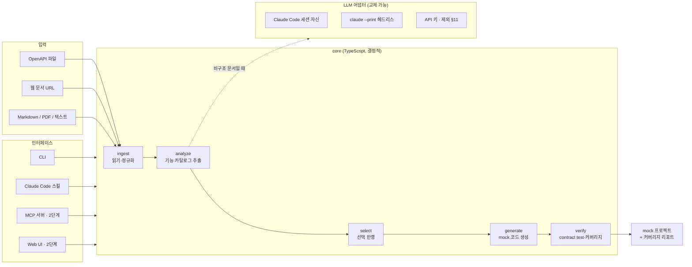
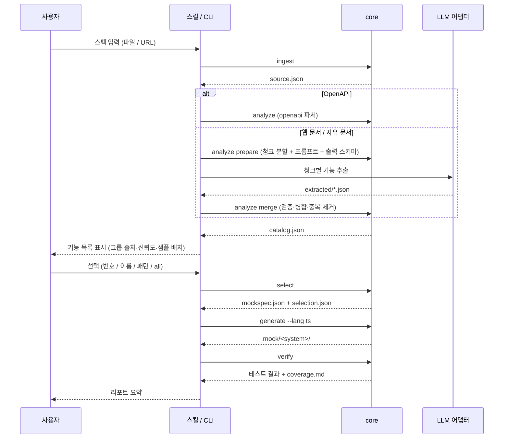

# specmock 설계 문서

작성일: 2026-11-04
상태: 승인됨. 3단계 중 3A(Java 생성기)·3B(실제 시스템 녹화 record) 머지 완료(2026-11-11). API 키 어댑터는 제외(§10·§11). 구현 중 확인된 사항은 12장 "구현 중 변경" 참고.
대상 범위: 전체 아키텍처 + 1단계 상세. 2·3단계는 인터페이스 경계만 정의.

---

## 0. 한 문장 요약

어떤 형태의 API 스펙이든 읽어서 언어 무관한 `MockSpec`으로 정규화하고, 그중 **필요한 기능만 골라** mock 서버와 검증 테스트를 생성하는 도구다.

## 1. 배경과 목표

### 1.1 해결하려는 문제

외부 시스템과 연동할 때 상대 시스템이 아직 없거나, 키를 발급받지 못했거나, 테스트 환경이 불안정한 경우가 많다. 스펙 문서는 있지만 그것을 읽고 mock을 손으로 만드는 일은 반복적이고 지루하다. 스펙이 OpenAPI처럼 구조화되어 있지 않고 웹 문서나 PDF로만 존재하는 경우도 흔하다.

### 1.2 목표

| 목표 | 설명 |
|---|---|
| 어떤 스펙이든 입력 | OpenAPI 파일, 웹 문서 URL, Markdown/PDF/텍스트. 셀렉트박스나 탭 뒤에 숨은 내용까지 수확 |
| 기능 목록을 보고 고른다 | 분석 결과를 출처·신뢰도와 함께 나열하고, 사용자가 필요한 기능만 선택 |
| 선택한 것만 생성 | 선택된 기능만 포함된 mock 서버와 contract test를 생성 |
| 믿을 수 있는지 보여준다 | 어디가 실제 샘플 기반이고 어디가 추측인지 커버리지 리포트로 명시 |
| 언어는 나중에 바꿀 수 있다 | TypeScript 참조 구현을 먼저 만들고, 검증된 MockSpec으로 다른 언어 생성 가능 |
| 구독만으로 동작 | Claude Code 구독만으로 LLM 단계를 수행. API 키는 선택 사항 |

**사용자 환경 가정 (2A부터 명시):**
- 사용자에게 있는 것: Claude Code, Node 22.19 이상, pnpm. ego-browser는 선택(없으면 수확만 건너뜀).
- 사용자에게 없는 것: 작성자의 개발 도구. 제품 코드·플러그인·스킬·README·커밋되는 설정은 이것 없이 동작하고 읽혀야 한다.
- 설치는 `git clone` → `pnpm install && pnpm build` → `claude --plugin-dir ./plugin`. 이것으로 스킬과 MCP 도구가 함께 켜진다.

### 1.3 비목표 (1단계)

- gRPC, GraphQL 입력
- Proxy 모드(실제 시스템 전달)와 응답 녹화
- Web UI, MCP 서버 (2단계)
- TypeScript 외 언어 템플릿 (3단계에서 LLM 생성으로 대체)
- 상태 있는 CRUD 시뮬레이션

### 1.4 이 프로젝트의 또 다른 목적

이 repo는 작성자의 AI 활용 이력이기도 하다. 그래서 다음을 지킨다.

- 설계 문서, 구현 계획, 결정 근거를 repo 안에 남긴다.
- 결정적 코드와 LLM 의존 부분의 경계를 명확히 하여 "어디에 AI를 썼는가"를 설명할 수 있게 한다.

## 2. 전체 아키텍처

### 2.1 구조도



### 2.2 설계 원칙

1. **결정적 코어, 얇은 LLM.** 파싱·생성·검증은 LLM 없이 동작하고 단위 테스트로 고정한다. LLM은 "구조화되지 않은 문서에서 기능 추출"과 "다른 언어로 생성"에만 쓴다.
   왜: 재현성과 테스트 가능성. 그리고 AI 사용 범위를 설명할 수 있어야 한다.
2. **파일이 인터페이스.** 모든 단계의 입출력은 `.specmock/<system>/` 아래 JSON 파일이다. CLI, 스킬, MCP, Web UI가 같은 파일을 읽고 쓴다.
   왜: 인터페이스 간 공유, 단계 중간 재개, 디버깅 용이.
3. **MockSpec이 단일 진실.** generate와 verify는 원본 스펙이 아니라 `mockspec.json`만 본다.
   왜: 언어가 무엇이든 같은 contract test로 검증할 수 있다.
4. **LLM 출력은 항상 의심한다.** 스키마 검증, 형식 검증, 근거 대조를 거친 뒤에만 카탈로그에 들어간다.

### 2.3 단계별 데이터 흐름



### 2.4 LLM 어댑터

```ts
interface LlmAdapter {
  extract(input: { prompt: string; schema: JSONSchema; chunk: Chunk }): Promise<unknown>;
}
```

| 구현 | 사용 상황 | 단계 |
|---|---|---|
| `SessionAdapter` | Claude Code 스킬 모드. 어댑터는 호출하지 않고, Claude 자신이 `chunks/`를 읽고 `extracted/`에 결과 파일을 쓴다. core는 파일이 생길 때까지 기다리지 않고 `merge` 단계에서 읽는다 | 1 |
| `ClaudeCodeAdapter` | CLI 단독 모드, Web UI. `claude --print --output-format json --json-schema <schema>`를 자식 프로세스로 실행. 구독 인증 사용 | 1 |
| `ApiAdapter` | 배포용. Anthropic API 키 | 제외(§11) |

왜 어댑터를 두는가: 처음 요구가 "로컬 Claude Code 구독 우선, 바꿀 수 있는 구조"였다. 어댑터가 그 교체 지점이다.

## 3. 데이터 모델

네 가지 JSON 파일이 핵심이다. 모두 **zod** 스키마(`packages/core/src/types.ts`)로 정의하고 core가 읽을 때마다 검증한다. 타입과 검증이 한 곳에서 나오고, 필요하면 `z.toJSONSchema()`로 JSON Schema를 내보낼 수 있다.

### 3.1 `source.json` — ingest 결과

원문을 보존한다. 이후 단계는 원본 파일이나 URL을 다시 보지 않는다.

```jsonc
{
  "system": "stripe",
  "inputs": [
    {
      "kind": "openapi" | "html" | "markdown" | "pdf" | "text",
      "origin": "파일 경로 또는 URL",
      "fetchedAt": "ISO 8601",
      "contentHash": "sha256",
      "title": "문서 제목(선택). HTML <title>, Markdown·PDF는 본문 첫 # 헤딩(firstHeading). PDF 메타데이터 제목은 후속 과제",
      "content": "정규화된 텍스트. HTML은 본문만 뽑아 Markdown으로 변환(코드 펜스·표·제목 보존), PDF는 추출 텍스트(페이지마다 헤딩), openapi는 dereference된 JSON 문자열",
      "harvestCandidate": { "reasons": ["..."] },   // 상호작용 요소 감지 결과(5.1). 수확 대상 여부 판단에 쓴다
      "harvested": {              // ego-browser 수확 시에만
        "pages": [{ "url": "", "title": "", "content": "" }],
        "interactions": [{ "type": "tab" | "select" | "details", "label": "", "content": "" }],
        "notes": ["수확을 건너뛰었거나 실패한 이유 등"]
      }
    }
  ]
}
```

### 3.2 `catalog.json` — analyze 결과

선택 화면의 원천이다. 사용자가 보는 모든 정보가 여기 있다.

```jsonc
{
  "system": "stripe",
  "generatedAt": "ISO 8601",
  "features": [
    {
      "id": "users.get",                // 안정적 id. operationId 우선, 없으면 "리소스.동작"
      "group": "users",                 // 표시 묶음
      "title": "사용자 조회",
      "summary": "id로 사용자 한 명을 조회한다",
      "method": "GET",
      "path": "/users/{id}",
      "request": {
        "params": { "id": { "schema": {}, "required": true } },
        "query": {}, "headers": {},
        "body": null                    // JSONSchema 또는 null
      },
      "responses": {
        "200": { "schema": {}, "examples": [ { "source": "spec-example", "body": {} } ] },
        "404": { "schema": {}, "examples": [] }
      },
      "auth": "bearer" | "apiKey" | "basic" | "none" | "unknown",
      "provenance": "openapi" | "doc-extracted" | "inferred",
      "confidence": 1.0,                // openapi=1.0. 추출은 LLM 자기평가를 근거 대조와 샘플 유무로 보정
      "hasExample": true,
      "evidence": [ { "chunk": 12, "quote": "원문 인용" } ],   // 비구조 문서일 때
      "notes": [ "pagination은 cursor 방식으로 추정" ]
    }
  ],
  "rejected": [ { "raw": {}, "reason": "path 형식 불일치" } ]
}
```

confidence 보정 규칙:

| 조건 | 조정 |
|---|---|
| provenance = openapi | 1.0 고정 |
| evidence 인용이 원문에 실제로 존재 | 유지 |
| evidence 인용이 원문에 없음 | 0.3 곱하고 notes에 "근거 불일치" |
| 샘플 응답 있음 | +0.1 (최대 1.0) |
| method 또는 path가 추론됨 | 0.5 상한 |

### 3.3 `selection.json` — 사용자의 선택

선택은 별도 파일로 남겨 재현 가능하게 한다. 같은 선택으로 재생성하거나, 나중에 기능을 추가할 때 이 파일을 수정한다.

```jsonc
{
  "system": "stripe",
  "catalogHash": "catalog.json의 sha256",
  "selected": [ "users.get", "users.list", "orders.*" ],   // 표현식 그대로 보존
  "resolved": [ "users.get", "users.list", "orders.list", "orders.get" ],  // 해석 결과
  "catalogIds": [ "users.get", "users.list", "orders.list", "orders.get", "..." ],  // 선택 시점의 카탈로그 전체 id. 이후 달라진 기능 diff의 기준(선택적 필드)
  "updatedAt": "ISO 8601"
}
```

### 3.4 `mockspec.json` — select 결과, generate/verify의 유일한 입력

```jsonc
{
  "system": "stripe",
  "baseUrl": "/",
  "language": "ts",
  "features": [
    {
      // catalog의 feature 그대로 +
      "fixtures": [
        { "status": 200, "body": {}, "source": "spec-example" | "doc-sample" | "schema-generated" | "empty" }
      ]
    }
  ],
  "notMocked": [ { "id": "users.delete", "method": "DELETE", "path": "/users/{id}" } ],   // 선택되지 않은 기능. 501 안내용
  "contracts": [
    { "featureId": "users.get", "name": "정상 요청",
      "request": { "method": "GET", "path": "/users/123", "headers": {}, "query": {}, "body": null },
      "expect": { "status": 200, "schema": {} } }
  ],
  "assumptions": [ "users.get: 응답 스키마 없음. 빈 객체 반환" ]
}
```

fixture 우선순위: `spec-example` → `doc-sample` → `schema-generated` → `empty`. 어떤 경로로 만들어졌는지 `source`에 남겨 커버리지 리포트가 "실제 모양 기반 N개, 추측 M개"를 셀 수 있게 한다.

## 4. 기능 목록 표시와 선택

이 도구의 중심 사용자 경험이다. 분석이 끝나면 **모든 기능을 나열**하고, 사용자는 **필요한 것만** 고른다.

### 4.1 표시 형식

CLI와 스킬 모드 모두 같은 정보를 같은 순서로 보여준다. 그룹은 이름순, 그룹 안에서는 path → method 순으로 정렬한다. 표시 번호는 이 순서로 매기므로 같은 catalog에서는 항상 같다.

```
stripe — 47개 기능 (openapi 40 · 문서추출 7)

  #  id                  method  path                       출처   신뢰  샘플
── users (5) ─────────────────────────────────────────────────────────────
  1  users.list          GET     /users                     spec   1.0   ●
  2  users.create        POST    /users                     spec   1.0   ○
  3  users.get           GET     /users/{id}                spec   1.0   ●
  4  users.update        PATCH   /users/{id}                spec   1.0   ○
  5  users.delete        DELETE  /users/{id}                spec   1.0   —
── webhooks (2) ──────────────────────────────────────────────────────────
  6  webhooks.register   POST    /webhooks                  doc    0.7   ●  ⚠ 근거 1건
  7  webhooks.list       GET     /webhooks                  doc    0.4   ○  ⚠ path 추론
...
범례  출처: spec=OpenAPI, doc=문서에서 추출, inf=추론 · 샘플: ●있음 ○스키마만 —없음
```

`list --group <그룹>`으로 필터해도 번호는 전체 카탈로그 기준으로 유지된다. 정렬은 로케일과 무관한 코드포인트 비교라 어떤 기기에서도 같다.

스킬 모드에서는 Claude가 같은 내용을 Markdown 표로 보여준다. 기능이 30개를 넘으면 그룹 요약을 먼저 보여주고 "어떤 그룹을 펼칠까요?"로 단계적으로 보여준다.

### 4.2 선택 표현식

| 표현 | 의미 |
|---|---|
| `all` | 전부 |
| `1,3,5-8` | 표시 번호 |
| `users.get,orders.list` | id 직접 지정 |
| `users.*` | id 글롭 (`.`은 문자 그대로, `*`만 와일드카드). 일치하는 기능이 없으면 오류 |
| `group:users` | 그룹 전체 (그룹은 태그 또는 첫 경로 세그먼트라 id 접두와 다를 수 있다) |
| `method:GET` | 조건 필터 |
| `confidence>=0.8` | 신뢰도 필터 |
| `has:example`, `has:schema` | 샘플/스키마 있는 것만 |
| `-users.delete` | 제외 (앞에 `-`). 별도 인자로 줘도 된다 |
| `@selection.json` | 파일에서 읽기 (항목은 쉼표로 다시 분리된다) |

여러 표현식은 쉼표로 결합하며 왼쪽부터 순서대로 적용한다. 예: `users.*,orders.*,-users.delete,confidence>=0.5`

필터(`group:`, `method:`, `has:`, `confidence`)는 **현재 선택이 비어 있으면 카탈로그 전체에서 포함**하고, 비어 있지 않으면 **현재 선택을 좁힌다**. 그래서 필터 두 개를 연달아 쓰면 교집합이다. 역순 범위(`5-3`)는 오류다.

### 4.3 대화형 선택 (CLI `--interactive`)

그룹 구분선이 있는 체크박스 목록(TTY 필요)을 띄운다. 공백으로 토글하고, 이전 선택은 미리 체크되며, `--group <이름>`으로 한 그룹만 보여 줄 수 있다. 확정하면 `selection.json`에 저장되는데, 표현식이 아니라 **id 목록으로 평탄화**된다. 그룹 접기/펼치기와 `/` 검색은 구현하지 않았다(12장).

### 4.4 나중에 기능 추가하기

mock을 쓰다가 기능이 더 필요해지는 경우가 많다. 이 흐름을 일급으로 지원한다.

```
specmock select stripe --add "payments.*"     # selection.json에 추가
specmock generate stripe                       # 추가된 라우트만 새로 생성. 기존 fixture는 보존
```

- 선택되지 않은 경로로 요청이 오면 mock 서버는 `501`과 함께 안내 바디를 돌려준다.
  ```json
  { "error": "not_mocked", "feature": "payments.create",
    "hint": "specmock select stripe --add payments.create" }
  ```
  catalog에 없는 경로면 `404`와 `"unknown_path"`.
- catalog가 갱신되어 `catalogHash`가 달라지면 select 단계가 "스펙이 바뀌었습니다. 새 기능 3개, 사라진 기능 1개"를 보여주고 selection 재확인을 요청한다.

### 4.5 선택 단계에서 판단을 돕는 정보

키 없이 쓰는 경우가 대부분이므로 다음을 선택 화면에서 바로 볼 수 있게 한다.

- 출처(provenance)와 신뢰도(confidence)
- 샘플 응답 존재 여부
- 경고 표시: 근거 불일치, path 추론, 응답 스키마 없음
- `specmock show stripe users.get` 으로 한 기능의 상세(스키마, 샘플, 근거 인용)를 확인 가능

## 5. 1단계 구성요소 상세

모든 구성요소는 `packages/core` 안의 독립 모듈이다. 입력 파일을 읽고 출력 파일을 쓰는 순수 함수에 가깝게 만든다.

### 5.1 ingest

| 입력 종류 | 처리 | LLM |
|---|---|---|
| OpenAPI 2/3 (json/yaml, 파일 또는 URL) | `@apidevtools/swagger-parser`로 `$ref` 전부 해석하여 보존 | 없음 |
| 웹 URL | 1) 일반 fetch → 본문 추출(`@mozilla/readability` + `linkedom`) 후 Markdown으로 변환(`turndown`. 코드 펜스·표 보존). 2) 본문이 빈약하거나 상호작용 요소가 감지되면 ego-browser 수확으로 전환 | 없음 |
| Markdown / 텍스트 | 그대로 보존. 헤딩 구조 파악 | 없음 |
| PDF | `pdf-parse`로 텍스트 추출. 페이지마다 `## [page N]` 헤딩을 붙여 청크 분할과 근거 위치에 쓴다. 표 구조는 손실 | 없음 |

**상호작용 요소 감지 규칙**: 본문 텍스트가 2,000자 미만이거나, `<select>`, `role="tab"`, `<details>`, `role="combobox"`, "Show more"/"더 보기" 텍스트 중 하나라도 있으면 수확 후보로 표시한다. CLI는 `--harvest auto|always|never`로 제어한다.

**ego-browser 수확 스크립트** (`packages/core/src/harvest/harvest.mjs`, `ego-browser nodejs`로 실행):

1. 페이지 로드. `details`와 `aria-expanded="false"` 요소를 모두 펼친다.
2. `role=tab` 요소를 순회하며 각 탭 패널 내용을 캡처한다.
3. 모든 `select`를 찾아 옵션을 하나씩 선택하고, 선택 전후 DOM 차이만 캡처한다.
4. `role=listbox` / `role=combobox` 커스텀 드롭다운은 **자동 수확하지 않는다**(1B 결정, 12장). 스킬의 수동 수확 절차로 한다.
5. 같은 출처의 API Reference 성격 링크(`/reference`, `/docs` 류)를 깊이 2까지 따라간다. 페이지 수 상한 50. bare `/api/` 경로는 따라가지 않는다(로그인 쿠키로 앱 API를 호출할 수 있음).
6. 결과를 내용 해시로 중복 제거하고 비밀값을 마스킹하여 `source.json`의 `harvested`에 저장한다. 시작 페이지는 `pages`에서 제외하고(본문과 중복), 같은 인터랙션 안에서 새로 보인 블록만 저장한다.
7. 자동 수확이 부족하면(수확 후에도 기능 추출 0건 등) 스킬 문서의 수동 탐색 절차로 넘어간다. Claude가 스냅샷을 보며 직접 클릭하고 결과를 `harvested`에 추가한다.

ego-browser는 셸 CLI이므로 CLI 모드에서는 core가 자식 프로세스로 실행하고, 스킬 모드에서는 Claude가 직접 실행한다. 미설치면 건너뛰고 `harvested.notes`와 stderr에 기록한다. ego-browser는 로그인된 브라우저로 페이지를 열므로 수확 대상 페이지의 내용이 모두 저장 후보가 된다.

### 5.2 analyze

- **OpenAPI**: 결정적 변환. `paths × methods` 전부를 feature로. id는 `operationId` → 없으면 `리소스.동작` 규칙(`GET /users/{id}` → `users.get`, `GET /users` → `users.list`, `POST` → `create`(operationId가 없고 경로 마지막 세그먼트가 변수이고, 같은 경로 모양에 PUT/PATCH가 없을 때만 `update`), `PUT/PATCH` → `update`, `DELETE` → `delete`, 그 외는 path 마지막 세그먼트). 하위 동작은 카탈로그의 경로 모양을 보고 부모 접두를 붙인다: POST `/<r>/{v}/<x>`는 부모 `/<r>/{}`가 있고 자기 모양에 GET이 없으면 `<r>.<x>`(`payment_intents.cancel`), GET `/<r>/<x>`는 부모 `/<r>`가 있으면 `<r>.<x>`(`customers.search`). 충돌 시 숫자 접미사. `provenance: openapi`, `confidence: 1.0`.
- **비구조 문서**: 세 단계.
  - `prepare`: 헤딩 기준 청크 분할(청크당 최대 6,000자, 겹침 200자). `chunks/NNN.md`를 쓰고, `analyze-request.json`에 `{ system, createdAt, prompt, schema, chunks: [{ index, file, heading, contentHash, … }], openapiFeatures }`를 기록한다. `schema`는 zod에서 만든 얇은 JSON Schema다. 프롬프트는 "이 청크에서 API 엔드포인트를 찾아라. 각 항목에 method, path, 요청/응답 스키마(알 수 있는 만큼), 샘플 응답 JSON(원문에 있으면 그대로), 근거 인용, 0~1 confidence를 적어라. 없으면 빈 배열"을 요구한다.
  - LLM 추출: 어댑터가 청크별로 호출하여 `extracted/NNN.json`을 원자적으로(.tmp → rename) 쓰고, 추출 당시 본문 해시를 `extracted/manifest.json`에 적는다(본문이 바뀐 청크만 다시 추출). 스킬 모드에서는 Claude가 직접 쓴다.
  - `merge`: 각 결과를 스키마 검증 → method/path 형식 검증 → 근거 인용을 원문에서 대조 → confidence 보정 → `method+path` 기준 병합(스키마는 합집합, examples는 누적, confidence는 최댓값) → 샘플 응답 수집 → `catalog.json`. 실패 항목은 `rejected`에 이유와 함께 남긴다. `--merge`는 `prepare` 없이 이미 있는 `extracted/*.json`만 합치므로, 일부 청크만 추출된 상태에서도 **부분 진행**이 된다(추출 안 된 청크는 알리고 건너뜀). 카탈로그를 쓸 때 이전 카탈로그와 id 기준으로 비교해 `catalog-diff.json`에 추가/삭제를 남긴다.
- OpenAPI와 문서를 동시에 입력하면 OpenAPI가 우선이고, 문서에서만 발견된 기능이 `doc-extracted`로 추가된다.

### 5.3 select

- 입력: 4.2의 선택 표현식. 결과를 `selection.json`에 저장하고 `mockspec.json`을 만든다.
- fixture 생성: `spec-example` → `doc-sample` → `schema-generated`(`json-schema-faker`, 고정 seed로 재현 가능) → `empty` + assumptions 기록.
- contract 생성: feature당 정상 경로 1개(필수 파라미터를 스키마에 맞게 채움, 기대 status는 가장 낮은 2xx, 기대 schema는 해당 응답 스키마). 스펙에 4xx 응답이 명시돼 있으면 "필수 파라미터 누락" 케이스 1개 추가.
- 응답 스키마가 없고 샘플만 있으면 샘플에서 스키마를 유추하여 contract에 사용하고 assumptions에 기록한다. (1A 미구현. 스키마 없는 샘플은 1B의 문서 추출에서만 나오므로 1B에서 구현한다.)
- "필수 값 누락" contract는 스펙이 422를 나열해도 **400을 기대**한다. 생성된 mock의 검증 실패 응답이 400으로 고정되어 있기 때문이다(5.4).
- 2xx 응답이 하나도 없는 기능에는 200 빈 객체 fixture를 추가하고 assumptions에 기록한다.

### 5.4 generate

TypeScript + Hono 템플릿. 생성 결과물:

```
mock/<system>/
├── package.json             # hono, @hono/node-server, ajv, tsx. scripts: start
├── tsconfig.json
├── src/
│   ├── server.ts            # 라우트 등록, 포트(env PORT, 기본 4010), 501/404 핸들러
│   ├── routes/<group>.ts    # 그룹별 핸들러: 요청 검증 → fixture 로드 → 응답
│   ├── fixtures.ts          # fixtures/ 디렉터리 런타임 로더
│   └── validate.ts          # ajv 기반 요청 검증
├── fixtures/<featureId>/<status>.json
├── contracts/<featureId>.json
├── specmock.lock.json       # mockspec 해시, 생성 시각, 기동 명령, 언어
└── README.md                # 실행법, 포함 기능 목록, 커버리지 요약
```

- 핸들러는 fixture 파일을 런타임에 읽는다. 데이터 변경에 코드 수정이 필요 없다.
- fixture 파일은 기능마다 라우트가 서빙하는 가장 낮은 2xx 하나만 쓴다. 다른 응답(4xx 등)은 mockspec에만 남아 coverage 집계에 쓰인다(12장 참고).
- 요청 검증 실패는 `400`과 ajv 오류 목록을 반환한다.
- 재생성 시 사용자가 수정한 fixture(해시가 lock과 다름)는 보존한다. `--force`로 덮어쓴다.
- 템플릿은 `packages/core/templates/ts-hono/`에 두고 `eta` 템플릿 엔진으로 렌더링한다. 생성 코드는 그대로 `tsc --noEmit`을 통과해야 한다(테스트로 고정). prettier 후처리는 두지 않았다.
- 재생성 시 선택 해제된 기능의 contract·route·수정 안 된 fixture는 삭제한다. 수정된 fixture는 남기고 `orphaned`로 보고한다. 보존 기준은 lock에 기록된 "생성기가 썼을 내용"의 해시다.

### 5.5 verify

- `specmock.lock.json`의 기동 명령으로 서버를 임시 포트에 띄우고 헬스체크(`GET /__specmock/health`) 후 `contracts/*.json`을 순서대로 실행한다.
- 각 contract: HTTP 요청 → status 일치 → 응답 바디 ajv 검증.
- 언어 무관: 대상 디렉터리에 `specmock.lock.json`과 `contracts/`만 있으면 어떤 언어 서버든 검증한다. 3단계에서 다른 언어를 생성할 때 이 성질을 쓴다.
- 출력 `coverage.md`:
  - 선택 기능 수 / 카탈로그 전체 수
  - fixture 출처 비율 (spec-example / doc-sample / schema-generated / empty)
  - confidence 분포 (1.0 / 0.8 이상 / 0.5 이상 / 미만)
  - assumptions 전체 목록
  - contract 결과 (통과/실패, 실패 상세)
  - 수확 수행 여부와 누락 가능성 경고

### 5.6 CLI (`packages/cli`)

```
specmock ingest   <system> <origins...> [--refresh] [--harvest auto|always|never] [--json]
specmock analyze  <system> [--llm session|claude-code] [--model m] [--prepare] [--merge] [--refresh] [--json]
specmock list     <system> [--group g] [--json]
specmock show     <system> <featureId> [--json]
specmock select   <system> [exprs...] [--add] [--remove] [--interactive] [--group g] [--json]
specmock generate <system> [--lang ts] [--out dir] [--force] [--json]
specmock verify   <system> [--dir d] [--report path] [--json]
specmock run      <system> <origins...> [--select expr] [--lang ts] [--out dir] [--no-verify]
                  [--llm claude-code] [--model m] [--refresh] [--json]   # 전 단계 한 번에. 세션 모드 불가
```

종료 코드: 모든 명령에서 0 성공, 1 오류. 2는 `analyze` = 일부 청크 추출 실패, `run` = contract 실패 또는 일부 추출 실패, `verify` = contract 실패.

- 모든 상태는 `./.specmock/<system>/`에 둔다. `--workspace`로 변경 가능.
- `--json` 출력을 모든 명령에 지원하여 스킬과 2단계 Web UI가 파싱할 수 있게 한다.
- `analyze --llm claude-code` · `generate --lang java`는 끝날 때 이번 실행분 LLM 사용량 합계를 stderr 한 줄로 보이고 `--json`에 `usage`를 싣는다. 호출별 기록은 `.specmock/<system>/llm-usage.jsonl`(설계 `2026-11-11-llm-usage-log-design.md`).

### 5.7 Claude Code 스킬 (`plugin/skills/specmock/SKILL.md`)

- 다섯 단계를 순서대로 CLI 호출로 안내한다.
- LLM이 필요한 지점에서 Claude가 할 일과 출력 형식을 명시한다.
  - 청크 추출: `chunks/NNN.md`를 읽고 `analyze-request.json`의 스키마대로 `extracted/NNN.json`을 쓴다. 한 번에 청크 하나. 근거 인용은 원문 그대로 복사.
  - 수동 수확: ego-browser로 스냅샷 → 상호작용 → 캡처한 내용을 `harvested`에 추가하는 절차.
  - 모호함: catalog의 `notes`와 `rejected`를 사용자에게 보여주고 판단을 구한다.
- 단계마다 사용자에게 보여줄 요약 형식(4.1 표, coverage 요약)을 고정한다.
- 플러그인 구조: `plugin/.claude-plugin/plugin.json` + `plugin/skills/specmock/`. 2단계에서 MCP 서버를 같은 플러그인에 추가한다.

## 6. 에러 처리

- **멈추지 않고 기록한다.** 일부 feature의 추출·검증이 실패해도 파이프라인은 계속 진행하고 실패 항목은 `rejected`와 `coverage.md`에 이유와 함께 남긴다.
- **단계마다 재개 가능.** 모든 단계는 `.specmock/<system>/` 파일만으로 다시 실행된다. fetch 실패는 `source.json` 이전에서 멈추고, 재실행 시 캐시된 원문이 있으면 재사용한다(`--refresh`로 강제 갱신).
- **LLM 출력 검증 3단계.** JSON Schema → method/path 형식 → 근거 인용 대조. 대조 실패는 confidence를 낮추고 notes에 표시한다.
- **ego-browser 실패 시 우회.** 미설치, 로그인 필요, 타임아웃이면 일반 fetch 결과로 진행하고 리포트에 "수확 미수행, 숨은 콘텐츠 누락 가능"을 명시한다.
- **사용자 입력 오류는 즉시.** 잘못된 선택 표현식, 없는 feature id, 지원하지 않는 언어는 파이프라인 진입 전에 메시지와 함께 종료한다.
- **민감 정보.** source.json에 저장하기 전에 `Authorization` 헤더 값, `sk_`/`Bearer ` 패턴 등 토큰처럼 보이는 문자열을 마스킹한다. `.specmock/`은 기본적으로 git에 올리지 않는다.

## 7. 테스트 전략

| 계층 | 대상 | 방식 |
|---|---|---|
| 단위 | 파서, id 규칙, 청크 분할, 병합, confidence 보정, fixture 생성, 선택 표현식, 템플릿 렌더링 | vitest. 입력 → 출력 JSON 스냅샷 |
| 골든 | OpenAPI 샘플 3종(Petstore, 인증 포함, `$ref` 중첩)과 HTML 문서 샘플 2종(탭·select 포함) | `packages/core/test/golden/`에 입력과 기대 `catalog.json`. 변경 시 diff 검토 |
| 통합 | ingest → select → generate → verify 전체 | 생성된 mock을 실제로 기동해 contract test 통과 확인. Node 하나로 완결 |
| LLM 경계 | `prepare`가 만드는 프롬프트·스키마, `merge`가 받는 입력 | LLM 호출 없이 녹음된 응답 파일로 테스트. 실제 호출 테스트는 `scripts/live-llm-check.ts`로 분리, CI 제외 |
| ego-browser | 수확 스크립트 | 로컬 정적 HTML(탭·select·details 포함)을 띄워 수확 결과 검증. CI에서는 `ego-browser` 존재 시에만 실행 |

## 8. repo 구조

pnpm 워크스페이스 모노레포.

```
specmock/
├── packages/
│   ├── core/              # @specmock/core   ingest·analyze·select·generate·verify·harvest, schemas/
│   ├── cli/               # @specmock/cli    core를 서브커맨드로 노출
│   ├── mcp/               # @specmock/mcp    (2단계)
│   └── web/               # @specmock/web    (2단계)
├── plugin/                # Claude Code 플러그인
│   ├── .claude-plugin/plugin.json
│   └── skills/specmock/SKILL.md
├── templates/ts-hono/     # 생성 템플릿
├── examples/              # 샘플 스펙과 생성 결과. README에서 링크
├── docs/
│   ├── architecture.md    # 다이어그램 중심 설계 요약 (한눈에 보기)
│   └── superpowers/
│       ├── specs/         # 설계 문서
│       └── plans/         # 구현 계획
├── .gitignore
├── package.json, pnpm-workspace.yaml, tsconfig.base.json
└── README.md
```

`.gitignore` 대상: `node_modules/`, `dist/`, `.specmock/`(사용자 작업 상태), `mock/`(생성 결과. `examples/` 아래 의도적으로 커밋한 것 제외), `coverage/`, `*.log`, `.DS_Store`, `.env*`, 에디터 설정.

## 9. README 요건

처음 보는 사람이 5분 안에 한 번 돌려볼 수 있어야 한다.

1. 한 문장 소개 + 전체 흐름 다이어그램 1개 (2.1)
2. 빠른 시작: 설치 → Petstore OpenAPI로 mock 생성 → 기동 → curl. 5개 명령 이내
3. 세 가지 사용 방식의 짧은 예시: CLI, Claude Code 스킬(대화 예시), Web UI(2단계 이후)
4. 입력 형식별 지원 범위와 한계 표 (ego-browser 필요 여부 포함)
5. 기능 목록 보는 법과 선택 표현식 (4.1, 4.2 요약)
6. 생성 결과물 구조와 fixture 편집 방법, 기능 추가 방법 (4.4)
7. 커버리지 리포트 읽는 법 (출처·신뢰도의 의미)
8. 아키텍처 링크(`docs/architecture.md`), 로드맵(2·3단계), 기여 방법

설계 문서도 같은 원칙으로 쓴다. 각 섹션 첫 줄에 한 문장 요약, 다이어그램은 Mermaid, 결정마다 "왜" 한 줄.

## 10. 로드맵

| 단계 | 내용 | 완료 기준 |
|---|---|---|
| 1 | core + CLI + Claude Code 스킬 | OpenAPI 파일과 웹 문서 URL에서 TS mock 생성. contract test 통과. coverage.md 출력. 기능 추가 재생성 동작 |
| 2 | MCP 서버 + Web UI | 브라우저 화면에서 같은 흐름 수행(스펙 입력 → 진행 로그 → 기능 체크리스트 → 언어 선택 → 결과·리포트). MCP로 Claude Code에서 도구 호출 |
| 3 | 다른 언어 생성, 녹화(record). API 키 어댑터는 제외(§11) | 검증된 MockSpec + TS 참조 구현을 보고 Claude가 임의 언어로 생성, 같은 verify 통과. 키 있을 때 실제 시스템에 contract를 보내 응답 녹화·스펙 대조(상주 프록시·전달은 하지 않음) |

2단계 인터페이스 경계: 2A(서비스 층 + MCP)와 2B(Web UI)로 나눈다. 2A는 완료, 2B도 완료(`specmock ui`, MCP `open_ui`, Playwright E2E)했다. MCP 도구는 2A에서 10개, 2B의 `open_ui`로 11개다.
- CLI 대응: `ingest_spec`, `analyze_spec`, `list_features`, `show_feature`, `select_features`, `generate_mock`, `verify_mock`.
- 문서 추출: `get_chunk`, `submit_extraction`, `merge_extractions`.
- 화면: `open_ui`(같은 프로젝트 루트의 화면 서버를 띄우고 URL을 돌려준다. 이미 떠 있으면 같은 URL).
- `run` 도구는 없다(중간에 사용자 선택이 필요하다).
- CLI·MCP·Web UI는 `core/src/service/`를 호출한다.
- Web UI 서버는 LLM으로 `ClaudeCodeAdapter`를 쓴다.
- 상세: [2026-11-05-phase2a-mcp-design.md](2026-11-05-phase2a-mcp-design.md), 2B는 [2026-11-06-phase2b-web-ui.md](../plans/2026-11-06-phase2b-web-ui.md) 계획과 실행 기록.

3단계 인터페이스 경계: 3A(다른 언어 생성)를 먼저 했다. `generate`는 언어 무관 `scaffold`(fixtures·contracts·lock·보존 판정)와 `LanguageGenerator`(`LanguageOutput`: 파일 · install · start · sourceGlobs)로 나뉜다. TS는 `TsHonoGenerator`(템플릿, 출력 바이트 동일), 그 밖의 언어는 `LlmGenerator`가 언어 프로필(Java: Maven + Javalin) + MockSpec + TS 참조 구현을 프롬프트로 claude에 보내고 임시 디렉터리에서 빌드·contract·런타임 계약(501·404)을 통과한 결과만 반영한다(기본 3회, 실패 시 exit 5). verify는 lock의 install·start만 안다. 세션 모드(`--llm session` → `--finalize`, MCP `finalize_generation`)로 대화 안에서도 생성한다. MCP 도구는 12개. 상세: [2026-11-09-phase3a-java-generator-design.md](2026-11-09-phase3a-java-generator-design.md), [계획](../plans/2026-11-09-phase3a-java-generator.md). 3B는 프록시 대신 `record` 명령이다: mockspec의 정상 contract를 `target.json`의 실제 시스템에 보내 `recorded/`에 저장하고 `drift.md`를 쓴다. `select`는 녹화를 최우선 fixture 출처 `recorded`로 쓰고, `generate`는 입력(`inputHash`)이 같으면 LLM 없이 fixture만 다시 쓴다. MCP 도구는 13개(`record_responses`). 상세: [2026-11-09-phase3b-record-design.md](2026-11-09-phase3b-record-design.md), [계획](../plans/2026-11-09-phase3b-record.md). API 키 어댑터(3C)는 하지 않는다(2026-11-11 결정, §11). 3단계의 남은 후보는 3A-2(Python/Go 언어 프로필)와 시나리오 제어(§12의 1A 항목 "시나리오 제어는 3단계")다.

## 11. 주요 결정 기록

| 결정 | 대안 | 이유 |
|---|---|---|
| 코어 + 여러 인터페이스 | 단일 형태(스킬만 / CLI만) | 형태를 바꿀 수 있어야 한다는 요구. 코어가 두꺼우면 인터페이스는 얇다 |
| Claude Code 구독 우선 | API 키 | 추가 비용 없이 바로 동작. 어댑터로 교체 가능 |
| TypeScript 참조 구현만 템플릿 | 언어별 템플릿 | mock이라 언어 다양성보다 빠른 검증이 중요. 다른 언어는 검증된 MockSpec으로 LLM 생성 |
| 문서 샘플 추출 + 출처/신뢰도 우선, Proxy/녹화는 후순위 | 녹화를 1단계에 | 키를 못 받는 경우가 대부분. 키 없이 판단을 돕는 정보가 더 중요 |
| 녹화는 끝나는 `record` 명령 | 상주 프록시 | ui-server 작업 구조(시스템당 하나·끝나는 작업)와 잠금에 맞고, HTTPS·요청↔기능 매칭 문제가 없다. 비밀은 `${ENV}`로만 |
| 파일 기반 상태 | 메모리 / DB | 인터페이스 간 공유, 재개, 디버깅 |
| 선택 표현식 + selection.json | 대화형 UI만 | 재현 가능하고 스크립트화 가능. 나중에 기능 추가가 쉬움 |
| 코어 → CLI → MCP 순서 | MCP 우선 | CLI가 디버깅이 빠르고 end-to-end를 먼저 확인할 수 있음. MCP는 같은 코어의 얇은 껍데기 |
| API 키 LLM 어댑터 제외 | 3C로 구현 | 사용자 환경 가정(§1.2)이 Claude Code 보유다. 구독만으로 전 단계가 동작하므로 키 어댑터는 유지 비용만 더한다. `LlmAdapter` 경계는 그대로 두어 필요해지면 추가할 수 있다 |

## 12. 구현 중 변경 (1A, 1B, 2A, 3A)

리뷰 과정에서 설계를 바꾼 지점. 위 본문에는 반영되어 있고, 여기에는 이유만 남긴다.

| 변경 | 이유 |
|---|---|
| 스키마를 JSON Schema 파일 대신 zod로 | 타입과 검증 단일화. 필요 시 `z.toJSONSchema()` |
| mockspec에 `notMocked` 추가, contract에 `query` 추가 | 501 안내와 GET 쿼리 contract에 필요 |
| 순환 `$ref`를 `{ "x-specmock-circular": true }` 마커로 직렬화 | `circular: "ignore"`는 순환에 닿는 모든 참조를 제거해 재귀 스키마가 사라짐 |
| OpenAPI 감지를 정규식에서 파싱 기반으로 | README에 `openapi:`가 적힌 문서를 오인 |
| id 규칙 보강 (부분 템플릿 세그먼트, 비정상 operationId 폴백, `/v1/` 그룹 건너뛰기, operationId 우선) | 선택 불가능하거나 안전하지 않은 id 방지 |
| 표시 순서를 코드포인트 비교로 고정 | `localeCompare`는 로케일에 따라 번호가 달라짐 |
| `group:<이름>` 필터 추가 | `users.*`는 id 글롭이라 그룹 선택이 아님 (예: `inventory.list`는 그룹 `store`) |
| Swagger 2.0 formData → body, `type: file` → `string/binary` | ajv가 `file` 타입을 컴파일하지 못함 |
| json-schema-faker 0.6.x의 `generateSync(schema, { seed })` 사용 | 0.6은 재작성판. `JSONSchemaFaker` 객체 없음 |
| 경로·쿼리 샘플 값을 스키마 제약에 맞게 생성 | `minimum: 5`인데 `1`을 보내면 정상 요청이 400 |
| verify: 스폰 실패 즉시 보고, 헬스체크 타임아웃 | 없는 명령이면 호스트 프로세스가 죽거나 영원히 대기 |
| `select --interactive`, `ingest/analyze/run --json`은 1A 미구현 | 범위 조정. 1B에서 |
| fixture 파일은 가장 낮은 2xx 하나만 쓴다 | 라우트가 그 상태만 서빙하므로 4xx 파일을 써 두면 "수정하면 반영된다"는 오해를 낳는다. 4xx 응답은 mockspec에만 남겨 coverage 집계에 쓴다. 시나리오 제어는 3단계 |
| 손상된 `specmock.lock.json`은 오류로 멈춘다 | 조용히 null 취급하면 보존 판단이 사라져 사용자가 수정한 fixture를 덮어쓴다. 메시지에 삭제 후 `--force` 재생성 안내 |
| 비밀값 마스킹은 패턴 3종(Bearer, `sk|pk|rk_live|test_`, `api_key:`/`password=` 류 키-값) | §6 그대로. OpenAPI의 파라미터 이름(`name: X-API-Key`)과 스키마 정의(`"password": {…}`)는 값이 아니므로 건드리지 않는다. 완전하지 않음을 README에 명시 |
| `.specmock/<system>/generate.json`에 outDir 기록, `verify`가 `--dir` 없이 그 경로 사용 | `generate --out`을 쓴 뒤 `verify`가 기본 경로를 찾다 실패하는 흐름이 불편했다 |
| `ingest --refresh`(원문 캐시) 미구현 | OpenAPI는 다시 읽는 비용이 작다. 캐시는 웹 수확을 넣는 1B에서 |
| **실사용 점검**: 병합이 group을 대소문자 무시로 묶어 대표 철자(최다, 동률은 먼저 나온 것) 하나로 통일(LLM group · 경로에서 파생한 group · OpenAPI 태그 모두). 같은 group에 OpenAPI 태그 철자가 있으면 그것이 대표(스펙 원문이라 문서 추출보다 권위가 높고, 문서를 추가해도 OpenAPI 기능의 group·생성 경로가 바뀌지 않게), `NameRegistry`는 소문자 기준으로 중복 판정 | LLM이 청크마다 `Customers`/`customers`를 달리 적으면 대소문자 비구분 파일시스템(macOS)에서 라우트 파일이 서로 덮어쓰였다 |
| **실사용 점검**: 병합 bucket 키에서 경로 변수 이름을 지우고(`/v1/customers/{}`) 묶는다. 경로 입구에서 `{{x}}`·`:x` 표기는 `{x}`로, 전부 대문자인 변수 이름은 소문자로(`{CUSTOMER_ID}` → `{customer_id}`), camelCase(`{petId}`)는 유지. 프롬프트에도 한 줄 | 문서 curl 예시의 `{{CUSTOMER_ID}}`와 `{id}`가 다른 경로로 취급돼 같은 기능이 둘로 나뉘었다 |
| **실사용 점검**: operationId 없는 POST는 경로 마지막 세그먼트가 변수이고 같은 경로 모양(변수 이름 무시)에 PUT/PATCH가 없을 때만 id 동작을 `update`로. PUT/PATCH가 있으면 POST는 `create`로 남긴다 | `POST /v1/customers/{id}`가 `customers.create2`로 나와 수정인지 알 수 없었다(Stripe식 관례) |
| §4.4 카탈로그 변경 diff("새 기능 N개 / 사라진 기능 M개") 미구현 | 1A는 `catalogHash` 불일치 경고만 낸다. diff는 1B에서 |
| §4.5 "응답 스키마 없음" 경고는 표의 샘플 배지(`—`)로만 표시 | 별도 경고 열 없이도 구분된다. 근거 불일치·path 추론 경고는 LLM 추출이 들어오는 1B에서 |
| §7 골든 테스트(OpenAPI 샘플 3종)는 1B로 이월 | 1A는 Petstore 하나로 단위·통합·e2e를 덮는다. 인증 포함·`$ref` 중첩 샘플은 1B의 LLM 경계 테스트와 함께 추가 |
| **1B** HTML을 평문이 아니라 Markdown으로 보존 (코드 펜스·표·H1 제목 유지) | 평문으로 펴면 코드 블록 경계와 표가 사라져 청크 분할과 근거 대조가 깨진다. Readability의 `keepClasses`로 언어 펜스 보존 |
| **1B** 수확 결과를 `source.json`의 별도 필드로 두되 prepare가 섹션으로 병합 | 청크 분할기는 하나의 Markdown만 다루면 된다. 라벨은 한 줄로, 빈 내용은 생략 |
| **1B** LLM 추출 스키마를 얇게(zod → JSON Schema) 하고 `merge`가 ajv로 컴파일 검사 | 모델이 만든 요청/응답 스키마가 컴파일되지 않으면 생성 단계에서 실패한다. 항목 단위로 파싱해 나쁜 항목만 `rejected` |
| **1B** 샘플 응답 → 스키마 유추(`inferSchema`)를 구현, 깊이 32·저장 값 64로 캡 | 문서엔 스키마 없이 예시만 있는 경우가 대부분. 거대한 샘플이 카탈로그를 부풀리지 않게 |
| **1B** `claude` 자식 프로세스를 빈 임시 cwd에서 실행, `--no-session-persistence`, `--tools ""` | 저장소 파일 접근과 세션 기록을 막고 모델이 청크 외 정보를 쓰지 못하게 함 |
| **1B** `extracted/manifest.json`(청크 본문 해시)로 낡은 결과 건너뛰기 방지 | 문서가 바뀌었는데 이전 추출을 재사용하면 조용히 틀린 카탈로그가 된다 |
| **1B** `--refresh` 의미 분리: ingest = 원문 캐시, analyze = 기존 `extracted/` 무시(claude-code) 또는 삭제(session) | 같은 이름이라도 지우는 대상이 다르다. 세션 모드는 Claude가 파일을 쓰므로 CLI가 지워야 한다 |
| **2A** generate가 specmock.lock.json 없는 비어 있지 않은 디렉터리를 --force 없이 거부 | MCP에서는 에이전트가 outDir을 고르므로 기존 프로젝트를 덮어쓸 위험이 커짐(리뷰 Major). CLI도 같이 보호 |
| **1B** `catalog-diff.json` 추가, `selection.json`에 `catalogIds` | §4.4 diff를 구현. 선택 시점의 전체 id가 있어야 "선택에 영향 있는 변경"을 알 수 있다. 내용 변경(changed)은 감지하지 않음 |
| **1B** 일부 청크 추출 실패 시 나머지로 계속 진행하고 `analyze`는 exit 2 | 한 청크 때문에 전체를 버리면 비용이 낭비된다. 재실행 시 실패분만 재시도 |
| **1B** 종료 코드 정리: analyze 2 = 추출 일부 실패, run 2 = contract 또는 추출 실패, verify 2 = contract | 스킬과 스크립트가 구분해 처리해야 한다. 전부 실패하면 run은 exit 1 |
| **1B** `run`은 `--llm claude-code`만 허용 | 세션 모드는 사람이 개입하는 2단계(prepare → Claude 추출 → merge)라 한 번에 실행할 수 없다 |
| **1B** 수확 스크립트를 `ego-browser nodejs`에 문자열로 `evaluate`, 시작 페이지는 `pages`에서 제외, 탭은 숨은 패널만·select는 새로 보인 블록만 | `page.evaluate`가 `document`를 넘기지 못함. 본문 중복 방지 |
| **1B** 링크 추종에서 bare `/api/` 경로 제외, 수확 결과·실패 로그 마스킹 | ego-browser의 로그인 쿠키로 앱 API를 방문하거나, 수확한 비밀값이 저장·로그에 남는 것을 막기 위해 (리뷰에서 Critical로 지적) |
| **1B** 커스텀 드롭다운(listbox/combobox) 자동 수확 제외 | 사이트마다 열기 방식이 달라 자동화 오동작 위험이 크다고 보고 범위에서 뺌. 스킬의 수동 수확 절차로 |
| **1B** `select --interactive` 축소: 그룹 접기·`/` 검색 없음, 저장은 id 목록으로 평탄화 | 1B 범위 축소(그룹 구분선 + 체크박스 + 이전 선택 사전 체크). 병합은 core 함수(`mergeInteractivePick`)로 분리해 테스트 |
| **1B** Claude Code 플러그인(`plugin/`) + 스킬 문서에 옵션 drift 테스트 | 스킬이 설명하는 CLI 옵션이 실제와 어긋나면 사용자가 잘못된 명령을 받는다. `--help`와 대조 |
| **1B** 구현 중 발견·수정: CommonMark 펜스 매칭, 공백 구간에서 1글자 전진하던 청크 분할 버그, ajv 루트 `$id`로 인한 카탈로그 오염, 프로토타입 키(`__proto__`) 안전 | 속성 테스트와 Task별 코드 리뷰에서 나온 실제 결함. 각각 회귀 테스트 추가 |
| **2A** MCP 도구에 분석 단계(`analyze_spec`, `get_chunk`, `submit_extraction`, `merge_extractions`)와 `show_feature` 추가 | 원래 1:1 목록에는 문서 추출 단계가 없어 MCP만으로 문서 입력을 끝낼 수 없었다 |
| **2A** 흐름 조립을 CLI에서 `core/src/service/`로 이동 | CLI·MCP·Web UI가 모드 분기와 판정을 두 벌 갖지 않게 |
| **2A** 청크 제출은 `submitExtraction`(해시 확인 · 엄격 검증 · 원자적 쓰기 · manifest) | 세션 모드 수기 파일은 manifest가 없어 문서가 바뀌어도 예전 결과가 쓰였다. 제출 시점 검증이어야 Claude가 바로 고친다 |
| **2A** MCP 서버 루트 = 실행 디렉터리(대비책 `--root`) | Claude Code가 플러그인 MCP 서버를 프로젝트 디렉터리에서 띄우는 것을 확인했다 |
| **2A** 플러그인 `mcpServers`가 `${CLAUDE_PLUGIN_ROOT}/../packages/mcp/dist/server.js` 실행, npm 배포 안 함 | clone해서 쓰는 전제. CLI도 배포하지 않으므로 MCP만 배포할 이득이 없다 |
| **3A** MCP 도구는 12개(`finalize_generation` 하나 추가) | 3A 설계 §4.2의 "11 → 13"은 오기. `list_languages`는 두지 않고 지원 언어는 오류 메시지와 `generate_mock` 설명에 싣는다 |
| **3A** Java 참조 발췌를 `core/templates/java/reference/`에 두고, 참조 mock 전문(`test/fixtures/java-petstore/`)과 같은지 테스트로 묶음 | 프롬프트가 런타임에 읽는 파일인데 `test/`는 배포되지 않는다 |
| **3A** 실행 안내를 `launchCommand(lock)`·`launchHint`로 조합하고 `GenerateReport.launch`에 실음 | `npm install && npm start` 하드코딩이 CLI·MCP·Web(`Generate.tsx`, 설계가 놓친 곳)·스킬에 흩어져 있었다 |
| **3A** 런타임 계약(501·404)은 `VerifyResult.runtime`·`runtimeFailed`로 contract와 따로 세고, 종료 코드는 `verifyFailed()` | 기존 `total/passed/failed` 단정을 지키면서 LLM 생성물의 라우터 동작을 검사 |
| **3A** 설치 마커 `.specmock-installed`에 설치 키(`install` + 소스 해시) 기록, lock의 `installCheck`·`installInputs`로 설치 완료·입력을 판정 | Java 설치는 빌드라서 소스가 바뀌면 jar가 낡는다. 키가 다르면 다시 빌드 |
| **3A** lock에 `installTimeoutMs`, `install`은 없음(옛 lock=npm install)/`null`(설치 없음) 구분, `generator`·`sourceFiles` 기본값 | verify가 lock만 보고 설치 여부·시간 제한을 정하고, 옛 lock을 그대로 읽게 |
| **3A** 테스트용 `fake` 프로필은 core에 등록하지 않고 `generate(…, { profile })`로 주입. 등록표는 `Map` | 지원 언어 목록(`SUPPORTED_LANGUAGES`)에 테스트 언어가 섞이지 않게. 객체 키 조회의 프로토타입 오염(`constructor` 등)을 피함 |
| **3A** 세션 진행 표식 `.specmock-session.json`과 `protectedHashes`. 재finalize 때 `protectedHashes`를 갱신 | 지시서를 쓴 outDir은 lock 없이 mvnw가 생겨 다시 부르면 덮어쓰기 거부에 걸렸다. finalize가 보호 파일 변경을 판정하되, 확정 뒤 다시 확정해도 거부하지 않게 |
| **3A** 환경 오류 패턴(JAVA_HOME·의존성 다운로드 실패 등)은 install 단계 로그에만 적용 | 컴파일 오류 메시지가 우연히 패턴에 걸려 "환경 문제"로 오판하면 재시도 기회를 잃는다 |
| **3A** 응답에서 빠진 기존 소스는 유지(notes에 기록), 삭제는 `content: null`로만 | 모델이 파일을 빠뜨려 사용자 소스가 사라지는 것을 막기 위해 |
| **3A** 언어 변경 `--force`의 삭제는 화이트리스트(fixtures·contracts 밖의 프로필 소스·산출물)만, `.git`·`.specmock`이 있으면 거부, 삭제는 생성 성공 뒤에 | 잘못된 경로 지정이 사용자 저장소를 지우는 것을 막고, 생성이 실패해도 기존 디렉터리가 남게 |
| **3A** 세션 모드의 `--force` 정리는 finalize에서 | 지시서를 쓰는 시점에는 새 소스가 없으므로, 새 소스가 확정되는 순간에 이전 언어 소스를 지운다 |
| **3A** TS 라우트 정리를 `LanguageOutput.prune`으로 | 쓰지 않은 `src/routes/*.ts`를 지우는 기존 동작 유지 |
| **3A** 세션 지시서는 `prepareGeneration`·`finalizeGeneration`으로 `generate`와 분리 | `generate`가 늘 `GenerateReport`를 돌려주게(CLI·MCP·Web 출력 단순화) |
| **실사용 점검** LLM 사용량 기록: `LlmAdapter.complete`의 선택 콜백 `onUsage`, `.specmock/<system>/llm-usage.jsonl`, CLI 종료 합계 | `ClaudeCodeAdapter`가 응답 봉투의 토큰 · 비용을 버리고 `--no-session-persistence`라 사후 복구도 안 돼, 점검의 근거 자료를 남길 수 없었다. 반환형을 바꾸지 않아 기존 어댑터 · 테스트는 그대로 |
| **실사용 점검**: 같은 기능(bucket)의 body는 속성 이름 합집합, required도 합집합(합친 속성에 있는 이름만), 같은 이름 속성은 신뢰도 높은 쪽. 최상위가 object가 아닌 body는 합치지 않는다. 응답 스키마는 상태 코드별 첫 스키마 유지(조각 문맥이 아니라 별도 청크에서 오므로) | 큰 페이지의 파라미터 표가 청크 여러 개로 잘려 추출되는데 병합이 body 하나만 골라 `payment_intents.create` 속성이 4개뿐이었다(원문 36개) |
| **실사용 점검**: 문서 추출 group은 느슨한 키(소문자, 공백·`_` 제거, 끝 `s` 제거)로 묶어 최다 철자를 대표로. OpenAPI 태그끼리는 지금처럼 대소문자만 무시(`pet`·`pets`는 다른 태그), 문서 group이 태그와 느슨한 키로 정확히 하나만 겹치면 태그 철자. 하위 리소스 group(`PaymentIntent LineItems`)은 따로 둔다 | `PaymentIntent` · `PaymentIntents`가 별도 group이 되어 라우트 파일이 갈렸다 |
| **실사용 점검**: 하위 동작 id 규칙(5.2)과 `deriveFeatureId`의 `shapes` 인자(merge · openapi가 같은 경로 모양 집합을 넘긴다. 생략하면 현행) | `cancel.create` · `search.list2`처럼 리소스 접두가 없고 충돌 번호가 붙었다 |
| **실사용 점검**: 같은 접두 아래 경로 변수 이름을 위치별(그 변수까지의 경로 모양)로 bucket 대표 이름 최다(동률 선착, 같은 접두의 OpenAPI 이름이 우선)로 통일. 자기 경로 변수와 맞지 않는 pathParam은 버린다 | `/v1/payment_intents/{id}`와 `.../{payment_intent_id}/cancel`이 섞여 이름 충돌에 엄격한 라우터(3A-2 후보)에서 문제가 될 수 있었다 |
| **실사용 점검**: body는 `required` 속성이 하나라도 있을 때만 최상위 `required:["body"]`(`tsHono`)이고 "필수 값 누락" contract도 같은 조건. Java 런타임 계약 6항 문구도 같은 뜻으로 보강 | body 없는 `POST …/confirm`이 400이었다(Stripe는 body 없이 호출 가능). LLM 요청 해시(`inputHash`)는 mockspec에서만 계산돼 문구 변경이 lock에 영향 없다 |
