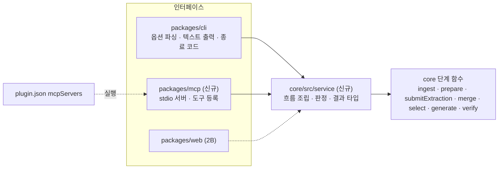
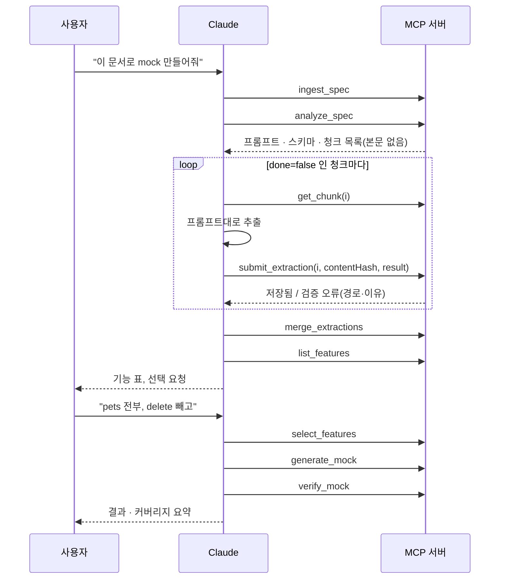

# specmock 2A 설계: 공용 서비스 층 + MCP 서버

작성일: 2026-11-05
상태: 승인됨 (대화에서 구간별 승인). 상위 설계는 [`2026-11-04-specmock-design.md`](2026-11-04-specmock-design.md).
범위: 2단계를 둘로 나눈 앞부분. Web UI는 2B에서 별도 설계한다.

---

## 0. 한 문장 요약

CLI 안에 흩어진 흐름 조립 코드를 core의 **서비스 층**으로 모으고, 그 위에 **MCP 서버**를 얹어 Claude Code가 셸 명령 없이 도구 호출만으로 스펙 → 기능 목록 → 선택 → mock 생성 → 검증을 끝내게 한다.

## 1. 목표와 범위

### 1.1 목표

| 목표 | 설명 |
|---|---|
| 도구로 쓴다 | Claude Code에서 `mcp__specmock__*` 도구 10개로 전 과정을 수행. 셸 권한 확인 창이 없고 결과가 구조화되어 돌아온다 |
| 대화 중인 Claude가 추출한다 | 비구조 문서의 기능 추출은 지금 대화하는 Claude가 청크를 읽고 결과를 도구로 제출. 별도 `claude` 프로세스를 띄우지 않는다 |
| 흐름은 한 곳에 | CLI·MCP·(2B) Web UI가 같은 서비스 함수를 호출. 모드 분기·판정 로직이 두 벌 생기지 않는다 |
| CLI는 그대로 | 출력 문구, `--json` 모양, 종료 코드를 바꾸지 않는다 |

### 1.2 사용자 환경 가정

이 문서와 이후 모든 단계의 전제다.

- 사용자에게 있는 것: **Claude Code, Node 26, pnpm**. ego-browser는 선택(없으면 수확만 건너뜀).
- 사용자에게 없는 것: 작성자의 개발 도구(harness 등). 제품 코드·플러그인·스킬 문서·README·커밋되는 설정은 이것 없이 동작하고 읽혀야 한다.
- 설치: `git clone` → `pnpm install && pnpm build` → `claude --plugin-dir ./plugin`. 이것으로 스킬과 MCP 도구가 함께 켜진다.

왜: 공개 저장소이고 주 사용자는 저장소를 clone해 읽고 돌려 보는 사람이다.

### 1.3 범위 밖

- Web UI (2B), MCP HTTP 전송
- npm 배포. clone 없이 설치하게 해 달라는 요구가 생기면 그때 CLI와 MCP를 함께 검토한다(CLI도 지금 배포하지 않으므로 MCP만 배포해서는 설치가 쉬워지지 않는다)
- `run` 같은 한 번에 끝내는 도구. 중간에 사용자 선택을 받아야 하므로 Claude가 단계별로 호출한다
- MCP에서 체크박스 대화형 선택. Claude가 표를 보여 주고 대화로 선택을 받는다
- 수동 수확 결과를 도구로 제출하는 기능. 수동 수확은 지금 스킬 절차(파일) 그대로

## 2. 구조



### 2.1 서비스 층 (`packages/core/src/service/`)

CLI에만 있던 다음 로직을 옮긴다. 각 함수는 **결과 객체**를 돌려주고, 텍스트 출력·다음 단계 힌트 문구·종료 코드 매핑은 호출자(CLI, MCP)가 한다.

| 옮길 것 | 현재 위치 |
|---|---|
| analyze 모드 분기(OpenAPI / 문서 prepare / claude-code 추출 / merge만) 와 "추출 일부 실패" 판정 | `cli/src/commands/analyze.ts` |
| LLM 추출 흐름(prepare → 어댑터 → extract → merge) | `cli/src/llmFlow.ts` |
| 세션 모드 refresh 시 `extracted/` 삭제 | `cli/src/commands/analyze.ts` (`clearExtracted`) |
| verify 대상 디렉터리 해석(`--dir` → `generate.json` → 기본 경로)과 `coverage.md` 쓰기 | `cli/src/commands/verify.ts` |
| 기능 id 조회 | `cli/src/commands/show.ts` |
| ingest 결과와 `source.json`의 수확 정보 결합 | `cli/src/commands/ingest.ts` |
| run 조립과 "전부 실패" 판정 | `cli/src/commands/run.ts` |

왜 core 안에 두는가: 옮길 코드가 약 150줄로 작고, CLI·MCP·Web이 이미 core에 의존한다. 새 패키지는 빌드 순서 스크립트까지 바꿔야 한다. 2B에서 커지면 그때 `@specmock/service`로 분리한다.

진행 상황은 `onEvent` 콜백 하나로 구조화된 이벤트(`{ stage, message, done?, total? }`)를 흘린다. 기존 `onLog`/`onProgress`는 서비스 안에서 이 이벤트로 변환한다.

### 2.2 새 core 함수 `submitExtraction`

```ts
submitExtraction(ws, system, { index, contentHash, result }):
  | { ok: true; file: string }
  | { ok: false; reason: "stale-chunk" | "unknown-chunk" | "invalid"; errors?: { path: string; message: string }[] }
```

- `analyze-request.json`에서 `index` 청크를 찾고, `contentHash`가 다르면 `stale-chunk`로 거부한다. 제출 사이에 문서를 다시 분석해 청크 번호가 바뀌었을 수 있다.
- `result`를 추출 스키마로 **엄격 검증**한다. 실패하면 저장하지 않고 오류 위치와 이유를 돌려준다. Claude가 바로 고쳐 다시 낸다.
- 성공하면 `extracted/NNN.json`을 원자적으로 쓰고(`.tmp` → rename) manifest에 청크 본문 해시를 기록한다.
- 기존 `extract()`(claude-code 어댑터 경로)도 청크마다 이 함수를 쓰게 바꾼다.

부수 효과: 지금 세션 모드는 Claude가 파일을 직접 쓰고 manifest를 남기지 않아서, 문서가 바뀌어도 예전 추출 결과가 그대로 쓰인다. 도구 제출은 manifest를 남기므로 이 구멍이 메워진다.

### 2.3 MCP 서버 (`packages/mcp`, `@specmock/mcp`, private)

- SDK: `@modelcontextprotocol/server` v2 (현행 안정판, zod 4를 직접 받음). 전송은 stdio.
- 로그는 stderr로만. stdout은 프로토콜 전용이다(core는 stdout에 쓰지 않음을 확인했다).
- 프로젝트 루트: 서버가 실행된 디렉터리. 상태는 `<루트>/.specmock/`, mock은 `<루트>/mock/`. Claude Code가 플러그인 MCP 서버를 프로젝트 디렉터리에서 실행하는지 첫 Task에서 확인하고, 아니면 시작 인자 `--root`로 받는다.
- 플러그인 연결: `plugin/.claude-plugin/plugin.json`의 `mcpServers`에서 `node`로 `packages/mcp/dist/` 진입 파일을 실행한다. clone에서 쓰는 전제라 플러그인 디렉터리 밖 경로를 가리킨다. 경로 변수(`${CLAUDE_PLUGIN_ROOT}`) 형식은 `claude plugin validate`와 실제 로드로 확인한다.

## 3. 도구

모든 도구는 `system`(문자열)을 받는다. 응답은 출력 스키마(zod)에 맞는 구조화 결과 + 한두 줄 요약 텍스트.

| 도구 | 인자 | 결과 |
|---|---|---|
| `ingest_spec` | `origins[]`, `refresh?`, `harvest?: auto\|always\|never` | 입력별 종류·크기·캐시 여부, 수확 후보 이유, 수확 여부 |
| `analyze_spec` | `refresh?` | OpenAPI: `{ mode: "catalog", features, diff }`. 문서: `{ mode: "needs-extraction", prompt, schema, chunks: [{ index, heading, chars, contentHash, done }] }` (본문 없음). `refresh`는 기존 추출 결과 삭제 |
| `get_chunk` | `index` | `{ index, heading, contentHash, content }` |
| `submit_extraction` | `index`, `contentHash`, `result` | `{ ok: true }` 또는 `{ ok: false, reason, errors }` |
| `merge_extractions` | — | `{ features, rejected, missingChunks, invalidChunks, diff }` |
| `list_features` | `group?` | 설계 4.1의 표(Markdown) + `[{ index, id, group, method, path, provenance, confidence, hasExample, warnings }]` |
| `show_feature` | `id` | Feature 전체(스키마, 샘플, 근거 인용, notes) |
| `select_features` | `exprs[]`, `mode?: set\|add\|remove` (기본 set) | `{ selected, resolved, catalogChanged, catalogDiff? }` |
| `generate_mock` | `outDir?`, `force?` | 생성 보고(written, preserved, orphaned, outDir) |
| `verify_mock` | `dir?` | `{ total, passed, failed, failures, coverageFile, coverageSummary }` |

상위 설계 §10의 1:1 목록(`ingest_spec`, `list_features`, `select_features`, `generate_mock`, `verify_mock`)에 문서 분석 단계(`analyze_spec`, `get_chunk`, `submit_extraction`, `merge_extractions`)와 `show_feature`를 더했다. 원래 목록에는 분석 단계가 빠져 있었다.

### 3.1 문서 추출 흐름



왜 청크를 하나씩 받는가: 큰 문서를 한 응답에 다 넣으면 컨텍스트가 낭비되고, 실패한 청크만 다시 하기도 어렵다.

### 3.2 오류 처리

- 도구는 예외로 서버를 죽이지 않는다. 오류는 MCP 도구 오류 응답(`isError`)으로 돌려주고, 메시지에 다음 할 일 힌트를 담는다. 예: 카탈로그가 없으면 "먼저 analyze_spec".
- `submit_extraction`의 검증 실패는 오류 응답이 아니라 정상 응답의 `ok: false`다. Claude가 고쳐서 다시 내는 흐름의 일부이기 때문이다.
- 일부 청크가 추출되지 않아도 `merge_extractions`는 진행하고 빠진 청크 번호를 결과에 담는다(CLI `--merge`와 같음).
- 사용자 입력 오류(잘못된 선택 표현식, 없는 기능 id)는 즉시 오류 응답.

## 4. 스킬 문서 변경

- `mcp__specmock__*` 도구가 보이면 3.1 흐름을 쓰고, 없으면 지금의 CLI 흐름을 쓴다.
- 추출 지침(근거 인용은 원문 그대로, 한 번에 청크 하나)은 두 흐름이 공유한다.
- 수동 수확 절차는 그대로 둔다.

## 5. 테스트

| 계층 | 대상 | 방식 |
|---|---|---|
| 서비스 단위 | analyze 모드 분기, verify 디렉터리 해석, 기능 조회, run 판정 | vitest, 기존 fixture |
| `submitExtraction` | 정상 저장 + manifest 기록, 스키마 오류의 위치·이유, `stale-chunk`, `unknown-chunk`, 원자적 쓰기 | vitest. 바뀐 `extract()`는 기존 테스트로 회귀 확인 |
| CLI 회귀 | 기존 `cli.test.ts` | **수정 없이** 통과. 출력·`--json`·종료 코드 불변의 증거 |
| MCP 통합 | 빌드된 서버를 자식 프로세스로 띄우고 SDK 클라이언트로 호출 | OpenAPI(petstore): ingest → analyze → select → generate → verify. 문서(`examples/docs-sample`): 녹음된 `extracted/000.json`을 `submit_extraction`으로 제출 → merge → … → verify. 둘 다 contract 통과까지. LLM 호출 없음 |
| MCP 오류 | 없는 system, 잘못된 표현식, 해시 불일치, 깨진 제출 | 오류 응답 후 서버가 다음 호출에 계속 응답 |
| 플러그인 | `claude plugin validate`, `mcpServers` 경로가 빌드 산출물을 가리킴, 스킬 문서의 도구 이름 = 등록된 도구 이름 | `plugin.test.ts` 확장 (CLI 옵션 drift 검사와 같은 방식) |

사용자 수동 확인: (1) `claude --plugin-dir ./plugin`에서 `/mcp`에 specmock 도구 10개가 보인다. (2) "examples/docs-sample/pets-api.md로 mock 만들어줘"를 셸 명령 없이 도구만으로 끝낸다.

## 6. 문서 반영

- README: "Claude Code에서 MCP로 쓰기" 절(설치 3줄, 도구 표, 대화 예시), 로드맵에서 2A를 현재로.
- `docs/architecture.md`: 구조도에 서비스 층·MCP, 문서 추출 시퀀스.
- 상위 설계: §10 도구 목록을 3장 기준으로, §12에 2A 변경 이유, 1.2의 사용자 환경 가정.
- `plugin/skills/specmock/SKILL.md`, `plugin/README.md`: 4장.

## 7. 완료 기준

1. `pnpm test`, 타입체크 통과.
2. MCP 통합 테스트의 OpenAPI·문서 두 경로가 contract 통과까지.
3. 새 clone에서 README 순서대로 MCP 도구 동작.
4. 사용자 수동 확인 2건.

## 8. 결정 기록

| 결정 | 대안 | 이유 |
|---|---|---|
| 2단계를 2A(서비스 + MCP) / 2B(Web UI)로 분리 | 한 PR | 리뷰 단위가 작아지고, 얇은 MCP로 서비스 층을 먼저 다진다 |
| 문서 추출은 대화 중인 Claude가 도구로 제출 | MCP 서버가 `claude --print` 실행 / 둘 다 | 추가 호출 비용 없음, 진행이 대화에 보임. Web UI는 서비스 층에서 `ClaudeCodeAdapter`를 그대로 쓴다 |
| 서비스 층을 `core/src/service/`에 | 새 패키지 / MCP가 직접 조립 | 옮길 양이 작고 빌드 스크립트 변경 없음. 직접 조립은 CLI와 두 벌이 된다 |
| MCP SDK v2 `@modelcontextprotocol/server` | v1 `@modelcontextprotocol/sdk` | v1은 유지보수 라인. v2는 zod 4를 직접 받고 의존이 적다 |
| 플러그인에 MCP 등록, npm 배포 안 함 | npm `@specmock/mcp` | CLI도 배포하지 않으므로 MCP만 배포해서는 이득이 없다. 배포는 이름·버전·번들·공급망 책임이 따른다 |
| 스킬은 MCP 우선, 없으면 CLI | CLI 유지 / MCP 전용 | 권한 창 없이 구조화 결과를 받고, MCP가 없는 환경도 지원 |
| 제출은 엄격 검증, 해시로 청크 일치 확인 | 느슨하게 받고 merge에서 거름 | 오류를 제출 시점에 돌려줘야 Claude가 바로 고친다 |
| `run` 도구 없음 | 있음 | 중간 선택을 사용자에게 받아야 한다 |
