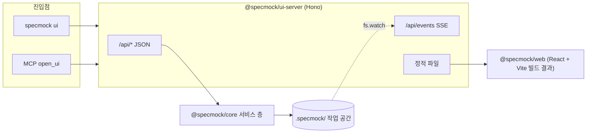

# specmock 2B: Web UI 설계

- 작성일: 2026-11-06
- 상태: 승인됨 (브레인스토밍 대화)
- 선행: [2A 설계](2026-11-05-phase2a-mcp-design.md) — 서비스 층(`packages/core/src/service`)과 MCP 서버

## 1. 목표

로컬 웹 화면에서 스펙 등록 → 분석 → 기능 선택 → mock 생성 → 검증을 끝낼 수 있게 한다. 화면은 2A 서비스 층을 그대로 쓰며 새 도메인 로직을 넣지 않는다.

사용자 환경 가정은 2A와 같다: Claude Code, Node 22.19 이상, pnpm, 저장소 clone 후 `pnpm install && pnpm build`. 개발자 개인 도구(harness)는 없다.

### 범위 밖

- 실행 중인 mock 서버 조작·요청 콘솔 (3단계 이후)
- 인증, 원격 접속 (로컬 전용)
- 마켓플레이스 배포, `analyze_spec` 프롬프트 재전송 비용 (2A 후속 과제로 별도)

## 2. 구조

### 2.1 패키지

| 패키지 | 역할 |
|---|---|
| `@specmock/ui-server` (private) | Hono 서버. `127.0.0.1`에만 바인딩, 포트 기본 자동(`--port`로 지정). `/api/*`는 서비스 층의 얇은 래퍼, `/api/events`는 SSE, 나머지 경로는 `@specmock/web` 빌드 결과 서빙. `startUiServer({root, port}) → {url, close}` export. |
| `@specmock/web` (private) | React + Vite 단일 페이지 앱. API 응답 타입은 core 타입을 재사용. |

### 2.2 진입점

- **CLI** `specmock ui [--port <n>] [--no-open]`: 서버 시작 후 브라우저를 연다. Ctrl+C로 종료.
- **MCP** `open_ui`: MCP 서버 프로세스 안에서 `startUiServer`를 호출해 URL을 돌려준다. 이미 떠 있으면 같은 URL. MCP 서버가 끝나면 함께 종료. MCP 도구는 11개가 된다.

### 2.3 작업 공간 동기화

서버는 `.specmock/`을 `fs.watch`로 감시하고 변경을 SSE `workspace-changed` 이벤트로 보낸다. 화면은 이 이벤트로 해당 시스템 데이터를 다시 불러온다. 그래서 대화 중 Claude가 `submit_extraction`으로 제출한 결과가 화면에 바로 반영된다.

### 2.4 core 보강

화면 서버가 두 번째 쓰기 주체가 되므로 2A 후속 과제 중 아래를 포함한다.

1. **파일 잠금**: 2A의 프로세스 내 mutex를 `<system>` 단위 파일 잠금으로 교체. 대상은 extracted 쓰기, 선택 저장, generate. `.lock` 파일 원자 생성(`wx`), 내용은 pid와 시각. 남은 잠금은 pid가 죽었거나 시간 초과면 회수. 같은 프로세스 안에서는 기존 mutex를 유지해 순서를 보장한다.
2. **잠금 키 realpath 정규화**: 심볼릭 링크 경로도 같은 잠금을 쓴다.
3. **manifest 쓰기 실패 정리**: manifest 갱신이 실패하면 방금 쓴 추출 파일을 지운다.
4. **`listFeatures` 모르는 그룹**: 예외 대신 빈 결과(CLI `list`와 일치).

## 3. 화면과 흐름

### 3.1 공통 틀

- **왼쪽 사이드바**: 시스템 목록(시스템별 단계 아이콘), "+ 스펙 등록".
- **상단 단계 표시**: ① 등록 ② 분석 ③ 기능 선택 ④ 생성 ⑤ 검증. 완료한 단계는 클릭해 돌아갈 수 있다. 앞 단계가 바뀌면 뒤 단계에 "다시 실행 필요" 표시(예: 선택 변경 → 생성·검증).

### 3.2 단계별 화면

| 단계 | 내용 |
|---|---|
| ① 등록 | 파일 경로 또는 URL 입력. core가 감지한 형식(OpenAPI/웹/MD/PDF) 표시. 시스템 이름 자동 제안, 수정 가능. |
| ② 분석 | OpenAPI는 버튼 하나로 끝. 문서는 청크 표(제목, 크기, 추출 상태). "추출 시작" → 확인 창("청크 N개, `claude` CLI 사용, 구독 사용량 발생") → 진행 바(n/N), 취소, 실패 청크만 재시도. `claude` CLI가 없으면 "Claude Code 대화에서 추출" 안내로 대체. 추출이 끝나면 merge 자동 실행 후 카탈로그로. |
| ③ 기능 선택 | 그룹별로 접히는 표, 그룹 체크박스 3상태(전체/일부/없음), 검색, 그룹·메서드 필터. 행 클릭 시 오른쪽 상세 패널(메서드, 경로, 요청/응답 스키마, 예시, 출처). 하단 고정 바 "N개 선택 · mock 생성 →". 선택은 바뀔 때마다 저장(`select_features` set과 같음). |
| ④ 생성 | 출력 디렉터리(기본 `mock/<system>`). 기존 디렉터리를 덮어쓰게 되면 확인 창(2A 덮어쓰기 보호 규칙). 결과: 생성 파일 목록, 실행 방법. |
| ⑤ 검증 | npm install 진행, 계약 테스트 결과를 기능별 통과/실패 표로, 커버리지 요약. |

### 3.3 시각 스타일

시안 여러 차례(모노톤·편집·산업·도면·고대비 등)를 거쳐 **다크 카드형**으로 확정했다. 기준 시안은 [`assets/2026-11-06-phase2b-style-reference.html`](assets/2026-11-06-phase2b-style-reference.html)이며, 화면 구현은 이 파일의 모양을 따른다.

원칙: 어두운 바탕 위에 둥근 카드 3개(사이드바·목록·상세)가 8px 간격으로 떠 있다. 포인트 색은 파랑 하나. 대비가 뚜렷하고(본문 흰색, 보조 글자도 충분히 밝게) 컴팩트하되 글자는 작지 않게. 문구는 부드러운 해요체("골라 주세요", "바뀌었어요"). 그라데이션, 그림자 카드 남발, 알약 배지, 이모지는 쓰지 않는다.

디자인 토큰(`@specmock/web`의 CSS 변수로 둔다):

| 분류 | 토큰 | 값 |
|---|---|---|
| 배경 | `bg` / `surface-1` / `surface-2` / `surface-3` | `#101013` / `#17171c` / `#202027` / `#2c2c35` |
| 선 | `line` / `line-strong` | `#26262d` / `#34343d` |
| 글자 | `text` / `text-2` / `text-3` | `#ffffff` / `#c3c3c6` / `#8b8b92` |
| 포인트 | `accent` / `accent-ink` / `selected` | `#3182f6` / `#ffffff` / `rgba(49,130,246,.16)` |
| 메서드 | `get` / `post` / `put` / `patch` / `delete` | `#33c48a` / `#ffb331` / `#4e9bff` / `#a586ff` / `#f04452` |
| 상태 | `ok` / `danger` | `#33c48a` / `#f04452` |
| 반경 | `radius-sm` / `radius-lg` | `8px` / `14px` |
| 글꼴 | `font` / `mono` | Pretendard → Apple SD Gothic Neo → 시스템 / JetBrains Mono → SF Mono → Menlo |
| 글자 크기 | 본문 / 화면 제목 / 상세 경로 / 경로·코드 / 메서드·숫자 | `14px` / `24px` / `22px` / `13.5px` / `12px` |
| 글자 크기(추가) | 로고 / 카드 제목 / 버튼 / 확인 창 제목 / 보조 글자 | `17px` / `15px` / `15px` / `18px` / `12px` (`--fs-logo` `--fs-panel-title` `--fs-button` `--fs-dialog-title` `--fs-caption`) |
| 높이 | 표 행 / 그룹 행 / 입력·탭 / 주 버튼 / 상단 바 | `32px` / `36px` / `38px` / `42px` / `56px` |
| 폭 | 사이드바 / 상세 패널 / 카드 간격 | `232px` / `392px` / `8px` |

체크박스는 원형, 선택된 행은 `selected` 배경, 선택 안 된 행은 경로·설명을 `text-3`으로 흐리게 한다. 경로 변수(`{id}`)는 `text-3`. 글꼴은 웹 폰트를 번들하지 않고 로컬 글꼴 순서로 지정한다(오프라인 동작).

## 4. 오류 처리와 동시성

### 4.1 API 규칙

- 응답: `{ok: true, data}` 또는 `{ok: false, error: {code, message, hint?}}`.
- 오류 코드와 hint는 2A 서비스 층 것을 재사용한다. hint 속 CLI 명령은 화면 동작 이름으로 바꾼다(2A MCP 층이 도구 이름으로 바꾼 것과 같은 방식).
- 상태를 바꾸는 API는 POST만 받는다.

### 4.2 오래 걸리는 작업 (추출, generate, verify)

- `POST`는 즉시 `{jobId}`를 돌려주고, 진행·완료는 SSE `job-progress` / `job-done` / `job-failed`로 보낸다.
- 작업은 시스템당 하나. 진행 중에 또 요청하면 `409 busy`, 화면은 진행 중인 작업으로 이동.
- 취소 시 `claude`·npm 자식 프로세스를 정리한다. 이미 제출된 청크는 남아 다음에 이어서 할 수 있다.
- 새로고침하면 `GET /api/jobs`로 진행 중인 작업에 다시 연결한다.

### 4.3 여러 프로세스의 동시 쓰기 (화면 서버, MCP 서버, CLI)

- core 파일 잠금(§2.4)으로 `<system>` 단위 쓰기를 직렬화한다.
- 잠금 대기가 길어지면 `busy` 오류와 "다른 곳(CLI/대화)에서 작업 중" hint.
- 다른 곳에서 바뀐 선택은 `workspace-changed`로 다시 불러온다. 편집 중인 선택과 겹치면 "다른 곳에서 변경됨, 다시 불러오기" 알림. 마지막 쓰기가 이긴다.

### 4.4 기타

- SSE가 끊기면 자동 재연결하고, 재연결 후 전체 상태를 다시 불러온다.
- 지정한 포트가 사용 중이면 명확한 오류. 자동 포트는 충돌하지 않는다.
- 웹 빌드 결과가 없으면 "`pnpm build`를 먼저 실행하세요" 안내 후 종료.

### 4.5 보안

로컬 전용이라 인증은 없다. `Host` 헤더가 `127.0.0.1:<port>` / `localhost:<port>`가 아니거나, `Origin`이 있는데 같은 출처가 아니면 거부한다(다른 사이트의 요청, DNS 리바인딩 차단).

## 5. 테스트

| 대상 | 내용 |
|---|---|
| core | 파일 잠금: 여러 자식 프로세스 동시 submit 전부 성공, 남은 잠금 회수, 심볼릭 링크 경로도 같은 잠금. manifest 실패 시 정리. `listFeatures` 모르는 그룹 → 빈 결과. 모두 실패하는 테스트를 먼저 확인. |
| ui-server | Hono `app.request()`로 소켓 없이 API별 정상·오류 형식·hint 변환·`409 busy`·Host/Origin 거부. SSE 이벤트 순서. 취소 시 자식 프로세스 정리(가짜 `claude` 실행 파일). |
| web | vitest + Testing Library: 그룹 체크박스 3상태, 검색·필터, 선택 저장 호출, 확인 창, 오류 알림. |
| E2E | Playwright 한 경로: OpenAPI 예제로 등록 → 분석 → 선택 → 생성 → 검증을 실제 서버·브라우저로. 문서 추출 경로는 가짜 `claude`로 한 번. 모델 호출 없음. |
| MCP | `open_ui`가 URL을 돌려주고 두 번 호출해도 같은 URL. 도구 목록 11개. |

실제 구독 호출은 쓰지 않는다. 테스트 안의 가짜 키는 실행 중에 만든다.

## 6. 문서

- README: "Web UI" 절(`specmock ui`, 대화에서 `open_ui`). 스크린샷은 스타일 확정 후.
- `docs/architecture.md`: 패키지 관계·데이터 흐름 Mermaid 갱신(파싱 검증).
- [최상위 설계](2026-11-04-specmock-design.md): 로드맵 2B 갱신.
- `plugin/skills/specmock/SKILL.md`: "화면으로 고르고 싶다"는 요청에 `open_ui` 안내.

## 7. 완료 기준

1. 새 clone에서 `pnpm install && pnpm build && pnpm test` 통과.
2. `specmock ui`로 OpenAPI 예제를 등록부터 검증까지 화면만으로 끝낼 수 있다.
3. Claude Code 대화에서 `open_ui`로 화면을 열고, 대화 중 제출한 추출 결과가 화면에 바로 반영된다.
4. 화면 서버와 MCP 서버가 같은 작업 공간에 동시에 써도 데이터가 손상되지 않는다.
5. 화면이 §3.3 디자인 토큰과 기준 시안의 모양을 따른다.
6. 저장소에 개발자 개인 도구의 흔적이 없다.

## 8. 결정 기록

| 결정 | 대안 | 이유 |
|---|---|---|
| 범위: 등록·분석·선택·생성·검증 | 보기 전용 / mock 서버 조작까지 | 서비스 층을 그대로 연결, API 키 없이 동작. 조작 콘솔은 범위가 커서 제외. |
| 진입점: CLI `specmock ui` + MCP `open_ui` | 하나만 | 서버 코드 하나, 진입점만 둘. 대화 중 추출 → 화면 선택 흐름이 이어짐. |
| React + Vite SPA | Hono JSX + htmx / 프레임워크 없음 | 상호작용이 많은 선택 화면, API와 화면 분리 테스트, 3단계 확장. |
| 레이아웃: 사이드바 + 단계 표시 | 마법사 / 대시보드 카드 | 여러 시스템, 단계 결과를 자주 오감. |
| 선택 화면: 그룹 표 + 상세 패널 | 그룹 트리 + 카드 / 체크 목록 + 표현식 | 수백 개 기능에서 검색·그룹 일괄 선택, 선택 전 스키마 확인. |
| 문서 추출: 화면에서 `claude` CLI 실행, 실행 전 확인 | 화면은 추출 안 함 | 화면만으로 끝까지 가능, 확인 창으로 비용 통제. |
| 2A 후속 과제 중 동시성·`listFeatures`만 포함 | 전부 / 없음 | 화면 서버가 두 번째 쓰기 주체가 되어 실제 버그가 됨. |
| 시각 스타일: 다크 카드형, 파랑 포인트, 큰 글자 컴팩트 | 모노톤 다크 / 편집·산업·도면 / 고대비 툴형 / 흑백 고대비 | 사용자가 "AI 같은" 시안(보라·그라데이션)과 대비 약한 시안을 거절, 어둡고 세련되며 컴팩트하고 대비가 뚜렷한 것을 원함. 큰 서비스의 디자인 원칙을 참고해 확정, 글자 크기를 키움. |
