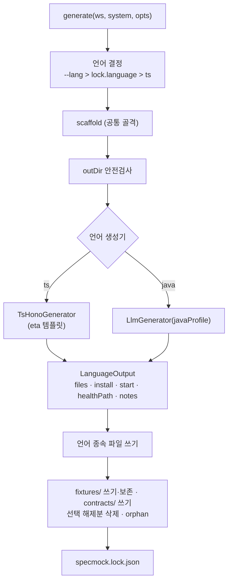
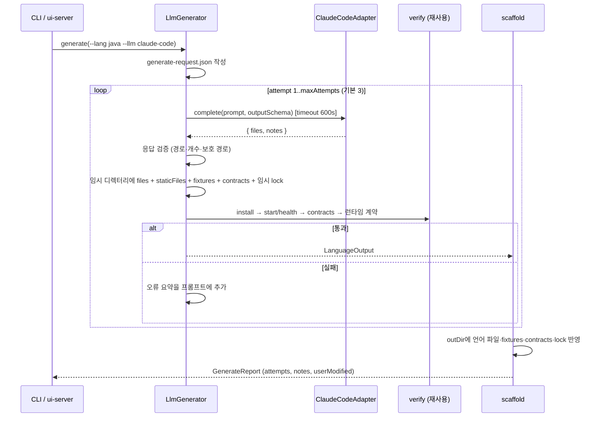
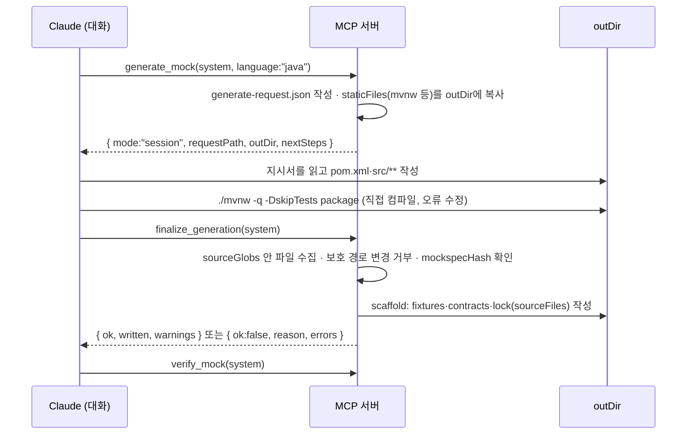
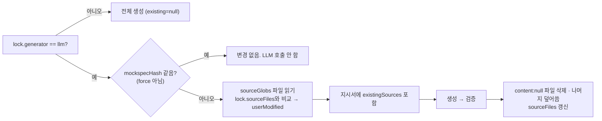

# 3A 설계: 다른 언어 생성 (Java 프로필)

작성일: 2026-11-09
상태: 구현 완료 (2026-11-09, 계획: [2026-11-09-phase3a-java-generator.md](../plans/2026-11-09-phase3a-java-generator.md), 설계와 달라진 점은 상위 문서 §12 "3A" 행)
기준 코드: main 0b28529
상위 문서: [specmock 설계 문서](2026-11-04-specmock-design.md) §10 로드맵 3단계, "3단계 인터페이스 경계"

---

## 0. 한 문장 요약

검증된 `mockspec.json`과 TypeScript 참조 구현을 LLM에 보여 **Java(Maven + Javalin)** mock 서버를 생성하고, 기존 `verify`가 그대로 통과하는지로 품질을 판정한다. 언어 무관 부분(fixtures · contracts · lock · 보존)은 core가 결정적으로 쓰고, LLM은 언어 종속 파일만 만든다.

## 1. 배경과 목표

### 1.1 왜 지금 이것인가

3단계는 세 가지 독립 작업(다른 언어 생성 · Proxy/녹화 · API 키 어댑터)으로 정의돼 있다. 그중 다른 언어 생성이 완료 기준의 핵심이고, 키 없이 진행할 수 있으며, `verify`가 이미 "lock의 기동 명령만 알면 어떤 언어 서버든 검증"하도록 설계돼 있어 기존 자산을 바로 쓴다.

### 1.2 목표

| 목표 | 설명 |
|---|---|
| Java mock 생성 | `specmock generate <system> --lang java`로 Maven + Javalin 프로젝트를 만든다 |
| 같은 verify 통과 | TS mock과 똑같은 contracts와 런타임 계약으로 검증한다. 통과하지 못하면 "생성 완료"가 아니다 |
| 두 실행 경로 | `claude-code` 어댑터(CLI · Web UI, 자동 재시도)와 세션 모드(MCP 도구, Claude가 직접 작성·컴파일) |
| 증분 생성 | 기능을 추가 선택한 뒤 다시 생성하면 기존 Java 코드와 사용자 수정을 유지하고 변경분만 반영한다 |
| 언어 추가가 쉽다 | 새 언어 = 프로필(규칙 · 정적 파일 · 명령) 하나 추가. 공통 골격은 건드리지 않는다 |
| 사용자 환경 | JDK 17 이상만 요구한다. Maven은 생성물에 포함된 Wrapper가 첫 빌드에 내려받는다 |

### 1.3 결정 사항과 이유

브레인스토밍에서 비교 후 정한 것들이다.

| 결정 | 대안 | 이유 |
|---|---|---|
| 지원 언어는 **고정 목록**(`ts`, `java`) | 임의 언어 인자 | 각 언어를 실제로 기동·검증하는 테스트를 두려면 언어마다 프로필과 툴체인이 필요하다. 보증 없는 언어를 받지 않는다 |
| 첫 LLM 언어는 **Java** | Python(툴체인 가벼움) | 작성자의 실사용 언어. 컴파일 · 빌드툴 · 느린 기동이라는 가장 까다로운 조건이 처음부터 들어와 설계가 튼튼해진다. Java가 통과하면 Python/Go 추가는 프로필 작업이다 |
| **Maven + Javalin** (+ Jackson, networknt json-schema-validator) | Spring Boot / 의존성 0(JDK 내장 HttpServer) / Gradle | mock은 쓰고 버리는 코드라 "한 번에 맞게 만들고 빠르게 verify 통과"가 익숙함보다 중요하다. Spring은 코드가 길어 컴파일 오류 · 재시도 비용이 늘고, 의존성 0은 JSON · 스키마 검증을 손으로 짜야 해 위험하다. Maven은 선언적이고 Wrapper가 스크립트만으로 동작한다 |
| **claude-code + 세션 둘 다** | 하나만 | 지시서와 사후 검증은 한 벌이고 "누가 파일을 쓰느냐"만 다르다. analyze 단계와 같은 대칭 구조 |
| 재생성은 **증분** | 전체 재생성 / 변경 없으면 건너뛰기 | TS의 "추가 라우트만 생성, 기존 fixture 보존" 정신과 일치. 사용자가 고친 Java 코드가 살아남아야 한다 |
| **공통 골격 + 언어 생성기** | 설계서의 `Generator.generate(mockspec, outDir)` 하나 / LLM이 전부 생성 | fixture 보존 · orphan · lock 로직을 한 곳에 둔다. 결정적이어야 할 fixture · contract를 LLM에 맡기지 않는다("결정적 코어, 얇은 LLM") |

### 1.4 비목표 (3A)

- Java 외 언어 프로필(Python, Go 등). 이후 3A-2로 분리.
- Spring Boot 등 두 번째 Java 프로필.
- 시나리오 제어(4xx 응답 전환). 1A에서 3단계로 미룬 항목이지만 3A 범위 밖.
- Proxy/녹화(3B), API 키 LLM 어댑터(3C).
- 모델이 생성 중 도구를 쓰는 에이전트형 생성. claude-code 모드는 `--tools ""`를 유지하고 재시도 루프는 core가 돌린다.
- Gradle 빌드.

## 2. 구조

### 2.1 공통 골격과 언어 생성기



지금 `renderTsHono`(`generate/tsHono.ts`) 한 함수가 언어 종속 파일(:125-133)과 언어 무관 파일(:135-186)을 함께 쓴다. 이 경계에서 둘로 나눈다. **TS 생성 결과는 바이트 단위로 변하지 않아야 하며** 기존 테스트가 그것을 보장한다.

```ts
// packages/core/src/generate/generator.ts
interface LanguageGenerator {
  readonly language: string;
  generate(ctx: GenerateContext): Promise<LanguageOutput>;
}
interface GenerateContext {
  spec: MockSpec;
  outDir: string;
  existing: ExistingSources | null;   // 증분 생성용 (2.4)
  signal?: AbortSignal;
  onProgress?: (e: GenerateProgress) => void;
}
interface LanguageOutput {
  files: { path: string; content: string }[];        // 언어 종속 파일만. outDir 상대 경로
  install: { command: string; args: string[] } | null;
  start: { command: string; args: string[] };
  healthPath: string;
  startTimeoutMs?: number;
  notes: string[];                                   // 모델의 가정·경고 → coverage.md
}
```

### 2.2 언어 프로필

`LlmGenerator`는 프로필 하나를 받아 동작한다. Java 프로필(`generate/profiles/java.ts`):

| 항목 | 값 |
|---|---|
| `language` | `java` |
| `displayName` | Java (Maven + Javalin) |
| `rules` | 프롬프트에 들어가는 규칙 텍스트(2.5) |
| `staticFiles` | `mvnw`, `mvnw.cmd`, `.mvn/wrapper/maven-wrapper.properties`(`distributionType=only-script`, Maven 3.9.x 고정). 모두 텍스트. core가 `templates/java/` 에서 복사 |
| `install` | `./mvnw -q -DskipTests package` (Windows는 `mvnw.cmd`; `process.platform`으로 선택) |
| `start` | `java -jar target/mock.jar` |
| `healthPath` | `/__specmock/health` |
| `startTimeoutMs` | 60_000 |
| `installTimeoutMs` | 600_000 (첫 빌드는 Maven과 의존성을 내려받는다) |
| `sourceGlobs` | `pom.xml`, `src/**` — 모델이 쓸 수 있는 곳이자 증분 생성 때 "기존 소스"로 읽는 범위 |
| `protectedPaths` | `fixtures/**`, `contracts/**`, `specmock.lock.json`, `mvnw*`, `.mvn/**`, `.specmock-installed`, `target/**` |
| `maxFiles` | 200 |
| `requires` | 사용자 안내용: JDK 17 이상, 첫 빌드 시 네트워크 |

프로필 등록표(`generate/profiles/index.ts`)에 있는 언어만 허용한다. 미등록 언어는 파이프라인 진입 전에 "지원 언어: ts, java"로 종료한다(설계 문서 §6 "사용자 입력 오류는 즉시").

### 2.3 언어의 출처

| 우선순위 | 출처 | 비고 |
|---|---|---|
| 1 | `--lang` / MCP `language` / UI 선택 | 명시 |
| 2 | 기존 `specmock.lock.json`의 `language` | 재생성 시 기본값 |
| 3 | `ts` | |

lock의 언어와 다른 언어를 `--force` 없이 요청하면 "이 디렉터리는 `ts`로 생성됐습니다. 다른 언어로 바꾸려면 `--force`(기존 소스 삭제) 또는 `--out`을 쓰세요"로 종료한다. `--force`로 언어를 바꿀 때 지우는 것은 **화이트리스트**다: lock의 `sourceFiles`에 기록된 언어 종속 파일, 이전 언어 프로필의 빌드 산출물(`ts`: `node_modules/`, `package-lock.json`; `java`: `target/`), 설치 마커. 그 밖의 파일은 건드리지 않는다. 그리고 outDir에 `.git` 또는 `.specmock`이 있으면 언어 변경을 거부한다(예전에 `--out . --force`로 프로젝트 루트에 만든 경우). 왜: "보호 경로 밖 전부 삭제"는 outDir이 잘못 잡혔을 때 사용자 소스를 지운다(리뷰 Major). lock의 `language`가 프로필 등록표에 없으면 즉시 오류다. fixtures 보존 규칙은 그대로다.

`mockspec.json`의 `language` 필드는 **제거**한다(`types.ts:128`). select가 쓰기만 하고 아무도 읽지 않았다. 옛 mockspec은 `.passthrough()` 없이도 zod가 모르는 키를 버리므로 호환된다. `select()`의 `language` 옵션도 삭제한다.

### 2.4 lock 확장

```jsonc
{
  "system": "petstore",
  "language": "java",                       // 열린 문자열 (프로필 표로 검증)
  "generator": "llm" | "template",
  "mockspecHash": "sha256",                 // 이제 실제로 읽는다 (아래)
  "generatedAt": "ISO 8601",
  "install": { "command": "./mvnw", "args": ["-q", "-DskipTests", "package"] } | null,
  "installCheck": "target/mock.jar",         // 설치 뒤 존재해야 하는 경로. 없으면 마커가 맞아도 다시 설치 (ts: node_modules)
  "start": { "command": "java", "args": ["-jar", "target/mock.jar"] },
  "healthPath": "/__specmock/health",
  "startTimeoutMs": 60000,                  // 선택. 없으면 30000
  "fixtureHashes": { "fixtures/<id>/<status>.json": "sha256" },
  "sourceFiles": { "pom.xml": "sha256", "src/main/java/.../Server.java": "sha256" }   // 언어 종속 파일의 생성 시 해시
}
```

- `install`이 없는 옛 lock은 `npm install --no-audit --no-fund --loglevel=error`로 해석한다(지금 하드코딩된 동작과 같다). TS 생성기는 앞으로 이 값을 명시적으로 쓴다.
- `sourceFiles`: 증분 생성 때 현재 파일 해시와 비교해 **사용자가 고친 파일**을 알아낸다. 보고(`GenerateReport.userModified`)와 프롬프트(2.5)에 쓴다. 템플릿 생성기(TS)도 기록한다 — 언어 변경 시 삭제 화이트리스트(2.3)와 설치 키의 근거가 된다. TS는 지금처럼 덮어쓴다(동작 불변).
- `installCheck`: 설치 마커(outDir 루트 `.specmock-installed`, 내용은 `hashJson({install, sourceFiles 현재 해시})`)가 맞아도 이 경로가 없으면 다시 설치한다. 왜: `rm -rf node_modules`, `target/` 삭제, 마커가 함께 커밋된 디렉터리를 새로 clone한 경우에 설치를 건너뛰면 기동이 실패하고 스스로 복구되지 않는다(리뷰 Major). 옛 lock은 `node_modules`로 해석한다.
- `mockspecHash`: LLM 생성기에서 lock의 해시와 현재 mockspec 해시가 같고 `--force`가 아니면 LLM을 호출하지 않고 "변경 없음"으로 끝낸다. 왜: 비결정적 호출을 이유 없이 반복하지 않는다.
- 손상된 lock은 지금처럼 오류로 멈춘다.

### 2.5 지시서 `generate-request.json`

세션 모드와 claude-code 모드가 **같은 지시서**를 만든다. 차이는 누가 읽고 누가 파일을 쓰느냐뿐이다. analyze의 `analyze-request.json`과 같은 역할.

```jsonc
// .specmock/<system>/generate-request.json
{
  "system": "petstore",
  "language": "java",
  "createdAt": "ISO 8601",
  "mockspecHash": "sha256",                  // finalize가 stale 판정에 쓴다
  "outDir": "/abs/path/mock/petstore",
  "prompt": "…(아래 구성 요소를 합친 전체 프롬프트)…",
  "rules": ["…프로필 규칙 줄 단위…"],
  "runtimeContract": ["…verify가 요구하는 계약 줄 단위 (3.3)…"],
  "reference": { "language": "ts", "files": [{ "path": "src/server.ts", "content": "…" }] },   // TsHonoGenerator 렌더 결과
  "existingSources": [{ "path": "src/main/java/…", "content": "…", "userModified": true }],   // 증분일 때만
  "protectedPaths": ["fixtures/**", "contracts/**", "specmock.lock.json", "mvnw*", ".mvn/**"],
  "sourceGlobs": ["pom.xml", "src/**"],
  "outputSchema": { /* { files:[{path,content}], notes:[string] } JSON Schema */ }
}
```

프롬프트 구성 요소:

1. 역할과 목표: "이 MockSpec의 mock 서버를 Java로 작성한다. 아래 런타임 계약을 지키면 verify가 통과한다."
2. MockSpec 요약: 선택된 기능의 id · method · path · 요청 스키마(params/query/body) · 서빙 상태 코드 · 응답 스키마. **fixture 바디는 넣지 않는다**(크기 절약; 서버는 런타임에 파일을 읽는다). `notMocked` 목록(501 안내용). contracts 전체(모델이 무엇으로 검증되는지 안다).
3. 런타임 계약(3.3).
4. TS 참조 구현 전체(렌더된 8개 파일). 왜: 구조 · 라우트 등록 · 검증 흐름 · 501/404 · 헬스 바디의 **정답 모양**을 보여 주면 설명보다 정확하다.
5. Java 프로필 규칙: JDK 17, Javalin 6, Jackson, networknt json-schema-validator, `pom.xml`은 `maven-shade-plugin`으로 `target/mock.jar`(finalName 고정, Main-Class 매니페스트), 패키지 `specmock.<system>`, 포트는 `PORT` 환경변수(기본 4010), `127.0.0.1` 바인딩, 요청 검증 실패는 400 `{error:"validation_failed", details}`, query 값은 스키마 타입으로 강제 변환(ajv `coerceTypes` 상당), 204/205는 바디 없음, SIGTERM에 종료, fixtures는 `fixtures/<id>/<status>.json`을 요청 때마다 읽음, 외부 네트워크 호출 금지, 파일은 `sourceGlobs` 안에만.
6. Java 참조 예시: `packages/core/test/fixtures/java-petstore/`(5.4)의 `pom.xml`과 서버 진입 파일 발췌. 왜: 의존성 좌표와 shade 설정은 모델이 자주 틀리는 부분이다.
7. 증분 생성(기존 lock이 `generator:"llm"`): `existingSources` 전부와 규칙 — "기존 코드를 유지하고 추가 · 삭제된 기능만 반영한다. `userModified:true` 파일은 라우트 추가 · 삭제 외에 바꾸지 않는다. 출력은 **전체 파일 집합**이다(바뀌지 않은 파일도 그대로 포함). 삭제할 파일은 `content: null`."
8. 출력 형식: `outputSchema`. `notes`에는 가정 · 지키지 못한 규칙을 적는다.

재시도 때는 8 뒤에 "이전 시도 결과" 절을 붙인다: 실패 단계(응답 검증 / 빌드 / 기동 / contract), 컴파일 오류 최대 50줄, 실패 contract마다 요청 · 기대 · 실제, 런타임 계약 검사 결과. 모델 출력은 매번 전체 파일 집합이다(부분 패치 아님 — 검증이 단순하다).

## 3. 데이터 흐름

### 3.1 claude-code 모드 (CLI · Web UI)



- 임시 디렉터리에서 검증하고 통과한 뒤에만 outDir에 반영한다. 왜: 실패한 시도가 사용자의 기존 mock을 깨지 않는다. 증분 생성 때 임시 디렉터리에는 사용자 fixture 수정분도 복사한다(검증은 실제 fixture로).
- Maven의 로컬 저장소(`~/.m2`)는 시도 간에 공유되므로 두 번째 빌드부터는 빠르다. 임시 디렉터리에는 `target/`만 새로 생긴다.
- 최종 실패(maxAttempts 초과): 종료 코드 **5**(verify 실패 2와 구분). 마지막 시도의 파일과 오류 요약을 `outDir/.specmock-attempt/`에 남기고 경로를 알려 준다. outDir의 기존 내용은 바꾸지 않는다. 다음 `generate`가 이 디렉터리를 지운다.
- 환경 오류는 재시도하지 않는다: `java`/`./mvnw` spawn 실패, 또는 **install 단계** 로그에 Maven 해석 실패 문구(`Could not transfer artifact`, `Could not resolve dependencies`, `JAVA_HOME is not defined`, `UnknownHostException`) 또는 **mvnw 스크립트 자체의 실패 문구**(`does not exist in PATH nor is JAVA_HOME set` = JDK 없음, `Failed to fetch` = 오프라인 첫 빌드, `release version 17 not supported` = JDK 17 미만)가 보이고 **컴파일 오류 표식(`COMPILATION ERROR`)은 없을 때** 즉시 "JDK 17 이상과 네트워크가 필요합니다"로 종료(코드 1). 기동 · contract 단계 로그에는 적용하지 않는다. 왜: 모델이 고칠 수 없는 실패에 토큰을 쓰지 않되, 모델 코드가 `UnknownHostException`을 참조해 javac가 그 줄을 되찍는 경우를 환경 오류로 오판하지 않는다(리뷰 Minor).
- `--force`로 언어를 바꾸는 경우, 이전 언어 파일의 삭제(2.3 화이트리스트)는 **생성이 통과한 뒤, 반영 직전**에 한다. 왜: 시도 전에 지우면 생성 실패 시 기존 mock이 깨진다(리뷰 Major).
- 알려진 한계: 반영 단계(언어 파일 → fixtures/contracts → lock)는 원자적이지 않다. 중간에 실패하면 새 소스 + 옛 lock이 남아 다음 증분 생성이 그 파일을 `userModified`로 볼 수 있다. 드물고 `--force`로 복구된다. `outDir/.specmock-attempt/`에는 빌드 로그 꼬리가 남으므로 outDir을 커밋한다면 `.gitignore`에 넣기를 README에 안내한다.
- 어댑터: `LlmAdapter.extract` → `complete(req: { prompt, schema, signal?, timeoutMs? })`로 이름과 시그니처를 일반화한다. 기존 호출부는 바꿔 끼운다. 기본 타임아웃은 호출마다 주입(추출 180s 유지, 생성 600s). 그 외(`--json-schema`, 빈 임시 cwd, `--no-session-persistence`, `--tools ""`, 모델 옵션)는 그대로.

### 3.2 세션 모드 (MCP · 스킬)



- `generate_mock`이 `ts`면 지금처럼 즉시 생성(LLM 없음). `java`면 지시서를 쓰고 멈춘다. 이미 지시서가 있고 mockspec 해시가 같으면 다시 쓰지 않고 같은 안내를 돌려준다.
- `finalize_generation` 거부 조건: 지시서 없음(`no-request`), 지시서의 mockspecHash ≠ 현재 mockspec(`stale-request`: "select가 바뀌었습니다. generate_mock을 다시 호출하세요"), 보호 경로 파일이 바뀌었거나 생겼음(`protected-path-modified`, 파일 목록 포함), `sourceGlobs` 안에 파일이 하나도 없음(`no-sources`), 파일 수 > maxFiles. 실패는 예외가 아니라 `{ok:false, reason, errors}`(submit_extraction과 같은 관례).
- finalize는 **컴파일하지 않는다**. 컴파일 · 기동 · contract는 `verify_mock`의 일이다. 왜: 역할을 하나씩 두고(작성 → 확정 → 검증), 세션 모드에서 Claude가 이미 컴파일했을 가능성이 높다.
- finalize는 **여러 번** 할 수 있어야 한다(verify 실패 → 소스 수정 → finalize → verify 반복). 그래서 보호 경로 변경 판정은 "지시서의 `protectedHashes`"와 비교하되, finalize가 성공하면 그 시점의 보호 파일 해시로 `protectedHashes`를 **갱신**한다. 빌드 산출물(`target/**`)과 설치 마커는 비교에서 제외한다(verify가 만든다). 왜: 그렇지 않으면 finalize 자신이 쓴 fixtures · contracts · lock이 "새로 생긴 보호 파일"로 잡혀 2번째 finalize가 항상 거부된다(리뷰 Major).
- 세션 모드에서 `--force`로 언어를 바꿀 때는 prepare가 이전 lock(언어 · `sourceFiles`)을 `.specmock-session.json`에 기록하고, finalize가 성공 직전에 2.3의 화이트리스트 정리(이전 언어의 소스 · 산출물 · 마커)를 수행한다. 왜: 그렇지 않으면 옛 TS 소스와 `node_modules`가 어떤 화이트리스트에도 들지 않는 고아가 된다.
- CLI 대응: `generate --llm session`(지시서 작성 후 멈춤, 다음 할 일 안내), `generate --finalize`(finalize). analyze의 `--prepare`/`--merge`와 같은 모양이다.

### 3.3 런타임 계약 (verify가 확인하는 것)

지시서의 `runtimeContract`이자 verify의 검사 항목이다. 언어와 무관하다.

| # | 계약 | 지금 | 3A |
|---|---|---|---|
| 1 | `specmock.lock.json`이 스키마를 만족 | ○ | `install`, `generator`, `sourceFiles`, `startTimeoutMs` 추가 |
| 2 | `install`(있으면)이 cwd=outDir에서 성공. 마커 `.specmock-installed`가 있으면 생략 | `npm install` 하드코딩, 마커는 `node_modules/` 안 | lock에서 읽음. 마커를 outDir 루트로 이동. 설치 타임아웃 `installTimeoutMs`(기본 600s) |
| 3 | `start`를 argv로 spawn(셸 없음), cwd=outDir, `PORT` 환경변수 | ○ | 그대로 |
| 4 | `127.0.0.1:<PORT>`에서 `startTimeoutMs` 안에 `healthPath` 2xx | 30s 고정 | lock 값(기본 30s) |
| 5 | contract마다 status 일치, 2xx 바디는 JSON이고 응답 스키마 통과 | ○ | 그대로 |
| 6 | 필수 query/body 누락 → 400 | ○ (contract로) | 그대로 |
| 7 | 선택 안 된 기능 경로 → **501 `{error:"not_mocked", feature, hint}`** | TS e2e만 확인 | verify가 검사: `notMocked`가 비어 있지 않으면 첫 항목으로 요청 |
| 8 | 모르는 경로 → **404 `{error:"unknown_path"}`** | TS e2e만 확인 | verify가 검사: `GET /__specmock/unknown-<random>` |
| 9 | SIGTERM에 종료(3s 뒤 SIGKILL) | ○ | 그대로 |

7 · 8의 결과는 `coverage.md`에 "런타임 계약" 절로 들어가고, 실패는 contract 실패와 같이 종료 코드 2다. 기존 TS mock은 이미 만족한다(e2e 테스트에서 확인됨).

### 3.4 증분 생성



- `--force`는 existing을 무시하고 언어 종속 파일을 지운 뒤 전체 생성한다.
- 선택 해제된 기능의 라우트 제거는 모델에 맡기되, 계약 7(501)로 누락을 잡는다.
- 사용자 수정 파일을 모델이 바꿨는지는 **강제하지 않는다**(규칙으로만 요청). 보고에 "사용자 수정 파일 N개가 다시 작성됨"을 표시해 사용자가 diff로 확인할 수 있게 한다. 왜: 라우트 등록 파일은 사용자가 고쳤더라도 새 기능을 더하려면 바꿔야 한다. 기계적으로 막으면 증분이 불가능하다.

## 4. 인터페이스 노출

### 4.1 CLI

```
specmock generate <system> [--lang ts|java] [--llm claude-code|session] [--model m]
                  [--max-attempts n] [--finalize] [--out dir] [--force] [--json]
specmock run      <system> <origins...> [--lang ts|java] ...      # 세션 모드 불가 (analyze와 동일)
```

- `--llm` 기본은 `claude-code`. `ts`에는 영향 없다.
- 완료 안내를 lock에서 조합한다: `cd mock/petstore && ./mvnw -q -DskipTests package && java -jar target/mock.jar`. 지금 `npm install && npm start`가 하드코딩된 곳(CLI `generate.ts:18`, `run.ts:41`, MCP `mock.ts:68,73`)을 모두 교체한다. 조합 함수는 core(`generate/lock.ts`)에 하나.
- 종료 코드: 0 성공, 1 오류(환경 · 입력), 2 verify contract 실패(`verify`), **5** LLM 생성이 maxAttempts 안에 통과하지 못함(`generate`, `run`).
- `--json` 출력에 `attempts`, `notes`, `userModified`, `skipped`("변경 없음") 추가.

### 4.2 MCP (11 → 12개 도구)

| 도구 | 변경 |
|---|---|
| `generate_mock` | 입력에 `language?: "ts" \| "java"`(기본 ts). `java`면 지시서를 쓰고 `{ mode:"session", requestPath, outDir, nextSteps[] }` 반환. 설명에서 "TypeScript(Hono)" 문구를 언어 목록으로 |
| `finalize_generation` | 신규. 입력 `{ system }`. 3.2의 거부 조건과 결과 |
| `verify_mock` | 설명의 "npm install을 먼저 실행" 문구를 "lock의 install 단계를 자동 실행"으로 |
| `list_languages` | 두지 않는다. `generate_mock` 설명에 언어 목록을 적는다 |

도구 이름은 SKILL.md와 양방향 drift 테스트(`mcp/test/plugin.test.ts:21`)로 묶여 있으므로 함께 기재한다.

### 4.3 Web UI

- Generate 화면: 출력 디렉터리 옆에 **언어 선택**(ts / java). `java`는 claude-code 모드로 작업(job)으로 실행.
- SSE job 이벤트에 단계(`generating` → `building` → `verifying`)와 `attempt n/maxAttempts`를 실어 진행을 보여 준다. `GenerateProgress`(2.1)의 `stage` · `attempt` · `maxAttempts` · `message`를 `job-progress`에 싣는다.
- ui-server `POST /api/systems/:s/generate` body에 `language?`. 결과에 `attempts`, `notes`, `userModified`. 작업 시작 전에 사전 검사: 모르는 언어는 400, 기존 lock과 다른 언어를 `force` 없이 요청하면 409 `language-change-required`(기존 `overwrite-required`와 같은 모양). 화면은 이 코드를 받으면 "기존 소스를 지우고 다시 만들까요? fixtures · contracts 수정은 보존됩니다" 확인 창을 띄우고 `force: true`로 재요청한다. 왜: Web UI에서도 언어를 바꿀 수 있어야 하고, 작업 실패(500)로 보이면 사용자가 원인을 알 수 없다(리뷰 Minor).
- 생성 작업은 **취소할 수 있다**. LLM 호출 · 빌드 · 검증은 임시 디렉터리에서 돌고 `LlmGenerator`가 abort에 응답하므로, 반영 직전까지는 취소해도 outDir이 변하지 않는다. 왜: Java 생성은 수 분이 걸릴 수 있는데 "파일을 쓰는 중"이라는 이유로 멈출 수 없게 두는 것은 사실과 다르다.
- 세션 모드는 화면에 없다(대화가 없으므로).

### 4.4 스킬 문서 (`plugin/skills/specmock/SKILL.md`)

- generate 절에 `--lang java`와 세션 모드 절차: `generate_mock(language:"java")` → 지시서(`generate-request.json`) 읽기 → `pom.xml`·`src/**` 작성 → `./mvnw -q -DskipTests package`로 컴파일 확인 → `finalize_generation` → `verify_mock` → 실패 시 수정 후 다시 finalize·verify.
- 실행법 안내를 언어별로(`npm install && npm start` / `./mvnw … && java -jar target/mock.jar`).
- CLI 경로에는 `--lang java --llm claude-code`를 안내한다(스킬 환경에서는 세션 모드를 우선).
- 옵션 drift 테스트(문서 → `--help` 단방향)가 있으므로 새 옵션 `--lang`, `--llm`, `--finalize`, `--max-attempts`가 CLI에 있어야 한다.

## 5. 테스트

| 계층 | 내용 | 환경 |
|---|---|---|
| 리팩터링 보호 | 기존 generate · e2e · verify 테스트가 그대로 통과. TS 생성 결과 바이트 동일(기존 스냅샷/보존 테스트). `install` 없는 옛 lock을 `npm install`로 해석 | Node |
| LlmGenerator 단위 | 가짜 `claude`(기존 `core/test/bin/` 방식)가 `{files, notes}`를 돌려준다. **테스트용 프로필** `fake`(start=`node server.mjs`, install=null, staticFiles 없음)로 전 흐름: 응답 검증(경로 탈출 · 보호 경로 · 개수), 임시 디렉터리 검증 → outDir 반영, 재시도(1회 실패 후 성공, 오류 요약이 두 번째 프롬프트에 포함), maxAttempts 초과 시 exit 5와 `.specmock-attempt/`, 환경 오류 즉시 중단, mockspecHash 같으면 건너뜀, 증분(existingSources · userModified · `content:null` 삭제) | Node |
| 세션 모드 | `generate --llm session`이 지시서를 쓰고 멈춤, `--finalize`의 거부 조건 5가지와 성공 경로, MCP `finalize_generation` 도구 등록 · 스킬 문서 drift | Node |
| verify 확장 | lock의 install 실행 · 생략(마커) · 타임아웃, 계약 7(501) · 8(404) 검사와 coverage.md 반영. lock.start 교체 패턴(`e2e.test.ts:106`)으로 "501을 내지 않는 서버"를 Node로 주입해 실패를 확인 | Node |
| **Java 참조 mock** | `packages/core/test/fixtures/java-petstore/`에 Petstore용 Javalin mock을 **손으로 작성해 커밋**(런타임 계약의 정답지). 테스트: Petstore를 ingest → select → scaffold로 fixtures/contracts/lock을 만들고 참조 소스를 얹어 `verify` 통과. 프롬프트의 Java 예시(2.5 §6)도 이 디렉터리에서 읽는다 | `java -version` 성공 시. 아니면 skip + 이유 출력. 네트워크 필요 |
| Java 프로필 | staticFiles 복사, install/start 조합 문구, Windows 분기 | Node |
| 실제 LLM | `scripts/live-llm-check.ts`에 "Petstore → Java 생성 → verify" 케이스 추가. 수동(`pnpm llm:check`), CI 제외 | claude · JDK |

CI 워크플로는 현재 없다. 추가하지 않는다(3A 범위 밖). 로컬 `pnpm test`가 기준이며 Java 테스트는 환경에 따라 skip된다.

## 6. 구현 순서 (계획 문서의 뼈대)

1. `renderTsHono` 분리: `scaffold` + `TsHonoGenerator`. lock에 `install`·`generator`·`sourceFiles` 추가, 옛 lock 호환. `mockspec.language` 제거. 기존 테스트 통과.
2. verify 확장: install 단계를 lock에서, 마커 이동, `startTimeoutMs`, 계약 7·8, coverage.md 절. 하드코딩 안내 문구를 lock 조합 함수로.
3. `LlmAdapter.complete` 일반화와 타임아웃 주입.
4. 지시서 작성기(`generate/request.ts`)와 응답 검증(`generate/validateOutput.ts`). 테스트용 `fake` 프로필.
5. `LlmGenerator`: claude-code 루프(임시 디렉터리 검증 · 재시도 · 환경 오류 · attempt 보존 · 증분).
6. 세션 모드: `--llm session`, `--finalize`, MCP `generate_mock(language)` · `finalize_generation`.
7. Java 프로필 + 정적 파일(mvnw) + Java 참조 mock + 환경 게이트 테스트.
8. CLI · MCP · ui-server · web 노출, SKILL.md, README, `docs/architecture.md`, 설계 문서 §10·§12 갱신.
9. `live-llm-check`에 Java 케이스. 실제 호출로 1회 이상 통과 확인.

## 7. 열린 질문

- Maven Wrapper only-script 모드가 요구하는 최소 Maven 버전과 Windows(`mvnw.cmd`) 동작은 구현 중 확인한다. Windows는 이 프로젝트의 테스트 대상이 아니므로 "동작하도록 작성, 미검증"으로 README에 적는다.
- networknt json-schema-validator의 draft 선택(mockspec 스키마는 OpenAPI 유래라 draft-07 ~ 2020-12 혼재). 참조 mock 작성 시 `V202012` 기본에 `$schema` 없을 때의 동작을 확인한다.
- 프롬프트 크기: TS 참조 구현 + MockSpec + 증분 소스가 수백 KB가 될 수 있다. 기능 100개 이상이면 응답 스키마를 요약(깊이 제한)하는 규칙을 둘지는 live 확인 뒤 결정한다.
