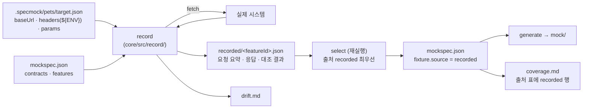
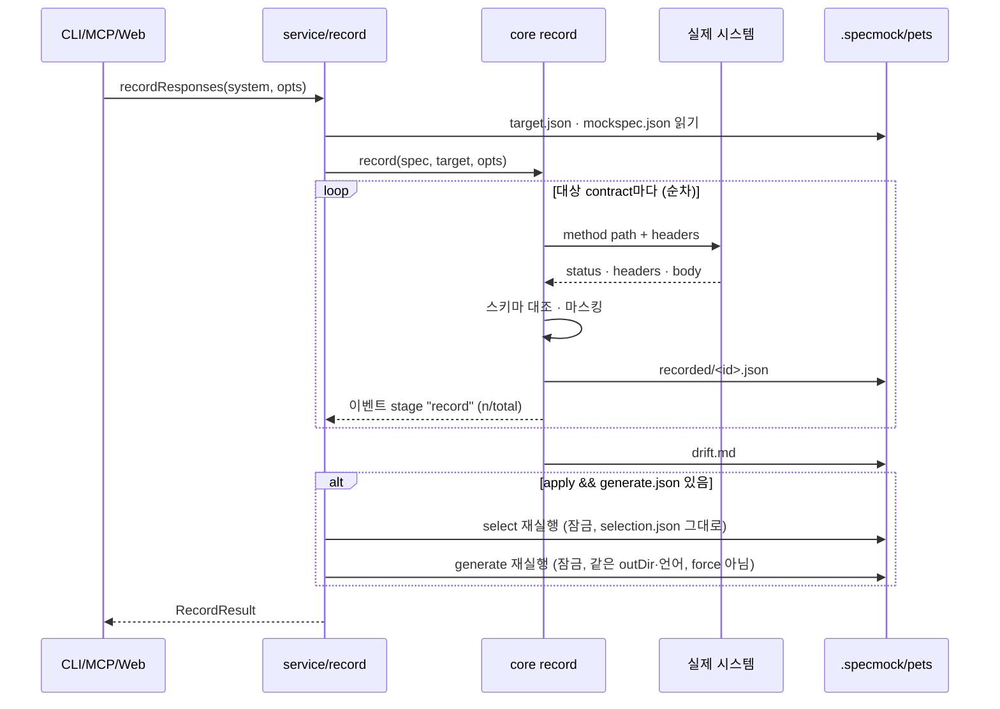

# 3B 설계: 실제 시스템 녹화(record)와 스펙 대조

작성일: 2026-11-09
상태: 구현 완료(2026-11-09).
상위 문서: [specmock 설계 문서](2026-11-04-specmock-design.md) §10 3단계 "Proxy/녹화".
코드 조사: `.harness/analyst-3b-survey.md`(HEAD d10311e 기준, 저장소 밖 작업 파일).

---

## 0. 한 문장 요약

`specmock record <system>`은 mockspec의 contract를 `target.json`에 적힌 실제 시스템에 보내 응답을 `.specmock/<system>/recorded/`에 저장하고 스펙과의 차이를 `drift.md`에 적는다. 이후 `select`가 녹화를 최우선 fixture 출처 `recorded`로 반영하고 `generate`가 평소처럼 mock을 만든다.

## 1. 목표와 결정

### 1.1 해결하려는 문제

지금 fixture는 스펙 문서에서 뽑은 것(`spec-example`, `doc-sample`)이거나 스키마만 보고 지어낸 것(`schema-generated`)이다. 실제 시스템을 부를 수 있는 키(또는 테스트 계정)를 받았을 때, 두 가지가 가능해져야 한다.

1. **녹화로 fixture 채우기**: 실제 응답을 한 번 저장해 추측 fixture를 대체한다. 이후에는 키 없이도 "진짜 모양"의 mock을 쓰고, 녹화 파일을 커밋하면 키 없는 동료도 같은 mock을 얻는다.
2. **스펙 대조(drift)**: 실제 응답이 스펙(응답 스키마·status)과 다른 지점을 리포트로 남긴다.

둘은 같은 동작("contract를 실제 시스템에 보낸다")의 두 결과물이라 한 명령으로 만든다.

### 1.2 결정 (브레인스토밍)

| 질문 | 결정 | 왜 |
|---|---|---|
| 3단계 "Proxy/녹화"의 범위 | ① 녹화로 fixture 채우기 + ③ 스펙 대조. ② 하이브리드 전달(mock에 없는 경로를 실제로 넘기기)은 제외 | ①③은 verify의 contract 실행기를 재사용하면 되고, ②는 생성된 mock(TS·Java) 안에 네트워크 코드가 들어가야 해서 성격이 다르다 |
| 실제 시스템 주소·키 전달 | `.specmock/<system>/target.json`. 비밀 값은 `${ENV}` 참조로만 | "파일이 인터페이스" 원칙과 맞고 CLI·MCP·Web이 같이 쓴다. 비밀은 환경변수에만 둔다 |
| 녹화 결과의 위치 | `.specmock/<system>/recorded/`에 두고 `select`가 mockspec에 `source: "recorded"`로 반영 | mockspec이 단일 진실이어야 coverage에 "녹화 n개"가 보이고, 재생성·언어 변경에도 살아남는다. mock의 fixture 파일을 직접 덮어쓰면 "사용자 수정"으로 취급되어 출처를 잃는다 |
| 실제 시스템에 보낼 요청 | 기본 GET·HEAD의 정상 경로 contract만. `--allow-mutating`으로 나머지 포함 | 지어낸 값으로 POST·DELETE를 보내면 테스트 계정이라도 데이터를 바꾼다 |
| 인터페이스 | CLI + MCP, Web은 실행 버튼과 결과 보기만(target 편집 없음) | 브라우저에 비밀을 입력받지 않는다 |
| 실제 응답이 스펙과 다를 때 | **실제가 이긴다**: 녹화해 fixture로 쓰되 contract 스키마는 그대로 두어 verify가 차이를 드러낸다 | 연동 개발에는 현실과 같은 mock이 중요하고, 차이는 숨기지 않는다 |
| 구조 | `record` 명령(끝나는 작업). 프록시 프로세스 없음 | 오래 사는 프로세스는 ui-server 작업 구조(시스템당 하나·끝나는 작업 전제)와 잠금(10분 stale)에 맞지 않고, HTTPS·요청↔기능 매칭 문제가 생긴다. 실트래픽 녹화는 필요해지면 별도 설계 |

### 1.3 비목표

- 프록시 프로세스와 실트래픽 녹화, 하이브리드 전달(②).
- 기능당 여러 응답(파라미터별), 4xx 응답 녹화. 현재 mock은 기능당 가장 낮은 2xx 하나만 서빙한다.
- 녹화 응답으로 contract 스키마를 갱신하는 것(결정 "실제가 이긴다"의 C안).
- Web에서 `target.json` 편집.
- LLM 사용. 이 작업은 전부 결정적 코드다.

알려진 한계: 응답 상한 검사는 바디를 받은 뒤 바이트 수로 한다(스트림 상한은 후속).

## 2. 구조



| 요소 | 위치 | 역할 |
|---|---|---|
| `TargetConfig` | `packages/core/src/record/target.ts` | `target.json` 읽기, zod 검증, `${ENV}` 치환(없는 변수는 즉시 오류). 치환된 값은 메모리에만 |
| contract 실행기 분리 | `packages/core/src/verify/contracts.ts` (기존 `verify/index.ts:47-83`에서 추출) | `runContract(baseUrl, contract, { headers, timeoutMs, params })` → `{ status, headers, body, schemaErrors }`. verify와 record가 같은 함수를 쓴다(대조 기준 하나) |
| `record()` | `packages/core/src/record/index.ts` | 대상 contract 선택 → 순차 실행 → 마스킹 → `recorded/` 저장 → `drift.md` → `RecordResult` |
| 마스킹 확장 | `packages/core/src/ingest/mask.ts` | `maskHeaders(headers)`: 키 이름(authorization·cookie·set-cookie·`*key*`·`*token*`·`*secret*`·`*password*`)만 보고 값 전체를 `***`. 기존 `maskSecrets`의 query 과다 마스킹(`?api_key=…&x=1`에서 `&x=1`까지 지움) 수정 |
| `select` 확장 | `packages/core/src/select/fixtures.ts` | `recorded/<id>.json`이 있고 status가 served status와 같으면 `source: "recorded"`. 아니면 기존 순서 + assumption |
| drift·coverage | `packages/core/src/record/drift.ts`, `verify/coverage.ts` | drift.md 렌더. coverage의 fixture 출처 표에 `recorded` 행(설명: "실제 시스템 응답을 녹화") |
| 서비스 층 | `packages/core/src/service/record.ts` | `recordResponses(system, opts)`: record → (apply) select 재실행 → generate 재실행. CLI·MCP·Web이 호출 |

**원칙 유지**: 생성된 mock(TS 템플릿·Java 프로필·참조 mock·런타임 계약)은 한 바이트도 바뀌지 않는다. 녹화는 mockspec을 거쳐 fixture 내용만 바꾼다. TS 스냅샷 테스트는 그대로 통과해야 한다.

## 3. 파일 형식

### 3.1 `.specmock/<system>/target.json` (사용자가 쓴다)

```json
{
  "baseUrl": "https://api.example.com/v2",
  "headers": { "Authorization": "Bearer ${PETS_TOKEN}", "X-Tenant": "dev" },
  "params": { "petId": "123", "status": "available" },
  "timeoutMs": 15000
}
```

| 필드 | 규칙 |
|---|---|
| `baseUrl` | 필수. `http://` 또는 `https://`. contract의 path(`/`로 시작)를 **경로 결합**으로 뒤에 붙인다(`https://host/v2` + `/pets` → `https://host/v2/pets`). `new URL(path, baseUrl)`은 `/v2`를 지우므로 쓰지 않는다. 끝 `/`는 하나로 정규화 |
| `headers` | 선택. 모든 요청에 붙인다. 값 안의 `${NAME}`은 환경변수 `NAME`으로 치환하고, 없으면 "환경변수 NAME이 없습니다"로 종료 코드 1. `${`가 없는 값은 그대로 쓴다(파일에 비밀을 적어도 동작하지만 README·SKILL에서 금지를 안내) |
| `params` | 선택. 파라미터 이름 → 문자열 값. contract의 경로·쿼리 파라미터 중 같은 이름의 생성값을 덮어쓴다(모든 기능에 공통 적용). 지어낸 id로 404가 나는 문제를 해결하는 수단 |
| `timeoutMs` | 선택. 요청당 제한. 기본 15000 |

모르는 키는 거부한다(오타 방지). 파일은 사용자 프로젝트 안에 있으므로 `.gitignore` 안내는 README에 적고 specmock은 쓰지 않는다(기존 원칙: 사용자 프로젝트에 `.gitignore`를 쓰지 않음).

### 3.2 `.specmock/<system>/recorded/<featureId>.json` (record가 쓴다. 덮어쓰기)

```json
{
  "featureId": "pets.get",
  "recordedAt": "2026-11-09T10:00:00Z",
  "mockspecHash": "sha256:…",
  "request": { "method": "GET", "path": "/pets/123", "query": {}, "headers": { "Authorization": "***" } },
  "response": { "status": 200, "headers": { "content-type": "application/json" }, "body": { "id": "p-123", "name": "Nabi" } },
  "contract": { "expectedStatus": 200, "statusMatch": true, "schemaErrors": ["/id: must be integer"] }
}
```

- `request.headers`는 `maskHeaders`를 거친 뒤 저장한다(재현용 기록이지 재전송용이 아니다). `request.path`에는 `params` 적용 뒤 실제 보낸 경로를 적는다.
- `response.headers`는 `content-type`·`content-length`만 남긴다. `set-cookie` 등은 버린다.
- `response.body`: JSON으로 파싱되면 값 그대로, 아니면 `{ "raw": "...", "contentType": "..." }`. 1MB(1,048,576바이트) 초과는 저장하지 않고 `"truncated": true, "bytes": n`만 적는다(fixture로도 쓰지 않는다).
- `mockspecHash`는 녹화 시점 mockspec.json의 sha256. select가 현재 값과 다르면 "낡은 녹화" 경고를 assumptions에 적되 **사용은 한다**(기능 id가 같으면 의미가 같다고 본다). `--refresh`로 대상 기능을 다시 녹화한다.
- 파일 이름은 featureId 그대로(id 규칙이 `[\p{L}\p{N}_.-]`라 경로로 안전하다. 구현 때 workspace의 이름 규칙으로 한 번 더 검사).

### 3.3 select가 녹화를 쓰는 규칙

`recorded/<id>.json`이 있고 `response.status === servedStatus(feature)`(가장 낮은 2xx)이고 `truncated`가 아니고 바디가 JSON이면 → `fixture = { status, body, source: "recorded" }`. 그 밖(404·401·비JSON·truncated)이면 무시하고 기존 순서(`spec-example` → `doc-sample` → `schema-generated` → `empty`)로 만들며 assumptions에 "`<id>`: 녹화 응답이 <status>라 사용하지 않음(추측 fixture 사용)"을 남긴다.

`Fixture.source` enum에 `"recorded"`를 추가한다. 영향: `verify/coverage.ts`(표 행 추가), `generate/tsHono.ts:86`과 `README.md.eta`의 "fixture 출처" 열(값을 그대로 출력하므로 문구만), `web/src/coverage.ts` 파서(행 수 고정이 아니라 영향 없음을 테스트로 확인).

### 3.4 `.specmock/<system>/drift.md` (record가 쓴다)

```
# pets 실제 시스템 대조 (2026-11-09 10:00, https://api.example.com/v2)
요청 5 · 일치 2 · 스펙과 다름 1 · 상태 불일치 1 · 건너뜀(변경 요청) 1 · 실패 0

## 스펙과 다름
- pets.get GET /pets/123 → 200. /id: must be integer (실제 "p-123")

## 상태 불일치
- pets.list GET /pets → 기대 200, 실제 401. 인증 헤더를 확인하세요

## 건너뜀
- pets.create POST /pets — 변경 요청. `--allow-mutating`으로 포함

## 실패
(없음)
```

"일치"는 status와 스키마가 모두 맞는 것. "스펙과 다름"은 status는 맞고 스키마 오류가 있는 것. "상태 불일치"는 status가 다른 것(401·403에는 인증 힌트, 404에는 "`params`로 실제 값 지정" 힌트). "실패"는 응답을 못 받은 것(timeout·연결 오류·비JSON·truncated 포함, 이유 한 줄). 모든 문구는 마스킹을 거친다. baseUrl은 헤더·쿼리 없이 그대로 적는다(비밀이 들어갈 자리가 아니다).

## 4. 명령·흐름·오류 처리

### 4.1 CLI

```
specmock record <system> [--allow-mutating] [--feature id...] [--refresh] [--no-apply] [--json]
```

| 옵션 | 뜻 |
|---|---|
| (기본) | GET·HEAD contract의 정상 경로 요청만 보낸다("필수 값 누락" 400 contract는 보내지 않는다). 녹화 뒤 **select → generate를 자동 재실행**(apply). `generate.json`이 없으면(mock을 만든 적 없음) 녹화와 drift만 하고 "generate를 실행하면 반영됩니다" 안내 |
| `--allow-mutating` | POST·PUT·PATCH·DELETE 포함 |
| `--feature <id>` | 지정 기능만. 반복 가능. 없는 id는 즉시 오류 |
| `--refresh` | 대상 기능의 기존 녹화를 버리고 다시 녹화(중단되면 유지). 건너뜀(변경 요청) 기능의 옛 녹화는 지우지 않는다 |
| `--no-apply` | 녹화·drift만. select/generate 건너뜀 |
| `--json` | `RecordResult`를 JSON으로 |

종료 코드: 0 전부 일치 · **2 drift 있음**(스펙과 다름 또는 상태 불일치가 1건 이상. verify의 2와 같은 의미) · 1 오류(target.json 없음/잘못됨, 환경변수 없음, 첫 요청 연결 실패, mockspec 없음). "실패"가 있어도 나머지 결과로 끝내며 종료 코드는 2(실패도 불일치로 본다).

`RecordResult`:

```ts
interface RecordResult {
  system: string;
  baseUrl: string;
  recorded: string[];      // 파일을 쓴 featureId
  matched: string[];
  drifted: { featureId: string; errors: string[] }[];
  statusMismatch: { featureId: string; expected: number; actual: number; hint?: string }[];
  skipped: { featureId: string; reason: "mutating" }[];
  failed: { featureId: string; reason: string }[];
  driftPath: string;
  applied: { selected: number; generate: GenerateReport | null } | null;   // generate가 null: generate.json이 없거나 LLM 재생성이 필요해 반영을 미룸
}
```

### 4.2 흐름



- 요청은 순차로 보낸다(실제 시스템 부하·rate limit 배려). 동시성 옵션은 두지 않는다.
- 녹화 단계는 잠금을 잡지 않는다(`recorded/`는 record만 쓴다). apply의 select·generate는 기존대로 `withSystemLock`을 잡는다.
- apply의 generate는 `--force` 없는 재생성이다. 사용자가 손으로 고친 fixture는 보존되고(녹화가 덮어쓰지 않음) 결과에 "보존됨 — 녹화가 반영되지 않음"으로 표시한다. 같은 언어이므로 언어 변경 삭제는 일어나지 않는다. Java는 fixture만 바뀌면 LLM을 다시 부르지 않아야 한다 — `generate/index.ts:154`의 "같은 mockspec" 판정이 fixture 본문까지 포함하는지 구현 때 확인하고, 포함하면 소스 결정 입력에서 fixture를 제외한다.
- 진행 이벤트: `ServiceStage`에 `"record"` 추가. `message`는 "`<id>` <METHOD> <path>"(마스킹된 path).

### 4.3 MCP

도구 1개 추가 `record_responses(system, allowMutating?, features?, refresh?, apply?)` → 도구 13개. 결과는 `RecordResult`와 drift.md 요약(요청 n · 일치 · 다름 · 불일치 · 건너뜀 · 실패 한 줄 + 다름·불일치 항목 목록). 키는 MCP 서버 프로세스의 환경변수에서 읽힌다(Claude Code를 띄운 셸의 env) — SKILL.md에 "`target.json`의 `${ENV}`는 Claude Code를 실행한 셸에 있어야 한다"를 적는다. drift 테스트: `tools.test.ts` 13, `plugin.test.ts`의 접미사 정규식에 `responses` 추가.

### 4.4 Web

설정 입력 없음. Verify 화면에 "실제 시스템" 카드:
- `GET /api/systems/:s/target` → `{ exists, baseUrl? }`(headers·params는 보내지 않는다).
- 있으면 [녹화] 버튼 + "변경 요청 포함" 체크박스 → `POST /api/systems/:s/record` → job kind `record`(취소 가능, 시스템당 하나 규칙 그대로) → 완료 시 drift.md 본문 표시, coverage 다시 읽기.
- 없으면 "`.specmock/<system>/target.json`을 만들어 주세요" 안내와 예시 JSON(복사 버튼).
- ui-server는 target.json 내용을 응답·로그에 절대 싣지 않는다.

### 4.5 오류 처리

| 상황 | 처리 |
|---|---|
| target.json 없음 | 코드 1. 메시지에 예시 JSON 포함 |
| target.json 스키마 오류·모르는 키 | 코드 1. 필드 이름만 출력 |
| `${ENV}` 미설정 | 코드 1. 변수 이름만 출력(값 노출 없음) |
| mockspec 없음 | 코드 1. 기존 PRODUCER 안내("`specmock select`를 먼저") |
| 첫 요청에서 연결 실패(DNS·거부·TLS) | 나머지 중단, 코드 1("baseUrl을 확인하세요"). 두 번째 이후 요청의 연결 실패는 "실패"로 기록하고 계속 |
| 요청 timeout | "실패"로 기록, 계속 |
| 401/403 | 상태 불일치 + 힌트 "인증 헤더를 확인하세요". 계속 |
| 404 | 상태 불일치 + 힌트 "`target.json`의 `params`로 실제 값을 지정하세요" |
| 비JSON·1MB 초과 | 녹화 파일에 raw/truncated로 기록, "실패"에 사유, fixture로 안 씀 |
| 오류 메시지·drift.md·진행 이벤트·로그 | 모두 `maskSecrets`/`maskHeaders` 통과. target.json 원문은 어디에도 찍지 않는다 |

## 5. 테스트

| 계층 | 대상 | 방식 |
|---|---|---|
| 단위 | `record/target.ts` | 스키마·모르는 키 거부, `${ENV}` 치환(있음·없음·여러 개·한 값에 둘), baseUrl 경로 결합(`/v2` 유지, 끝 `/` 정규화), `params` 덮어쓰기(경로·쿼리) |
| 단위 | `ingest/mask.ts` | `maskHeaders`(authorization Basic·cookie·set-cookie·`x-api-key`·`token`·대소문자), query `&` 과다 마스킹 수정. 기존 `mask.test.ts` 4건 유지 |
| 단위 | `record/index.ts` | `node:http` 가짜 서버(`listen(0, "127.0.0.1")`): 일치 / 스키마 다름 / 401 / 404 / 비JSON / 1MB 초과 / timeout / 변경 요청 건너뜀 / `allowMutating` / `features` / `refresh`(기존 파일 삭제) / 첫 요청 연결 실패 중단 / 두 번째 요청 실패는 계속 / 녹화 파일의 헤더 마스킹 / 요청 순차성(서버가 동시 접속 수를 기록) |
| 단위 | `record/drift.ts` | 렌더 스냅샷(절 구조·집계 줄), 마스킹 통과(Bearer 값이 들어간 오류 문구) |
| 단위 | `select/fixtures.ts` | recorded 있음 → `source: recorded`; status 불일치·truncated·비JSON → 무시 + assumption; 낡은 `mockspecHash` 경고 |
| 단위 | `verify/coverage.ts`, `web/src/coverage.ts` | 출처 표 `recorded` 행, web 파서가 5행을 읽음 |
| 회귀 | `verify/contracts.ts` 추출 | 기존 verify·runtime·e2e 테스트 전부 통과. **TS 스냅샷 무변경** |
| 통합 | `service/record.ts` | 가짜 서버 → record → select → generate 재실행 → mock fixture 파일이 녹화 바디로 바뀜 · 사용자 수정 fixture 보존 · `generate.json` 없으면 apply 생략 · fake 프로필(Java 대역)은 LLM 미호출 |
| CLI | `cli/test/cli.test.ts` | 종료 코드 0/1/2, `--json` 모양, target.json 없을 때 예시 출력, env 없을 때 변수 이름만 |
| MCP | `tools.test.ts`(13), `plugin.test.ts`(접미사), `record_responses` 결과 요약 |
| ui-server·web | job `record` 시작·취소·409, `GET target`이 headers를 싣지 않음, drift 표시, target 없음 안내 |
| 수동 | `pnpm record:check` | 키가 필요 없는 공개 API 하나(예: `https://petstore3.swagger.io/api/v3`)의 OpenAPI로 ingest → select → record → drift 확인. CI 제외, README에 명령만 |

## 6. 문서

- README: "실제 시스템 녹화" 절 — target.json 예시, 비밀 규칙(`${ENV}`만, 파일 커밋 주의), 기본 읽기 요청만, drift.md 읽는 법, 종료 코드 2.
- `docs/architecture.md`: 상태 파일 표에 `target.json`·`recorded/`·`drift.md`, 흐름도에 record, 로드맵의 "Proxy/녹화"를 "녹화(record, 3B)"로.
- 설계 문서 §10(3단계 경계 문단에 3B), §11(결정: 프록시 대신 record 명령), §12(구현 중 변경은 구현 뒤).
- SKILL.md: 명령 목록에 `record`, MCP 도구 절에 `record_responses`, "키는 셸 env로만" 규칙, 변경 요청 포함 전 사용자 확인.
- 이 문서 §9 "구현 중 변경"에 리뷰로 바뀐 결정을 기록.

## 7. 구현 순서

리뷰 가능한 묶음 단위다. 계획 문서에서 Task로 나눈다.

1. `verify/contracts.ts` 추출 + 회귀(생성물·verify 동작 불변 확인)
2. `record/target.ts` + `maskHeaders` + query 마스킹 수정
3. `record/index.ts`(녹화·`recorded/` 쓰기) + `record/drift.ts`
4. `Fixture.source: recorded` + `select` 확장 + `coverage` 행
5. `service/record.ts`(apply) + `ServiceStage "record"`
6. CLI `record`
7. MCP `record_responses` + SKILL.md
8. ui-server job `record` + Web 카드
9. 문서 + `pnpm record:check` + 최종 확인

## 8. 열린 질문

- `pnpm record:check`의 대상 공개 API는 구현 때 안정적인 것을 고른다(응답이 자주 바뀌면 drift가 늘 나온다 — 그 자체는 정상 동작이므로 "실행이 끝나고 drift.md가 생기면 OK" 기준).
- 녹화 파일에 `request.headers`를 남기는 것이 필요한지(마스킹해도 헤더 이름은 남는다). 지금은 "무엇을 보냈는지 재현"을 위해 남기되, 리뷰에서 불필요하다고 보면 이름만 남기거나 뺀다.

## 9. 구현 중 변경

계획 문서 "설계 문서 대비 결정 사항" D1–D18 중 설계와 달라진 것: generate lock에 `inputHash`를 두어 fixture만 바뀐 경우 LLM 없이 다시 씀(D4·D5), `applied.generate`가 `null`일 수 있음(generate 전 녹화, D17), `GET target`에 `example`·`error` 추가(D18). 아래는 리뷰로 바뀐 결정이다.

| 항목 | 설계·초안 | 구현 | 이유 |
|---|---|---|---|
| 실패 종류 | 요청 실패를 network·timeout 둘로 | `failure.kind`에 `"invalid"` 추가(`요청 불가:`). 보낼 수 없는 요청은 첫 전송 판정(연결 실패 시 중단)에 세지 않음 | contract path의 `?`·`#` 같은 문제를 연결 실패로 오인하지 않음 |
| `--refresh` 삭제 시점 | 녹화 전에 `recorded/` 삭제 | 실행이 끝난 뒤 이번에 쓰지 않은 파일만 삭제(중단되면 유지) | 연결 실패·취소로 기존 녹화를 잃지 않음 |
| `--refresh` 삭제 대상 | 기존 `recorded/` 전부 삭제 | 이번 실행의 대상 기능(보냈거나 실패한 것) 중 새로 쓰지 않은 옛 녹화만 삭제. `features` 필터 밖 기능과 건너뜀(변경 요청) 기능의 옛 녹화는 유지, 중단되면 아무것도 지우지 않음 | 일부만 다시 녹화해도 나머지를 잃지 않음 |
| Web coverage 반영 | 완료 시 coverage 다시 읽기 | 카드는 "coverage에 반영하려면 verify를 다시 실행하세요"를 안내. coverage는 verify가 다시 돌아야 바뀜 | record는 coverage를 계산하지 않음 |
| 마스킹 범위 | 헤더·쿼리 | 비2xx 응답 본문과 `raw`(비JSON) 본문도 마스킹, `maskHeaders`에 `auth`·`session` 포함 | 오류 응답·평문 본문에 토큰이 실려 올 수 있음 |
| apply의 선택 재실행 | `selection.selected`를 표현식으로 다시 해석 | 모든 항목이 현재 카탈로그 id와 정확히 일치하면 `literalIds: true` | UI·`--interactive`가 저장한 `all`·`3` 같은 id가 다른 집합이 되는 것을 막음 |
| apply 오류 | 던져서 결과 버림 | 녹화·drift.md는 남기고 `notes`에 `반영 실패: …`, `applied: null`로 결과 반환. CLI 종료 코드 2 | 이미 쓴 녹화 결과를 잃지 않음 |
| generate 생략 판단 | mockspec 해시가 다르면 다시 생성 | `inputHash`(fixture 본문·출처·assumptions 제외)가 같으면 scaffold만 다시 씀(D4·D5), 다르거나 옛 lock이면 apply는 LLM을 부르지 않고 안내만 | 녹화는 fixture만 바꾸므로 LLM 비용을 쓰지 않음 |
| `generate.json` 없음 | 녹화 후 오류 | select까지만 하고 "generate를 실행하면 반영됩니다"(D17) | mock을 만든 적 없어도 녹화·drift는 유용 |
| `GET target` | 파일 내용 | `example`(TARGET_EXAMPLE)·`error` 포함(D18) | Web UI가 만드는 법과 읽기 실패를 보여 줌 |
| `joinUrl` | 경로에 `?`·`#` 허용 | 거부(요청 불가) | 쿼리가 path로 섞여 다른 URL로 나가는 것을 막음 |
| 빈 환경변수 | 빈 문자열로 치환 | `${ENV}`가 비어 있으면 오류(변수 이름만 표시) | 빈 `Authorization`으로 조용히 401이 나는 것을 막음 |
